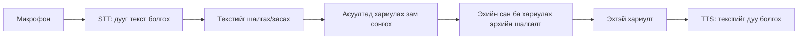

# Манай системийн үндсэн ойлголтууд

**Зорилго:** сургуулийн тодорхой хүрээний мэдээллийг Монгол дуугаар асууж, хүчинтэй эх сурвалжтай хариулт авах систем бүтээж, чанар ба хугацааг үе шат бүрээр хэмжих.

2026.12.15 бол хязгаарласан анхны demo-ийн зорилтот өдөр. Дипломын бүтэн ноорог 2027.04.15, хамгаалалт 2027.05-д сургуулийн товоор. [Эцсийн roadmap](../ROADMAP-FINAL-2026-10-07.mn.md) хэвээр.

[Ажиллах зарчим](#танилт-засвар-сургалт-гурвыг-ялгах-нь) · [Одоогийн нотолгоо](#судалгааны-зорилго-ба-одоогийн-нотолгоо) · [Дараагийн ажил](#дараагийн-ажлын-дараалал)

Одоо энэ хөгжүүлэлтийн урсгал браузерт холбогдсон: микрофон/файл, STT-ийн текст
засвар, A/B/D/E чиглүүлэгч, эхийн шалгалт, TTS ба тоглуулагч. Бичгэн асуулт,
FAQ/веб эхийн хайлт мөн ажиллана. C генерацийн хэрэгцээ, бүх хэллэгийн router,
сургуулийн баталгаа, бодит орчин/таблет ба эцсийн үнэлгээ үлдсэн.

| Ойлголт | Манай төсөлд ямар үүрэгтэй вэ? |
|---|---|
| STT / ASR | Дууг текст болгоно. Cafet Монгол Whisper жинг ашиглаж байгаа; өөрийн сургалт хийгээгүй. |
| Зөв transcript | Бичлэг дээр бодитоор хэлсэн бүх үг. WER/CER тооцох хүний баталсан харьцуулах текст. |
| WER / CER | Үг, тэмдэгтийн засварын харьцаа; утгын зөв ойлголтын хувь биш. |
| Вебийн эхийн сан | Сайт дээрх эхийг URL, огноо, hash, хувилбартай хадгална. CORE/database/website.db. |
| Facts / FAQ сан | Ямар мэдээллээр хариулж болохыг эх, хамрах хүрээ, баталгаа/хугацаатай удирдана. runtime/content.db. |
| Chunk | Урт эхээс гаргасан хайлтын текстийн хэсэг; бүтэн эхийн offset/URL/хувилбартай. |
| BM25 | Үгийн давхцал, давтамжаар боломжит эхийг эрэмбэлдэг хайлт. |
| E5 embedding | Утгын төстэй байдлаар эрэмбэлэх бэлэн модель. Өндөр score нь зөв хариултын магадлал биш. |
| Router | Шууд хариулах, эхээс хайх, тодруулах, татгалзах эсвэл шаардлагатай генерацийн замыг сонгоно. |
| C-RAG | Батлагдсан эхээр генератив тайлбар шаардах бодит асуултад LLM ашиглах зам. Тохиолдол батлагдаагүй бол зохиохгүй. |
| TTS | Хариултын текстийг дуу болгоно; нэр, тоо, товчлол, огнооны дуудлагыг хүн сонсож үнэлнэ. |
| Draft | Татсан/бэлтгэсэн боловч хариултад ашиглахаар хүний батлаагүй агуулга. |

Вебийн бүх текстийг татах нь STT моделийг сургах ажил биш. Энэ өгөгдөл нь
сургуулийн асуултын эхийг хайх, FAQ/fact бэлтгэхэд хэрэглэгдэнэ.
Шууд хариулт, хайлтын зөв эх, эшлэлийн дэмжлэг, STT алдаа, дууны чанарыг тусад нь хэмжинэ.

[BM25/E5 аргын эх](../papers/05-retrieval-method-notes.mn.md) ·
[Эшлэл/үнэлгээ/интерфэйсийн үндэслэл](../papers/06-evaluation-interface-method-notes.mn.md)

## Одоо хэрэгжсэн чиглүүлэлтийн суурь

`question_router.py` нь A=fact, B=бүртгэлтэй FAQ, D=тодруулах,
E=одоогийн эх/баталгаа/хамрах хүрээгээр хариулах боломжгүй гэсэн хөгжүүлэлтийн
mapping ашиглана. Одоогийн A нь fact-тай холбоотой **хадгалсан хариулт** буцаана; дурын fact-ээс шинэ өгүүлбэр үүсгэдэг ерөнхий систем хараахан биш. C генерацийн зам батлагдсан бодит хэрэгцээгүй тул нээгдээгүй.

| Зам | Зорилго | Одоогийн хэрэгжилт |
|---|---|---|
| A | Бүтэцтэй баримтын шууд хариулт | Fact-тай холбоотой хадгалсан хариултын хязгаарласан mapping |
| B | Бэлтгэсэн FAQ-ийн хариулт | Бүртгэлтэй exact асуулт/alias ба эхийн шалгалт |
| C | Эхээс генератив тайлбар шаардсан хариулт | Батлагдсан бодит тохиолдол 0; LLM дуудлага 0 |
| D | Дутуу эсвэл хоёрдмол асуултыг тодруулах | Зарим нэр/оны хязгаарласан дүрэм |
| E | Эх, баталгаа, хугацаа, хүрээ хангагдаагүйг тайлбарлах | Тусдаа шалтгаантай татгалзал |

Demo-ийн хайлт/чиглүүлэлт одоогоор BM25 ашиглана. E5 нь тусдаа хөгжүүлэлтийн харьцуулалтад туршсан сонголт; E5 бүхий бүх урсгалын чанар батлагдсан гэсэн үг биш.

Хадгалсан exact асуулт эсвэл илэрхий alias л шууд хариултын эрхтэй.
Ойролцоо candidate-ийн өндөр оноог зөв хариултын магадлал гэж хэрэглэхгүй.
Он/нэр/дугаарын ялгааг таамгаар засахгүй; dated эхийг шинэ онд хүчинтэй гэж
хэрэглэхгүй. Баталгаа/мэдэгдэж буй хугацаа/бүрэн агуулгын шалгалтыг DB-ээс авна.
Draft харахыг сонгосон нь хүний баталгаа биш.

**E-ийн шалтгаанууд ялгаатай:** мэдээлэл энэ жижиг санд бүртгэгдээгүй,
асуултын он/нэрийн хүрээ өөр, эсвэл мэдээлэл байгаа ч баталгаажаагүй байж болно.
Үүнийг «сургуулийн сайт дээр огт мэдээлэл байхгүй» гэсэн ерөнхий дүгнэлт болгохгүй.
Router-ийн хүний gold үнэлгээ, бүх хэллэгийн хамрах хүрээ үлдсэн. Дууны холбоос
бэлэн болсон нь эдгээр шалгалтыг орлохгүй.

[Хэрэгжилт](../question_router.py) · [Шалгалт](../tests/test_question_router.py) ·
[3-р долоо хоногийн шийдвэр](WEEK03-DECISIONS.mn.md)

Одоогийн нэрийн дүрэм нь ARC/Sakura болон албаны хүрээний хязгаарласан lexical
шалгалт; бүх Монгол/гадаад нэрийг ойлгодог NLP модель биш. Exact alias-ийн зөв
утгыг агуулга бэлтгэхдээ хүн нягтлах шаардлагатай. Шинэ нэр, асуултын хэллэг,
сургууль/албаны ялгааг хүний dev асуултаар шалгаж байж хүрээг өргөжүүлнэ.
ARC-ийн онтой тодруулга зөвхөн literal суурь асуулт+эхийн дэмжсэн он гэсэн
хязгаарласан binding; DB-д шинэ alias автоматаар үүсгэхгүй.

## Танилт, засвар, сургалт гурвыг ялгах нь

`voice_runtime.py` бэлэн Cafet жинг revision/hash болон тогтоосон decoder-оор
шалгаж, локал CPU/int8 дээр дууг танина. Жинг өөрчлөхгүй, шинэ өгөгдлөөр сургахгүй.
Хуудаст зассан асуултыг router-т дамжуулна; STT-ийн анхны текстийг тусад нь үзнэ.
Энэ засвар өөрөө WER-ийн батлагдсан reference болохгүй. Pilot-ийн зөв текстийг
сонсголын тусгай хэсэгт хүн илэрхий баталж байж хэмжилтэд ашиглана.

TTS нь сервер эх/багцыг дахин шалгасны дараах хариулт эсвэл тодруулга/татгалзлын
текстийг уншина. Батаа/Есүй нь туршилтын сонголт; эцсийн дууны чанар ба үйлчилгээ
хүнээр хүлээн авагдаагүй. Дууны файл үүсэх хугацаа, дууны үргэлжлэх хугацаа,
сонсогчийн ойлгомжтой байдлын үнэлгээ тусдаа хэмжүүрүүд.

Шинэ аудио/үр дүн `runtime/voice-demo/`-д түр хадгалагдана. Reset микрофоны
track-ууд, тоглуулагч, тухайн хуудасны түр файлуудыг цэвэрлэнэ. STT-ийн эхэлсэн
native тооцооллыг дундаас нь таслахгүй; reset-ийн дараа ирсэн хуучин үр дүнг
дэлгэцэд ашиглахгүй. Эхний 20 WAV болон хүний хадгалсан үнэлгээг устгахгүй.
[Дууны хэрэглэгчийн заавар](../reports/system/SQLITE-SEARCH.mn.md).

## Судалгааны зорилго ба одоогийн нотолгоо

Дууг зөв бичвэр болгох, асуултад зөв эх олох, зөв зам сонгох, зөв хариулах,
хариултыг ойлгомжтой унших нь тус тусдаа асуудал. Жишээлбэл STT «2026»-г
«2027» болгосон бол зөв хайлт хийсэн ч хэрэглэгчийн анхны асуултад буруу үр дүн
гарч болно. Харин текст зөв боловч эх нь хуучирсан бол STT моделийг солих нь
тэр алдааг засахгүй. Тиймээс нэг ерөнхий «accuracy» тоогоор бүгдийг тайлбарлахгүй.

| Хэсэг | 2026.10.10-нд байгаа нотолгоо | Нотолгооны хязгаар |
|---|---|---|
| STT | 20 WAV; 13 бүтэн reference; Cafet WER36.0%, CER16.9% | Нэг хэлэгчийн development pilot. 6 reference дутуу, q05 хассан. 64% утгыг зөв ойлгоно гэж хөрвүүлэхгүй. |
| Албан вебийн эх | 72 HTML, 153 chunk, 1 PDF, 4 PNG | Бүгд draft; PDF/PNG текст болон client tab-ийн хамрах хүрээ үлдсэн. |
| Шууд хариултын сан | 6 source, 10 fact, 5 FAQ | Сургуулиар батлагдсан агуулга 0. Вебийн 72 хуудсаас тусдаа бэлтгэсэн багц. |
| Хайлт | 5 FAQ-ийн 15 proposed асуулт: BM25 top1 10/15, E5 14/15 | Хүний gold биш; зөв хариултын хувь биш. Эхгүй асуулт өндөр similarity авсан. |
| Router ба дуу | Локал A/B/D/E, микрофон/файл–STT–засвар–хариулт–TTS холбогдсон | Зорилтот хүрээний хэллэгийн coverage, C, FastAPI/HTTPS/таблетын хүлээн авалт үлдсэн. |
| Кодын ажиллагаа | Voice integration-ийн 149 локал, 149 remote-clone тест; 11 browser шалгалтын хадгалсан нотолгоо | Тестийн тоо нь хариултын accuracy биш. Микрофоны QA-д q01 fake input ашигласан; бодит төхөөрөмжийн туршилт биш. |
| TTS | Батаа/Есүй онлайн гаралт; хуучин дуунаас дээр гэсэн хэрэглэгчийн санал | 3 controlled дууны нарийвчилсан хүний сонсголын үнэлгээ үлдсэн. |

13 reference-д 186 үгийн 67 edit, зайгүй 1089 тэмдэгтийн 184 edit гарсан.
Эдгээр бичлэг, model draft харсан reference, модель сонгосон туршилт нь эцсийн
хараагүй test биш. Хуучин 19 question-reference-ийн дүнг «325→36 сайжирсан»
гэсэн дүгнэлтэд ашиглахгүй: зөв текст болон үнэлсэн багц өөрчлөгдсөн.

Хоёр сангийн зориулалтыг ялгана. `CORE/database/website.db` нь URL/огноо/hash/
хувилбартай эх баримтын сан. `runtime/content.db` нь хариултад ашиглах fact/FAQ,
эхийн холбоо, баталгаа, хугацааг удирдах сан. Албан сайтаас татсан нь өнөөдрийн
асуултад хүчинтэй, сургуулиар батлагдсан хариулт болсон гэсэн үг биш.

[Voice-ийн санитизласан нотолгоо](../docs/experiments/voice-integration-20261010.json) ·
[Модель/схемийн сонголт](WEEK03-DECISIONS.mn.md) ·
[Веб сангийн хамрах хүрээ](WEBSITE-DATA.mn.md).

## Энэ ажлын судалгааны хэсэг

Судалгааны хувь нэмрийн боломжит төв нь эхийн хувилбар/баталгаа/хугацааг хадгалж,
шууд хариулт, шаардлагатай генераци, тодруулга, татгалзлыг Монгол дууны урсгалд
холбоод алдаа ба хугацааг шат бүрээр хэмжих хэрэгжилт юм. Энэ нь одоогийн
баримтаас гаргасан чиглэл; багшаар баталсан эцсийн шинэ ололтын мэдэгдэл биш.

[Судалгааны нэгтгэл](../reports/research/THESIS-RESEARCH-SYNTHESIS-2026-10-10.mn.md)-д
дөрвөн асуултын ноорог бий:

1. Ижил аудио/зөв текст дээр STT сонголт үг, нэр, он, дугаар болон хугацаанд хэрхэн нөлөөлөх вэ?
2. Ижил эх/асуулт дээр BM25 ба E5 зөв FAQ/эхийг хэр сайн олдог вэ?
3. Шууд хариу, тодруулга, татгалзал, шаардлагатай генерацийн сонголт хариултын зөв байдал, эхийн дэмжлэг, LLM хэрэглээ, хугацаанд хэрхэн нөлөөлөх вэ?
4. Ижил даалгаврыг бичгээр ба дуугаар хийхэд STT засвар, TTS ойлгомж, даалгаврын амжилт хэрхэн өөрчлөгдөх вэ?

Алдааны шалтгааныг ялгахын тулд нэг асуултыг **хүний зөв бичвэр**, **raw STT**,
**хэрэглэгчийн зассан STT** гэсэн гурван оролтоор ижил эх/тохиргоонд шалгана.
Шалгах зөв эх, зөв хариулт, хүлээгдсэн замыг хүн тусад нь нягтална.
Зөв хариулсан хувь, хариу өгсөн хүрээ, эшлэлийн дэмжлэг, тодруулга/татгалзлын
зөв байдал, үе шат/нийт хугацааг тусад нь тайлагнана. Одоогийн кодын тестийг
энэ хүний үнэлгээний оронд ашиглахгүй.

Таны WAV-д хэлсэн хариултын текстийг бичих нь STT **үнэлгээ** бэлтгэж байгаа ажил.
Өөрийн модель сургах бол train өгөгдлөөр жин өөрчлөх тусдаа ажил болно; манайд
түүнийг хийгээгүй. Cafet-ийн нийтлэгч сургалтын metadata нийтэлсэн
([моделийн эх](https://huggingface.co/Cafet/whisper-small-mongolian)); бид тэр
бэлэн checkpoint-ийг локал inference-д ашиглаж байна. Эхийн model-card WER-ийг
манай өөр аудионы дүнтэй ижил benchmark гэж үзэхгүй.

Whisper-ийн 680,000 цаг нь олон хэл/даалгаврын нийт сургалтын хэмжээ
([эх өгүүлэл](https://arxiv.org/abs/2212.04356)). Энэ нь Монгол хэлээр сургуульд
зөв хариулдгийг батлахгүй. E5 нь хайлтын текстийн дүрслэл сурсан модель
([аргын тайлан](https://arxiv.org/abs/2402.05672)); хариулт үүсгэгч, баримтын
үнэн зөвийг шалгагч биш.

## Дараагийн ажлын дараалал

1. **Үнэлгээний сууриа гүйцээх.** q10/q13/q16/q17/q19/q20-ийн хэлсэн бүх үгийг хүн батална; q16-ийн орхисон утасны дугаарыг таахгүй. 3 controlled TTS-ийг нэр/тоо/огноо/ойлгомжийн хувьд сонсоно. Бэлэн гаралтуудыг шинэ reference-ээр дахин оноход unchanged inference давтах шаардлагагүй.
2. **Эхийн агуулгыг хариултад бэлтгэх.** PDF/4 PNG текст, client tab-ийн хамрах хүрээ, мэдээллийн зөрчил/он/хүчинтэй хугацааг нягталж fact/FAQ-ийн ноорог бэлтгэнэ. Сургуулийн хүний баталгааг тусад нь авна.
3. **30–50 хөгжүүлэлтийн бодит асуулт.** Зөв эх/хариулт/зам, нэр/он дутуу болон эхгүй controls-ийг хүнээр нягтлуулах багц бэлтгэнэ. Proposed ба approved gold-ийг ялгана.
4. **Ижил нөхцөлтэй үнэлгээ.** Хайлт, router, answer, TTS болон бичгэн/raw/зассан-STT даалгаврыг тус тус хэмжинэ. Final test-ийн шинэ асуулт/бусад хэлэгчийг хөгжүүлэлтийн сонголтод ашиглахгүй; эцсийн тохиргоог өмнө нь тогтооно.
5. **Үлдсэн урсгал ба бодит төхөөрөмж.** Батлагдсан бодит C хэрэгцээнд л генераци туршина. Roadmap-ийн FastAPI, HTTPS, таблет, бодит микрофон, алдаа/сэргээх хүлээн авалтыг гүйцээнэ. Одоогийн сервер нь локал стандарт HTTP хэрэгжилт.

Хүний transcript/сонсгол/сургуулийн баталгааг агент хийсэн гэж зохиохгүй.
Тэдгээрийг хүлээх зуур эх боловсруулах, proposed cases, үнэлгээний арга болон
хязгаарласан хэллэгийн кодыг бие даан үргэлжлүүлж болно.

20 гол + 6 нэмэлт өгүүлэл бүртгэлтэй; 26 metadata/abstract, 8 сонгосон аргын
нягтлал байгаа ч бүтэн уншлага дууссан бүртгэл 0. Roadmap-ийн 20-иос доошгүй
өгүүлэл судлах шаардлага хэвээр. Код ба уншлагыг зэрэгцүүлнэ; нэмэлт 6-г бүгдийг
одоо дуусгах шаардлагагүй. Уншсан арга бүрийг асуудал/өгөгдөл/үнэлгээ/хязгаар/
манай шийдвэртэй холбоно. [Уншлагын заавар](../reports/research/STUDENT-READING-GUIDE.mn.md).

Хуучин чат, тайланг тухайн үеийн commit ба хэмжилтийн хүрээгээр уншина.
«66 тест, дуу холбогдоогүй» гэдэг нь эрт үе; «149 тест, дуу холбогдсон» нь
шинэ voice integration-ийн төлөв. Нэг өдрийн огноотой байлаа ч ижил үе биш.
Явцыг [ROADMAP-PROGRESS.mn.md](ROADMAP-PROGRESS.mn.md)-ээс, төслийг нээх ажиллагааг
[README.mn.md](README.mn.md)-ээс шалгана.
