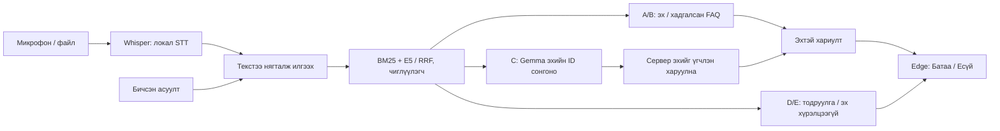
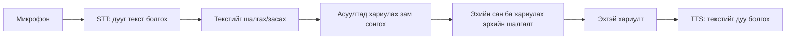

## 2026.10.25 — LLM хоёр өөр ажилтай

**Whisper дууг текст болгоно. Gemma дуу сонсдоггүй.** Gemma-д тухайн таньсан текст эсвэл асуулттай нь хамт олдсон эхийн текст очно. Edge TTS хариултыг дуу болгох тусдаа үйлчилгээ.

1. **RAG-ийн C замд:** BM25 ба E5-ийн эрэмбийг RRF нэгтгэнэ → Gemma олдсон эхийн хэрэгтэй нэгжийн ID-г сонгоно → сервер ID, эхийн байрлал, нөхцөлийг шалгаж эхийн үгийг харуулна. Gemma шинэ баримт зохиож бичих эрхгүй; зөв хэсэг сонгосон, бүх шаардлагыг хамарсан эсэх нь тусдаа чанарын асуудал хэвээр. Шууд fact/FAQ болон бүрэн танигдсан бүтэцтэй талбарын A/B хариулт Gemma-г алгасаж болно.
2. **STT-ийн дараа:** тусад нь идэвхжүүлсэн локал Gemma анхны танилтад хэл найруулгын санал гаргана. Анхны текст шууд засах, илгээхэд бэлэн; санал хүлээж блоклохгүй. Тоо, он, нэрийн ойрын контекст, үгүйсгэл, үг нэмэх/хасах болон хэт өөрчлөлтийн хамгаалалттай. Саналыг хэрэглэгч сонгож хэрэглэнэ; raw текст ба аудионы холбоо хадгалагдана. Энэ нь ASR жинг сургах, эсвэл алдагдсан үгийг аудиогоос сэргээх ажиллагаа биш.

Жишээ нь компанийн нэр танигдаагүй «хамтын ажиллагаа эхэлсэн сар, ямар платформ» асуултад он/компанийн нэрийг LLM-ээр таалгахгүй. Санд байгаа компаниас тодруулж сонгуулаад, **анхны асуултыг бүтнээр нь хадгалж** байгууллагын нэрийг нэмнэ. StoD-ийн өөрийн эхэд Gitty дурдагдсан; Sakura-ийн хэсэгт тэр платформын нэрийг нөхөж оруулахгүй. Хоёр талбарын нэг нь эхгүй бол хариулт хэсэгчилсэн гэдгийг текст болон дуугаар мэдэгдэнэ.

Локал demo-д `runtime/rag-model.json`-ийн `stt_correction_from_rag: true` сонголт RAG-д тохируулсан локал моделийн нэр/хаягийг тусдаа corrector runtime-д ашиглуулна. Илт өгсөн environment тохиргоог дарахгүй, модель автоматаар татахгүй. Шинэ clone-д энэ хувийн тохиргоо байхгүй бол санал идэвхгүй байж болно. Энэ өөрчлөлт raw STT WER буурсны баталгаа биш; [бодит хэмжилт ба хязгаар](ROADMAP-PROGRESS.mn.md)-ыг харна.

## 10.24 — Гарчигтай хэд хэдэн эхийн мөрийг хамтад нь сонгох

N2-ийн ганц мөрийг салгахад ямар замын шаардлага гэдэг нь алга болно. Иймээс танигдсан дөрвөн асуултын хүрээнд эхийн гарчиг ба хүссэн мөрүүдийг тус тусын яг offset-аар авч, сүүлийн нэгжид өмнөх гарчгуудыг заавал хадгалах context холбоо өгнө. Сонголт нь эхийн resolver-ээр дахин шалгагдана. Зөрүүтэй, дутуу, нөхцөлт, хуучин гэж тэмдэглэсэн эхийг чимээгүй алгасаад тохиромжтой хэсгийг ашиглахгүй. Энэ нарийн зам A/0LLM; бусад C асуултад Gemma ID сонгох хэвээр. Ерөнхий entailment баталгаа биш.

Багшийн нэр/үүргийн эх ба хөрөг зураг тусдаа баталгаатай. Жишээ зурагтай named record-ийн нэрийг устгахгүй; карт нь зураггүй гэдгээ ил тод хэлнэ. Бүрэн ажилтны roster гэдгийг дөрвөн object эсвэл тав гэсэн summary counter дангаараа батлахгүй.

<!-- semantic-core-method-20261024:start -->
## 2026.10.24 — Одоо хэрэгжсэн хариултын арга

**Зорилго нь асуусан хүн, орчин, үйл явдал болон шаардсан мэдээлэлд тохирох эхээр хариулах юм.** SQLite эхийн хувилбарыг хадгална. BM25 үгийн давхцлаар, multilingual E5 утгын ойролцоо байдлаар хайж, RRF эрэмбийг нэгтгэнэ. C замд локал Gemma хэрэгтэй эхийн нэгжийн ID сонгоно; хэрэглэгчид харагдах текстийг сервер эхээс үгчлэн сэргээнэ. Шууд бүтэцтэй lookup болон танигдсан нарийн асуултад Gemma шаардлагагүй. [Мэдлэгийн мод](http://127.0.0.1:8765/data#tree) нь эх, сэдэв, системийн урсгалыг харах тусдаа зураглал; өөрөө шинэ баримт үүсгэхгүй.

- **Багшийн мэдээлэл:** тэнхимийн богино нэрийг эхийн гарчигтай тулгаж хүрээг тогтооно. Нэрлэсэн хүнийг өөрийн багш/эрхлэгчийн дүртэй нь холбоно; ижил нэртэй оюутан, зөрүүтэй овог эсвэл инициал орлуулахгүй. Зурагтай танилцуулгын хэсэгчилсэн санг бүх багшийн бүрэн жагсаалт гэж үзүүлэхгүй. Хэнийг, ямар мэдээллийг асуусныг тогтоогоогүй бол тодруулна.
- **Ажиллах цаг:** номын сан, хоолны газрын цагийг тухайн орчны өөрийн хуваариар батална. Эхэд цаг байхгүй бол талбай, суудлын тоо, сургуулийн ерөнхий ажлын цагийг орлуулахгүй; E замаар мэдээлэл хүрэлцээгүйг хэлнэ.
- **Байрлах давхар:** номын сангийн өөрийн гарчиг ба давхрыг заасан өгүүлбэрийг хамтад нь хадгална. Өрөөний жагсаалтын дугаар нь давхар биш. Өөр барилгын давхар, барилгын нийт давхрын тоо, батлагдаагүй эсвэл нөхцөлт байршлыг зээлдэхгүй.
- **Түүхэн үйл явдал:** сургууль байгуулагдсан, анхны төгсөлт болсон, хөтөлбөр нээгдсэн, анхны элсэгчдээ авсан он нь тусдаа холбоо. Нэг үйл явдлын оныг нөгөөгийн хариу гэж зөвшөөрөхгүй. Нэрлэсэн хөтөлбөрийн түүхийн хайлтыг өргөтгөхдөө асуусан субъект, үйл явдлыг хадгалж, зөвхөн тохирох эхийг нэмнэ.
- **Нарийн хүрээтэй шууд эшлэл:** багшийн тоо, нэртэй багшийн холбооны талбар, сургуулийн ерөнхий утас ба хүссэн өдрийн цаг, спортын заалын тусдаа талбай зэрэг бүрэн танигдсан асуултад эхийн тохирох хэсгийг шууд хуулж болно. Багшийн имэйл нь өөрийн нэр, үүрэгтэй нэг холбооны хэсэгт байх ёстой. Спортын заалын талбайд бүжгийн танхимын талбайг нэмж тооцохгүй. Танигдаагүй нэмэлт нөхцөл, нийлмэл хүсэлтийг энэ богино замаар чимээгүй хасахгүй.

Эдгээр дүрэмд сургуулийн хариуны он, давхар, утас, имэйл, талбайг тогтмол утгаар бичээгүй; утгыг тухайн хадгалсан эхээс авна. Дүрэм болон үгчлэн нийцэл нь ерөнхий утгын зөв, хамаатай, бүрэн хариулсны баталгаа биш. Хөгжүүлэлтийн автомат шалгалт, бодит хариултыг эхтэй тулгасан үнэлгээ, хүний хараат бус үнэлгээ тусдаа хэвээр.

Cafet/Whisper нь дууг текст болгох STT, Edge TTS нь тухайн хариултад холбогдсон текстийг унших тусдаа үйлчилгээ. Энэ RAG засвар STT-ийн модель, decoder эсвэл жинг өөрчлөөгүй; raw танилтын чанар сайжирсан гэж тооцохгүй. Доорх огноотой тэмдэглэлүүд тухайн үеийн арга, хэмжилтийг хадгална.
<!-- semantic-core-method-20261024:end -->

## Мэдлэгийн мод хаана хэрэгтэй вэ?

[Мод](KNOWLEDGE-TREE.mn.md) нь сургуулийн эхүүдийг сэдэв→дэд сэдэв→бүртгэл гэж үзүүлнэ. Нэг fact олон сэдэвтэй холбоотой байж болох ч нэг ID-тай. Gemma C замд хайлтаар олдсон эхийн ID сонгох үүрэгтэй хэвээр;модүүсгэгчийн ажил нь read-only ангилал. Хаалттай зорилгын асуултын субъектын scope-ийг Gemma-д тусад нь өгч, сонголтын дараа хүссэн субъектийн root/context болон субъект нь үл танигдсан эхийг хадгална. Энэ нь зорилгын нэг үгийг хараад зөв хариуг устгахаас хамгаална. [15 эхийнаргынүндэслэл](../papers/08-knowledge-tree-research.mn.md).

<!-- rag-focus-method-20261023:start -->
## Эхийн модон бүтцийг хариултын заагт ашиглах нь

Вэбийн хэд хэдэн карт хавтгай текстэд залгагдахад нэг эшлэлд өөр сэдэв орж болно. Одоо хадгалсан HTML-ийн SHA ба бүтэн canonical текстийг тулгасны дараа DOM section/card заагийг эхийн яг байрлалд буулгана. Нийтлэг тексттэй card group-ийг салгахгүй; он, нөхцөл, субъектын утгыг программ тааж арилгахгүй. Энэ нь navigation knowledge tree эсвэл RAPTOR-ийн summary tree-тэй адил алгоритм биш.

Gemma эхийн ID сонгож, сервер үгчлэн сэргээх үүрэг хэвээр. Тодорхой зорилгын grammar дээр explicit зорилгын үг, зөв субъект хадгалагдсан үед л анхны root-уудын богино subset-ийг хэрэглэнэ. Үйл ажиллагаа хийсэн тухай өгүүлбэр зорилго гэсэн баталгаа болохгүй. Үл танигдсан нийлмэл асуултад энэ pruning идэвхжихгүй. DOM-ийн зөв offset нь хариултын ерөнхий утгын зөв байдлыг дангаар нотлохгүй.
<!-- rag-focus-method-20261023:end -->

<!-- answer-refinement-method-20261022:start -->
## Давталтыг хасахдаа утгыг хэрхэн хадгалж байна вэ?

Ижил үг хоёр газар байлаа гээд адил мэдээлэл гэсэн үг биш. Хуучин ба шинэ оны төлбөр ижил тоотой байж болно. Иймээс нэг URL, хувилбар, физик байрлал дахь яг нэг эхийн хуулбар болохыг шалгаж байж давхцлыг арилгана. Бүтэн том хэсгийг хадгалж, доторх нөхцөл, тоо, тайлбарыг таслахгүй.

«Сургууль байгуулагдсан оныг хэл» гэдэг тодорхой хэлбэрт үүсэлтийн эх байхад сонгосон төгсөлтийн нэмэлт хэсгийг хасаж болно. Харин «байгуулагдсан он, үүсгэн байгуулагчийг хэл» гэвэл оны guard ганцаараа хоёр дахь талбарыг хамгаалахгүй. Тиймээс ерөнхий shortest-answer дүрэм хэрэглээгүй: зөвхөн танигдсан хоёр богино grammar дээр анхны ID-уудын subset бүрийг эх/context/талбарын шалгалтаар дахин нэвтрүүлнэ. Шинэ эх нэмэхгүй, шинэ өгүүлбэр зохиохгүй. Нэмэлт LLM дуудлага байхгүй.

Gemma-ийн үүрэг эх сонгох хэвээр. Энэ deterministic дараах шалгалтыг LLM-ийн өөрийн мэдлэг/accuracy өссөн гэж тайлбарлахгүй. Ижил 16 хөгжүүлэлтийн хариулт богино болсон ч шинэ хүний үнэлгээ, ерөнхий хамаарал/бүрэн байдлын баталгаа байхгүй.
<!-- answer-refinement-method-20261022:end -->

<!-- rag-method-clarity-20261022:start -->
## Gemma ба RAG-ийг дипломд хэрхэн тайлбарлах вэ?

Одоогийн системийн нарийн нэр нь **хосолсон хайлт, LLM-ийн эх сонголтод тулгуурласан extractive асуулт–хариулт** юм. SQLite нь эхийг хадгална. BM25 үгээр, multilingual E5 утгын ойролцоо байдлаар хайж, RRF үр дүнгийн эрэмбийг нэгтгэнэ. Дараа нь C замын Gemma олдсон хэсгүүдээс асуултад хэрэгтэй эхийн нэгжийн ID сонгоно. Сервер тэр ID-ийн эх текстийг сэргээж, хүрээ, он, шаардсан талбар болон эхийн холбоог шалгаад эшлэлтэй харуулна.

Жишээ нь «Сургууль анх хэдэн оюутан, хэдэн бүлэгтэй байгуулагдсан бэ?» гэвэл хайлт түүхийн хэсгийг олно. Gemma тэр хэсгийг сонгох ёстой. «Анх удаа гурван оюутныг тэтгэлэгт нэр дэвшүүлсэн» гэсэн өөр мэдээг сонговол үгчлэн хуулсан ч асуултад зөв хариулаагүй. Иймээс эхэд байгааг шалгах, асуултад хамаатайг шалгах хоёр тусдаа ажил.

Дипломд ашиглаж болох тайлбар:

> Систем нь RAG-ийн эх хайж ашиглах зарчимд тулгуурласан, хязгаарласан extractive архитектуртай. BM25 ба multilingual E5 хайлтыг RRF-ээр нэгтгэнэ. Локал Gemma нь C замд хариулах эхийн нэгжийн ID сонгох үүрэгтэй; хэрэглэгчид үзүүлэх өгүүлбэрийг сервер эхээс үгчлэн сэргээнэ. Чөлөөт генератив тайлбар болон анхны RAG-Sequence/RAG-Token сургалтын архитектурыг хэрэгжүүлээгүй.

Gemma-г илүү олон удаа дуудах нь өөрөө судалгааны хувь нэмэр биш. Шууд fact/FAQ, багшийн бүтэцтэй мэдээлэлд LLM шаардахгүй. Шинээр өгүүлбэр найруулдаг генератив горим нэмбэл утгын үнэн зөв, эшлэл, орхигдол, хугацааг дахин харьцуулах хэрэгтэй болно. Одоогийн хугацаанд ажиллаж буй аргаа зөв нэрлэж, бодит давуу ба сул талыг хэмжих нь хамгаалж болох хүрээ юм. Ижил development асуултын өмнөх харьцуулалт Gemma-ийн ерөнхий давуу талыг батлаагүй.

Lewis нарын анхны RAG нь retriever-ийг текст үүсгэх seq2seq загвартай холбосон. Манай серверийн үгчлэн сэргээх алхам түүнээс ялгаатай тул зөвхөн «генератив RAG хэрэгжүүлсэн» гэж бичихгүй. [Анхдагч өгүүлэл](https://arxiv.org/abs/2005.11401).
<!-- rag-method-clarity-20261022:end -->

<!-- core-next-teaching-20261021:start -->
## Манай төсөл яг ямар RAG хэрэглэдэг вэ?

**RAG-ийн зорилго нь хариулахаасаа өмнө хэрэгтэй эхийг олох юм.** Жишээ нь «ARC-тэй хамтарсан хичээлүүд ямар хэлбэрээр орсон бэ?» гэвэл сургуулийн эхээс ARC-ийн хэсгийг олж, хичээлийн нэрс ба «онлайнаар» гэсэн хэлбэрийг хамтад нь харуулах ёстой. Нэрсийг өгөөд хэлбэрийг орхивол эхтэй боловч дутуу хариулт болно.

Манай одоогийн арга бол **BM25 + E5 хосолсон хайлттай, Gemma-аар эхийн ID сонгуулдаг RAG**. RAG нь нэг тусгай модель эсвэл нэг сангийн нэр биш; хайлт ба хариултыг холбосон зохион байгуулалт юм.

| Үе шат | Юу хийдэг вэ? | Манай хэрэгжилт |
|---|---|---|
| Эх бэлтгэх | Албан мэдээллийг хувилбар, URL, огноо, hash-тай хадгална | SQLite,201хэсэг;40fact/30FAQ тусдаа |
| Үгээр хайх | Асуулттай давхцах чухал үгийг олно | BM25 |
| Утгаар хайх | Өөр үгээр бичсэн ойролцоо утгатай хэсгийг олно | multilingual-e5-small; query:/passage: prefix |
| Эрэмбэ нэгтгэх | Хоёр хайлтын дарааллыг нийлүүлнэ | RRF, k=30; нэмэлт хүрээ/anchor дүрэм |
| Эх сонгох | Асуултын бүх хэсэгт хэрэгтэй нэгжийн ID сонгоно | Локал Gemma3 4B |
| Хариулах | Сонгосон эхийн текстийг сэргээж, он/тоо/талбар/эшлэл шалгана | Сервер үгчлэн харуулна; дутвал тодруулга/татгалзалт |

RRF-ийн оноо нь зөв хариулсан магадлал биш. Шууд fact/FAQ болон багшийн бүтэцтэй карт зарим асуултад Gemma дуудахгүй. Дууг текст болгох нь Cafet/Whisper; хариултыг унших нь онлайн Edge TTS. Эдгээр нь RAG-ийн Gemma-аас тусдаа.

Судалгааны нэршлээр hybrid retrieval, хязгаарласан extractive хариулт гэж тайлбарлаж болно. [Lewis нарын RAG өгүүлэл](https://arxiv.org/abs/2005.11401)-ийн DPR/BART загварыг end-to-end сургаж хуулсан хэрэг биш. Утгын embedding-ийн үндэслэл [E5-ийн тайлбарт](https://github.com/microsoft/unilm/tree/master/e5), эрэмбэ нэгтгэх арга [RRF-ийн эх өгүүлэлд](https://cormack.uwaterloo.ca/cormacksigir09-rrf.pdf) бий.

Яагаад хоёр алдаа үлдсэн бэ? Эх олдсон ч нэг нь diagram-ийн чиглэл–нэр салж, нөгөө нь компанийн дараах өгүүлбэрийн холбоо алдагдсан. Тиймээс энэ удаа хайлтын шинэ модель нэмэхийн оронд эхийн бүтцийг хадгалж, асуултын бүх шаардсан талбарыг шалгасан. Ижил8development асуултад бүрэн байдал8/8 болсон ч давталт/хамааралгүй нэмэлт болон шинэ асуултын эрсдэл хэвээр. Энэ нь бүх RAG алдааг шийдсэн гэсэн үг биш.
<!-- core-next-teaching-20261021:end -->

<!-- rag-completeness-concepts-20261021:start -->
## Зөв эхээс хуулсан ч хариулт дутуу байж болно

Жишээ нь «сургалт хэдэн жил, хэдэн оны зун хэдэн оюутан оролцсон бэ?» гэдэг асуултад хугацаа ба оюутны тоог олсон ч оныг орхивол бүрэн хариулаагүй. Gemma эхийн ID сонгоно; сервер он болон шаардсан талбарууд байгаа эсэхийг дахин шалгана. Дутвал зөвшөөрөгдсөн нэг/хоёр хэсгийн сонголтоос нэг удаа дахин сонгуулж, дахин шалгаад л харуулна. Хариултын үгийг модель шинээр зохиохгүй.

Энэ хамгаалалт утгын бүх алдааг илрүүлэхгүй. Ижил 8 development асуултын AI бүрэн байдал 4/8→6/8 болсон ч чанарын хоёр урсгалын доороос дээш/дээрээс доош чиглэлийн холбоо, онлайн сургалтын хэлбэр орхих хоёр алдаа үлдсэн. Хүний анхны үнэлгээ ба дараах AI хөгжүүлэлтийн дүнг тусад нь тайлагнана. [Хэмжилт](ROADMAP-PROGRESS.mn.md).
<!-- rag-completeness-concepts-20261021:end -->

<!-- human-feedback-concepts-20261021:start -->
## Хүний pilot ба LLM-ийн ашиг

10.21-ний24үнэлгээ нь8асуултын3аргыг нэг хөгжүүлэгч үнэлсэн дүн. Gemma-ийн утгын зөв/хэсэгчилсэн/буруу нь1/5/2,best1 4/2/2,best3 5/1/2. Бүрэн байдал тусдаа1/5/2,3/4/1,3/4/1. Ижил харагдах3хосын2т өөр оноо өгсөн; үр дүнг хасаагүй. Модель дуудах нь ашигтай гэсэн баталгаа биш; энэ жижиг self-report нь ч ерөнхий model ranking биш.

Нэг task-д raw ба илэрхий баталсан текст яг ижил байсан. Хүний өөр success label нь edit gain гэсэн causal дүгнэлт болохгүй. Хайлтын spelling alias нь танилтын текстийг засахгүй. ЕБС-ийн бүтэн уншлага нь зөвхөн TTS copy-д үйлчилнэ; эхийн өгүүлбэр хэвээр. [Дүн ба хязгаар](ROADMAP-PROGRESS.mn.md).
<!-- human-feedback-concepts-20261021:end -->

<!-- delivery-concepts-20261021:start -->
## LLM одоо яг юу хийдэг вэ?

Одоогийн Gemma 3 4B нь хайлтаар олдсон эхийн хэсгүүдээс асуултад хариулахыг сонгоно.
Жишээ нь химийн тэнхимийн үндсэн ба цагийн багшийн тоог асуухад зөв эхийн хэсгийн ID-г
буцааж, сервер тэр эхийн өгүүлбэрийг эшлэлтэй харуулна. Хадгалсан бодит шалгалтад
энэ асуулт нэг Gemma дуудлагатай, `unit_ids=["u1"]` гэсэн сонголттой байсан.

Дууг текст болгох Cafet/Whisper, хайх BM25/E5, эх сонгох Gemma, текст унших Edge TTS
дөрөв тусдаа үүрэгтэй. Шууд fact/FAQ хариунд Gemma дуудахгүй. STT-ийн нэмэлт LLM
засвар одоогоор тохируулаагүй; RAG-ийн Gemma ажиллаж байгаа нь түүнээс тусдаа.

Энэ нь **LLM-ээр эх сонгуулж, үгчлэн хариулах горим**. Чөлөөт өгүүлбэрээр тайлбар
найруулдаг генератив хариулттай адилтгахгүй. Кодын `rag_generated` гэх хуучин нэр
дангаараа шинэ хариултын текстийг модель зохиосон гэсэн утгагүй.
10.21-нд ижил frozen эхтэй8асуултад Gemma ба LLM-гүй best1/best3 сонголтыг
ижил renderer/guard-тай харьцуулсан. AI-ийн бүрэн хариулт Gemma4/8,best1 3/8,best3 5/8;
хамааралгүй хэсэг нэмсэн нь4/8,1/8,7/8. Энэ жижиг туршилт Gemma-ийн давуу талыг
батлаагүй. Хүний үнэлгээ0; модель бодитоор дуудах нь чанарын ашигтай адил биш.
Харьцуулалтын [анхны оролт/гаралт/хязгаар](../runtime/quality-media-20261021/llm-comparison/README.mn.md)
хадгалагдсан; үр дүнг харж selector/prompt өөрчлөөгүй.

Багшийн зурагтай танилцуулга нь өөр замтай: албан эхийн нэр, үүрэг, товч мэдээлэл,
зураг холбоотой бүтэцтэй бичлэгийг шууд сэргээнэ. Энд Gemma шаардлагагүй. Эхэд
байхгүй намтар зохиохгүй; ерөнхий хүсэлтэд багшийг тодруулна. Энэ нь албан эхийн
нэр–зураг холбоос бөгөөд зурагнаас хүн таних AI биш.

## 2026.10.21 — Өгөгдөл солигдох ба дуу хаана холбогдох вэ?

Admin-д зассан мэдээлэл тусдаа ноорогт байна. Diff ба integrity шалгалтын дараа нийтлэхэд
нэг active pointer шинэ websiteDB/FAQDB хосыг сонгоно. Буцаахад өмнөх хосыг шинэ activationID-аар
сонгодог тул хуучин хариултын дуу, тодруулгыг сэргээж ашиглахгүй.

Whisper дууг текст болгоно. Raw текст ба хэрэглэгчийн илгээсэн засварыг серверийн transcriptionID
холбоно; зассан нь хүний gold transcript болсон гэсэн үг биш. BM25/E5 эх хайна. C-д Gemma эхийн
нэгжийн ID сонгож, сервер эхийн үгийг сэргээнэ. Edge TTS зөвхөн тухайн хариултад холбогдсон
текстийг уншина. Он/утасны хэлбэржилт нь танилтын жинг өөрчлөхгүй.
<!-- delivery-concepts-20261021:end -->

<!-- core-finalization-20261017:start -->
## 2026.10.17 — Үндсэн урсгалын үргэлжлэл

705 локал тест тэнцсэн. Стандарт нийтийн HTTPS-ийн27HTTP шалгалт, хэрэглэгчийн
6TTS сонсголын үнэлгээ бүртгэгдсэн. Шинэ24 анхны AI17/7; засварын дараа24corepass,
9presentation partial. Өмнөх24corepass/50facts50pass. Бүгд development; human gold биш.
RawSTT WER36.02% хэвээр. [Дэлгэрэнгүй явц](ROADMAP-PROGRESS.mn.md).
Браузерт сертификат суулгах шаардлагагүй; сервер ажиллаж байхад түр HTTPS ашиглана.
<!-- core-finalization-20261017:end -->

## 2026.10.17 — STT, RAG, LLM, TTS яг хаана ажиллах вэ?



Gemma-ийн source selection нь чөлөөт шинэ өгүүлбэр бичихгүй. `generated` гэх хуучин
route flag-г дангаар нь text-generation гэж тайлбарлахгүй: `rag.llm_role` ба
`rag.answer_text_generated`-г харна. Шууд A/B болон урьдчилсан D/E-д LLM дуудахгүй;
C-г оролдсоны дараа E болсон бол attempted call бүртгэлтэй байж болно.
STT текст засах **нэмэлт** LLM-ийн `status.llm` нь RAG-ийн `status.rag.provider`-оос
тусдаа. Одоогийн нэмэлт correction тохируулаагүй ч RAG Gemma бодитоор ажиллаж байна.
TTS нь серверт хадгалсан responseID/query/package/source-тай холбогдсон текстийг
уншина; аудио хүсэлт шинэ answer generation хийхгүй. Cache нь яг ижил text+voice-г
түр ашиглаж, response бүрд тусдаа audioID өгнө. [Бодит дүн](ROADMAP-PROGRESS.mn.md).

---

## 2026.10.16 — Whisper-ийн одоогийн сайжруулалт

Cafet/Whisper-small хэвээр. Ижил13development бичлэгт baselineWER36.02/CER16.90%;
hotwords47.31/23.05%муудсан,beam10ижил тул нэвтрүүлээгүй. Шинэ яриа байгаа эсэхийн
локал gate нь аудиог тайрахгүй:17/17speech нэвтэрч,2/2nonspeech хориглогдсон;
нэмэлт8богино/сулsynthetic speech нэвтэрсэн. Энэ нь WER сайжирсан гэсэн дүн биш.
590локал тест PASS; loadedSTThash/fingerprint-ийг collector шалгана.
Багшийн scope:тохиргоо/системийн сайжруулалт+харьцуулалт; өөрийн training/download0.
Дэлгэрэнгүй: [явц](ROADMAP-PROGRESS.mn.md). Доорх нь өмнөх checkpoint-ийн түүх.

## 2026.10.15 — тасарсан таван алхмын үргэлжлэл, эцсийн локал V6

**568 автомат тест PASS; серверийн10 loaded hash диск/freeze-тэй таарсан.**
Observed development AI review: **24 =21 зөв/3 дутуу/0 алдаатай;16 =16 overall pass**.
16-ийн required facts **40 pass/2 partial/2 fail** тул16/16-г100% accuracy гэж нэрлэхгүй.
Reviewer засварт оролцсон; human_review=null. Хоёр багц хоёулаа development.

Ижил4 синтетик WAV-аар STT→typed/raw RAG→хариултын TTS/decode **4/4**;
typed smoke4/4, raw анхны шалгуур2/4. Koha→«ков/коо» үед автоматаар сольж
хариулахгүй, D тодруулга өгсөн. Хоёр corrected бүтэн query-г илэрхий сонгосныг
дуурайлган шалгахад2/2 номын тоо/он гарсан; хүний туршилт биш.

Таван алхмаас1/2/3/5 дууссан;4-ийн аудио дууссан, шинэ browser visual/playback
шалгалт URL-ийг итгэлтэй тогтоож чадаагүй Computer Use хоригт үлдсэн.
Бүх5-ыг бүрэн дууссан гэж үзэхгүй. Чанарын үлдэгдэл, түүхий нотолгоо ба дараагийн
ажил: [явцын үндсэн бүртгэл](ROADMAP-PROGRESS.mn.md).
Week3 engineering6/6, operational checklist5/8 хэвээр; дипломын хувь биш.
Шинэ модель таталт/өөрийн training/commit/push хийгээгүй; анхны roadmap хэвээр.
Доорх хуучин тоо/untuned тэмдэглэлүүд нь тухайн checkpoint-ийн түүх.

---

## Week4-ийн эх ба хариултын сан өргөжсөн — 2026.10.15

**75 HTML + 5 баримт; 201 хайлтын хэсэг (150 HTML + 21 баримт + 30 нэмэлт таб).**
Чанар, түүх, сургалтын орчны 3 хуудсыг нэмж, 6 тэнхимийг дахин татсан.
Хоосон загвар ба огноогүй табын тоон үзүүлэлтийг хассан. Бүх сайт/таб хамрагдаагүй.
Үндсэн HTML болон нэмэлт табын татсан огноо/hash тусдаа; хуучин эхийг шинэ мэт
огноолохгүй. Хоёр SQLite-г нөөцөлж, хуучин run/package-г хадгалсан; импорт давхардахгүй.

**40 fact / 30 FAQ / 14 эхийн хувилбарын бүртгэл (11 өөр URL).** Шинэ 30 fact,
25 FAQ-ийн эх/заалт/он/хүрээг шалгасан; 39 exact асуулт/alias бодит HTTP-ээр B,
LLM0. GitHub-ийн шинэ clone v2 багцыг ашиглана; private бүтэн corpus автоматаар ирэхгүй.
[Эхийн атлас](http://127.0.0.1:8765/data) · [FAQ](http://127.0.0.1:8765/data#curated).

**Засварт ашиглаагүй 24 шинэ асуултын анхны AI үнэлгээ: 8 pass / 6 partial / 10 fail.**
Асуулт, зөв эх, шаардсан баримт, rubric-г гаралтаас өмнө царцаасан. Хүний gold,
ерөнхий accuracy биш. 14 хариулттай кейсийн 13-д шаардсан эх олдсон боловч
«тус бүрээс3/нийт15»-ыг «тус бүрээс15» болгох, төлөвлөснийг гүйцэтгэсэн мэт
хэлэх, N2 шаардлагыг өөр замд ерөнхийлөх алдаа гарсан. Эх олдох ба зөв хариулах
хоёр тусдаа. Дараагийн засварт энэ24-ийг ашиглавал development багц болно.

432 локал тест51.999s, 9 шинэ browser шалгалт; 375px mobile хэвтээ overflowгүй.
24HTTP амжилттай:15C/8E/1D,20LLMcall; warm бичгэн HTTP медиан2.741s.
STT/TTS, cold-start, төхөөрөмжийн хугацааг энэ хэмжилт оруулаагүй.
Raw: `runtime/week04-untuned-live-20261015.json`; dimensional AI review:
`runtime/week04-untuned-reviewed-20261015.json`.

Week3 техникийн6/6 хэвээр. Week4-ийн хязгаарласан эх/facts/FAQ ба AI хэмжилт бэлэн;
утгын алдааны засвар, хүний final QA, бодит typed/raw/edited-STT, HTTPS/таблет үлдсэн.
Ажиллах хувилбарын checklist5/8 хэвээр; нийт дипломын хувь биш.
Анхны roadmap өөрчлөгдөөгүй; шинэ модель сургалт/таталт хийгээгүй.

**2026.10.15 — видеоны санаанаас богино тодруулгын хариу хэрэгжсэн.**
«Бүртгэлийн хураамж хэд вэ?» → «Элсэлтийнх» эсвэл «Олимпиадынх»;
ARC-ийн оны тодруулгад «2026» гэж бичиж үргэлжлүүлж болно. Таньсан бүтэн
асуултыг хариултын дээр харуулж, эх/он/тоо/төрлийн хамгаалалтаар дахин шалгана.
Тодруулсан хариултыг «Сонсох» дарж уншуулна. «Өөр асуулт асуух», «Шинэ чат»
нь өмнөх тодруулгын холбоосыг арилгана. Энэ нь roadmap-ийн D замын сайжруулалт.

397 локал тест, 15 бодит HTTP шалгалт, 11 браузерийн шалгалт тэнцсэн.
Desktop/375px mobile зураг нягталсан; бодит TTS-ийн23.544 секундийн дуу ачаалсан.
Энэ удаа шинэ STT inference эсвэл хүний сонсголын үнэлгээ хийгээгүй.
Элсэлтийн20,000/олимпиадын5,000 дүнг эхээс авна; кодод мөнгөн дүн хадгалаагүй.
Автоном агент/утасны дуудлага нэмээгүй; өөрийн модель сургаагүй.
Анхны roadmap, агуулгын хоёр DB-ийн hash хэвээр. Энэ нь Week4-ийн хөгжүүлэлтийн
нэмэлт ахиц; Week4 бүтэн эсвэл дипломын эцсийн чанар дууссан гэсэн үг биш.

# Манай системийн үндсэн ойлголтууд

**2026.10.14 — week4-ийн 40 асуулт, автомат дууны туршилт ба алдааны засвар.**
[Эхийн атлас](http://127.0.0.1:8765/data) · [Явц](http://127.0.0.1:8765/data#progress).
40 reference-г гаралтыг үзэхээс өмнө тогтоосон: 26 хариулагдах / 6 тодруулах /
8 тухайн frozen багцад батлагдаагүй. 12 нь өмнөх атрибутын шинэ найруулга.
Энэ нь туслахын development багц; хүний gold/final held-out үнэлгээ биш.

Бичгийн100/ярилцлагын20, гадаад ЕБС-ийн хоёр баримт, бүртгэлийн хураамж/
суралцах гэрээ, жил/сар, эхгүй фонт/SQL цагийн андууралтыг bounded дүрмээр зассан.
Эцсийн 40 хүсэлт **23A / 3C / 6D / 8E**. Туслахын оношлогоо **39 pass / 1 partial**
(C ажлын нэрсийн найруулга); бүх human_review null. Засварт ашигласан тул энэ
дүнг системийн нийт зөв хариултын хувь гэж тооцохгүй.

**6 асуулт × Батаа/Есүй = 12 синтетик бичлэг**: асуултын TTS → WAV → Cafet STT →
typed/raw RAG → хариултын TTS/decode. Өмнөх ба дараах яг ижил WAV, raw STT;
синтетик **WER27.8%, CER7.3%** өөрчлөгдөөгүй. SQL нэр алдагдахад цагийн оронд
хөтөлбөрийн тайлбар өгөх алдааг хаасан; эргэлзээтэй үгийг тодруулна. ASR-ийг
дахин сургаагүй, хүний ярианы шинэ benchmark биш.
[SELF-CHECK.cmd](SELF-CHECK.cmd) хоёр дарвал шинэ private хавтсанд туршилт хийж,
дуу/текст/хариултын HTML-г нээнэ. Онлайн Edge TTS ашиглана; хэдэн минут үргэлжилнэ.
Одоогийн харагдац: `runtime/voice-selftest-after-20261014/index.html`.

**347 автомат тест, хувийн viewer-ийн 7 браузерийн шалгалт тэнцсэн.**
Импортолсон кодын hash-ийг collection-оос өмнө шалгана; хуучин кодтой серверийг
бодитоор блоклосон. Өмнөх буруу/бүтэлгүй логийг дарж бичээгүй.
Week3 техникийн6/6 дууссан. Week4-ийн эхийн бүрэн хамрах хүрээ, facts/FAQ
өргөтгөл, хүний хараат бус QA үлдсэн. Ажиллах хувилбарын checklist хэвээр
**5 бэлэн / 2 үргэлжилж буй / 1 үлдсэн**; нийт дипломын хувь биш.
[Бодит нотолгооны нэгтгэл](../docs/experiments/rag-integration-20261012.json).

**Зорилго:** сургуулийн тодорхой хүрээний мэдээллийг Монгол дуугаар асууж, хүчинтэй эх сурвалжтай хариулт авах систем бүтээж, чанар ба хугацааг үе шат бүрээр хэмжих.

**Хэрэглэгчийн шинэ зорилт: 2026.11.10-нд ажиллах хувилбар бэлэн болгож, дараа нь алдаа засна.** Өмнөх 12.15-ны demo зорилтыг урагшлуулсан. Дипломын бүтэн ноорог 2027.04.15, хамгаалалт 2027.05-д сургуулийн товоор. [Эцсийн roadmap](../ROADMAP-FINAL-2026-10-07.mn.md) хэвээр.

Үлдсэн pilot transcript/TTS сонсголыг хөгжүүлэлтийн нөхцөл болгохгүй, дахин шаардахгүй. Албан сайтын мэдээллийг төсөлд ашиглах хэрэглэгчийн зөвшөөрлийг `config/content-use.json` бодлогоор хэрэгжүүлсэн. Хуучин DB-ийн draft metadata-г сургуулийн ажилтны approval болгон өөрчлөөгүй; одоогийн хариулт албан эхийн URL/татсан огноо/хамрах хүрээгээр тайлбарлагдана.

[Ажиллах зарчим](#танилт-засвар-сургалт-гурвыг-ялгах-нь) · [Одоогийн нотолгоо](#судалгааны-зорилго-ба-одоогийн-нотолгоо) · [Дараагийн ажил](#дараагийн-ажлын-дараалал)



Одоо микрофон/файл, STT-ийн текст засвар, A/B/C/D/E чиглүүлэгч, BM25+E5
hybrid хайлт, Gemma-ийн эхийн хэсэг сонголт, TTS ба тоглуулагч браузерт холбогдсон.
Эхийн атлас нь веб snapshot болон fact/FAQ холбоог тусад нь харуулна. Бүх
хэллэгийн зөв ажиллагаа, эхийн хамрах хүрээ, бодит орчин/таблет ба эцсийн
хариултын чанарын үнэлгээ үлдсэн.

| Ойлголт | Манай төсөлд ямар үүрэгтэй вэ? |
|---|---|
| STT / ASR | Дууг текст болгоно. Cafet Монгол Whisper жинг ашиглаж байгаа; өөрийн сургалт хийгээгүй. |
| Зөв transcript | Бичлэг дээр бодитоор хэлсэн бүх үг. WER/CER тооцох хүний баталсан харьцуулах текст. |
| WER / CER | Үг, тэмдэгтийн засварын харьцаа; утгын зөв ойлголтын хувь биш. |
| Вебийн эхийн сан | Сайт дээрх эхийг URL, огноо, hash, хувилбартай хадгална. CORE/database/website.db. |
| Facts / FAQ сан | Ямар мэдээллээр хариулж болохыг эх, хамрах хүрээ, баталгаа/хугацаатай удирдана. runtime/content.db. |
| Chunk | Урт эхээс гаргасан хайлтын текстийн хэсэг; бүтэн эхийн offset/URL/хувилбартай. |
| BM25 | Үгийн давхцал, давтамжаар боломжит эхийг эрэмбэлдэг хайлт. |
| E5 embedding | Утгын төстэй байдлаар эрэмбэлэх бэлэн модель. Өндөр score нь зөв хариултын магадлал биш. |
| Router | Шууд хариулах, эхээс хайх, LLM-ээр эх сонгуулах, тодруулах эсвэл татгалзах замыг сонгоно. |
| C зам | Gemma эхийн нэгжийн ID сонгож, сервер эхийн текстийг үгчлэн харуулна. Сонгосон хэсэг асуултад зөв, бүрэн хариулсныг тусад нь үнэлнэ. |
| TTS | Хариултын текстийг дуу болгоно; нэр, тоо, товчлол, огнооны дуудлагыг хүн сонсож үнэлнэ. |
| Draft | Эхийн сангийн хуучин metadata. Албан эхийг төсөлд ашиглах хэрэглэгчийн шийдвэрийг тусдаа бодлогоор хадгална. |

Вебийн бүх текстийг татах нь STT моделийг сургах ажил биш. Энэ өгөгдөл нь
сургуулийн асуултын эхийг хайх, FAQ/fact бэлтгэхэд хэрэглэгдэнэ.
Шууд хариулт, хайлтын зөв эх, эшлэлийн дэмжлэг, STT алдаа, дууны чанарыг тусад нь хэмжинэ.

[BM25/E5 аргын эх](../papers/05-retrieval-method-notes.mn.md) ·
[Эшлэл/үнэлгээ/интерфэйсийн үндэслэл](../papers/06-evaluation-interface-method-notes.mn.md)


## Одоо хэрэгжсэн чиглүүлэлтийн суурь

`question_router.py` нь A=fact, B=бүртгэлтэй FAQ, D=тодруулах,
E=одоогийн эх/баталгаа/хамрах хүрээгээр хариулах боломжгүй гэсэн хөгжүүлэлтийн
mapping ашиглана. Одоогийн A нь fact-тай холбоотой **хадгалсан хариулт** буцаана; дурын fact-ээс шинэ өгүүлбэр үүсгэдэг ерөнхий систем хараахан биш. Одоогийн C замд LLM эхийн хэсгүүдийн ID-г сонгож, сервер тэдгээрийн текстийг үг өөрчлөхгүй хариултад оруулна. Асуултад хамаарах байдал, шаардсан баримтын бүрэн байдлыг тусад нь үнэлнэ; бодит жин ба туршилтын төлөвийг доорх RAG хэсгээс харна.

| Зам | Зорилго | Одоогийн хэрэгжилт |
|---|---|---|
| A | Бүтэцтэй баримтын шууд хариулт | Fact-тай холбоотой хадгалсан хариултын хязгаарласан mapping |
| B | Бэлтгэсэн FAQ-ийн хариулт | Бүртгэлтэй exact асуулт/alias ба эхийн шалгалт |
| C | Олдсон эхээс хариулах хэсгүүдийг сонгох | Gemma 3 4B зөвшөөрөгдсөн хэсгийн ID-г сонгоно; сервер эхийн текстийг үгчлэн сэргээж, эшлэл холбоно |
| D | Дутуу эсвэл хоёрдмол асуултыг тодруулах | Зарим нэр/оны хязгаарласан дүрэм |
| E | Эх, баталгаа, хугацаа, хүрээ хангагдаагүйг тайлбарлах | Тусдаа шалтгаантай татгалзал |

FAQ-ийн lexical baseline нь BM25; веб RAG-д BM25+E5 RRF болон ил тод домэйн дүрэм ашиглана. Ижил 160 хэсгийн сангийн paired ablation хийгдсэн; шинэ асуултын нийт чанар батлагдаагүй.

Хадгалсан exact асуулт эсвэл илэрхий alias л шууд хариултын эрхтэй.
Ойролцоо candidate-ийн өндөр оноог зөв хариултын магадлал гэж хэрэглэхгүй.
Он/нэр/дугаарын ялгааг таамгаар засахгүй; dated эхийг шинэ онд хүчинтэй гэж
хэрэглэхгүй. Баталгаа/мэдэгдэж буй хугацаа/бүрэн агуулгын шалгалтыг DB-ээс авна.
Draft харахыг сонгосон нь хүний баталгаа биш.

**E-ийн шалтгаанууд ялгаатай:** мэдээлэл энэ жижиг санд бүртгэгдээгүй,
асуултын он/нэрийн хүрээ өөр, эсвэл мэдээлэл байгаа ч баталгаажаагүй байж болно.
Үүнийг «сургуулийн сайт дээр огт мэдээлэл байхгүй» гэсэн ерөнхий дүгнэлт болгохгүй.
Router-ийн хүний gold үнэлгээ, бүх хэллэгийн хамрах хүрээ үлдсэн. Дууны холбоос
бэлэн болсон нь эдгээр шалгалтыг орлохгүй.

[Хэрэгжилт](../question_router.py) · [Шалгалт](../tests/test_question_router.py) ·
[3-р долоо хоногийн шийдвэр](WEEK03-DECISIONS.mn.md)


Одоогийн нэрийн дүрэм нь ARC/Sakura болон албаны хүрээний хязгаарласан lexical
шалгалт; бүх Монгол/гадаад нэрийг ойлгодог NLP модель биш. Exact alias-ийн зөв
утгыг агуулга бэлтгэхдээ хүн нягтлах шаардлагатай. Шинэ нэр, асуултын хэллэг,
сургууль/албаны ялгааг хүний dev асуултаар шалгаж байж хүрээг өргөжүүлнэ.
ARC-ийн онтой тодруулга зөвхөн literal суурь асуулт+эхийн дэмжсэн он гэсэн
хязгаарласан binding; DB-д шинэ alias автоматаар үүсгэхгүй.


## Танилт, засвар, сургалт гурвыг ялгах нь

`voice_runtime.py` бэлэн Cafet жинг revision/hash болон тогтоосон decoder-оор
шалгаж, локал CPU/int8 дээр дууг танина. Жинг өөрчлөхгүй, шинэ өгөгдлөөр сургахгүй.
Хуудаст зассан асуултыг router-т дамжуулна; STT-ийн анхны текстийг тусад нь үзнэ.
Энэ засвар өөрөө WER-ийн батлагдсан reference болохгүй. Pilot-ийн зөв текстийг
сонсголын тусгай хэсэгт хүн илэрхий баталж байж хэмжилтэд ашиглана.

TTS нь сервер эх/багцыг дахин шалгасны дараах хариулт эсвэл тодруулга/татгалзлын
текстийг уншина. Батаа/Есүй нь туршилтын сонголт; эцсийн дууны чанар ба үйлчилгээ
хүнээр хүлээн авагдаагүй. Дууны файл үүсэх хугацаа, дууны үргэлжлэх хугацаа,
сонсогчийн ойлгомжтой байдлын үнэлгээ тусдаа хэмжүүрүүд.

Шинэ аудио/үр дүн `runtime/voice-demo/`-д түр хадгалагдана. Reset микрофоны
track-ууд, тоглуулагч, тухайн хуудасны түр файлуудыг цэвэрлэнэ. STT-ийн эхэлсэн
native тооцооллыг дундаас нь таслахгүй; reset-ийн дараа ирсэн хуучин үр дүнг
дэлгэцэд ашиглахгүй. Эхний 20 WAV болон хүний хадгалсан үнэлгээг устгахгүй.
[Дууны хэрэглэгчийн заавар](../reports/system/SQLITE-SEARCH.mn.md).


## Судалгааны зорилго ба одоогийн нотолгоо

Дууг зөв бичвэр болгох, асуултад зөв эх олох, зөв зам сонгох, зөв хариулах,
хариултыг ойлгомжтой унших нь тус тусдаа асуудал. Жишээлбэл STT «2026»-г
«2027» болгосон бол зөв хайлт хийсэн ч хэрэглэгчийн анхны асуултад буруу үр дүн
гарч болно. Харин текст зөв боловч эх нь хуучирсан бол STT моделийг солих нь
тэр алдааг засахгүй. Тиймээс нэг ерөнхий «accuracy» тоогоор бүгдийг тайлбарлахгүй.

| Хэсэг | 2026.10.10-нд байгаа нотолгоо | Нотолгооны хязгаар |
|---|---|---|
| STT | 20 WAV; 13 бүтэн reference; Cafet WER36.0%, CER16.9% | Нэг хэлэгчийн development pilot. 6 reference дутуу, q05 хассан. 64% утгыг зөв ойлгоно гэж хөрвүүлэхгүй. |
| Албан вебийн эх | 72 HTML, 153 chunk, 1 PDF, 4 PNG | Бүгд draft; PDF/PNG текст болон client tab-ийн хамрах хүрээ үлдсэн. |
| Шууд хариултын сан | 6 source, 10 fact, 5 FAQ | Албан эхийг ашиглахыг хэрэглэгч зөвшөөрсөн. Хуучин staff-approval metadata 0; одоо энэ нь ажиллах gate биш. Вебийн сангаас тусдаа бэлтгэсэн багц. |
| Хайлт | 5 FAQ-ийн 15 proposed асуулт: BM25 top1 10/15, E5 14/15 | Хүний gold биш; зөв хариултын хувь биш. Эхгүй асуулт өндөр similarity авсан. |
| Router ба дуу | Локал A/B/D/E, микрофон/файл–STT–засвар–хариулт–TTS холбогдсон | Зорилтот хүрээний хэллэгийн coverage, C, FastAPI/HTTPS/таблетын хүлээн авалт үлдсэн. |
| Кодын ажиллагаа | Voice integration-ийн 149 локал, 149 remote-clone тест; 11 browser шалгалтын хадгалсан нотолгоо | Тестийн тоо нь хариултын accuracy биш. Микрофоны QA-д q01 fake input ашигласан; бодит төхөөрөмжийн туршилт биш. |
| TTS | Батаа/Есүй онлайн гаралт; хуучин дуунаас дээр гэсэн хэрэглэгчийн санал | Хуучин сонсголын дэлгэрэнгүй үнэлгээ архивт заавал биш байдлаар үлдсэн; ажиллах хувилбарын gate биш. |

13 reference-д 186 үгийн 67 edit, зайгүй 1089 тэмдэгтийн 184 edit гарсан.
Эдгээр бичлэг, model draft харсан reference, модель сонгосон туршилт нь эцсийн
хараагүй test биш. Хуучин 19 question-reference-ийн дүнг «325→36 сайжирсан»
гэсэн дүгнэлтэд ашиглахгүй: зөв текст болон үнэлсэн багц өөрчлөгдсөн.

Хоёр сангийн зориулалтыг ялгана. `CORE/database/website.db` нь URL/огноо/hash/
хувилбартай эх баримтын сан. `runtime/content.db` нь хариултад ашиглах fact/FAQ,
эхийн холбоо, баталгаа, хугацааг удирдах сан. Албан сайтаас татсан нь өнөөдрийн
асуултад хүчинтэй, өнөөдрийн төлөвийг баталсан гэсэн үг биш. Албан эхийг ашиглах хэрэглэгчийн зөвшөөрөл хүчинтэй; эхийн он/огноо ба зөрчлийг хадгална.

[Voice-ийн санитизласан нотолгоо](../docs/experiments/voice-integration-20261010.json) ·
[Модель/схемийн сонголт](WEEK03-DECISIONS.mn.md) ·
[Веб сангийн хамрах хүрээ](WEBSITE-DATA.mn.md).

## Энэ ажлын судалгааны хэсэг

Судалгааны хувь нэмрийн боломжит төв нь эхийн хувилбар/баталгаа/хугацааг хадгалж,
шууд хариулт, LLM-ийн эх сонголт, тодруулга, татгалзлыг Монгол дууны урсгалд
холбоод алдаа ба хугацааг шат бүрээр хэмжих хэрэгжилт юм. Энэ нь одоогийн
баримтаас гаргасан чиглэл; багшаар баталсан эцсийн шинэ ололтын мэдэгдэл биш.

[Судалгааны нэгтгэл](../reports/research/THESIS-RESEARCH-SYNTHESIS-2026-10-10.mn.md)-д
дөрвөн асуултын ноорог бий:

1. Ижил аудио/зөв текст дээр STT сонголт үг, нэр, он, дугаар болон хугацаанд хэрхэн нөлөөлөх вэ?
2. Ижил эх/асуулт дээр BM25 ба E5 зөв FAQ/эхийг хэр сайн олдог вэ?
3. Шууд хариу, тодруулга, татгалзал, LLM-ийн эх сонголт хариултын зөв байдал, эхийн дэмжлэг, LLM хэрэглээ, хугацаанд хэрхэн нөлөөлөх вэ?
4. Ижил даалгаврыг бичгээр ба дуугаар хийхэд STT засвар, TTS ойлгомж, даалгаврын амжилт хэрхэн өөрчлөгдөх вэ?

Алдааны шалтгааныг ялгахын тулд нэг асуултыг **хүний зөв бичвэр**, **raw STT**,
**хэрэглэгчийн зассан STT** гэсэн гурван оролтоор ижил эх/тохиргоонд шалгана.
Шалгах зөв эх, зөв хариулт, хүлээгдсэн замыг хүн тусад нь нягтална.
Зөв хариулсан хувь, хариу өгсөн хүрээ, эшлэлийн дэмжлэг, тодруулга/татгалзлын
зөв байдал, үе шат/нийт хугацааг тусад нь тайлагнана. Одоогийн кодын тестийг
энэ хүний үнэлгээний оронд ашиглахгүй.

Таны WAV-д хэлсэн хариултын текстийг бичих нь STT **үнэлгээ** бэлтгэж байгаа ажил.
Өөрийн модель сургах бол train өгөгдлөөр жин өөрчлөх тусдаа ажил болно; манайд
түүнийг хийгээгүй. Cafet-ийн нийтлэгч сургалтын metadata нийтэлсэн
([моделийн эх](https://huggingface.co/Cafet/whisper-small-mongolian)); бид тэр
бэлэн checkpoint-ийг локал inference-д ашиглаж байна. Эхийн model-card WER-ийг
манай өөр аудионы дүнтэй ижил benchmark гэж үзэхгүй.

Whisper-ийн 680,000 цаг нь олон хэл/даалгаврын нийт сургалтын хэмжээ
([эх өгүүлэл](https://arxiv.org/abs/2212.04356)). Энэ нь Монгол хэлээр сургуульд
зөв хариулдгийг батлахгүй. E5 нь хайлтын текстийн дүрслэл сурсан модель
([аргын тайлан](https://arxiv.org/abs/2402.05672)); хариулт үүсгэгч, баримтын
үнэн зөвийг шалгагч биш.

## Дараагийн ажлын дараалал

1. **Ажиллах урсгал ба UI.** Үндсэн асуух/засах/хариулах/сонсох урсгалыг сайжруулж, хэрэглэгчийн зөвшөөрсөн албан эхийг normal горимд ашиглана. Хуучин дутуу pilot үнэлгээг дахин шаардахгүй; 13 reference-ийн түүхэн дүн хэвээр.
2. **Эхийн агуулгыг хариултад бэлтгэх.** PDF/4 PNG текст, client tab-ийн хамрах хүрээ, мэдээллийн зөрчил/он/хүчинтэй хугацааг нягталж fact/FAQ-ийн ноорог бэлтгэнэ. Тусдаа сургуулийн approval шаардахгүй; нийтлэлийн огноо болон зөрчилтэй мэдээллийг ялгана.
3. **30–50 хөгжүүлэлтийн бодит асуулт.** Зөв эх/хариулт/зам, нэр/он дутуу болон эхгүй controls-ийг хүнээр нягтлуулах багц бэлтгэнэ. Proposed ба approved gold-ийг ялгана.
4. **Ижил нөхцөлтэй үнэлгээ.** Хайлт, router, answer, TTS болон бичгэн/raw/зассан-STT даалгаврыг тус тус хэмжинэ. Final test-ийн шинэ асуулт/бусад хэлэгчийг хөгжүүлэлтийн сонголтод ашиглахгүй; эцсийн тохиргоог өмнө нь тогтооно.
5. **Үлдсэн урсгал ба бодит төхөөрөмж.** Батлагдсан бодит C хэрэгцээнд л генераци туршина. Roadmap-ийн FastAPI, HTTPS, таблет, бодит микрофон, алдаа/сэргээх хүлээн авалтыг гүйцээнэ. Одоогийн сервер нь локал стандарт HTTP хэрэгжилт.

Хуучин дутуу transcript/сонсголыг дууссан гэж тэмдэглэхгүй; архивын optional үнэлгээ хэвээр. Албан эх ашиглах зөвшөөрөл өгөгдсөн тул эх боловсруулах, асуултын багц, үнэлгээ ба кодыг шууд үргэлжлүүлнэ.

20 гол + 6 нэмэлт өгүүлэл бүртгэлтэй; 26 metadata/abstract, 8 сонгосон аргын
нягтлал байгаа ч бүтэн уншлага дууссан бүртгэл 0. Roadmap-ийн 20-иос доошгүй
өгүүлэл судлах шаардлага хэвээр. Код ба уншлагыг зэрэгцүүлнэ; нэмэлт 6-г бүгдийг
одоо дуусгах шаардлагагүй. Уншсан арга бүрийг асуудал/өгөгдөл/үнэлгээ/хязгаар/
манай шийдвэртэй холбоно. [Уншлагын заавар](../reports/research/STUDENT-READING-GUIDE.mn.md).

Хуучин чат, тайланг тухайн үеийн commit ба хэмжилтийн хүрээгээр уншина.
«66 тест, дуу холбогдоогүй» гэдэг нь эрт үе; «149 тест, дуу холбогдсон» нь
шинэ voice integration-ийн төлөв. Нэг өдрийн огноотой байлаа ч ижил үе биш.
Явцыг [ROADMAP-PROGRESS.mn.md](ROADMAP-PROGRESS.mn.md)-ээс, төслийг нээх ажиллагааг
[README.mn.md](README.mn.md)-ээс шалгана.


## LLM хаана хэрэглэх вэ?

Одоогийн STT нь Cafet; вебийн хайлт нь BM25 + E5. E5 бол embedding модель.
Эхээс хариулах хэсэг сонгох C код `rag_runtime.py`, `evidence_contract.py`-д тусдаа холбогдсон. LLM зөвшөөрөгдсөн хэсгийн ID-г буцааж, сервер эхийн текстийг үгчлэн сэргээнэ; LLM-ийн шинээр найруулсан хариултын текстийг хэрэглэгчид үзүүлэхгүй. Жин сууж, эхтэй хөгжүүлэлтийн асуултаар туршсан; сонгосон хэсэг асуултад тохирох эсэх, шаардсан бүх баримтыг хамарсан эсэхийн эцсийн үнэлгээ үлдсэн.

`llm_runtime.py` болон `/api/voice/correct` нь **STT текстийн засварын санал**
гаргах локал Ollama холбоос. Аудиог сонсдоггүй, асуултад хариулдаггүй.
Анхны текстийг хадгалж, саналыг тусад нь харуулна; «Саналыг хэрэглэх» дарж байж
editable асуулт өөрчлөгдөнө. Тоо/он/латин болон том үсгээр бичсэн нэрийн
өөрчлөлт, их засвар, эргэлзсэн саналд эх текстээ хэвээр үлдээнэ. Эдгээр дүрэм
бүх Монгол нэрийг таньдаг баталгаа биш. Reference/gold-ийг өөрчлөхгүй.

LLM суулгаагүй эсвэл тохируулаагүй үед fallback нь анхны STT текст.
Тиймээс энэ холбоос бэлэн болсон нь LLM бодитоор сайжруулсан гэсэн үр дүн биш.
Жин/model provider бэлэн бол raw vs LLM vs хамгаалсан LLM-ийг ижил 13 reference
дээр WER/CER, өмнө зөв байсан үгийг буруу болгосон тоо, нэр/он/дугаар, хугацаагаар
харьцуулна. Шинэ зургаан transcript авахыг энэ туршилтын нөхцөл болгохгүй.

STT засвар болон **C: эхээс хариулах хэсэг сонгох** нь хоёр өөр LLM хэрэглээ.
Зассан асуулт ч хариулах эх/он/хүрээний шалгалтыг давна; STT LLM нэмэгдсэнээр
эхгүй асуултад хариулт зохиох эрх үүсэхгүй.

Судалгаанд зарим нөхцөлд LLM засвар сайжирсан, заримд зөв үгийг буруу зассан
байдаг ([ASR error correction](https://arxiv.org/html/2409.09554),
[low-resource West Frisian](https://arxiv.org/html/2605.19711)). Монгол хэлэнд
манай бодит туршилтгүйгээр сайжралын хувь зарлахгүй.

Ollama-д суулгасан **локал** моделийн нэрийг сервер эхлэх орчинд өгнө:

```powershell
$env:THESIS_LLM_MODEL = 'суулгасан-локал-моделийн-нэр'
# Сонголт: $env:THESIS_OLLAMA_URL = 'http://127.0.0.1:11434'
```

Серверийг энэ орчинд дахин асаана. Runtime өөрөө программ/жин татахгүй, cloud
модель ашиглахгүй. Суурилуулалт/модель сонголтын бодит төлөвийг demo-ийн нэмэлт
хэсэгт харуулна. [11.10 хүртэлх ажлын төлөвлөгөө](ROADMAP-PROGRESS.mn.md).

## 2026.10.11 — Whisper, Chimege ба өөрийн сургалтын ялгаа

**Баттай төлөв: манайд өөрийн ASR сургалт/fine-tuning хийгдээгүй.**
`voice_runtime.py` нь `Cafet/whisper-small-mongolian`-ийг хувилбар/hash-аар шалгаж,
локал CPU/int8 inference хийнэ. Өгсөн transcript-ийг WER/CER хэмжихэд хэрэглэсэн;
optimizer/training loop-оор жин шинэчлээгүй. CTranslate2 хөрвүүлэлт, beam/language
сонголт, гар эсвэл LLM-ийн текст засвар нь өөрийн ASR сургалт биш.

| Хийх арга | Ямар зүйл өөрчлөгдөх вэ? | Модель сургаж байгаа юу? |
|---|---|---|
| Бэлэн Cafet/Whisper ашиглах | Аудионоос гарах текст | Үгүй |
| Үгийн/контекстийн decoding hint | Таних үеийн нэмэлт нөхцөл; одоогийн runtime-д хэрэгжүүлээгүй | Үгүй |
| Гаралтыг гараар/LLM-ээр засах | Гарсан текст; ASR жин хэвээр | Үгүй |
| Fine-tuning | Audio–transcript train өгөгдлөөр жин эсвэл adapter параметр шинэчлэх | Тийм; одоогоор хийгээгүй |

[Cafet model card](https://huggingface.co/Cafet/whisper-small-mongolian) нь
нийтлэгчийн сургалтын тохиргоо/дүнтэй. Тэр сургалтыг бид хийсэн гэж бичихгүй.
[Hugging Face-ийн Whisper fine-tuning заавар](https://huggingface.co/blog/fine-tune-whisper)
нь audio–transcript өгөгдөл, train/evaluation split, training loop-ийг тусад нь үзүүлдэг.
Тэндхийн хэл/багцын тоон сайжралыг Монгол өгөгдлийн амжилтын баталгаа болгохгүй.

[Chimege-ийн албан API](https://docs.api.chimege.com/) нь Монгол STT/TTS үйлчилгээ,
идэвхтэй токен шаарддаг. API-г ашиглах нь өөрөө тэдний моделийг сургахгүй.
Бидний шалгасан баримт нь API ашиглах заавар; өөрөө сургах жинг олгодог гэсэн
нотолгоо биш. Манай локал Cafet болон Chimege-ийн чанарыг ижил аудиогоор
харьцуулаагүй; хэн нь дээр гэж дүгнэхгүй. Локал STT-ийн сонголтын давуу тал нь
өөрийн төхөөрөмж дээр ажиллуулах, хувилбар/decoder-ийг тогтоох, шаардлагатай бол
өөрийн fine-tuning туршилт хийх боломж. Энэ нь бүх pipeline offline гэсэн үг биш.

**Багшийн шаардлага:** хэрэглэгч «одоогоор мэдэхгүй» гэж хариулсан. Тиймээс бэлэн
модель ашигласан системийг тухайн сургуулийн дипломын шаардлагад заавал хангана
гэж амлахгүй. Нэг тодруулах зүйл: дипломын гол үр дүн нь сургуулийн эхтэй дууны
систем ба туршилтын үнэлгээ юу, эсвэл ASR жин өөрчлөх сургалтын туршилт заавал юу?
Энэ тодруулга UI/эхийн сан/чиглүүлэлтийн ажлыг зогсоохгүй.

**Санал болгож буй үндсэн судалгааны хүрээ:** сургуулийн эх/огноо/хувилбартай
систем; бичгэн vs raw-STT vs зассан-STT асуултын хариулт/эх/router-ийн алдаа,
хугацаа; хэрэглэгчийн даалгаврын амжилт, үйлдлийн тоо, тусламж шаардсан байдал.
Код/браузерын тест нь хүний usability дүн биш. Чат интерфэйс нэмсэн нь C-RAG LLM
ажиллаж байгаа гэсэн үг биш; STT postcorrection модель идэвхгүй. C генерацийн шинэ төлөвийг дараагийн RAG хэсгээс харна.

**Хэрэв сургалтын туршилт сонговол:** нийтлэх/ашиглах эрхтэй audio–transcript
хосыг бэлтгэж, train/dev/test-ийг тусгаарлана; боломжтой бол хэлэгчээр салгана.
Бэлэн baseline → fine-tuned хувилбарыг сургахад ашиглаагүй ижил test дээр WER/CER,
нэр/тоо/сургуулийн нэр томьёоны алдаа, хугацаагаар харьцуулна. Нэг хэлэгчийн 13
сонголтын pilot-ийг train ба final test-д давхар хэрэглэхгүй. Жижиг өгөгдөл цээжилсэн
дүнг ерөнхий сайжрал гэж нэрлэхгүй. Үр дүнгийн сайжралыг урьдчилан амлахгүй,
сургалтыг хэрэглэгчийн шийдвэргүйгээр эхлүүлээгүй.

Багшид өгөх саналын нэг өгүүлбэр: «Монгол хэлний бэлэн ASR ашиглан сургуулийн
эх сурвалжтай дууны асуулт–хариултын систем бүтээж, танилтын алдаа хариулт болон
хэрэглэгчийн даалгаварт хэрхэн нөлөөлөхийг хэмжинэ; шаардлагатай бол domain
fine-tuning-ийг тусдаа харьцуулсан туршилт болгон нэмнэ.»

## RAG ба чатны шинэ холбоос — 2026.10.11

Хэрэглэгчийн асуулт → эхийн хайлт → тохирох текст → хариулт → эхийн холбоос.
Өмнө нь үндсэн чат 5 FAQ-д л хариулдаг, 72 хуудасны сан тусдаа хайлт байсан.
Иймээс сайтад байгаа мэдээллийг хүртэл «таарах асуулт алга» гэж буцааж байв.
Одоо `website_retrieval.py` бүх сүүлийн snapshot-ийн зөвхөн үндсэн текстээс хайж,
`rag_runtime.py` тэр эхийг чатны хариултад ашиглана.

- BM25 нь үг/хэллэгийг тааруулна. Монгол үгийн түгээмэл хувилбарын ил тод дүрэм нэмсэн.
- E5 нь бэлэн жингээр асуулт/эхийг вектор болгож утгаар нь эрэмбэлнэ. Хоёр жагсаалтыг
  reciprocal-rank fusion-оор нэгтгэнэ. Оноо нь зөв хариултын магадлал биш.
- Энгийн төлбөр, мэргэжил, элсэх эрх, бүртгүүлэх алхмын lookup нь эхийн хэсгийг шууд хуулна; LLM call 0.
- Одоогийн C замд олдсон эхийн текстийг тогтвортой ID, байрлалтай хэсгүүдэд хуваана.
  Локал LLM эдгээрээс асуултад хариулах хэсгийн ID-г сонгоно; шинээр найруулсан
  хариулт буцаахгүй. Сервер ID, эхийн байрлал, үгчлэн тохирох байдлыг шалгаж,
  холбоотой гарчиг, нөхцөлийг хамт хадгалан эхийн текстээр хариултыг сэргээнэ.
  Хариулт ба эшлэлийг LLM-ээр дахин бичүүлэхгүй. Тодорхой талбар, тоо, нэрийн
  хязгаарласан шалгалтууд ажиллана. Гэвч эхэд байгаа хэсэг нь асуултад хамааралгүй
  эсвэл дутуу байж болно; үгчлэн тохирох нь баримтын үнэн, өнөөдрийн хүчинтэй
  байдал, асуултад тохирох утга, шаардсан бүх баримтын бүрэн байдлыг батлахгүй.
  Эдгээрийг хариултын чанарын үнэлгээнд тусад нь шалгана.
- LLM байхгүй, хугацаа хэтэрсэн, эх хангалтгүй эсвэл гаралт шалгалтад унасан үед
  эхийн хэсэг ба тодруулах сонголт үлдэнэ. Худал генерацийг амжилттай гэж тооцохгүй.
- «Одоо элсэлт нээлттэй юу?» гэх өнөөдрийн төлөвийг 2026.10.10-ны snapshot-оос
  батлахгүй. Асуусан он, хүчинтэй хугацаа, дутуу баримтын хуучин хамгаалалт хадгалагдана.

Энэ ажил **өөрийн ASR эсвэл LLM сургаж байгаа хэрэг биш**. Cafet, E5, Gemma-ийн
бэлэн загварыг эхийн сан, чиглүүлэгч, интерфэйс, хэмжилттэй холбож байна. Судалгааны
харьцуулалт нь FAQ-only, lexical, hybrid retrieval болон эхтэй генераци хэрхэн
хариултын хүрээ/алдаа/хугацаанд нөлөөлөхийг ижил хөгжүүлэлтийн асуултаар шалгах юм.
Эцсийн тестийг эдгээр дүрэм тааруулсан асуултаас тусгаарлана.

Аргын эх: [RAG, Lewis et al.](https://arxiv.org/abs/2005.11401),
[Multilingual E5](https://arxiv.org/abs/2402.05672),
[Gemma 3 model card](https://ai.google.dev/gemma/docs/core/model_card_3),
[Ollama chat API](https://docs.ollama.com/api/chat).
Анхны RAG өгүүллийн end-to-end training туршилтыг манай inference хэрэгжилттэй адил гэж нэрлэхгүй.

Ажиллуулахдаа CORE/DEMO.cmd → http://127.0.0.1:8765 → Ctrl+F5.
`/api/status`-ийн rag нь provider/model, corpus, хайлтын төрөл, тухайн серверийн
LLM calls/generated answers/direct extracts тоолуурыг тусад нь харуулна.
`runtime/rag-model.json` локал тохиргоо; runtime/llm-ийн үйлчилгээ, жин нийтлэгдэхгүй.
Өмнө суусан .venv-modeltools орчинд embedding ба voice dependencies бэлэн бол
DEMO түүнийг сонгоно; байхгүй үед .venv-ээр lexical/эхтэй үндсэн чат ажиллана.

Одоогийн хязгаар: PDF/4 PNG доторх текст болон hidden client tab бүрэн ороогүй;
номын сан/дотуур байр зэрэг асуултад батлах текст олдоогүй. Ярианы өмнөх ээлжийг
автоматаар ойлгодог генератив context memory хараахан нэмээгүй.


2026.10.12-ны бодит туршилт генератор дангаараа элсэлтийн алхмыг шалгалт/элсэх
эрхтэй андуурч, Коосэний тайлбарын оронд уулзалтын мэдээ хураангуйлж болдгийг
харуулсан. Бүтэн системд бүртгүүлэх алхмыг эхээс шууд хуулдаг; Коосэний ерөнхий
тайлбарын хангалттай эхгүй үед холбогдох эхийг үзүүлдэг. Өөр оны асуултыг
чиглүүлэгч болон генераторын өмнөх шалгалт хоёул хамгаална. Эдгээр нь ил тод
хөгжүүлэлтийн дүрэм; бүх утгын алдааг автоматаар шийдсэн гэсэн дүгнэлт биш.
Дараагийн хэмжилтэд өөр хэллэгтэй, тусдаа асуултууд, эхийн хамрах хүрээ,
тогтвортой хугацаа, бодит хэрэглэгчийн үнэлгээг нэмнэ.
