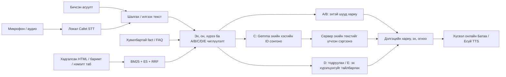

**2026.10.29 — II-ийн бэлтгэл шалгагдав:** [20 өгүүллийн үндсэн уншлага ба Cafet–Gemini арга](../papers/09-stt-candidate-review-20261029.mn.md),тусдаа runner,вэбийн дээд5өнгөний тайлбар бэлэн. 129 чиглэсэн тест PASS;208 код/хөрөнгийн hash тестийн үед drift0,32 хамгаалсан файл drift0. 15файл158s-ийн сүлжээгүй packet бэлэн;бодит Gemini/STT/TTS inference,сургалт,аудио дамжуулалт,шинэ хүний оноо0. Одоо II active;бодит paired харьцуулалт нь багцад холбосон тусдаа зөвшөөрөл/credential хүлээнэ. Raw WER36.02% хэвээр. [Төслийн үндсэн тэмдэглэл](PROJECT-NOTE.mn.md).

**2026.10.28 — шинэ аудитын засвар шалгагдав:** бүртгэлийн мөнгө/элсэх эрх, хувийн голч, онлайн бүртгэлийн бүх алхмын алдааг зассан. Тусдаа 21 хөгжүүлэлтийн асуулт 8 зөв/6 дутуу/7 алдаа → завсрын 20/0/1 → эцсийн 21/0/0; үүнд 14 мэдээлэлтэй хариулт, 7 зөв татгалзалт/боломжийн хязгаарын тайлбар багтсан. Хоёр бага илүүдэл үлдсэн. 1534 тест =1533 PASS/1 Windows-symlink SKIP; 203 код/хөрөнгийн hash drift0. Хүний/heldout/general accuracy биш. [Бүтэн тайлан](AUDIT-FOLLOWUP-2026-10-28.mn.md), [багшид асуух 8 асуулт](TEACHER-QUESTIONS.mn.md). Одоогийн багц I-ийн засвар ба III-ийн бичвэр; дараагийн гол ажил II · STT/TTS. Шинэ Gemini/ASR/TTS туршилт, сургалт, хүний оноо 0.

**2026.10.28 — GitHub шинэчлэл ба зай цэвэрлэгээ:** код, тест, мэдлэгийн хүрээ, RAG засвар, вэб төлөвлөгөөг [d20716b](https://github.com/sereeindahouse/THesisS/commit/d20716b7694ba6a0438fe302bcc9cbfe5a4df792)-оор нийтэлсэн. Хэрэглэгч том backup ажлыг цуцалсан тул модель/аудио/DB/runtime artifact нийтлээгүй; өөрийн нийтлэгдээгүй draft release-ийг устгасан. Түр архив, давхар clone, хаасан GPU орчин/кэш, хуучин тестийн браузерийн профайлаас **53.91 GiB (57.88 GB)** цэвэрлэсэн. Үндсэн моделүүд, аудио, reference, эхийн сан, туршилтын бодит дүн, ажиллах хоёр Python орчныг хадгалсан. Энэ нь raw STT чанарын шинэ хэмжилт биш.

<!-- rag-context-complete-20261027:start -->
## 2026.10.27 — RAG-ийн илүүдэл эх ба Gemma-тай/гүй харьцуулалтын багц шалгагдав

[Вэбийн одоогийн явц](http://127.0.0.1:8765/data#progress). Энэ нь I хэсгийн хэрэглэгчийн хүссэн хоёр ажлын багц; бүх диплом эсвэл бүх асуултын чанар дууссан гэсэн дүгнэлт биш.

**42 хөгжүүлэлтийн шалгалт:** эхний 32 зөв /2 дутуу /8 алдаа → эцсийн 42 /0 /0. Үүнд мэдээлэлтэй 32 асуулт, дэмжих эхгүй 10 татгалзах хяналт орсон; 42 substantive answer гэж тооцоогүй. Шинэ 24 найруулга нь танил сэдвийн хувилбарууд, тусдаа heldout биш. Эцсийн өөр субъектын илүүдэл 0; их илүүдэлтэй 9, бага илүүдэлтэй 6 үлдсэн. Review хөгжүүлэлтэд оролцсон AI-гийн эхтэй тулгалт; хүний эсвэл ерөнхий accuracy биш.

Засварууд: хугацаа ба утсыг өөрийн зарын гарчиг/огноо/нэг нийтлэлтэй холбох; элсэлтийн нөхцөлд Олимпиадын QPay-г оруулахгүй байх; ARC/Sunny-ийн илэрхий өөр компанийн root ба эзэн нь батлагдсан continuation-ийг цөөлөх; лабораторийн бүх талбарыг хадгалж клубийн хэсгийг хасах; контактын цаг/имэйлийг нэг card-д бүрэн шаардах; «цагийн хуваарь»-ийг цагийн багштай андуурахгүй байх; ижил эшлэлийг UI-д нэг удаа үзүүлэх. Тоо, хичээл, компани, огнооны хариуг кодод бичээгүй. Нөхцөл, төлөөний үг, үл танигдсан хүрээтэй эхийг дур мэдэн тайраагүй.

**Ижил production context-ийн 20 найруулга /10 танил сэдэв, 4 сонголтын 80 гаралт:**

| Арга | Хүссэн талбар бүрэн | Өөр субъектын илүүдэл | Том илүүдэл | LLM дуудалт |
|---|---:|---:|---:|---:|
| Gemma сонголт | 20/20 | 0 | 6 | 25 |
| BM25 top1 | 13/20 | 0 | 2 | 0 |
| BM25 top3 | 17/20 | 5 | 15 | 0 |
| Талбар шалгадаг BM25 | 20/20 | 0 | 2 | 0 |

Тус бүр ижил эх/нэгж, provenance, шаардлагатай талбар, уртын шалгалт, renderer ашигласан. Context-ийг бодит ChatRAG хайлт, дутуу талбарын нэмэлт хайлтын дараа provider дуудалгүй царцаасан. Reference/хүлээсэн хариуг selector-д өгөөгүй. Gemma ба хүчтэй BM25 хүссэн мэдээллээр тэнцсэн; **Gemma-ийн давуу тал энэ багцаар нотлогдоогүй.** «20 талбар бүрэн» нь 20 төгс, товч хариулт гэсэн үг биш. Сонголтын хугацаа нь нэг локал run-ийн тайлбарлах хэмжилт; бүх RAG-ийн latency benchmark биш. Үндсэн системийн Gemma-г хасаагүй; LLM-гүй нөхцөл зөвхөн хувийн харьцуулалтын runner-д байна.

**Шалгалт:** 1513 тестээс 1512 PASS /1 Windows-symlink SKIP; 181.931s; 200 код/хөрөнгийн hash тестийн үед өөрчлөгдөөгүй. Завсрын регрессүүд, Windows10053-тэй нэг суит, экспортын хувьсагчийн алдаа болон анхны raw-ууд хадгалагдсан; засварын дараах дээрх эцсийн суит тэнцсэн. 2026.10.28-нд локал үйлчилгээг сэргээж, браузерийн 7 чат шалгалт, нэг эшлэлийн давхардалгүй харагдац, шинэчилсэн явцын хүснэгтийг баталгаажуулсан. API/браузерийн түүхий нотолгоо completion-checkpoint-д холбоостой.

**Хязгаар ба дараа:** урт барилгын танилцуулга, маягт/төлбөрийн алхам, Sunny-ийн нэг paragraph доторх сошиал тайлбар зарим хариултад үлдсэн. Snapshot-ийн «бүртгэл хаагдсан» UI нь өнөөдрийн live баталгаа биш. Ерөнхий entailment болон хүний хэрэглээний чанарыг батлаагүй. Дараагийн гол инженерийн багц II · STT/TTS; I-ийн ирээдүйн шинэ асуултын үнэлгээг тусад нь хийнэ.

STT/TTS-ийн 7 код/тохиргооны hash өмнөхтэй ижил; шинэ ASR/TTS inference, сургалт, таталт, хүний оноо 0. Raw WER 36.02% хэвээр. [Өөр speech аргын сонгосон уншлага](../papers/04-training-inference-evaluation.mn.md) нь хэрэгжүүлсэн gain биш. Энэ RAG хэмжилтэд эх/жин/reference өөрчлөөгүй; 10.27-ны локал үр дүнг 10.28-ны нийтлэх багцад нэгтгэсэн. Үндсэн үргэлжлэх цэг: runtime/rag-context-ablation-20261027/completion-checkpoint.json. May31 төлөвлөлтийн хил, Nov10 цуцлагдсан хэвээр.
<!-- rag-context-complete-20261027:end -->

<!-- rag-section-I-20261027:start -->
## 2026.10.27 — Одоо I хэсэг: RAG-ийн чанарын багц шалгагдав

[Одоогийн явц ба гурван долоо хоногийн тайлан](http://127.0.0.1:8765/data#progress). Хэрэглэгчийн дараалал **I мэдлэг/RAG → дараагийн гол багц II STT/TTS**. III-ийн тест, нотолгоо, бичвэр тухайн ажлыг дагана. I бүхэлдээ дууссан гэж тэмдэглээгүй.

16эхийн эшлэлтэй12асуулт+6directcontrol-ийг outputs-оос өмнө хадгалсан. Ижил12-ын тусдааAIхяналт **7бүрэн/1дутуу/4алдаа→12/0/0**;10supported+2unsupportedcontrol. Нэмэлт6control2A/4Eэхийн хүрээнд тохирсон. Одоо бүх18observeddevelopment; хүний/schoolgold/heldout/generalaccuracy биш. Case07-ийн завсрын утасорхисонregression-ийг илрүүлж зассан; эцсийнreview-д хугацаа+хоёрутас бүрэн. Case08-ийн эхнийreview retrievalонош буруу байсныг тусад залруулсан: VI.3анхныtop5-д байгаагүй; анхныreview/raw-ийг дарж солиогүй.

Засвар: directlookup-д эзэн/талбар/нөхцөлийнsharedcontract; бүхAshortcut-д knownfieldcompleteness; дутууadmission-stage-д rolequery; зөвхөнfield-supportedofficialsource, ижилcorpus,≤2нэмэлт/талбар, originalrowsхадгалах; анхныvsнийттөгсөгч; цагийнүгvsхүн; асуусанонvsзаасанон; personalIDvspubliccontacts; зарынdeadline+phone. Хариултын15минут/CJavaутгыг authorization-д тогтмол шаардах хамаарлыг арилгасан; тоо/хэлийг эхээс авна. Genericsemanticentailment баталсан арга биш.

Эцсийн **1439run=1438PASS/1Windows-symlinkSKIP;204.287s**,195sourceбайт тестийн үедdrift0. Дараахconfigstatus+HTMLтайлбарынкопи2файлыг34focusedUI/plan/graph,liveharness,Brave,API-аар шалгасан.21loadedhashтаарсан. Браузерт зарынсүүлийнөдөр+80110134+99065326, эхийн1холбоо; явцынIфокус ба3мөрийнweekhistory баталсан. Зөвхөнdesktop1382px энэ багцаар; horizontaloverflow0.

STT/TTS-ийн7код/тохиргооны SHA өмнөхcheckpoint-той ижил. ШинэASR/TTS/training/download/humanrating0. RawWER36.02%хэвээр; энэRAGgain-гASRgainгэж тооцохгүй. SourceDB/weights/humanrefs өөрчлөөгүй; GitHubpush энэ ажлаар хийгээгүй. Эцсийннотолгоо runtime/rag-section-I-20261027/completion-checkpoint.json; өмнөх/завсрын/эцсийнraw,AIreview,tests,API/browserproof тэнд.

ДараагийнI: ижилcorpus/context-ийн retrieval/Gemmaablation, source/Sakura/navigationclutter-ийг нөхцөл алдахгүй бууруулах, шинэunexposedнайруулга. May31төлөвлөлтийнхил; Nov10цуцлагдсанхэвээр.
<!-- rag-section-I-20261027:end -->

<!-- three-results-20261027:start -->
## 2026.10.27 — Гурван том үр дүн, мэдээллийн хүрээ ба TTS-ийн засвар

[Гурван хэсэг ба долоо хоногууд](http://127.0.0.1:8765/data#progress), [мэдлэгийн мод ба хүрээ](http://127.0.0.1:8765/data#tree), [STT/TTS/RAG-ийн тайлбар](CONCEPTS.mn.md).

Багшийн зөвлөсөн3 том үр дүн: I сургуулийн мэдлэг/RAG/Gemma; II Монгол дуу/STT/TTS; III нэгдсэн систем/үнэлгээ/бичвэр. Тус бүр5 дэд ажил, бэлэн/үлдсэн ажил, дуусах шалгуур, нотолгоотой. Бүх32 хугацаа холбогдсон; энэ холбоо нь ажил дууссан гэсэн шошго биш. W01-ийн гурван чиглэл зэрэг явна; шинэ бодит аудио нь W02-ийн тусдаа pilot, бусад ажлыг зогсоохгүй. May31 нь төлөвлөлтийн хил, Nov10 цуцлагдсан хэвээр.

Хүрээний гэрээ нь бодит8 салбар/33 сэдэв,75HTML/196хайлтын хэсэг/14бүтэцтэй эх/40баримт/30FAQ-тай.18сэдэвт бүтэцтэй баримт0; HTML текстгүй гэсэн дүгнэлт биш. Хамрах/хасах/unknown дүрэм ба талбарын төрлийг харуулна. Модны навигац нь retrieval эрэмбэ, LLM жин, бүх асуултын зөв байдлын баталгаа биш. Энэ ажлаар RAG answer accuracy өссөн гэж хэмжээгүй; өмнөх курс-бүрийн observed засвар хэвээр.

TTS: тодорхой дараалсан хичээлийн жилийн хоёр оныг үгээр унших бэлтгэл; QR/утас/он/валютын URL/имэйл/кодын хил хамгаалалт. Шинэ9 test-method; эхний7методын15subcase алдаа, нэмэлт2методын7subcase алдааг өмнөх гаралтаар хадгалж зассан. Өмнөх/дараах2хоолой×2хувилбарын4provider synthesis/decode PASS. Эхний4sandbox connection failure тусдаа. Эцсийн сервер дээр бодит эхтэй курс-бүрийн хариулт, шинэ spoken он, 23.328s аудионы native playback ажигласан. Хүний сонсголын gain биш; display/source өөрчлөгдөөгүй.

Эцсийн бүх суит **1387run=1386PASS/1Windows-symlinkSKIP;202.667s**. 190код/хөрөнгийн hash drift0;21 loaded hash drift0;3served asset SHA таарсан. Эхний1385 суитийг дараах identifier хамгаалалтын өөрчлөлтөөс өмнөх checkpoint гэж хадгалсан. Brave:3карт,II хэсгийн21хугацаа,8хүрээ/33зангилаа,academic салааны эх рүү шилжих;1382px ба327CSSpx, overflow0, viewport reset.375 override нь327CSSpx болсон тул375гэж тайлагнаагүй.

Үндсэн raw STT WER36.02%/CER16.90% хэвээр; шинэ ASR/сургалт/model download/хүний оноо0. Хоёр200-update сөрөг дүн өөрчлөгдөөгүй. Эцсийн үргэлжлэх цэг: runtime/thesis-three-pillars-20261027/completion-checkpoint.json. Тест/API/browser/TTS түүхий нотолгоо тэр хавтсанд. Хувийн аудио/DB/model нийтлэгдээгүй; GitHub push энэ ажлаар хийгээгүй.
<!-- three-results-20261027:end -->

<!-- plan-web-20261027:start -->
## 2026.10.27 — Төлөвлөгөө системийн вэбэд орсон

**[Явц, долоо хоногийн зорилго, дараагийн алхмыг нээх](http://127.0.0.1:8765/data#progress).** Нэг Markdown эхээс32 хугацааны карт,9 тайлбарын хэсэг,4үндсэн компонент уншина. Хийх ажил/гарах үр дүн/хүлээн авах шалгуур, нотолгоо болон дараагийн алхам тусдаа. Сар/төлөв/үгээр шүүх, native дэлгэх/хураах, гарын товчоор ажиллах боломжтой. Хуанлийн өнгөрсөн өдөр ажлыг автоматаар дууссан болгохгүй. Хуучин техникийн checkpoint-ийг шинэ W03-той андуурахааргүй тэмдэглэсэн.

**Эцсийн хамтатгасан шалгалт:**1368тест=1367PASS/1Windows-actual-symlinkSKIP;203.468s.189код/хөрөнгийн hash тестийн явцад өөрчлөгдөөгүй. Вэбийн өмнөх1360суит болон UIharness зэрэг өөрчлөгдсөн эхний суитийг тусад нь хадгалсан. Бодит Brave дээр1396px болон341CSSpx нарийн харагдац,32карт/4компонент/9хэсэг, сар/төлөв/хайлт, Enter нээх, semantic хүснэгтийг шалгасан; horizontal overflow0.375гэсэн override өгсөн ч browser zoom-оос бодит innerWidth341байсан тул375гэж тайлагнаагүй. Эхний selector/ачааллын timeout-ийг шинэчилсэн DOM-оор ялгасан; бүтээгдэхүүний алдаа гэж тооцоогүй. Тестийн дараах config-ийн төлөв/нотолгооны текстийг live API-аар дахин шалгасан.

**Хүний ажил тусдаа:** хэрэглэгч өөрөө transcript бөглөнө, мөн туслах хүн олдсон гэж мэдэгдсэн. Нэг хэлэгчийн evaluation-only/dev горим48тесттэй; олон хэлэгчийн анхны тусгаарлалтын дүрэм хэвээр. Шинэ pilot аудио/reference0. Энэ нь код/RAG/LLM/TTS/эх/вэбийн ажлыг зогсоох нөхцөл биш. Raw STT WER36.02% хэвээр; вэбийн шинэчлэлтийг танилтын өсөлт гэж тооцоогүй.

Нэмэлт live RAG-ийн эхний гурван тохиолдол A1/E2: багшийн4танилцуулга/2эхтэйзураг ажилласан; эхгүй албаны давхар/утсыг нөхөөгүй; механикийн асуултад Gemma provider unavailable байв. Зөвхөн project-owned Ollama-ийн PID/зам/эхэлсэн цагийг батлаад, одоогийн starter-ийг зөвшөөрөгдсөн execution-ээр сэргээсэн; шинэ model/download/ACL өөрчлөлт0. Дараах бодит C1call ажилласан ч зөвхөн нийт128 гарч,5курсын мөр дутсан. `source_fields.py`-ийн нийт гэсэн зайлшгүй шаардлага ба бүрт хэлбэрийн дутуу grammar-ийг хязгаарлан засав. Student/count cue, нэрлэсэн тэнхим/нэг он, бүтэн хүснэгт/нийлбэр, extra qualifier/negation хамгаалалт хэвээр; тоо/он hardcode0. Шинэ8тест өмнөх gitHEAD replay-д8FAIL, дарааPASS; бие даасан хяналт тэнцсэн. Ижил бодит асуулт одоо A/0LLM, бүх5курсын мөр эхтэйгээ таарсан. Энэ нь нэг observed-development case; хүний/general accuracy, ASR/TTS сайжрал биш.

Үргэлжлэх цэг: `runtime/plan-web-20261027/completion-checkpoint.json`. Эцсийн нотолгоо: `full-tests-combined-final.json`, `full-tests-combined-final.log`, `live-api-proof-final.json`, `browser-qa.json`, `course-answer-review.json`; бүгд `runtime/plan-web-20261027/` дотор. Хувийн pilot-ийн хоосон бэлтгэл `runtime/stt-personal-question-pilot-20261026/`-д. Анхны roadmap, source DB, хуучин reference өөрчлөгдөөгүй. GitHub publication энэ ажлаар хийгээгүй.
<!-- plan-web-20261027:end -->

<!-- may-plan-20261026:start -->
## 2026.10.26 — Шинэ чиглэл, бодит сургалтын дүгнэлт

**11.10-ны зорилгыг хэрэглэгч цуцалсан.** [Өнөөдрөөс2027.05.31хүртэл долоо хоног бүр хийх төлөвлөгөө](WEEKLY-PLAN-2026-2027.mn.md) нь одоогийн үндсэн дараалал. 5.31-ийг төлөвлөлтийн хязгаар болгосон; албан хамгаалалтын өдөр гэж үзэхгүй. Анхны roadmap түүхээрээ хэвээр.

**STT сургалт ба эцсийн шалгалт дууссан, candidate татгалзсан.** Эхний FLEURS-only200update нь HF validation13/16→18/41→22/64 болж baseline0 сонгогдсон. Дараагийн128нийтийн бодит+128синтетик domain сургалтын200update нь шинэ synthetic validation32-д61/127→45/99үгийн/тэмдэгтийн алдаатай. Гэвч ижил CPU INT8 private13-д **67/184→77/221; WER36.02%→41.40%**, хуучин synthetic4-д2/8→3/9 болсон. Нийтийн CPU test32-д26/48→24/40 болсон бага ахиц үүнийг нөхөхгүй. Үндсэн модель/profile-ийг сольсонгүй; raw WER36.02% хэвээр.

Жингийн бие даасан аудит48проекц зөв өөрчлөгдсөн,431бусадtensor byte-иар хэвээр, хөрвүүлсэн4asset эхтэй ижил гэдгийг шалгасан. CPU-ийн83шинэ+64суурь+19түүхэн, нийт166raw гаралтыг тусдаа edit алгоритмаар тоолж батлав. Бүх13-ын хос хяналтаар q03-ийн2026он алдагдсан; q06давхар/q08нэр хадгалагдсан ч exact шалгалт унасан. Энэ нь synthetic validation бодит хэрэглээг хангалттай төлөөлөхгүй байгааг харуулна; цорын ганц акустик шалтгааныг тогтоосон гэсэн үг биш.

**W01-ийн бие даан хийх суурь дууссан:** [24сценари](../data/stt-question-study-scenarios-v1.json), [цуглуулалт/reference/split заавар](STT-REAL-QUESTION-STUDY.mn.md), [WAV/consent/speaker/reference validator](../tools/stt_study_manifest.py), [эх хадгалдаг16kHz аудио бэлтгэл](../tools/prepare_stt_study_audio.py). Хоёр хэрэгслийн55тестээс54PASS/1Windows-symlinkSKIP, явцын15тестPASS. Overflow болон cleanup race-ийг бие даасан хяналтаар илрүүлж зассан. Шинэ хүний аудио/reference0; эхний долоо хоног бүхэлдээ дуусаагүй. Бодит train/dev өгөгдөл, алдааны шинжилгээ бэлэн болохоос өмнө дахин сохроор training/model search хийхгүй.

Хувийн нотолгоо: `runtime/stt-domain-reserve-20261026/run-001/summary.json`, `independent-outcome-review.json`, `independent-weight-export-audit.json`, `independent-cpu-outcome-review.json`; `runtime/stt-domain-reserve-20261026/private-critical-review.json`; `runtime/stt-weight-adaptation-20261025/ct2-evaluation/domain-comparison-first.json`. W01-ийн үргэлжлэх цэг: `runtime/stt-real-question-pilot-20261026/completion-checkpoint.json`. Модель ажиллуулах зөв environment-д readiness7/7; локал API шинэ May/W01явцыг буцаасан. Эхнийmainvenv readiness6/7баlauncher20s timeout-ийг логт хадгалсан; өргөтгөсөн нэг удаагийнcold-start серверээрAPIшалгасан. Өмнөх1262coreтест/Brave/TTS-ийг энэ удаа дахин ажиллуулсан гэж тайлагнахгүй; шинэ visualQA/playback хийгээгүй.
<!-- may-plan-20261026:end -->

<!-- core-direct-20261025:start -->
## 2026.10.25 — RAG-ийн найруулга, нэрийн хүрээ ба дуугаар унших засвар

**Эцсийн 1,262 автомат тест 201.278 секундэд тэнцсэн.** Өмнөх `8f400a1` шинэчлэл GitHub-д баталгаажсан. Энэ нэмэлт ажлын эхний 1,253 тестийн явцад код өөрчлөгдсөн тул түүнийг эцсийн checkpoint болгоогүй. Дараагийн 1,255 тест нэг бодит алдаа илрүүлсэн: «аль давхарт» гэдгийг албаны нэрийн хэсэг гэж ойлгожээ. Үүнийг зассан 1,256 тест, дууны нэмэлттэй 1,261 тест тэнцсэн. Дараа нь албаны өөрийн эх байгаа үед нэмэлт сэдвийн эхийг хасаж болохыг regression тестээр баталж зассан; эцсийн 1,262 тест тэнцсэн. Завсрын лог, анхны гаралтууд хадгалагдсан.

**RAG.** Гаралтаас өмнө царцаасан 9 шинэ найруулгыг өмнө, дараа нь бодит API-д илгээсэн. StoD-ийн платформ, механикийн курс бүрийн тоо орхигдох алдааг асуултын талбар, үгийн дараалал, тийн ялгалыг тусад нь таньдаг хязгаарласан логикоор засав. Sakura-ийн эх платформын нэр заагаагүйг ил тод мэдэгдэнэ. Албаны бүтэн нэр, өөрийн давхар ба утсыг хамтад нь батлах бүртгэл шаардана; Hub-ийн давхар, сургуулийн ерөнхий утсаар орлуулахгүй. Үгүйсгэл, он, тоо эсвэл нэмэлт хүсэлтийг хасаж өөр асуултад хариулахгүй. Энэ нь бүх асуултын утгыг зөв ойлгодог баталгаа биш.

Шинэ 9 асуултын үр дүн: **2 бүтэн, эх дутууг мэдэгдсэн 1 хэсэгчилсэн, эхгүй эсвэл хүрээ тодорхойгүйг мэдэгдсэн 6**. Хүлээсэн ажиллагааны 9 шалгалт тэнцсэн; 9 бүтэн зөв хариулт, хүний эсвэл ерөнхий accuracy гэж үзэхгүй. Тухайн багцын C4/E5 зам A3/E6 болж, LLM дуудлага 4-өөс 0 болсон. Үүгээр бүх асуултад LLM хэрэггүй гэж дүгнэхгүй. Зургаан claim эхийн яг хэсэгтэй. Эцсийн кодтой сервер дээр өмнөх 12 RAG асуултыг дахин илгээхэд хариултууд хадгалагдаж, бүх 20 ачаалсан файлын SHA таарсан.

**Whisper/STT.** Ганц сургуулийн нэртэй `initial_prompt` нь өмнөх урт жагсаалттай prompt-оос жагсаалтыг хассан харьцуулалт; шинэ механизм эсвэл жингийн сургалт биш. Ижил 13 reference дээр үгийн алдаа 67-оос 87, тэмдэгтийн алдаа 184-өөс 249 болж муудсан: WER 36.02% → 46.77%, CER 16.90% → 22.87%. Дөрвөн синтетик ярианы алдаа мөн өсөж, өмнө зөв байсан он, давхар алдагдсан. Яриагүй хоёр raw гаралт хийсвэр тексттэй хэвээр; системийн Silero хамгаалалтыг үүнээс тусад нь ялгасан. Шинэ 19 локал decode хийж, baseline inference-ийг давтаагүй. Үндсэн агент түүхий файлуудаас өөр edit алгоритмаар дахин тоолсон. Нэвтрүүлээгүй тул **үндсэн raw WER 36.02% хэвээр**. Өөрийн сургалт, шинэ модель таталт хийгээгүй.

**TTS.** Боловсролын ойрын өгүүлбэрт байгаа тоотой «кр цаг», «кр.цаг»-ийг зөвхөн дууны текстэд «кредит цаг» болгон дэлгэнэ. Дэлгэцийн эх, тоо, citation хэвээр. URL, ID, тоон муж, танихгүй нөхцөл болон боловсролын бус хэрэглээг өөрчлөхгүй. Нэршлийг NMCT-ийн химийн эх, НССДС-ийн кредит цагийн заавартай тулгасан. Ижил Батаа хоолойтой өмнөх, дараах хоёр бодит provider хүсэлтийн MP3 нь 8.544 ба 8.736 секундээр decode тэнцсэн. Дараах дуу хариултын ID болон эхтэй текстдээ холбогдсон. Ижил тексттэй шинэ хариултын дуу Brave дээр 8.736 секунд дуустал тоглосон. Хос харьцуулалтын хоёр болон эцсийн браузерийн нэг, нийт гурван provider хүсэлт хийсэн. TTS-ийн нейрон жинг сургаагүй, хүний шинэ сонсголын чанарын өсөлт хэмжээгүй.

**Түр зураг.** Тусгаарласан жишээ 9 хайрцаг, 8 сумтай SVG урсгал, «ШМТК → 5 бүлэг → эхүүд» гэсэн холбоостой модтой болсон. Python-ийн 7 тест, SVG renderer-ийн 11, HTTP-ийн 14, бодит Brave-ийн 6 шалгалт тэнцсэн. Үндсэн 33 сэдэв, 16 хайрцагтай урсгал болон моделийн тохиргоонд энэ түр жишээг нэгтгээгүй. Дан BM25 хайлтын нэр дэвшигч нь генератив RAG, LLM-ийн шударга харьцуулалт эсвэл модель доторх нейроны зураг биш.

196 эхийн мөр, анхны roadmap, хоёр DB, хүний 52 файл хэвээр. Албаны давхар, тусгай утас болон эхгүй платформын нэрийг зохиогоогүй. Багшийн «5» гэсэн summary ба 4 profile-ийн зөрүү, хараат бус хүний үнэлгээ, байнгын HTTPS, өөр компьютерт цэвэр сэргээх ажиллагаа, дипломын эцсийн хяналт үлдсэн.
<!-- core-direct-20261025:end -->

<!-- actual-user-followup-20261025:start -->
## 2026.10.25 — Бодит асуултын засвар ба LLM-ийн хоёр үүрэг

**1239 локал тест PASS/144.163s.** Үндсэн кодын шалгалт, бодит HTTP, Brave UI гэсэн тусдаа түвшнээр шалгав. Хэрэглэгчийн ажигласан болон шинээр найруулсан 12 development тохиолдол хүлээсэн хариулах/тодруулах/эх дутууг мэдэгдэх ажиллагаагаа биелүүлсэн (A4/C4/D2/E2; 5 LLM дуудлага; 13 үгчлэн эхтэй claim). Энэ нь 12 бүрэн хариулт эсвэл хараат бус хүний accuracy биш. Өмнөх24-ийн23бүрэн/1partial дүнг энэ удаа дахин хэмжсэн гэж үзэхгүй.

**RAG ба тодруулга:** компанийн сонголтын товч анхны сар/платформын хүсэлтийг устгаж байсныг бодит Brave дээр илрүүлж зассан. Sakura болон StoD дээр бодитоор дахин дарж зөв хүрээ хадгалагдсаныг шалгав. Механикийн нийт/курсийн хүснэгтэд клубийн өөр тоо орохгүй. Загварын repair-ийн илт context нь зөвшөөрсөн эхийн нэгжийн dependency-тэй яг ижил үед л зөвшөөрөгдөнө; дурын эхийг нэгтгэхгүй. Ерөнхий сургуулийн асуултад тохироогүй мэдээ сонгохын оронд сэдэв тодруулна (D/0LLM).

**LLM хоёр тусдаа газар ажиллана.** RAG-ийн C замд Gemma эхийн нэгжийн ID сонгож, сервер үгийг эхээс нь сэргээнэ. STT-ийн дараах тусад нь идэвхжүүлсэн Gemma raw текстэд санал гаргана; raw текст шууд засах/илгээхэд бэлэн, санал автоматаар хэрэгжихгүй. Хүлээлт цуцлах, хуучин санал оройтож ирэх, тоо/нэр/үгүйсгэл болон үг нэмэх/хасах хамгаалалтыг шалгасан. Эдгээр нь утга зөв байсны баталгаа биш. q01 зөвшөөрсөн аудиогоор Brave-д нэг бодит STT → автомат санал → илт хэрэглэх → raw lineage хадгалах урсгал ажиллав. Нийт4 бодит локал correction хүсэлт шалгасан. Шинэ clone-д хувийн opt-in тохиргоо байхгүй бол санал идэвхгүй байна.

**STT:** ижил13 reference-ийн raw67/186 word error,184/1089 character error буюу **WER36.02%,CER16.90% хэвээр**. Архивын LLM саналын replay нь synthetic control-ыг дордуулсан тул автомат correction-ийг дэвшүүлээгүй. Нэг шинэ q01 техникийн шалгалт нь хурд/accuracy benchmark биш; өөрийн сургалт, шинэ модель таталт0.

**TTS ба браузер:** 3 шинэ бодит provider хүсэлт хариултын ID/эхтэй текстдээ холбогдсон;36.72/23.40/36.72s MP3 decode тэнцсэн. Эх дутуугийн мэдэгдэл дуугаар уншигдаж, renderer-ийн citation индекс уншигдахгүй. Brave дээр36.72s дуу дуустал тоглосон; хүний сонсголын шинэ оноо биш. Fresh tab-аас локал HTML нээх асуудлыг хязгаарласан navigation засвараар шийдсэн; API, POST, илт гаднын Origin хамгаалалт хэвээр. Дахин extension суулгах, шинэ зөвшөөрөл шаардлагагүй. Эцсийн4 Brave үйлдэл тэнцсэн.

**Эх дутуу нь хэвээр:** Sakura-ийн хадгалсан эх платформын нэр заагаагүй; сургалтын албаны давхар/тусгай дугаар хадгалсан санд байхгүй. Ерөнхий утас, өөр компанийн нэрээр нөхөөгүй. Багшийн summary5 vs4танилцуулга, хараат бус хүний үнэлгээ, байнгын HTTPS, өөр компьютерт цэвэр сэргээх, дипломын эцсийн хяналт үлдсэн.196эхийн хэсэг, анхны roadmap, хоёрDB,52хүний файл өөрчлөгдөөгүй.

**Түр LLM-гүй жишээ** үндсэн кодод ороогүй; canonical33сэдэв болон16блоктой урсгал хэвээр. Системийн зураг нь өгөгдөл боловсруулах архитектур, сэдвийн мод нь эхийн ангилал; сурсан нейроны жин эсвэл LLM-ийн дотоод бодол биш. Түр BM25 эхийн хайлтыг генератив RAG, LLM-ийн чанарын шударга ablation гэж нэрлэхгүй.
<!-- actual-user-followup-20261025:end -->

<!-- browser-qa-20261024:start -->
## 2026.10.24 — Бодит браузерийн шалгалт, товшилтын засвар

**Brave дээр бодит харагдац, үйлдлийн 9 эцсийн шалгалт тэнцсэн.** Компьютер болон хэмжсэн 374/376 CSS px өргөнд мод, эх нээх, хайх, томруулах, багшийн дөрвөн карт/хоёр зураг ажиллав. Түр viewport-ийг буцаасан. Браузерийн zoom-оос болж яг 375 CSS px гэсэн эхний assertion-ууд буруу таамагтай байсныг түүхий бүртгэлд хадгалсан; яг 375 px гэж тайлагнаагүй.

SVG бүх товшилтыг шууд pointer capture хийснээс зангилаа хулганаар нээгдэхгүй байсныг засав. Өмнөх код шинэ regression-д унаж, зассан код тэнцсэн. Үндсэн зангилаа 83 эхийн урт жагсаалт харуулж системийн зургийг дарахгүй болсон. «Багшийн нэр, танилцуулгыг харуул» гэсэн хүсэлт дөрвөн эхтэй нэр/үүрэг, хоёр зурагтай карт нээнэ; нэмэлт батлагдаагүй талбаруудыг орхиж хариулахгүй. Curated эхийн хувилбар ба хадгалсан HTML capture нь өөр бүртгэл гэдгийг нээх товч тайлбарлана.

**1148 тест PASS/135.455s.** Шинэ сервер дээр ижил 24+12 асуултыг дахин илгээж, 20 loaded artifact-ийн SHA-г шалгав. Харагдах хариулт өмнө нэг бүрчлэн уншсан гаралттай ижил: **23 бүрэн/1 хэсэгчилсэн; нэмэлт 12 handling PASS**. Хүний эсвэл хараат бус accuracy биш. Багшийн эхийн «5» тоо ба дөрвөн танилцуулгын зөрүү үлдсэн. Raw STT **WER 36.02% хэвээр**; patience2-г нэвтрүүлээгүй. Өмнөх хоёр бодит TTS decode тэнцсэн; энэ браузерийн шалгалтаар шинэ synthesis, playback эсвэл хүний сонсголын оноо аваагүй.

[Мэдлэгийн мод](http://127.0.0.1:8765/data#tree) · [Чат](http://127.0.0.1:8765/). Өмнөх «браузер холбогдоогүй» бүртгэл нь өмнөх шалгалтын үеийн түүх; энэ шинэ шалгалт түүнийг нөхөв.
<!-- browser-qa-20261024:end -->

<!-- core-followup-20261024:start -->
## 2026.10.24 — Дөрвөн илүүдэл хариултыг засаж, STT-ийн шинэ тохиргоог шалгав

**1148 автомат тест тэнцсэн, 176.858 секунд.** Ижил 24 бодит асуултын AI үнэлгээ 19 бүрэн/5 хэсэгчилсэн → **23 бүрэн/1 хэсэгчилсэн** болсон. Өөрөөр найруулсан 12 асуултын хариулах, тодруулах, татгалзах ажиллагаа тэнцсэн. Эдгээр нь засварт ашигласан development асуулт; өөрийн кодыг шалгасан AI үнэлгээ бөгөөд хүний эсвэл хараат бус нийт accuracy биш.

Hub-ийн хоёр өрөө, дадлагын хүсэлт ба ярилцлага, дэвшин суралцах N2, зөвлөлийн таслалтад асуугаагүй өөр workflow, тэтгэлэг, урт танилцуулга нэмэгдэхээ больсон. Бүрэн танигдсан асуултад эхийн мөрүүдийг нийтлэг гарчиг, нөхцөлтэй нь холбож шалгана. Он, нөхцөл, нэмэлт хүсэлт, эхийн зөрүү байвал ердийн хамгаалалттай RAG замд үлдэнэ. Бодит хариуны тоо, он, түвшнийг кодод тогтмол бичээгүй. Бүх 20 loaded SHA болон анхны эхийн байрлал таарсан.

**Багшийн нэр 2→4, баталгаатай хөрөг 2 хэвээр.** Албан Next Flight-ийн дөрвөн хүний нэр, үүргийг эхийн SHA, pointer-тай тулгана. Жишээ зурагтай байсан хоёр хүний нэрийг устгахгүй; зургийг нь бодит хөрөг гэж харуулахгүй. Эхийн «5 багш» гэсэн тоо дөрвөн танилцуулгатай зөрдөг тул бүрэн roster батлагдаагүй, fresh02 хэсэгчилсэн хэвээр. Хуучин 11 эх, зураг өөрчлөгдөөгүй. Шинэ manifest нь хувийн runtime-д; эх DB болон RAG corpus өөрчлөгдөөгүй.

**TTS:** дөрвөн нэрийн хэсэгчилсэн сангийн мэдэгдэл болон гарчигтай N2 хариултад бодит Edge TTS ажиллаж, 31.368 ба 8.064 секундийн MP3 decode тэнцсэн. Response ID болон эхтэй spoken text таарсан. Хүний сонсголын шинэ оноо, браузерийн playback гэж тооцоогүй.

**STT:** beam5/patience2 гэсэн өмнө туршаагүй ганц хувилбарыг гаралтаас өмнө царцааж, 19 локал decode хийсэн. Ижил baseline-ийг дахин ажиллуулахын оронд аудио, модель, тохиргоо, сангийн хувилбарын hash таарсан архивыг ашиглав. 17 ярианы гаралт ижил; чимээгүй/шуугиантай хоёр raw контролд хийсвэр текст өөр байсан. Түр өгсөн «19 ижил» гэсэн тайлбарыг үндсэн агентын бие даасан тооллоор засав. 13 баталсан reference дээр 67/186 word error, 184/1089 character error буюу **WER 36.02%, CER 16.90% хэвээр**. Шинэ тохиргоог нэвтрүүлээгүй. Аппын өмнөх яриа илрүүлэх хамгаалалт хоёр контролыг Whisper ачаалахаас өмнө татгалзсаныг тусад нь батлав; үүнийг raw WER сайжрал гэж үзэхгүй. Модель таталт, өөрийн сургалт 0.

Браузерийн inventory 0; Chrome нээхэд unavailable. Албан desktop → Settings → Computer Use → Chrome extension → @Chrome зааврыг өгсөн. Бодит visual QA хийгдээгүй. [Чат](http://127.0.0.1:8765/) · [Мэдлэгийн мод](http://127.0.0.1:8765/data#tree).
<!-- core-followup-20261024:end -->

<!-- visual-semantic-20261024:start -->
## 2026.10.24 — Харагдах мэдлэгийн мод ба бодит чатны засвар

**[Холбоост модыг нээх](http://127.0.0.1:8765/data#tree).** Сургуулийн мэдээлэл 33 зангилаа, 32 салаагаар; системийн ажиллах урсгал 16 зангилаа, 19 сумаар харагдана. Томруулж, чирж, хайж, сэдвийг дарж эхийг нээнэ. Gemma-ийн байрлал ба шууд fact/FAQ зам тусдаа харагдана. Энэ нь эхийн ангилал, бодит өгөгдлийн урсгал; нейрон жин эсвэл дотоод бодлын зураг биш.

**1124 автомат тест PASS, 156.819 секунд.** Ижил 24 бодит чатны асуултын AI үнэлгээ анх 9 бүрэн/8 partial/5 алдаа/2 хэрэггүй татгалзалт → одоо 19 бүрэн/5 partial/0 алдаа. Өөрөөр найруулсан 12 асуултад хариулах/тодруулах/татгалзах handling 12/12 тэнцсэн. Эдгээрийг засварт ашигласан development шалгалт; хүний эсвэл хараат бус нийт accuracy биш. Анхны болон завсрын буруу үр дүн хадгалагдсан.

Багшийн нэрийг оюутны овогтой андуурах, тэнхимийн тоог өөр хүрээнээс зээлдэх, номын сангийн давхрыг жагсаалтын дугаартай андуурах, спортын талбайд бүжгийн танхим нэмэх, үүсэлт/анхны төгсөлт/хөтөлбөрийн оныг холих тохиолдлуудыг засав. Цагийн эх байхгүй бол талбай, суудлын тоогоор орлуулахгүй. Бүтэн багшийн roster эхэд байхгүй: хадгалсан хоёр профайлыг дэлгэц болон унших текстэд partial гэдгийг мэдэгдэнэ.

Үлдсэн 5 partial: бүрэн roster дутуу; Hub, дадлага, N2, зөвлөлийн хариултад асуугаагүй мэдээлэл нэмэгдсэн. Үгчлэн эх хуулсан нь утгын зөв байдлын дан баталгаа биш. SVG geometry, бодит API/симуляцтай DOM-ийн 13 сценарий тэнцэж, хоёр PNG preview-г үзсэн; браузер холбогдоогүй тул шинэ browser screenshot/device QA гэж тооцоогүй.

75 хуудас/196 хэсэг/14 эхийн хувилбар/40 fact/30 FAQ, эх DB, roadmap, хүний 52 файл өөрчлөгдөөгүй. **Raw STT WER36.02% хэвээр**; шинэ STT/TTS inference, модель таталт, өөрийн сургалт 0. Хараат бус хүний судалгаа, байнгын hosting, clean-machine суулгалт, дипломын эцсийн хяналт үлдсэн.
<!-- visual-semantic-20261024:end -->

<!-- knowledge-tree-20261023:start -->
## 2026.10.23 — Сургуулийн мэдлэгийн мод бэлэн

[**Модыг унших**](KNOWLEDGE-TREE.mn.md).33 сэдэвт 75 хуудас/196 хэсэг/14 эхийн хувилбар/40 fact/30 FAQ г нэг primary байрлалтай холбосон;ангилагдаагүй 0,source-ref dangling0. Эхийн холбоос байгаа эсэх, structured fact байгаа эсэхийг тусад нь үзүүлнэ.11 tree тест,15 хөндлөн integrity шалгалт тэнцсэн. Сургуулийн албан taxonomy/хариултын accuracy биш.

15 өгүүллийн үндсэн эх ба байгаа хавсралтыг уншиж, хувилбар/хамрах хүрээг бүртгэсэн. Мод нь source-linked navigation;одоогийн RAG эрэмбэ/DB-г өөрчлөхгүй. Ерөнхий чанарын өсөлт хэмжээгүй.
<!-- knowledge-tree-20261023:end -->

<!-- rag-focus-20261023:start -->
## 2026.10.23 — RAG-ийн хамаарал ба бүрэн байдлын засвар

**Нийлмэл 1039 автомат тест PASS/166.943 s;30 бодит API guard шалгалт тэнцсэн.** Хадгалсан HTML-ийн SHA ба бүтэн canonical текстийг тулгаж, section заагийг эшлэлийн exact offset-д дамжуулна. Нийтлэг тексттэй дотоод картуудыг салгахгүй.75 хуудас/196 хайлтын хэсэг, эхийн ID, өмнө сонгож болох nonspace хамралт хэвээр; эх DB/immutable roadmap/хүний үнэлгээ өөрчлөгдөөгүй.

Ижил эхийн багц, Gemma/тохиргоотой 20 development асуултад шаардсан бүх literal талбар 19/20→20/20, дэлгэцийн текст 9575→7619 тэмдэгт;9 хариулт өөрчлөгдсөн. Үүсэлтийн хариулт 222→151, номын сан 785→255, Гашшүкү 655→301 тэмдэгт. Энэ нь хүний accuracy биш;4 шинэ найруулга ч мэдэгдсэн сэдвийн development шалгалт. Дуудлага 24→25 тул хурд/зардал сайжирсан гэж дүгнээгүй.

Нэрийн тийн ялгалтай программын он/нийт ном/нэг оюутны хэмжээг танина. Зөвхөн зорилго асуусан бүрэн grammar-д Gemma-д requested/excluded subject scope өгнө. Серверийн subset хамгаалалт нь хүссэн субъектыг дурдсан бүх root ба шаардлагатай context-ийг хадгалж, субъект нь тодорхойгүй эсвэл өмнө нь үл танигдсан тексттэй root-ийг хасахгүй. «Зорилго» гэдэг үг дангаараа бүрэн хариултын баталгаа болохгүй; нөхцөл/үгүйсгэл/нэмэлт асуултын guard хэвээр.

Эцсийн live30 C20/D3/A3/E4,24 Gemma дуудлага,31 exactclaim;17 loadedSHA таарсан. Root/predicate-ийн илэрсэн synthetic regression-үүдийг засаж,58 бие даасан probe/191 focused tests болон нийлмэл suite-ээр шалгасан. Үнэлгээний асуултын илүү мониторинг, Sakura/механикийн зарим нэмэлт root хэвээр; ерөнхий entailment баталгаа биш. Шинэ STT/TTS inference/модельтаталт/сургалт 0.

[Мэдлэгийн мод](KNOWLEDGE-TREE.mn.md) · [Арга](CONCEPTS.mn.md) · [Нийтийн aggregate](../docs/experiments/rag-integration-20261012.json).
<!-- rag-focus-20261023:end -->

<!-- answer-refinement-20261022:start -->
## 2026.10.22 — Хариултын давталт, STT хүлээлт, TTS цэвэрлэгээг сайжруулав

**981 автомат тест тэнцсэн, 137.376 секунд. Шинэ код чатад ажиллана.** Ижил URL, хувилбар, физик байрлалтай HTML эхийн давхцсан хуулбарыг нэг удаа харуулна. Өөр он, өөр хуудас, өөр байрлалын ижил үгийг автоматаар устгахгүй. Байгуулагдсан оныг асуусан хоёр богино хэлбэр болон хоёр урсгалын чиглэл–нэрийн тодорхой хэлбэрт л анхны сонголтын бүрэн subset-ийг шалгаж хэрэглэнэ. Нэмэлт асуулт, нөхцөл, танигдаагүй талбарт анхны сонголтыг хадгална. Эхийн үгийг шинээр найруулахгүй, нэмэлт LLM дуудахгүй.

Ижил эх, ижил root сонголттой **16 observed-development C хариулт** дээр эшлэл **34→29**, дэлгэцийн текст **9102→8007**, унших текст **9009→7934 тэмдэгт** болсон. Гурван хариулт өөрчлөгдөж, эхийн үгчлэн нийцэл болон танигдсан шаардсан талбарууд хадгалагдсан. Энэ нь шинэ хүний accuracy биш; хамааралгүй болон өөр байрлалд давтагдсан агуулга үлдсэн. Эцсийн 26 API асуулт C16/D3/A3/E4, 20 Gemma дуудлага, 29 үгчлэн эшлэлтэй; шинэ model сонголт нь fixed-root туршилттай адил нөхцөл биш.

**STT хэрэглээ:** браузерийн хүлээлт 120 секундээр хязгаарлагдана. Timeout/reset/аудио солих үед хуучин хүсэлт шинэ текстийг дарж бичихгүй; дахин оролдох, бичиж асуух боломж сэргэнэ. Цэвэрлэгээний ID-г амжилттай хариу иртэл хадгалж, normal/pagehide замд 100-аар багцална. Бүтээгдэхүүний жинхэнэ JavaScript handler-ийн 13 сценарий тэнцсэн. Энэ нь бодит браузерийн visual/device QA биш; server inference-ийг зогсоосон гэж хэлэхгүй.

**TTS:** ижил мониторингийн асуулт/Батаа хоолойн хос туршилтад дэлгэцийн текст 614→318, унших текст 606→314 тэмдэгт; decoded audio 34.368→19.536 секунд болсон. Чиглэл–нэрийн control дээр өмнөх LLM сонголт аль хэдийн товч байсан: 352 тэмдэгт, 28.248 секунд өмнө/дараа ижил. Иймээс бүх хариултын latency эсвэл дуудлага сайжирсан гэж дүгнэхгүй. Хүний шинэ сонсголын оноо байхгүй.

Дуу бэлтгэх зуур content/багшийн эх солигдвол stale409 буцаахын өмнө зөвхөн шинээр үүссэн, хэрэглэгчид буцаагаагүй аудиог устгана. Бодит түр файлтай 3 race/control тестээр хуучин болон өөр session-ийн файл хадгалагдсан. Offline readiness 7/7 PASS; байнгын HTTPS эсвэл шинэ компьютерт бүтэн суулгалтын баталгаа биш.

**Raw STT WER 36.02% хэвээр.** Энэ үеийн STT inference, таталт, өөрийн сургалт 0. Хүний 49 event, эх DB, immutable roadmap, 196 индекс/40 fact/30 FAQ өөрчлөгдөөгүй. [Кодын тайлбар](../CORE/CORE-FILES.mn.md) · [Нотолгоо](../runtime/answer-refinement-20261022/README.mn.md) · [Чат](http://127.0.0.1:8765/). Доорх checkpoint-үүд түүхэн хэмжилт.
<!-- answer-refinement-20261022:end -->

<!-- audit-fixes-20261022:start -->
## 2026.10.22 — Аудитын гурван доголдол ба түүхийн буруу сонголтыг засав

**949 автомат тест PASS,129.069секунд; шинэ код чатад ачаалагдсан.** Эхийн хэсгийг бүтэн физик мөрөөр зааглаж, «Нэмэлт тайлбар хэрэггүй» зэрэг хэлбэрийн хүсэлт completeness хамгаалалтыг арилгахгүй болгож, хасагдсан paragraph дээгүүр «Мөн…» өөр эхтэй холбогдохыг хориглов. Сургуулийн үүсэлтийн огноо/анхны оюутан/бүлгийн тоо нь нэг эерэг үйл явдал, нэг нэрлэсэн объектод хамаарахыг хязгаарласан дүрмээр шалгана. Хариуны бодит он, тоог production кодод тогтмол бичээгүй. Зохиомол30сөрөг/эерэг probe тэнцсэн; ерөнхий entailment баталгаа биш.

**Аудитын20асуулт+6найруулгын бодит давталт:** C16/D3/A3/E4,19Gemmaдуудлага,34/34эшлэл эхийн яг хэсэгт байна. Түүхийн4найруулга зөв түүхийн эхтэй; үндсэн асуулт2014оны9сарын15,93оюутан,3бүлгийг агуулсан. Хэлбэрийн2хүсэлт мониторинг/үнэлгээний шаардлагыг хадгалсан. Эхний давталтад Sakura хариултгүй болсон регрессийг хадгалж, компанийн нэр–дараах тайлбарын холбоог зассаны дараа шаардсан хичээл/жил/оюутны мэдээлэлтэй C болсон. 26/26 зөв хариулт гэсэн accuracy биш; давталт, илүүдэл агуулга үлдсэн.

Индексийн strict тасархай зааг26→0;201→196хэсэг=145HTML+21баримт+30таб. /departments-ийн2505ба3021тэмдэгтийн хоёр хэт урт мөрийн4876зайнаас бусад тэмдэгт шинэ индексийн хамралтаас хасагдсан; эхийн DB өөрчлөгдөөгүй. Нийт5530тэмдэгтийн хамралтын өртөгтэй, чанарын ерөнхий өсөлт гэж тооцоогүй. Хуучин seal/data хэвээр үлдэж, хуучин индексийн summary-г баталгаатай кодоор давтаад, patch-ээс гарсны дараа шинэ кодоор тусдаа validate/publish CAS хийсэн.40fact/30FAQ ба тусдаа багшийн зураг хэвээр.

16loadedSHA таарсан; хариултад холбогдсон TTS24.360секунд decode,хуучинresponseID409,багшийнзураг200,FAQ0LLM,8790хүнийүнэлгээнийсервер200. Хүний49event ба original DB/roadmap өөрчлөгдөөгүй. **RawSTT WER36.02%хэвээр;шинэSTTinference/таталт/сургалт0,шинэхүнийонооnull.**

Аргын нарийн нэр: **хосолсон хайлт + LLM-ийн эх сонголт + extractive хариулт**. Gemma шинэ хариултын өгүүлбэр найруулдаггүй. [Аргын тайлбар](../CORE/CONCEPTS.mn.md) · [Нотолгоо](../runtime/audit-fixes-20261021/README.mn.md) · [Чат](http://127.0.0.1:8765/). Доорх огноотой checkpoint-үүд түүхэн хэмжилт. Байнгын host,өөр компьютерт бүтэн суулгалт,хараат бус хүний чанарын судалгаа,албан дипломын загвар/удирдагчийн хяналт үлдсэн.
<!-- audit-fixes-20261022:end -->

<!-- independent-audit-20261021:start -->
## 2026.10.21 — Бие даасан аудит: ажилладаг систем ба чанарын хязгаар

Шалгасан source commit: `640bf986`. **897 автомат тестийг дахин ажиллуулахад 897 PASS, 174.942 секунд; код/өгөгдлийн drift 0.** Одоогийн серверийн 16 ачаалсан кодын SHA диск дээрхтэй таарсан. 20 асуулт, нэг тодруулгын follow-up-ийг бодит API-аар шалгасан; энэ нь 20 зөв хариулт эсвэл шинэ accuracy гэсэн үг биш.

**Ажилласан:** бүртгэлийн гурван алхам, элсэлт/олимпиадын тодруулга, химийн тэнхимийн багшийн тоо, эхэд байхгүй 2029–2030 оны хураамжид татгалзах, банкны хязгаарлалтыг хадгалах, нэртэй багшийн албан зураг. Нэг synthetic WAV → raw STT → эхтэй хариулт → TTS урсгал ажиллаж, 25.488 секундийн MP3 decode болсон; өөр асуултад хуучин response ID хэрэглэхэд 409 өгсөн. Хүний сонсголын шинэ оноо биш.

**Бодит алдаа хэвээр:** сургуулийн байгуулагдсан өдөр/анхны оюутны тоог асуухад Ясуда тэтгэлгийн мэдээг сонгосон. Зарим хариулт «улахад…» гэх үгийн дундаас эхэлж, илүүдэл жагсаалт давтсан. Ижил8 observed-development дээрх AI8/8 нь энэ шинэ асуултын алдааг үгүйсгэхгүй.

Кодын тусгаарласан давталтаар гурван P2 доголдол батлагдсан; энэ аудит тэдгээрийг засварлаагүй:

- `website_retrieval.py`: өгүүлбэрийн хэсэг үгийн дундаас эхэлж болно.
- `source_fields.py`: «Нэмэлт тайлбар хэрэггүй», «Зөвхөн энэ хоёрыг…» гэсэн хэлбэрийн хүсэлт бүх completeness шаардлагыг арилгаж болно.
- `evidence_contract.py`: хэт урт хэсгийг хасахад дараах «Мөн…» өмнөх өөр хэсэгтэй буруу холбогдож болно.

**Хэмжилтийн зөв дүгнэлт:** шинэ кодын ижил8 AI бүрэн байдал Gemma8/8, best3 мөн8/8. Ерөнхий LLM давуу тал тогтоогдоогүй. Өмнөх нэг хөгжүүлэгчийн 49 event/12дуу/24хариулт/нэг task-ийн pilot бодитоор байгаа; шинэ засварын хүний дахин үнэлгээ null. TTS critical slot12/14→11/14, raw/баталсан task текст ижил/edit0 тул TTS gain болон causal edit gain батлагдаагүй. Raw Cafet WER67/186=36.02%, CER184/1089=16.90% хэвээр.

56 өгүүллийн catalog/note/ledger-ийн hash нийцлийг шалгасан; энэ аудит56анхдагч өгүүллийг шинээр бүтнээр уншаагүй. 10бүлэгтэй private Markdown ноорог байгаа; албан template, хараат бус хүний чанарын үнэлгээ, байнгын hosting, өөр компьютерт бүтэн суулгалт ба эцсийн удирдагчийн хяналт үлдсэн.

Хүний үнэлгээний эх, бичлэг, corpus, model weights-ийг өөрчлөөгүй, нийтлээгүй. Нийтийн clone-ийн хадгалсан шалгалт897run=896PASS/1private-sourceSKIP; өмнөх project environment ашигласан, clean dependency install биш. Дүгнэлтийн тоон нэгтгэл нь `docs/experiments/rag-integration-20261012.json` дахь `independent_audit_20261021` талбарт бий. Доорх огноотой checkpoint-үүд түүхэн хэмжилт.
<!-- independent-audit-20261021:end -->

<!-- core-next-20261021:start -->
## 2026.10.21 — Үлдсэн хоёр RAG тохиолдлыг зассан одоогийн хувилбар

**897 тест PASS, 167.919 секунд; шинэ код чатад ачаалагдсан.** Чиглэл–нэрийн холбоотой diagram-card, компанийн нэр–«тус компани»–хичээлийн хэлбэрийн холбоог эхийн contiguous хэсэгт хадгалж, шаардсан хоёр талбарыг хамт шалгадаг болсон. Нэр, курс, он, зөв хариуг кодод тогтмол бичээгүй. Өөр компанийн өгүүлбэр, үгүйсгэл, давхардсан чиглэл, хэт урт хэсгийн 15 нэмэлт control тэнцсэн.

Ижил 8 observed-development асуултын **AI бүрэн хариулт: Gemma 4→6→8; best1 4/8, best3 8/8**. Бүх24 гаралтыг reference-тэй тулгаж уншсан; 46/46 эшлэл candidate эхийн яг хэсэгт байна. Энэ нь шинэ хүний accuracy биш. Gemma-д 2/8 хамааралгүй нэмэлт, 2/8 давталт; best3-д 7/8 хамааралгүй нэмэлт, 3/8 давталт үлдсэн. Best1-ийн чиглэлгүй нэг partial шинэ guard-аар татгалзалт болсон. Gemma-ийн ерөнхий давуу тал тогтоогоогүй.

Бодит чатад хоёр асуулт бүрэн C хариулттай гарсан: **10 HTTP, 2 Gemma дуудлага, 16 loaded SHA**, нэг TTS-ийн **59.640 секундийн MP3 decode** тэнцсэн. ARC-ийн онгүй асуултад D тодруулга өгөх нь зөв; live C шалгалтад2025–2026оныг илэрхий заасан. Анхны D үр дүнг хадгалсан; түүнийг тойрох гэж router-ийг өөрчлөөгүй. Багшийн зураг/FAQ, эхгүй ирээдүйн төлбөр ба хуучин responseID regression тэнцсэн.

**STT:** дөрвөн моделийн хадгалсан гаралт дээр урьдчилан тогтоосон хамгаалалттай үг нэгтгэх аргыг нэг удаа шалгав. Үгийн алдаа67→67, тэмдэгтийн алдаа184→183; нэг л үг солигдсон. WER буураагүй тул үндсэн системд нэвтрүүлээгүй. Энэ нь raw Cafet-ийн шинэ гаралт биш. 13 бичлэгийн CLI/вэб16k mono decode sample бүрээр ижил; pipeline-аас шууд засах resampling алдаа илрээгүй. **Raw WER36.02%, CER16.90% хэвээр.** Энэ үеийн шинэ STT inference/модель таталт/өөрийн сургалт0; хүний өмнөх49event хэвээр, шинэ хүний онооnull.

[Чат](http://127.0.0.1:8765/) · [Ямар RAG хэрэглэж байгааг ойлгох](../CORE/CONCEPTS.mn.md) · [Энэ үеийн нотолгоо](../runtime/core-next-20261021/README.mn.md). Доорх checkpoint-үүд огноотой түүхэн хэмжилт. Байнгын host, өөр компьютерт бүтэн суулгалт, хараат бус хүний чанарын судалгаа тусдаа үлдсэн.
<!-- core-next-20261021:end -->

<!-- rag-completeness-20261021:start -->
## 2026.10.21 — RAG-ийн мэдээлэл орхидог хоёр алдааг засаж, чатад ачаалсан

**Одоогийн код: 882/882 тест PASS, 169.776 секунд; ажиллаж буй серверийн 10 HTTP шалгалт PASS.** Өмнөх 855 тестийн checkpoint нь засварын өмнөх түүхэн хэмжилт. [Чат](http://127.0.0.1:8765/) одоо шинэ кодоор ажиллаж байна.

Эхийн `•` жагсаалтын том үсэгтэй сүүлийн мөрийг гарчиг гэж андуурч тасалдаг алдааг зассан. Онтой асуултад эхний сонголт мэдээлэл дутуу бол серверийн шалгалтад тэнцэх нэг эсвэл хоёр хэсгийн хязгаарласан сонголтоос Gemma нэг удаа дахин сонгоно. Үйлдвэрлэлийн болон танилцах дадлагын байгууллагыг хамт асуухад хоёр тусдаа гарчигтай жагсаалтыг шаарддаг болсон. Эх, эшлэл, raw STT-ийг өөрчилж нөхөөгүй.

| Ижил 8 хөгжүүлэлтийн асуулт | Анхны AI: бүрэн / дутуу / алдаатай буюу хариултгүй | Засварын дараах AI |
|---|---|---|
| Gemma эхийн ID сонголт | 4 / 3 / 1 | **6 / 2 / 0** |
| BM25 best1 | 3 / 3 / 2 | 3 / 2 / 3 |
| BM25 best3 | 5 / 3 / 0 | 6 / 2 / 0 |

Энэ нь **аль хэдийн харсан асуултаар хийсэн хөгжүүлэлтийн AI үнэлгээ**; шинэ хүний accuracy биш. Анхны reference, ижил candidate эхүүд, анхны гаралт, хүний 49 event өөрчлөгдөөгүй. Эцсийн давталт 8 асуултад 9 Gemma дуудлагатай; 24 хариултын 49/49 эшлэл эхийн яг хэсэгтэй таарсан нь утгын зөв байдлын баталгаа биш. Best1-ийн нэг дутуу хариулт шинэ бүрэн байдлын хамгаалалтаар хариултгүй болсон. Best3 мөн 6/8 тул Gemma-ийн ерөнхий давуу тал тогтоогоогүй.

Бодит серверт зассан хоёр асуулт шаардсан мэдээллээ бүрэн агуулсан C хариулттай гарсан; нийт 3 Gemma дуудлага. 16 ачаалсан кодын SHA дискэн дээрхтэй таарч, хариулттай холбосон TTS-ийн **27.576 секундийн MP3 decode**, хуучин response ID-ийн 409, багшийн зураг, хэвийн FAQ, эхгүй ирээдүйн төлбөрт татгалзах шалгалт тэнцсэн. Шинэ STT inference болон шинэ модель таталт/өөрийн сургалт 0.

Үлдсэн хоёр дутуу тохиолдол нь чанарын хоёр урсгалын доороос дээш/дээрээс доош чиглэлийн холбоо ба гурван сургалтын онлайн хэлбэрийг орхисон асуудал. Нэг Gemma хариултад жагсаалт давтагдсан. Засварын дараах хүний оноо байхгүй; өмнөх N=1 хөгжүүлэгчийн бодит pilot-ийг шинэ AI дүнгээр дараагүй. **Raw STT WER 36.02% хэвээр.** Байнгын HTTPS, өөр компьютерт бүтэн суулгалт, хараат бус хүний үнэлгээ тусдаа үлдсэн. 201 RAG хэсэг, 40 fact, 30 FAQ, тусдаа хоёр багшийн зургийн багц хэвээр.

Нотолгоо: [үе шатны тайлбар](../runtime/rag-completeness-20261021/README.mn.md), [882 тест](../runtime/rag-completeness-20261021/verification/full-unit-tests-shipping.json), [эцсийн AI үнэлгээ](../runtime/rag-completeness-20261021/development-replay-v3/ai-review.json), [бодит HTTP/TTS](../runtime/rag-completeness-20261021/live-rag-proof.json).
<!-- rag-completeness-20261021:end -->

<!-- human-feedback-20261021:start -->
## 2026.10.21 — Хүний хадгалсан дүнг баталж, илэрсэн алдааг зассан

**Бодит нэг хөгжүүлэгч оролцогч 12дуу,24хариулт,нэг асуултын гурван нөхцөлийг үнэлсэн.** Нийт49event-ийн дараалал/SHA, царцаасан багц, дууны hash таарсан. Хүний үнэлгээ, тайлбар, бичлэгийг өөрчлөөгүй. Энэ нь24тусдаа асуулт/хүн, хараат бус gold биш. Доорх өмнөх багцын «хүний дүн0» нь хариу ирэхээс өмнөх04:32UTCтөлөв.

| Сонголт | Хүний утгын зөв байдал: зөв / хэсэгчлэн / буруу | Бүрэн байдал: бүрэн / дутуу / хангалтгүй |
|---|---|---|
| Gemma | 1 / 5 / 2 | 1 / 5 / 2 |
| BM25 best1 | 4 / 2 / 2 | 3 / 4 / 1 |
| BM25 best3 | 5 / 1 / 2 | 3 / 4 / 1 |

Нөхцөл бүрд8асуулт. Ижил харагдах3хосын2нь өөр оноотой байсан; мөрийг хасаагүй. Нэг хүний, rubric/дарааллын нөлөөтэй дүнгээс ерөнхий model ranking, significance эсвэл Gemma-ийн ашигтай гэсэн дүгнэлт гаргахгүй. AI ба хүний бүрэн байдлын оноо их зөрсөн; нэгийг нөгөөгөөр нь дарж засаагүй.

**Сонсгол:** constructed6clip/arm дээр critical slot **12/14→11/14**. Нэг сонсогчийн ойлгомжийн дундаж4.00→3.33,жам ёсны байдал3.83→3.00; populationMOS биш. Тоон утга16/16,нэгж4/4,үгүйсгэл3/4,зохиомол нэр0/4. Өмнөх хэлбэржилтийн TTS gain батлагдаагүй.

**Бодит даалгавар:** typedE/амжилтгүй,rawC/хэсэгчилсэн,илэрхий баталсанC/амжилттай гэж хүн тэмдэглэсэн. Raw ба баталсан текст яг ижил, бодит edit0; бичсэн санаанд үсгийн алдаа байсан. Дараалал typed→баталсан→raw,4TTSхүсэлтээс2шинэprovider/2cache. Иймээс edit gain, causal task improvement, шинэ ASR WER тооцохгүй.

**Тусдаа засвар:** хайлтад л хамаарах3яг таг зөв бичлэгийн alias; танилт/илгээсэн асуулт/эх өөрчлөгдөхгүй. TTS-д uppercaseЕБС,ЕБС-ийн гэсэн2хэлбэрийг бүтэн үгээр уншина; дэлгэц/эшлэл хэвээр. Шинэ хүний дахин сонссон оноо null. Код шинэчлэхэд хуучин release hash зөрөхийг fail-closed хэвээр үлдээж, хуучин sealed байтыг өөрчлөхгүй stage-code-upgrade→validate→publish ажиллагаагаар ижил өгөгдлийг шинэ кодоор идэвхжүүлсэн.

**Шалгалт:** бүтэн **855PASS,131.633s**, код drift0; бодит **9HTTP**,16loadedSHA, зассан TTS-ийн**7.152s**decode тэнцсэн. [Чат](http://127.0.0.1:8765/) · [Хүний хуудас](http://127.0.0.1:8790/). RawSTT WER36.02% хэвээр. БайнгынHTTPS/өөр компьютерт бүтэн install/өргөн хараат бус судалгааг дууссан гэж тооцоогүй.

Нотолгоо: [24хариултын нэгтгэл](../runtime/quality-media-20261021/human-results-20261021/answer-review-analysis.mn.md), [сонсголын нэгтгэл](../runtime/quality-media-20261021/human-results-20261021/listening-summary.mn.md), [даалгаврын хувийн дүн](../runtime/human-feedback-20261021/task-summary-private.json), [бүтэн тест](../runtime/human-feedback-20261021/verification/full-unit-tests-final.json), [бодит засварын шалгалт](../runtime/human-feedback-20261021/live-feedback-fixes.json).
<!-- human-feedback-20261021:end -->

<!-- quality-media-20261021:start -->
## 2026.10.21 — Багшийн зураг, LLM-ийн бодит харьцуулалт, хүний шалгалт

**Ажиллаж буй [чат](http://127.0.0.1:8765/)-д «Соронзонболд багшийн зурагтай танилцуулга үзье» эсвэл «Батчулуун багшийн зурагтай танилцуулга үзье» гэж асууна.** Нэр, эхэд байгаа албан үүрэг/товч тайлбар, албан зураг, эхийн холбоос ба татсан огноо гарна. Ерөнхий «багшийн зураг» хүсэлтэд хэнийг гэдгийг тодруулна. Хоёр зураг нь [албан тэнхимийн хуудасны](https://nmct.edu.mn/departments/computer-science) нэр–зурагтай бүтэцтэй бичлэгээс авсан; placeholder зургуудыг оруулаагүй. Зурагнаас хүнийг таних арга, зохиомол намтар ашиглаагүй. Сургуулийн нийтэлсэн холбоосыг ашигласан болохоос дүр төрхийг хараат бусаар баталсан гэсэн үг биш.

- **LLM-ийн хяналттай харьцуулалт хийгдсэн:** гаралтаас өмнө царцаасан ижил8асуулт/эх дээр Gemma, BM25 best1, BM25 best3-ийг ижил renderer/guard-тай шалгав. AI-ийн бүрэн/дутуу/хариултгүй дүн: Gemma **4/3/1**, best1 **3/3/2**, best3 **5/3/0**. Хамааралгүй хэсэг нэмсэн нь тус тус4/8,1/8,7/8. **Gemma илүү сайн гэдгийг энэ жижиг туршилт батлаагүй.** Хүний accuracy биш; бүх8одоо observed development.
- **Хүний үнэлгээний ажиллагаа бэлэн:** [http://127.0.0.1:8790/](http://127.0.0.1:8790/) дээр аргыг нь нуусан24хариулт,12сонсголын жишээ, өөрийн шинэ асуултын typed/raw-STT/илэрхий зассан-STT даалгаврыг хадгална. [Богино заавар](../CORE/HUMAN-QUALITY-CHECK.mn.md). Одоогоор бодит хүний шинэ event **0**; хөгжүүлэгчийн fixture-ийг хүний дүнд оруулаагүй. Хүний шалгалт дууссан гэж тэмдэглээгүй.
- **Техникийн шалгалт:** бүтэн **841/841 PASS,160.893s**, код тестийн үеэр өөрчлөгдөөгүй. Хараат бус backend84PASS; хүний хэрэгслийн21PASS ба тусдаа21PASS. Бодит12HTTP-д2зураг,16loadedкодын SHA, буруу багшийн response-аар TTS авахад409, хэвийн FAQ regression тэнцсэн. Багшийн хариултын бодит MP3 **3.792s** decode болсон; энэ нь сонсголын чанарын оноо биш. Production renderer-ийн12JavaScript шалгалт тэнцсэн; CUA браузер unavailable тул rendered screenshot/visual QA хэмжээгүй.

Шинэ багшийн эх нь **10.21-ний тусдаа огноо/hash-тай багц**. Хуучин201RAGхэсэг, хоёрDB-д дуугүй нэгтгээгүй; ижил URL боловч өөр capture hash-тай хуучин эшлэлд шинэ зураг наахгүй. Зураг/эх өөрчлөгдвөл тухайн хариултын TTS capability хүчингүй болно. Энэ багц admin-ийн DB publish-ээс тусдаа, одоогоор автоматаар шинэчлэгдэхгүй.

**Raw STT WER36.02%,CER16.90% хэвээр.** Шинэ модель таталт/өөрийн сургалт0. Хүний хараат бус чанарын дүн, байнгын host/domain/TLS, өөр компьютерт бүтэн install тусдаа үлдсэн. Доорх огноотой checkpoint-үүд түүхэн хэмжилт.

Нотолгоо: [бүтэн тест](../runtime/quality-media-20261021/verification/full-unit-tests.json), [бодит зураг/дуу](../runtime/quality-media-20261021/live-teacher-proof.json), [LLM-ийн анхны харьцуулалт](../runtime/quality-media-20261021/llm-comparison/README.mn.md), [хүний хэрэгслийн live proof](../runtime/quality-media-20261021/human-trial-qa/ready-proof-v2.json).
<!-- quality-media-20261021:end -->

<!-- delivery-implementation-20261021:start -->
## 2026.10.21 — Admin, мэдээллийн хувилбар ба дууны холбоос хэрэгжсэн

**Одоо нээх:** [Чат](http://127.0.0.1:8765/) · [Мэдээлэл шинэчлэх](http://127.0.0.1:8765/admin) · [Явц](http://127.0.0.1:8765/data#progress).
Нэг даралтаар [CORE/ADMIN.cmd](ADMIN.cmd); [админы заавар](ADMIN-GUIDE.mn.md).

- **Өгөгдөл:** тусдаа staging → эх/FAQ-ийн бүтэн diff → integrity/hash шалгалт → explicit publish → rollback. Нийтлэхээс өмнө чат өөрчлөгдөхгүй. Хоёр sealed хувилбартай; эхийн хариулт, тоог өөрчлөлгүй холбоо барих FAQ-д нэг ижил утгатай асуулт нэмсэн хувилбар идэвхтэй. Бодит **23 HTTP**-аар нийтлэх/буцаах, хуучин capability409, эх хоёр DB өөрчлөгдөөгүйг шалгасан.
- **STT/RAG/TTS:** сервер өөрийн танилтын ID-аар raw ба засаж илгээсэн текстийг тусад нь холбоно. Бодит аудионы raw C ба edited C тус бүр Gemma дуудсан; хариултын хоёр MP3 decode тэнцсэн (55.248s/43.584s). Он/шошготой8оронтой утсыг унших bounded хэлбэржилтийн constructed before/after12MP3 тэнцсэн. Хүний шинэ ойлгомжийн оноо хэмжээгүй.
- **RAG-ийн утга:** «сургалтын мөнгө» асуултын жилийн/сарын ялгаа, «бүртгэлийн мөнгийг аль данс руу» гэсний төрөл/дансны талбарыг зассан. Шинэ8-ийн анхны AI6зөв/2алдаа; засварт ашигласан ижил8-ийн давталт8зөв. Хүний accuracy биш.165зорилтот тест, дансны тодруулгын HTTP regression тэнцсэн.
- **Шалгалт:** бүтэн **787 PASS, 149.976s**; тусдаа backend **100 PASS**; admin17, chat11 JavaScript mock шалгалт; local delivery preflight7/7. Серверийн15loadedSHA дискпен таарсан. CUA браузер unavailable тул шинэ UI-ийн screenshot/visual QA хийсэн гэж үзэхгүй.

**Raw STT чанар шийдэгдээгүй:** нэг хэлэгчийн13development бичлэгт WER36.02%,CER16.90% хэвээр. Модель таталт/өөрийн сургалт0. Дууны урсгал ажиллах нь ASR gain биш. Хүний хараат бус answer gold/өргөн study, байнгын host/domain/TLS, clean-machine бүтэн install тусдаа үлдсэн.

Нотолгоо: [бүтэн тест](../runtime/delivery-implementation-20261021/verification/full-unit-tests-shipping-final.json), [23HTTP](../runtime/delivery-implementation-20261021/live-release-flow-final.json), [бодит дууны урсгал](../runtime/delivery-implementation-20261021/live-voice-flow/results-final.json), [runtime preflight](../runtime/delivery-implementation-20261021/delivery-readiness.json).
[RAG анхны8](../runtime/delivery-implementation-20261021/rag-independent/first-run-reviewed.json) → [ижил8 development](../runtime/delivery-implementation-20261021/rag-independent/development-run-reviewed.json).
LLM-ийн нэршлийн тодруулга: одоогийн Gemma эхийн хэсгийн ID сонгож, сервер эхийг үгчлэн харуулна. LLM-ийн сонголт ижил эхтэй LLM-гүй хувилбараас чанарыг дээшлүүлснийг хүний хараат бус харьцуулалтаар хараахан батлаагүй. CORE/CONCEPTS.mn.md-ийн хуучин «генератив тайлбар» нэршлийг бодит ажиллагаатай нийцүүлж тодруулсан. Энэ нь баримт бичгийн засвар; шинэ inference/сургалт, чанарын хэмжилт, тестийн давталт хийгээгүй.
Өмнөх алдаатай test-harness оролдлогууд хадгалагдсан; final файлууд нь зөв API contract-тай үр дүн. GitHub commit/push энэ шатанд хийгээгүй. Доорх хуучин огноотой checkpoint-үүд түүхэн төлөв.
<!-- delivery-implementation-20261021:end -->

<!-- foundation-delivery-20261020:start -->
## 2026.10.20 — 11.10-ны хүргэлтийн чиглэл, суурийн засвар

Хэрэглэгч 11.10-ны зорилгыг **ажиллах бүтэн demo + багшид үзүүлэх дипломын ноорог** гэж тодруулсан.
Одоо системийн өгөгдөл шинэчлэлт, чанарын үнэлгээ, хүргэлтийг гүйцээнэ.
Cafet STT/BM25+E5+RRF/Gemma эхийн ID сонголт/Edge TTS-ийг суурь болгоно.
Raw STT WER36.02%, CER16.90% хэвээр; энэ удаагийн ажлыг ASR gain гэж үзэхгүй.

26+30=56 өөр өгүүллийн үндсэн текстийг нэг бүрчлэн нягталж, эх/хувилбар/арга/дүн/хязгаар/шийдвэртэй
тэмдэглэл нэгтгэв. Бүх appendix/зураг/томьёог давтан баталсан, туршилтыг давтсан,
хэрэглэгч өөрөө уншсан гэсэн тайлан биш. Шинэ YouTube холбоос/metadata олдсон ч
media/transcript хандалт саатсан; бүтнээр үзсэн гэж тэмдэглээгүй.

Бодит засвар: committed SQLite WAL өөрчлөлт main DB-ийн mtime/size-г өөрчлөхгүй үед
warm хайлт хуучин эх хэрэглэдэг байсныг зассан. Шинэ4 regression, module22PASS,
**бүтэн709PASS87.437s**, тусдаа reviewer22PASS. Локал demo12loadedSHA таарч,
3functionalHTTP(C/D/D,1Gemma) ажилласан; хүний semantic accuracy биш.
341файл/104,464,827байтын data-only backup-ийг тусдаа сэргээж201passage/40fact/30FAQ,
corpus/package ID таарсан. Эх roadmap/хоёрDB/frozenreference өөрчлөгдөөгүй.

Дараагийн хэрэгжилт: **staging/diff/validate → explicit publish/rollback → жижиг admin**.
Admin одоо хэрэгжээгүй. Дизайн backend-ийн дараа. Байнгын hosting, бүтэн model/runtime
reproduction, хараат бус хүний answer gold/өргөн task study тусдаа үлдсэн.

[Хүргэлтийн нэг төлөвлөгөө](../CORE/DELIVERY-PLAN-2026-11-10.mn.md) · [56өгүүллийн нэг бүрийн тэмдэглэл](../papers/research-review-20261020/README.mn.md) · [Түүхий phase checkpoint](../runtime/foundation-20261020/completion-checkpoint.json)
<!-- foundation-delivery-20261020:end -->

<!-- continuation-stt-20261019:start -->
## 2026.10.19 — хэрэглэгчийн хүссэн цэвэрлэгээ ба шинэ STT туршилт

**Raw STT-ийн чанарын зорилго дуусаагүй: WER36.02%, CER16.90% хэвээр.**
BuzzASR-ийн жин/INT8/таталтын хэсэг, баталгаажсан давхардсан installer/model ZIP,
идэвхтэй Gemma-тай яг таарсан таталтын хэсгүүд, хэрэглэхгүй FP32 conversion-ийг устгав.
Нийт **13,400,245,037 байт хэмжээтэй файл**; энэ нь файл хэмжээний нийлбэр,
дискний free-space-ийн тусдаа хэмжсэн өсөлт биш. Жижиг metadata, түүхий үр дүн,
эх WAV/reference, Cafet/E5/Gemma, roadmap, хоёр DB хадгалагдсан. Идэвхтэй жин ба
өөрчлөхгүй гурван файлын SHA-г бие даан шалгасан. Buzz-ийн том artifact-ийг
шаарддаг хуучин binding checker-ийг одоо дахин ажиллуулахгүй; устгалын бүртгэлд холбосон.

Ижил13 хүний development бичлэг,186үг/1089тэмдэгт: fresh baseline67/184алдаа;
pitch хадгалсан tempo0.9 нь77/222, tempo1.1 нь79/218 болсон. Хурдасгасан arm-д
өмнө зөв байсан нэр/он/Internet үг алдагдсан; хоёр arm-ыг нэвтрүүлээгүй.
Локал Gemma-ийн бүхэл native hypothesis ID сонголт19/19 valid,0fallback,
0өөрчлөлттэй: системийн WER мөн36.02%. Тээвэр зөв ч чанарын ашиг гараагүй.
3constructed sanity нь ASR benchmark биш. Reference, сургуульд хариулах зөв текстийг
ASR/selector prompt-д өгөөгүй; өөрийн сургалт0, шинэ модель таталт0, хувийн upload0.

**705/705 локал тест PASS89.627s; pip check PASS; live12кодын SHA таарсан.**
Дээр нь шинэ туршилтын тусдаа guard/DSP/independent-DP шалгалтууд бий; тестийн тоог
ASR accuracy, хүний шинэ сонсгол эсвэл диплом дууссаны баталгаа гэж тооцохгүй.
Нэг нэрд өгөх дэмжлэгийг1nat-аар хязгаарласан source-only trie-ийн19оролтын хэмжилт дууссан. Ижил native HF суурь72/200, шинэ decoder73/202word/character edit; хамгийн сайн CT2 суурь67/184-тэй харьцуулсан бүх нэвтрүүлэх шалгуурыг хангаагүй. Нэвтрүүлээгүй. Урт нэрд илүү reward өгдөг анхны prototype-ийг бодит candidate inference-ээс өмнө зассан; түүний candidate inference0. Эцсийн хувилбарт10механик тест ба тусдаа2000case/10000delta шалгалт тэнцсэн.

Нотолгоо: `runtime/stt-next-20261019/completion-checkpoint.json`,
`storage-audit/completed-cleanup-independent-audit.json`,
`verification/post-cleanup-project-sanity.json` (сүүлийн хоёр нь ижил phase дотор).
Хараат бус хүний answer gold, өргөн typed/raw/edited даалгаврын судалгаа,
байнгын hosting, бүтэн clean-machine runtime reproduction тусдаа үлдсэн.
<!-- continuation-stt-20261019:end -->

<!-- buzz-local-comparison-20261019:start -->
## 2026.10.19 — шинэ STT харьцуулалт, гурван чиглэлийн шалгалт

**Raw STT-ийн асуудал шийдэгдээгүй: WER 36.02%, CER 16.90% хэвээр.**
Зөвшөөрсөн BuzzASR-ийн 3.08 GB бэлэн жинг татаж, тусдаа 1.55 GB INT8 хувилбар үүсгэв.
Ижил нэг хэлэгчийн 13 development бичлэг, 186 үг/1089 тэмдэгт дээр WER 46.24%,
CER 28.37% болж муудсан. Өмнө зөв байсан он, нэр, хэлсэн дүн алдагдсан тул нэвтрүүлээгүй.
Дөрвөн synthetic control мөн муудсан; хоёр nonspeech оролтод зохиомол текст гарсан.

Эх FP16 ба INT8-ийн хоёр бичлэгийн token ID, waveform, feature яг таарсан;
буруу он эх загварт мөн гарсан. Үүнийг бүх 13 бичлэгийн precision equivalence гэж
өргөтгөөгүй. Native шалгалт paging-д өртсөн тул хэрэглээний хурд гэж тайлагнаагүй.

Нэмэлт Cafet туршилт: (1) дотоод завсарлагаар тусдаа таних, (2) native 5 хариунаас
албан эхийн нэрээр сонгох. Хоёул 67/186 үгийн, 184/1089 тэмдэгтийн алдаатай хэвээр.
Хоёр дахь аргын 95 hypothesis, 19 waveform/mel, тусдаа DP оноо шалгагдсан; selector
бүгдэд нь эхний танилтыг хадгалсан. Oracle 58 word edit нь reference ашигласан
үнэлгээний боломжит хязгаар; бодит системийн шинэ оноо биш. Муудсан болон ашиггүй
өөрчлөлтийг нэвтрүүлээгүй. Өмнөх 11 candidate-ийн түүхэн phase тусдаа хэвээр.

**705 локал тест PASS (81.228 секунд).** Бодит аудио→STT→raw RAG C (1 Gemma)
→хариулттай холбосон TTS ажиллаж, 74.688 секундийн дууг decode шалгав. Noise 400,
хуучирсан response ID 409; loaded кодын 12 hash дискпен таарсан. Энэ нь шинэ хүний
сонсгол эсвэл latency benchmark биш. Шинэ download 1, offline conversion 1,
өөрийн training 0, хувийн аудио upload 0. Нийтийн HTTPS дахин нээгээгүй.

Үндсэн STT/RAG/TTS код, эх roadmap, хоёр DB, reference-ийг эдгээр туршилтаар өөрчлөөгүй.
Raw чанар, хараат бус хүний answer gold, typed/raw/edited даалгаврын судалгаа,
байнгын hosting болон бүтэн model/runtime reproduction үлдсэн. Өмнөх утасны
functional баталгаа ба нэг хүний 6 TTS үнэлгээг шинэ raw ASR дүнтэй хольж тооцоогүй.

Нооргийн холбоос: 135 локал холбоосын лавлагаа, 90 өөр файл, тасарсан 0; давхардсан холбоосыг тоолсон.
Нотолгоо: `runtime/stt-buzz-comparison-20261018/`; эцсийн төлөв нь
`completion-checkpoint.json`, бүтэн урсгал `resume-20261019/live-smoke/proof.json`.
<!-- buzz-local-comparison-20261019:end -->

<!-- raw-stt-negative-phase-20261018:start -->
## 2026.10.18 — raw STT харьцуулалт ба локал бүтэн урсгал

**Raw ASR-ийн гол асуудал шийдэгдээгүй: WER36.02%, CER16.90% хэвээр.**
13 хүний батлагдсан development бичлэг,186үг/1089тэмдэгт,67/184алдаа гэсэн
нэг ижил reference/normalization-ийг хадгалсан. Нэмэлт11хувилбарын9ньмуудсан,
2ньижил; аль нь ч нэвтрээгүй. ROVER нь хадгалсан4моделийн13гаралтын тусдаа
зөвшилцөл; шинэ raw inference/19control бүрэн гэж тооцоогүй.

Эх/төгсгөлийн trim, эхFP32жингийн CT2int8/float32, prefix/suppression/timestamp,
HF-тэй таарах waveformpadding, beam3, length1.2 болон nativeHF-г шалгав.
NativeHF13human72/200алдаа,4synthetic3/9алдаа; q03онэвдэрсэн, silence448token
хязгаарт хүрсэн тул хассан. Fresh paired baseline19transcript өмнөхтэй ягтаарсан.
Хоёр өөр edit-distance тооцоо, frozen WAV/model/code SHA, нэр/тоо/оны regression
шалгалт тэнцсэн. Үүнийг ерөнхий хүний ASR accuracy эсвэл шинэ сургалт гэж нэрлэхгүй.

**705локалтестPASS87.842s.** Локал demo/Ollama-г таньж баталгаажуулан сэргээв.
Эхний sandbox launch-ийн manifest/file ба TTSnetwork сааталтай лог хадгалсан;
зөв launch-ийн дараа бодитq01→STT→raw RAG C(1Gemma)→boundTTS **74.688s** аудио
decode ажилласан. Noise400, бурууresponseID409;12loadedcodehash дискпен таарсан.
Энэ нь хүний шинэ сонсголын үнэлгээ, latencybenchmark эсвэл rawWERgain биш.

Дипломын private үндсэн ноорогт эдгээрийг нэгтгэсэн;119локалхолбоос ажиллана.
Originalroadmap/хоёрDB/13reference/эхWAV/modelбайт өөрчлөгдөөгүй. Энэ checkpoint-д
өөрийнtraining0,шинэmodeldownload0,GitHubpush0. ТүрHTTPS10.17-нддууссан;
өмнөх утасны чат/микрофон/дуу ба1хүний6TTSүнэлгээний баталгаа хэвээр.

Нотолгоо: `runtime/stt-final-push-20261017/`; үндсэн аудит
`all-arms-final-audit.json`, бие даасан шалгалт `resume-20261018/`, бодит урсгал
`resume-20261018/live-smoke-after-runtime-restart/proof.json`.
Шинэ чиглэл: Монгол tokenizer-той шинэ Whisper-derived BuzzASR-ийн metadata,
лиценз, локал compatibility-г тусдаа шалгаж байна; энэ бичлэгт жинг татсан,
танилт сайжирсан гэж тооцоогүй. Хүний answergold/typed-raw-edited хугацаатай
судалгаа, байнгын hosting, rawASR чанарын ажил үлдсэн.
<!-- raw-stt-negative-phase-20261018:end -->

<!-- core-finalization-20261017:start -->
## 2026.10.17 — HTTPS, хүний TTS үнэлгээ, шинэ RAG шалгалт

**705 локал тест PASS (91.453s). Стандарт TLS-тэй нийтийн HTTPS туршилт бодитоор ажиллав.**
Сертификат суулгахгүй. Хэрэглэгчийн яг Cloudflare/өгөгдлийн хүрээний зөвшөөрлөөр
кодтой, хоёр цагийн түр холбоос нээсэн; 27 гаднын HTTP шалгалтаар хувийн API/хуучин
дуу хаагдах, q01 STT→raw RAG, эхтэй хариултын TTS ба MP3 decode батлагдсан.
Энэ нь байнгын hosting биш. Хэрэглэгч утсан дээр чат, микрофон, дуу ажилласныг баталсан; нэг төхөөрөмжийн functional self-report. Browser telemetry, танилтын шинэ WER/CER, даалгаврын хугацаа хэмжээгүй.

- **RAG:** эхийг л харсан тусдаа AI-ийн шинэ24 анхны дүн **17 зөв/7 алдаатай**;
  анхны асуулт/reference/rubric/raw өөрчлөгдөөгүй. Засварын дараах observed development
  давталтад **24 core pass**, харин **9 presentation/relevance partial** үлдсэн.
  Өмнөх24-ийн regression **24 core pass, шаардсан50/50fact**; тэнд4presentation partial.
  Энэ нь хүний/heldout/general accuracy биш. Тэнхимийн хүрээ, гэрээний үр дагавар,
  хоёр түүхэн он, нэрлээгүй тэтгэлэг/тэнхим, unsupported цаг/тоноглол, мэдээний
  байршлын орхигдлыг ерөнхий шалгуураар зассан. Бүх human answer review=null.
- **TTS:** хэрэглэгч6жишээг сонссон гэж баталж үнэлгээг хадгалсан; 1хүний6clip.
  Ойлгомж4/5, дуудлага4/5, хэвийн яриа4.5/5 гэсэн дүрслэх дундаж; MOS биш.
  QR кодыг «кью ар код» болгож, серверийн «татсан огноо/эхийн мэдээлэл» caption-г
  дуунд уншихгүй болгосон. Эхийн гарчиг/он/нөхцөл/тоо/үндсэн текст дэлгэцэд хэвээр.
  Зассан дуудлагын19.56s MP3-г decode шалгасан; шинэ дуудлагын хүний дахин оноо байхгүй.
- **STT:** шинэ5хувилбараас аль нь ч13confirmed development бичлэгт дээрдээгүй.
  **Raw WER36.02%,CER16.90% хэвээр**; муудсан gain/float32/Gemma correction-г
  нэвтрүүлээгүй. Микрофоны live дуу сул/хэт чанга сануулга, боломжит browser
  noise/echo/gain тохиргоо нэмсэн. Raw танилтын асуудлыг шийдсэн гэж тайлагнахгүй.

Whisper/Gemma сервер дээр, браузер интерфэйсээр ажиллана. Gemma C-д эхийн unitID
сонгож, сервер үгчлэн харуулдаг; нэмэлт STT text-correction идэвхгүй.
TTS онлайн Edge, raw аудионы танилт локал. Cloudflare нь зөвшөөрсөн HTTPS тээвэр.
Өөрийн training/шинэ model download0; original roadmap/хоёр DB/frozen reference хэвээр.
Байнгын hosting, өргөн хүний судалгаа/answer gold, raw ASR чанарын ажил үлдсэн.

Локал баримтын төв: `runtime/core-finalization-20261017/completion-checkpoint.json`.
Нийтлэх JSON-д зөвхөн агрегат дүн бий; аудио/reference/кодтой холбоос/түлхүүр/review
файлууд private хэвээр. Энэ удаа GitHub commit/push хийгээгүй.
<!-- core-finalization-20261017:end -->

## 2026.10.17 — RAG/STT/TTS үндсэн урсгалын шинэ шалгалт

**Энэ хувилбарын гол зорилго: эхтэй хариулт, ярианы оролт, дуут гаралт.**
Браузер нь интерфэйс; Whisper/Gemma/хайлт сервер дээр ажиллана. Хэрэглэгчээс
сертификат суулгах түр Android алхмыг үргэлжлүүлэхгүй. Ердийн нийтийн HTTPS
байршуулалт ба бодит төхөөрөмжийн эцсийн шалгалт тусдаа үлдсэн.

- **RAG:** 10/16-нд бэлэн сервисээр хэмжсэн шинэ24-ийн AI дүн13зөв/5дутуу/6алдаатай
  байв. Одоо энэ ажигласан development24-ийн core rubric24pass, required50facts50pass.
  Нийтлэл/нийтэлсэн сар/үйл явдлыг ялгаж, асуусан талбар дутвал≤1бүрэн replacement
  сонголт хийдэг. 18C/3D/3E,20LLMcall;31claim span эхтэй үгчлэн таарсан.
  **Энэ нь хүний/хараат бус/heldout/general accuracy биш.** Reviewer хэрэгжилтэд
  оролцсон; human_review=null. 4хариултад урт/давхардсан/илүү background болон
  presentation/relevance partial үлдсэн; core pass-ийг бүх чанарын100% гэж нэрлэхгүй.
- **STT:** ижил13confirmed бичлэг дээр шинэ өгүүлбэрэн initial_prompt WER51.08%,
  CER25.16% болж муудсан тул нэвтрүүлээгүй. Суурь beam5/nohint WER36.02%,CER16.90%
  хэвээр. Шинэ дуу сул/хэт чанга, decoder score эргэлзээтэй сануулга нь raw текстийг
  өөрчлөхгүй; calibrated confidence/accuracy биш. Бодит2speech200+nonzero noise400,
  үлдсэн6reference/q05excluded хэвээр; шинэ training/weights/download0.
- **TTS:** ижил normalized text+voice-г5минут/6entry/8MiB дотор дахин ашиглана;
  response бүр тусдаа устгаж болох audioID-тай. Батаа/Есүй, A/C-ийн6provider request+
  6cache hit,12audio decode шалгасан. Эдгээр жишээнд эхний HTTP0.92–8.95s,
  давтан0.055–0.111s. Хүний сонсголын шинэ оноо байхгүй. Браузерт0.85/1/1.15×
  сонсох хурд нэмсэн; browser inventory empty тул шинэ UI-г visually accepted гэж
  хэлэхгүй, JS syntax/static болон HTTP урсгалыг шалгасан.
- **LLM:** Gemma3-4b-text:q4_k_m нь C-д эхийн unitID сонгоно; сервер эхийг үгчлэн
  харуулна. Whisper өөрөө STT, онлайн Edge өөрөө TTS. Нэмэлт STT text-correction
  LLM одоогоор тохируулаагүй, автоматаар текст солихгүй. TTS metadata нь
  `answer_llm_role=evidence_selection`, `answer_llm_calls` болон тухайн TTS-ийн
  `llm_calls=0`, `text_generated=false`-г тусад нь өгнө.

**651локал тест PASS; хувийн өгөгдөлгүй187файлын export дээр651run/650PASS/1private
SKIP.** Export нь шинэ GitHub clone биш, projectvenv ашигласан; энэ удаа GitHub-д
push хийгээгүй. 12loaded hash диск/freeze-тэй;40immutable inputs,2DB,original roadmap,
шинэ24-ийн original reference/rubric/first raw хэвээр. Бүх завсрын алдаа/гаралт хадгалсан.

Private evidence: `runtime/core-quality-20261017/completion-checkpoint.json`,
`new24-development-reviewed.json`, `stt-prompt-comparison.json`, `tts-live-proof.json`,
`tts-final-live-proof.json`, `stt-final-live-proof.json`, `measurement-shipping/`.
Нөөцийн data-only restore ба хүний судалгааны ХООСОН материал10/16-нд бэлэн болсон;
бодит human study, human gold/listening, хэвийн publicHTTPS, эцсийн дипломын хяналт үлдсэн.

Доорх нь өмнөх checkpoint-үүдийн түүх.

---

## 2026.10.16 — Whisper-ийн харьцуулалт ба яриагүй оролтын хамгаалалт

Хэрэглэгч багшийн шаардлагыг **«Тохиргоо, системийн сайжруулалт ба харьцуулалт»**
гэж тодруулсан. Яриа танихад Cafet/whisper-small-mongolian буюу Монгол хэлд өөр
зохиогчийн сургасан Whisper-small жинг ашиглаж байна; өөрийн training/fine-tuning0.

| Ижил13 баталгаажсан development бичлэг | WER | CER | Шийдвэр |
|---|---|---|---|
|Өмнөх beam5, hint-гүй|36.02% (67/186)|16.90% (184/1089)|Хадгалсан|
|Эхээс авсан6 нэр томьёоны hotwords|47.31% (88/186)|23.05% (251/1089)|Муудсан, нэвтрүүлээгүй|
|Hint-гүй beam10|36.02% (67/186)|16.90% (184/1089)|Ижил текст, нэмэлт хугацааны ашиггүй; нэвтрүүлээгүй|

**Бодит системийн сайжруулалт:** Whisper-ээс өмнө багцад аль хэдийн байсан локал
Silero-оор яриа байгаа эсэхийг шалгана. Яриатай аудиог огт тайрахгүй, бүтэн
waveform-ийг өмнөх beam5/nohint/vad_filter=False decoder-т дамжуулна. Яриагүй бол
`audio_no_speech`400, detector ажиллахгүй бол тодорхой503; Whisper ачаалахгүй,
утгагүй transcript хадгалахгүй. Exact-zero оролтыг өмнө нь ч хориглодог байсан.
Шинэ nonzero Gaussian noise жишээ өмнө200+утгагүй текст, дараа400 болсон.

Шинэ серверийн бодит HTTP19 оролтод **13 хүний+4 синтетик яриа17/17 нэвтэрсэн,
яриагүй2/2 хориглогдсон**.13 хүний болон4 синтетик raw текст өмнөхтэй яг ижил;
хүний WER/CER буураагүй. Богино хоёр үг×хоёр хоолой×normal/0.1gain нэмэлт8
синтетик оролт **8/8 нэвтэрсэн**; clip тус бүр1.872s тул subsecond input шалгасан
гэж хэлэхгүй. «Элсэлтийнх» дөрвөн raw гаралт буруу хэвээр, «Тийм» дөрөв зөв;
gate acceptance нь зөв transcript/богиноD reply амжилтын оноо биш.

**590 локал автомат тест PASS51.542s.** Ачаалсан voice_runtime/stt_mn hash ба
бодит decoder/model fingerprint-г status болон transcript-д хадгалдаг болсон.
Хуучин STT серверийг collector output/TTS/STT эхлэхээс өмнө бодитоор хориглосон.
Шинэ серверийн2 voice hash диск/freeze-тэй,8 RAG hash одоогийн кодтой таарсан.
Нэмэлт offline туршилтын CLI нь шинэ output, confirmed reference, WAV/model asset
hash, нэг тохиргооны ялгаа, тусдаа human/synthetic/nonspeech metrics-г шаарддаг.
Reserved/Windows device/casefold-duplicate ID болон JSON read/hash race-г зассан.
Хэмжсэн runner-ийн архивыг хадгалсан; дараах CLI өөрчлөлт preflight-only гэдгийг
model call/decoder AST-аар баталсан, шинэ кодыг хуучин measurement hash гэж нэрлэхгүй.

Энэ нь нэг хэлэгчийн ажигласан13 development бичлэг, хязгаарласан synthetic
оношлогоо; хүний/general/heldout accuracy, бүх шуугиан/сул ярианы баталгаа биш.
Яриатай гэж буруу зөвшөөрсөн оролтод Whisper үг зохиох боломж хэвээр. Бодит
device/noise/short-utterance study ба хүний сонсгол үлдсэн. Human reference13 хэвээр,
pending6/q05excluded өөрчлөгдөөгүй; хуучин6/3 gate-г сэргээхгүй. Шинэ модель
таталт0; VAD нь суусан faster-whisper1.2.1-ийн packaged Silero, өөрийн сургалт биш.

Нотолгоо: `runtime/stt-improvement-20261016/` дотор `experiment-plan-frozen.json`,
`runner-freeze.json`, `run-school-hotwords/`, `run-beam10/`, `paired-comparison.json`,
`candidate-quality-audit{,-second}.json`, `vad-presence-{plan,results}.json`,
`live-freeze.json`, `live-stt-{before,after}-gate.json`, `short-reply-controls/`,
`validation-hardening-audit.json`, `tests-final-v2.txt`. Аудио/хүний transcript private.
Immutable roadmap, хоёр DB, бүх анхны WAV/reference/baseline өөрчлөгдөөгүй.
Өмнөх RAG40 development дүн болон operational checklist5/8 хэвээр; дипломын хувь биш.

---

## 2026.10.15 — таван алхмын үргэлжлэл: эцсийн локал V6 checkpoint

Хэрэглэгч дараа нь хэрэгжүүлж дуусгахыг зөвшөөрсөн тул өмнөх аудитын дараах
засварыг хийж, нэг кодыг царцаан live сервер/асуулт/дуу/өгөгдөлтэй нь тулгав.
Энэ хэсэг нь доорх аудитын «код өөрчлөөгүй/сервер stale» төлөвийг шинэчилнэ.
HEAD ба локал origin/main reference479cbc2 хэвээр; энэ followup локал, commit/push
хийгээгүй. Өмнөх нийтлэгдсэн checkpoint болон бүх эхний үр дүн хадгалагдсан.

### Зассан бодит асуудлууд

- Acronym eligibility-г score boost-ийн дараах эцсийн guard болгосон. Тухайн эхийн
  яг өмнөх мөрийн нарийн company context-г ranking-д хэрэглэнэ; ишлэл/offset өөрчлөхгүй.
- Сонгох боломжгүй урт шинэ heading-ийн цаанаас хуучин компанийн context өвлөхийг
  хаасан. Магадлан итгэмжлэлийн эцсийн шийдвэрийн огноог өөр үйл явдлын огнооноос ялгана.
- Асуусан зорилго/давтамж, CAD/CAM, анги/суудал, ажилд орох явц, хуваарийн хоёр
  хугацаа, номын нийт тоо/программ эхэлсэн он зэрэг literal талбар дутсаныг шалгана.
  Нэг бүрэн replacement сонголт зөвшөөрөх бөгөөд хамгийн ихдээ2 model POST,
  generation-ийн shared100s budget-тэй; нийт HTTP latency-ийн баталгаа биш.
  Бүрэн нэг unit байгаа үед дутуу unit-г repair pool-оос хасна. Сервер active ID,
  schema, exact span, context, жил/хүрээ, бүх талбар, уртын guard-ийг дахин шалгана.
  Энэ literal screen нь ерөнхий semantic correctness/entailment баталгаа биш.
- Нэрлэсэн ганц тэнхимийн лабораторийн жагсаалт+нэг удаагийн багтаамж нэг тодорхой
  эхэд байвал яг тэр existing unit-г A замаар харуулна. Нэр/тоо/хариуг кодод хадгалаагүй.
- «болон»-ы доторх «он»-ыг жилийн асуулт гэж андуурахыг хаасан. STT-ийн танигдаагүй
  номын сангийн программын нэрийг эх дэх нэртэй автоматаар сольдоггүй; qualifier-уудыг
  хадгалсан бүтэн query-г санал болгож, хэрэглэгчийн илэрхий сонголтыг шаардана.

### Гурван түвшний шалгалт ба бодит үр дүн

1. **Код:**568 тест PASS52.893s. Positive/negative synthetic regression, transport
   omission/repair, malformed/duplicate/unknown/out-of-pool ID, provider/deadline,
   scope/context/date guards орсон. Файл: `runtime/continuation-five-20261015/tests-v6-final.txt`.
2. **Live:** restart хийж,10 loaded hash=freeze=disk гэдгийг шалгав. Бодит HTTP23/23:
   source-bound шууд бүртгэл, богино fee тодруулга, replay/reset409, буруу TTS response
   binding409, cross-origin403, буруу draft400 болон UI asset delivery.
   Энэ нь browser DOM/render/playback шалгалт биш.
3. **Гарал үүсэл:**14 кодын freeze/copy,9 анхны frozen input hash таарсан; хоёр DB
   өөрчлөгдөөгүй/FK0, strict14 эхийн validation PASS. Active14source/40fact/30FAQ,
   indexed201=150HTML+21document+30client хэвээр.45 generated claim/45 quote эхийн
   яг span;372 unit offset,184 retrieved source шалгасан. A1 exact extract тусдаа,
   generated=false/LLM0. Эхтэй үгчлэн таарах нь зөв сонголт/бүрэн хариултыг батлахгүй.

| AI review багц | Анхны үр дүн | Өмнөх нийтлэгдсэн | Эцсийн V6 development |
|---|---|---|---|
|24|8 зөв/6 дутуу/10 алдаатай|20/3/1|**21/3/0**; required29/29 pass|
|16|5 зөв/6 дутуу/5 алдаатай|анхны16-ын үр дүн хэвээр|**16 overall pass**; required40pass/2partial/2fail|

24-ийн03/04/05 хамааралгүй нэмэлт/давхардсан хэсгээс partial хэвээр.16-ийн13 дээр
бүжгийн танхим/нийтийн хоолны газрын тодорхой объект дутуу;15-д сарын цэсийн
context,16-д үргэлжилж буй магадлан итгэмжлэлийн context орхигдсон.13/16-ийн анхны
run-тай fact-level regression-ийг нуугаагүй. Overall rubric нь зөв тодруулга/эхгүй
мэдээллийг хэлэхийг pass гэж зөвшөөрсөн ч бүх ancillary fact-г бүрэн болгосон биш.
24 =13C/1A/4D/6E,14LLMcall;16 =11C/2D/3E,14LLMcall. Бүх40 HTTP provider error0.
Хоёр багцыг засварт ашигласан; AI reviewer хэрэгжилтэд оролцсон, human_review=null.
Эдгээр нь хүний gold, шинэ unseen/heldout, ерөнхий accuracy эсвэл статистикийн
сайжралын баталгаа биш. Анхны freeze/rubric/reference/гаралтуудыг өөрчлөөгүй.

**Дуу:**2 асуулт×Батаа/Есүй=4 ижил WAV SHA баталж, локал STT→typed/raw RAG→
хариулттай bound онлайн Edge TTS→decode4/4. Typed frozen smoke4/4; raw2/4 хэвээр:
Koha хоёр raw transcript-д «ков/коо» болсон тул D тодруулга өгсөн. Raw анхны C
шалгуурыг D болгож сольж оноо өсгөөгүй. Бүтэн corrected suggestion-г илэрхий
сонгосон HTTP simulation2/2 тоо/оныг өгсөн; хүний edited-STT туршилт биш.
Synthetic WER2/34=5.882%, CER8/192=4.167%; ижил WAV/STT-тэй, өөр асуултын өмнөх
WER-үүдтэй харьцуулж ASR improvement гэж үзэхгүй. Хүний сонсгол/playback үнэлгээ0.
Анхны sandbox TTS failure, V4 typed omission/repair failure зэрэг бүх завсрын лог
хадгалагдсан. Эцсийн онлайн TTS хүсэлт анх destination/payload тодорхойгүй гэж
auto-review-д татгалзсан; зөвхөн generic D текстүүд `speech.platform.bing.com` рүү,
WAV зөвхөн loopback STT рүү очихыг локал код/HTTP/hash-аар нотолсны дараах хүсэлт
зөвшөөрөгдөж4/4 дууссан. Endpoint-г албан дэмждэг API гэж нэрлэхгүй.

### Таван алхмын үлдсэн хязгаар

1 засвар,2 server correspondence,3 observed40 remeasurement,5 evidence/docs **дууссан**.
4-ийн synthetic audio **дууссан**, browser visual/mobile/native playback **дуусаагүй**:
Computer Use current browser URL-ийг хангалттай итгэлтэй тогтоож чадаагүй тул
ажиллагааг зогсоосон; өөр UI хэрэгслээр тойроогүй. JS syntax ба HTTP asset delivery-г
actual browser QA гэж тайлагнахгүй. Иймээс бүх5 бүрэн дууссан гэсэн тэмдэглэл хийхгүй.

Видео `3_4BvqFznMQ`: хадгалсан бүтэн auto transcript ба өмнөх1080p keyframe review-г
нягталсан. Өмнөх keyframes0:26/0:56/1:01/1:11/1:21/5:31/5:51–5:56; тасралтгүй бүтэн
дуу/дүрс үзсэн биш. Шинэ web open cache miss, UI мөн хоригтой. Хэрэгжүүлсэн санаа нь
үйлдлийн үр дүнг харах→дутууг тодруулах→лог хадгалах→алдаа ангилах→засаж дахин шалгах.
Манай автомат SELF-CHECK нь видеонд батлагдсан арга/модель/framework биш.

Үндсэн private нотолгоо: `runtime/continuation-five-20261015/` дотор
`measurement-freeze-v6.json`, `answers{16,24}-v6-development.json`,
`reviewed{16,24}-v6-development.json`, `final-integrity-v6-audit.json`,
`live-contracts-v6.json`, `voice-loop-v6/results.json`, `tts-transmission-plan-v6.json`.
Raw corpus/DB/хувийн voice/context-г public болгохгүй.

Week3 engineering6/6, operational checklist5/8 хэвээр; дипломын хувь биш.
Nov10 ажиллах хувилбарын зорилт, immutable анхны roadmap хэвээр. Шинэ модель
таталт/өөрийн training0. Дараагийн ажил: blocked browser acceptance, шинэ хараат бус
human-labelled protocol/answer review, бодит typed/raw/explicit-edited speech/user
task, corpus/restore/deployment/HTTPS/device, дипломын бичвэр. Эдгээрийг энэ
development checkpoint-оор дууссан гэж тооцохгүй.

---

## 2026.10.15 — төслийн нэгдсэн аудит, тасарсан ажлын бодит цэг

Хэрэглэгчийн энэ удаагийн хүсэлт: эхлээд төслийн зорилго, өмнөх явц, код,
өгөгдөл, хэмжилт, roadmap-ийг тулгаж ойлгох; дараагийн хэрэгжилтийг дараа нь хийх.
Энэ аудитад production код/өгөгдөл/сервер өөрчлөөгүй. Доорх 479cbc2-ийн блок нь
**нийтлэгдсэн checkpoint-ийн түүх**; түүнээс хойш локал development өөрчлөлт бий.

### Зорилго ба одоогийн систем

Сургуулийн хязгаарласан албан эхээс Монгол хэлээр бичиж эсвэл дуугаар асууж,
эхийн хувилбар, огноо, нөхцөлтэй хариулт авах систем бүтээж байна. Хариулах
боломжгүй үед тодруулж, мэдээлэл хүрэлцэхгүйг хэлэх нь үндсэн чадварын нэг.
2026.11.10 нь ажиллах хувилбарын зорилт; 2027.04.15-ны бүтэн ноорог,
2027.05-ны сургуулийн товтой хамгаалалт тусдаа. Анхны roadmap өөрчлөгдөөгүй.



Одоогийн C нь LLM-ээр эхийн хэсэг сонгодог extractive RAG. Чөлөөт дэлгэрэнгүй
тайлбар үүсгэх анхны C санаанаас механизм нь өөрчлөгдсөн. Үгчлэн сэргээх нь
модель тоо/нөхцөлийг дахин найруулж гажуудуулах боломжийг хязгаарлана; зөв объектын
эх сонгосон, асуусан бүх мэдээллийг өгсөн гэдгийг өөрөө батлахгүй. Нэмэлт STT
LLM засварын холбоос бий боловч шалгасан live status-д идэвхгүй. Богино D reply нь
хязгаарласан нэг удаагийн context; ерөнхий олон ээлжийн LLM memory биш.

### Гурван түвшний шалгалт

1. **Одоогийн дискний код:** шинээр 523 тест 52.982 секундэд бүгд PASS.
   Лог: `runtime/project-understanding-tests-20261015.txt`. Өмнөх 494 нь нийтлэгдсэн
   checkpoint-ийн тоо; тест PASS нь Монгол хариултын accuracy биш.
2. **Өгөгдөл ба гарал үүсэл:** roadmap/хоёр DB/201 эхийн snapshot/24 ба16-ийн анхны
   case/raw/review нийт 9 frozen SHA256 бүгд таарсан. Хоёр DB-ийн foreign-key зөрчил0.
   Strict evidence validator 14 эх файлыг шалгаж valid=True, алдаа0 гаргасан.
   Active багц 14 эхийн хувилбар/40 fact/30 FAQ; website75 өөр HTML URL/164 raw chunk/
   5 asset, retrieval201=150 HTML+21 баримт+30 нэмэлт таб хэвээр. SQL-ийн бүх мөрийг
   тоолоход хадгалсан хуучин version/package давхар орно; түүнийг шинэ хамрах хүрээ
   гэж тооцохгүй. Provenance шалгалт нь хүний gold эсвэл өнөөдрийн хүчинтэй байдал биш.
3. **Амьд сервер ба хадгалсан хэмжилт:** `/api/status` ажилласан ч `rag_runtime.py`,
   `source_fields.py`-ийн loaded hash дискнээс өөр; бусад шалгасан8 hash таарсан.
   Тасарсан16/24 гаралт мөн тэр хоёр файлын одоогийн хувилбарыг төлөөлөхгүй.
   Серверийг энэ аудитад restart хийгээгүй. Browser surface байхгүй, IAB боломжгүй
   байсан тул энэ удаагийн шинэ visual/mobile/audio QA гэж тайлагнахгүй.

### Яг хаана тасарсан бэ?

Локал HEAD ба локал origin/main reference `479cbc2`; энэ аудитад live remote-г дахин
шалгаагүй. Аудит эхлэхэд 10 файлд 568 нэмэлт/11 хассан мөрийн өөрчлөлт байсан.
`runtime/coverage-followup-20261015/` нь дараагийн ажлын хадгалсан үндсэн хавтас.
Эхийн хэсгийн зааг, нэртэй heading context, тусдаа client field-ийн эрэмбийн зай,
тодруулга/өнөөдрийн цэс/шийдвэрийн огнооны хамгаалалтад өөрчлөлт хийсэн байна.

16 ба24-ийн завсрын development HTTP гаралт,16-ийн AI review,523 тестийн өмнөх лог
бий. Хоёр асуултын `voice-cases.json` бэлтгэсэн боловч энэ followup-ийн шинэ voice
үр дүн, browser QA, эцсийн кодын16/24 хэмжилт ба24-ийн review, publication proof
олдоогүй. Иймээс тасарсан ажлыг нийтэлж дууссан гэж үзэхгүй; өмнөх checkpoint-ийн
нийтлэл өөрөө дууссан хэвээр.

| Хэмжилт | Зөв / дутуу / алдаатай | Хэрэглэх хүрээ |
|---|---|---|
| Анхны24, анхны гаралт | 8 / 6 / 10 | Хадгалсан анхны AI оношлогоо |
| Ижил24, нийтлэгдсэн засвар | 20 / 3 / 1 | Development, ерөнхий accuracy биш |
| 16, анхны frozen гаралт | 5 / 6 / 5 | Хүний gold биш; анхны run хэвээр |
| Ижил16, тасарсан завсрын followup | 12 / 4 / 0 | Development AI review; одоогийн кодын хоёр hash зөрнө |

Завсрын12 pass нь бүх талбар бүрэн гэсэн үг биш:44 required fact-ийн35 pass,
7 fail,2 partial; completeness9 pass/7 partial, relevance8 partial. Эдгээр44 нь
answerable болон бусад төрлийн кейсийн бүх тэмдэглэсэн талбарын нийлбэр. Нэг ongoing
context өмнөхөөс алга болсон.24-ийн шинэ чанарын оноо тогтоогоогүй. Одоо16 ч засварт
ашиглагдсан тул **хоёр багц хоёулаа development**; unseen гэсэн нэрийг дахин хэрэглэхгүй.

36 retrieval кейсийн aggregate22/29/30 хэвээр ч observed16-ийн нэг ARC асуултын
хоёр дахь шаардсан эх top5-аас гарсан. Зарим өөр асуултын эх олддог болсон.
Нийлбэр онооны цаана сайжрал, regression зэрэг байгааг case/талбар бүрээр шалгана.

### Үлдсэн чанарын асуудлын шалтгаан

Одоогийн кодын гурван сул талыг модель/сүлжээ ашиглахгүй зохиомол эхээр давтаж
баталсан: acronym байхгүй эхийг хаасан score дараагийн boost-оор буцаад эерэг болох;
урт шинэ heading-ийг алгасаж өмнөх байгууллагын нэртэй өөр хэсгийг холбох;
эцсийн шийдвэр гэсэн үгтэй хамт байгаа хурлын огноог шийдвэрийн огноонд дэмжлэгтэй
гэж үзэх. Эдгээр нь **synthetic structural counterexample**, бодит сургуулийн corpus
дээр хэмжсэн гурван алдаа гэсэн дүн биш. Засварыг энэ аудитад хийгээгүй.

Тиймээс дараагийн чанарын ажил эх олдох → объект/он/нэгж/нөхцөлдөө зөв холбогдох →
бүх шаардсан талбар үндсэн хариултад орох гэсэн гурван холбоог шалгах ёстой.
Зөвхөн олон regex, урт prompt эсвэл top-k өсгөх нь нийт чанарын баталгаа болохгүй.
Өмнөх coverage-JSON prompt болон өргөн title boost-ийн муудсан оролдлогыг амжилттай
хэрэгжүүлэлт мэт дахин санал болгохгүй; raw түүх нь хадгалагдсан.

### Дараагийн ажлын санал — энэ аудитад хэрэгжүүлээгүй

1. Тасарсан локал засварыг дээрх counterexample ба ARC regression-тай нь нягталж,
   нэг тодорхой код/эхийн хувилбар тогтооно. Тэр хувилбараар observed24/16-г
   development regression болгон required field бүрээр дахин шалгана.
2. Хүний тогтоосон шинэ асуулт/эх/шаардсан баримт/тодруулах ба татгалзах rubric-г
   гаралтаас өмнө тогтооно. Зөв бөгөөд бүрэн эхтэй хариулт, буруу хариулт, хэт
   татгалзалт, зөв тодруулгыг тусдаа хэмжинэ; AI overall-ийг human gold болгохгүй.
3. Ижил даалгаврын бичсэн асуулт / түүхий STT / хэрэглэгчийн зассан STT-г харьцуулж,
   зөв хариулт, даалгаврын амжилт, засах хугацаа, бүтэн хугацааг хэмжинэ. Хуучин13
   WAV-ийн зарим нь guided асуултын хариулт тул шинэ incoming-question судалгаа биш.
4. Бүтэн corpus-ийг сэргээх, шинэ орчны суулгалт, үйлчилгээ тасрах/сэргэх, HTTPS ба
   бодит төхөөрөмжийг шалгана. Одоогийн API нь localhost ThreadingHTTPServer;
   FastAPI/таблет/HTTPS хараахан хэрэгжээгүй. Public clone-ийн тест project venv
   ашигласан нь цэвэр машин дээр бүтэн систем сэргээснийг батлахгүй.
5. Арга, өгөгдөл, хэмжүүр, алдаа ба хязгаарлалтын дипломын бичвэрийг зэрэг явуулна.
   Үндсэн RQ-г typed/raw/edited-STT-ийн task success/хугацааны ялгаанд төвлөрүүлж,
   selective retrieval/LLM-ийг туслах харьцуулалт болгох нь хэлэлцэх боломжит хүрээ;
   эцсийн RQ, оролцогчийн тоо, fine-tuning шаардлага батлагдсан гэж үзэхгүй.

Week3 техникийн6/6, инженерийн checklist5/8 гэсэн хязгаар хэвээр; дипломын хувь биш.
Өөрийн модель сургалт0, шинэ модель таталт0. Хуучин6 reference/3TTS-г gate болгохгүй.
26 өгүүлэл нь бүртгэл ба ялгаатай түвшний сонгосон уншлага; бүгдийг бүтнээр уншаагүй.
Синтетик TTS→STT нь integration шалгалт; хүний ASR/TTS/user-study үр дүн биш.

Одоогийн зааврын зөрүүг дараагийн цэгцлэлд засна: README-ийн v1 manual import ба
launcher-ийн v2 сонголт, хугацаа нь тодорхойгүй «LLM ажиллуулаагүй» өгүүлбэр,
хуучин432/6-source тоо ба synthesis-ийн C хэрэгжээгүй түүхэн мөрүүд.

Аудитын raw нотолгоо: `runtime/project-understanding-audit-20261015.json`,
`runtime/project-understanding-status-20261015.json`,
`runtime/project-understanding-synthetic-probes-20261015.json`,
`runtime/project-understanding-heading-probe-20261015.json`.
Эдгээр болон хувийн дуу/эх GitHub-д нийтлэгдээгүй. Энэ удаа зөвхөн аудитын
бүртгэлүүд шинэчлэгдсэн; runtime кодын өмнөх өөрчлөлтүүд хадгалагдсан.

---

## Нийтлэгдсэн үр дүн — эхийн хэсэг сонгох засвар, 2026.10.15, 479cbc2

Чат, эхийн сан, дууны урсгал ажиллана. **Шинэ асуултад зөв, бүрэн хариулах чанар
хангалттай батлагдаагүй**; Week4-ийн чанарын ажил үргэлжилнэ. Доорх хуучин
блокууд тухайн үеийн түүхэн хэмжилт бөгөөд энэ хэсгийг одоогийн төлөв гэж уншина.

| Багц | AI үнэлгээ: зөв / дутуу / алдаатай | Яаж ойлгох вэ? |
| --- | --- | --- |
| Анхны 24, эхний гаралт | 8 / 6 / 10 | Анхны raw өөрчлөгдөөгүй |
| Ижил 24, засварын дараа | 20 / 3 / 1 | Засварт ашигласан development; ерөнхий accuracy биш |
| Засварт ашиглаагүй шинэ 16, анхны гаралт | 5 / 6 / 5 | Код/эх/reference/rubric-г урьдчилан царцаасан AI оношлогоо; хүний gold биш |

Энэ16-г цааш засварт ашиглавал development гэж тэмдэглэнэ. Үр дүнг харсны дараа
тус багцад тааруулж код өөрчлөөгүй. Бүх31 claim эхийн яг хэсэг байсан ч зарим
хариулт буруу сэдэвтэй, дутуу, эсвэл тодруулах шаардлагатай байв. Эшлэлийн
зөв байдал нь асуултад зөв, бүрэн хариулсны баталгаа болохгүй.

**Хийсэн засвар:** Gemma хэсгийн ID сонгоно, сервер эхийн текстийг үг өөрчлөхгүй
гаргана. Тооны үүрэг/нөхцөл/төлөвлөсөн хэлбэрийг хадгална; нийтэлсэн огноо ба
эхлэх хугацааг ялгах context, нэрлэсэн тэнхимийн багшийн хүрээ, тодруулах/эхгүй
талбарын bounded шалгалт нэмсэн. Давхардсан page-header оролтыг хасаж seed42
тогтоосон; энэ нь төхөөрөмж бүрд ижил чанарын баталгаа биш. Бүртгэлийн гурван
алхам, мөнгөн дүнг дуугаар унших өмнөх засваруудыг хамтатган regression шалгасан.

**494 автомат тест PASS (51.559s).** 2 асуулт × Батаа/Есүй = 4 шинэ синтетик
бичлэгээр TTS → WAV → Cafet STT → typed/raw RAG → хариултын TTS/decode 4/4
ажилласан. Raw route2C/2D. Энэ хоёрхон асуултын синтетик WER11.1%, CER2.83% нь
хүний ярианы accuracy эсвэл өмнөх өөр асуултын WER-ээс сайжирсан гэсэн дүн биш.
Хүний сонсгол/физик микрофон/таблетын чанарын үнэлгээ хийгдээгүй.

Анхны roadmap, хоёр DB, хуучин raw үр дүн хэвээр; 201 хэсэг,40fact,30FAQ.
Шинэ модель таталт/өөрийн сургалт0. Week3 техникийн6/6 дууссан; ажиллах хувилбарын
5/8 шалгуур хэвээр, нийт дипломын хувь биш. Дараагийн ажил нь **хэрэгтэй хэсгийг
бүтнээр сонгох, нэр/замын хоёрдмол асуултыг тодруулах, эхгүй талбарт хамааралгүй
эшлэл өгөхгүй байх** юм; дараа нь хүний үнэлгээ, бодит typed/raw/edited-STT,
HTTPS/төхөөрөмжийн шалгалт үргэлжилнэ.

Нэгдсэн тоон нотолгоо: [RAG туршилтын бүртгэл](../docs/experiments/rag-integration-20261012.json).
Хувийн raw: `runtime/semantic-release-v2-development-20261015.json`,
`runtime/semantic-unseen-live-20261015.json`, `runtime/semantic-unseen-reviewed-20261015.json`,
`runtime/semantic-voice-loop-20261015/index.html`. Бүтэн хувийн эх/audio GitHub-д орохгүй.

---

## Week4-ийн эх ба хариултын сан өргөжсөн — 2026.10.15

**75 HTML + 5 баримт; 201 хайлтын хэсэг (150 HTML + 21 баримт + 30 нэмэлт таб).**
Чанар, түүх, сургалтын орчны 3 хуудсыг нэмж, 6 тэнхимийг дахин татсан.
Хоосон загвар ба огноогүй табын тоон үзүүлэлтийг хассан. Бүх сайт/таб хамрагдаагүй.
Үндсэн HTML болон нэмэлт табын татсан огноо/hash тусдаа; хуучин эхийг шинэ мэт
огноолохгүй. Хоёр SQLite-г нөөцөлж, хуучин run/package-г хадгалсан; импорт давхардахгүй.

**40 fact / 30 FAQ / 14 эхийн хувилбарын бүртгэл (11 өөр URL).** Шинэ 30 fact,
25 FAQ-ийн эх/заалт/он/хүрээг шалгасан; 39 exact асуулт/alias бодит HTTP-ээр B,
LLM0. GitHub-ийн шинэ clone v2 багцыг ашиглана; private бүтэн corpus автоматаар ирэхгүй.
[Эхийн атлас](http://127.0.0.1:8765/data) · [FAQ](http://127.0.0.1:8765/data#curated).

**Засварт ашиглаагүй 24 шинэ асуултын анхны AI үнэлгээ: 8 pass / 6 partial / 10 fail.**
Асуулт, зөв эх, шаардсан баримт, rubric-г гаралтаас өмнө царцаасан. Хүний gold,
ерөнхий accuracy биш. 14 хариулттай кейсийн 13-д шаардсан эх олдсон боловч
«тус бүрээс3/нийт15»-ыг «тус бүрээс15» болгох, төлөвлөснийг гүйцэтгэсэн мэт
хэлэх, N2 шаардлагыг өөр замд ерөнхийлөх алдаа гарсан. Эх олдох ба зөв хариулах
хоёр тусдаа. Дараагийн засварт энэ24-ийг ашиглавал development багц болно.

432 локал тест51.999s, 9 шинэ browser шалгалт; 375px mobile хэвтээ overflowгүй.
24HTTP амжилттай:15C/8E/1D,20LLMcall; warm бичгэн HTTP медиан2.741s.
STT/TTS, cold-start, төхөөрөмжийн хугацааг энэ хэмжилт оруулаагүй.
Raw: `runtime/week04-untuned-live-20261015.json`; dimensional AI review:
`runtime/week04-untuned-reviewed-20261015.json`.

Week3 техникийн6/6 хэвээр. Week4-ийн хязгаарласан эх/facts/FAQ ба AI хэмжилт бэлэн;
утгын алдааны засвар, хүний final QA, бодит typed/raw/edited-STT, HTTPS/таблет үлдсэн.
Ажиллах хувилбарын checklist5/8 хэвээр; нийт дипломын хувь биш.
Анхны roadmap өөрчлөгдөөгүй; шинэ модель сургалт/таталт хийгээгүй.

## Богино тодруулгын хариу хэрэгжсэн — 2026.10.15

Видеонд тодорхойгүй мэдээллийг дахин асууж байсан санааг roadmap-ийн D замд
хэрэгжүүлэв. Богино хариу нь серверийн хамгийн сүүлийн зөвшөөрсөн сонголттой
яг таарвал бүтэн асуултад холбогдоно; тэр асуулт одоогийн router/RAG-ийн бүх
эх, он, нэр, тооны шалгалтаар дахин орно. LLM-ээр дутуу үгийг тааж нөхөхгүй.

Сервер нэг удаагийн300s/64entry хязгаартай RAM холбоос хадгална. Raw reply ба
resolved query тусдаа. Он/тоо/иргэншил/хугацаа/нөхцөл арилдаг сонголтод холбоос
өгөхгүй. Танихгүй хариуг шинэ асуултаар шалгана; expired/reused ID эсвэл
package/corpus/draft өөрчлөгдвөл409. Шинэ чат browser pending холбоосыг арилгана;
серверийн ажил цуцлахгүй, хоцорсон response-г UI generation шалгалтаар хаяна.
Хүний асуултыг хадгалдаг ерөнхий LLM memory, streaming эсвэл weight training биш.

Бодит урсгал: элсэлт/олимпиадын ангиллын хариу A эхтэй; ARC «2026» A;
шинэ сэдэв өмнөх хураамжид холбогдоогүй; reset/replay409; урвуу2026–2025 хүрээ E.
Олимпиадын amount lookup өмнө нь LLM бэлэн болохыг шаардсан тул canonical
асуултад literal HTML field pair/PDF eligibility+amount clause авах нарийн
дүрэм нэмсэн. Мөн FAQ candidate байхгүй үед алгасагдсан урвуу оны хамгаалалтыг
candidate шалгалтаас өмнө шилжүүлсэн. Дуу бэлэн болмогц тоглуулагч руу scroll хийнэ.

Шалгалт:397 локал автомат тест42.552s; 15 бодит HTTP; 11 IAB браузерийн шалгалт.
Desktop/mobile JPG-г үзсэн. Богино хариунаас гарсан бүтэн query-г TTS-д холбож,
23.544s бодит аудио decode/load/native playback шалгасан; human listening false.
Нэг history-гүй «Элсэлтийнх» шинэ query C болсон нь бусад ерөнхий яриаг хараахан
context-оор холбохгүйг харуулна. Энэ development run-д1LLM call; хоёр fee answer0.
Хүний gold, эцсийн ASR/чат accuracy эсвэл хэрэглэгчийн даалгаврын амжилт биш.

Private raw:runtime/clarification-live-final-20261015.json;
runtime/clarification-tests-local-20261015.txt;
runtime/clarification-browser-qa-20261015.json; desktop/mobile JPG.
Өмнөх failed/partial raw логийг хадгалсан. Шинэ snapshot/import/model download
хийгээгүй. Source/client-tab coverage, independent final QA, төхөөрөмж/HTTPS
дараагийн гол ажил хэвээр; анхны roadmap өөрчлөгдөөгүй.

# Ажиллах хувилбарын зорилт ба явц — 2026.10.14

**2026.10.14 — week4-ийн 40 асуулт, автомат дууны туршилт ба алдааны засвар.**
[Эхийн атлас](http://127.0.0.1:8765/data) · [Явц](http://127.0.0.1:8765/data#progress).
40 reference-г гаралтыг үзэхээс өмнө тогтоосон: 26 хариулагдах / 6 тодруулах /
8 тухайн frozen багцад батлагдаагүй. 12 нь өмнөх атрибутын шинэ найруулга.
Энэ нь туслахын development багц; хүний gold/final held-out үнэлгээ биш.

Бичгийн100/ярилцлагын20, гадаад ЕБС-ийн хоёр баримт, бүртгэлийн хураамж/
суралцах гэрээ, жил/сар, эхгүй фонт/SQL цагийн андууралтыг bounded дүрмээр зассан.
Эцсийн 40 хүсэлт **23A / 3C / 6D / 8E**. Туслахын оношлогоо **39 pass / 1 partial**
(C ажлын нэрсийн найруулга); бүх human_review null. Засварт ашигласан тул энэ
дүнг системийн нийт зөв хариултын хувь гэж тооцохгүй.

**6 асуулт × Батаа/Есүй = 12 синтетик бичлэг**: асуултын TTS → WAV → Cafet STT →
typed/raw RAG → хариултын TTS/decode. Өмнөх ба дараах яг ижил WAV, raw STT;
синтетик **WER27.8%, CER7.3%** өөрчлөгдөөгүй. SQL нэр алдагдахад цагийн оронд
хөтөлбөрийн тайлбар өгөх алдааг хаасан; эргэлзээтэй үгийг тодруулна. ASR-ийг
дахин сургаагүй, хүний ярианы шинэ benchmark биш.
[SELF-CHECK.cmd](SELF-CHECK.cmd) хоёр дарвал шинэ private хавтсанд туршилт хийж,
дуу/текст/хариултын HTML-г нээнэ. Онлайн Edge TTS ашиглана; хэдэн минут үргэлжилнэ.
Одоогийн харагдац: `runtime/voice-selftest-after-20261014/index.html`.

**347 автомат тест, хувийн viewer-ийн 7 браузерийн шалгалт тэнцсэн.**
Импортолсон кодын hash-ийг collection-оос өмнө шалгана; хуучин кодтой серверийг
бодитоор блоклосон. Өмнөх буруу/бүтэлгүй логийг дарж бичээгүй.
Week3 техникийн6/6 дууссан. Week4-ийн эхийн бүрэн хамрах хүрээ, facts/FAQ
өргөтгөл, хүний хараат бус QA үлдсэн. Ажиллах хувилбарын checklist хэвээр
**5 бэлэн / 2 үргэлжилж буй / 1 үлдсэн**; нийт дипломын хувь биш.
[Бодит нотолгооны нэгтгэл](../docs/experiments/rag-integration-20261012.json).


**Одоогийн зорилт: 2026.11.10 гэхэд сургуулийн мэдээллийн дууны системийг ажиллах хувилбарт хүргэж, дараа нь бодит алдааг засна.** Энэ нь хэрэглэгчийн шинэ шийдвэр; өмнөх 12.15-ны demo зорилтыг урагшлуулсан. Доорх хугацаа нь ажлын төлөвлөгөө, бүх шалгалт урьдчилан тэнцсэн гэсэн баталгаа биш.

## Хэрэглэгчийн шинэ шийдвэр

- Үлдсэн зургаан pilot reference, гурван TTS-ийн сонсголыг дахин шаардахгүй. Тэдгээрийг архивын **заавал биш, дуусаагүй үнэлгээ** гэж хадгална; хөгжүүлэлтийн gate биш.
- `nmct.edu.mn` албан сайтын мэдээллийг хэрэглэгч энэ төсөлд ашиглахыг зөвшөөрсөн. Сургуулийн ажилтны тусдаа зөвшөөрлийг програм ажиллуулах нөхцөл болгохгүй. Энэ нь **хэрэглэгчийн эх ашиглах шийдвэр**; сургуулийн ажилтан агуулга нэг бүрийг баталсан гэсэн бүртгэл үүсгэхгүй.
- Эх URL, snapshot/хувилбар, татсан огноо, баримтад бичсэн он/хугацааг хадгална. Зөрчилтэй элсэлтийн төлөв, дутуу баримт, өөр оны мэдээллийг таамгаар нөхөхгүй.

[Анхны эцсийн roadmap](../ROADMAP-FINAL-2026-10-07.mn.md)-ийн файлыг өөрчлөөгүй; өмнөх шийдвэрийн эхээр хадгална. Шинэ 11.10-ны зорилт болон gate хассан зааврыг энэ явцын файлд мөрдөнө. 2027.04.15-ны дипломын ноорог, 2027.05-ны хамгаалалтын зорилт тусдаа хэвээр.

**Хуваариар:** 2026.10.14 нь 2-р долоо хоног. Схем, модель сонголт, чат,
хайлт болон C-RAG-ийн кодыг дараагийн үеэс урагшлуулж хийсэн. Архивласан дууны үнэлгээг
дууссан гэж тэмдэглэхгүй; эхийн хамрах хүрээ, хөгжүүлэлтийн асуултын үнэлгээ,
FastAPI/HTTPS/таблет болон бодит хэрэглэгчийн шалгалт үргэлжилнэ.

## Одоо байгаа суурь

Локал микрофон/файл → Cafet STT → текст засвар → A/B/C/D/E → эхтэй хариулт → онлайн Edge TTS урсгал холбогдсон. SQLite/эхийн хувилбар/импорт/reset, BM25 хайлт, хадгалсан QA бэлэн. E5 вебийн hybrid хайлттай холбогдсон. C генератор сууж, эхтэй бодит хөгжүүлэлтийн асуултуудаар ажилласан; FastAPI/HTTPS/таблетын ажиллагаа дуусаагүй.

Албан вебийн 72 HTML, 153 анхны chunk, 1 PDF, 4 PNG хадгалагдсан; одоогийн RAG индекс 139 HTML + 21 баримтын хэсэгтэй. Хариултын бэлтгэсэн сан 6 source/10 fact/5 FAQ. Хуучин сангийн `draft/approved0` нь өмнөх import-ийн metadata; хэрэглэгч эхийг зөвшөөрөөгүй гэсэн шинэ дүгнэлт биш. Шинэ бодлогыг код/өгөгдөлд хэрэгжүүлсэн төлөвийг бодит өөрчлөлттэй нь тусад нь шинэчилнэ.


## Аудитаас гарсан судалгааны дүгнэлт ба дараагийн хэмжилт

Эхийн хамрах хүрээ, хайлтын эрэмбэ, асуултад зөв хариулах нь тусдаа асуудал.
Эхийн үгийг яг хуулсан A ч асуусан талбарыг андуурч болно; C-ийн source ID/тоо
таарсан нь өгүүлбэрийн утгыг батлахгүй. 6/10, 3/10 нь хөндлөнгийн үнэлэгчийн
чанарын санал; дипломын албан дүн эсвэл ажлын гүйцэтгэлийн хувь биш.

**Судалгааны асуултын санал:** ижил сургуулийн эх, ижил даалгаварт бичсэн асуулт,
түүхий STT, хэрэглэгчийн зассан STT нь эхтэй зөв хариулт, зөв тодруулга/татгалзал,
даалгаврын амжилт, нийт хугацаанд хэрхэн нөлөөлөх вэ? Нэмж, BM25/E5/RRF/домэйн
дүрмийн нөлөөг тусад нь харьцуулна. Өөрийн модель сургаагүй; инженерийн сонголт,
хяналттай харьцуулалт, алдааны шинжилгээ нь одоогийн бие даасан ажлын хэсэг.
Багшийн fine-tuning зайлшгүй шаардлага одоогоор тодорхойгүй хэвээр.

Дараалал:

1. **Одоогийн хэмжилтийг тогтоох:** frozen corpus/код/model digest, query IDs,
   ашигласан бүх эх, бодит answer/route/citation, HTTP wall болон policy/retrieval/
   generation хугацааг хадгална. Нэмсэн collector үүнийг хийдэг; нийтэд яг сэргээх
   corpus/runtime багц хараахан дуусаагүй.
2. **Шинэ асуулт:** хөгжүүлэлтийн 36 болон аудитын 14-ийг final test болгохгүй.
   Засварт оролцоогүй хүн өөрөөр найруулсан асуулт, ойролцоо боловч эхгүй асуулт
   бэлтгэнэ. Хүссэн талбар, зөв эх/хариулт/нөхцөл, answerability-г гаралтыг үзэхээс
   өмнө тэмдэглэнэ. Final багцыг засварт ашиглавал development болгон шилжүүлнэ.
3. **Хариултыг тусдаа үнэлэх:** асуултад зөв хариулсан эсэх, эшлэлийн дэмжлэг,
   шаардлагатай нөхцөл бүрэн эсэх, тодруулах/татгалзах нь зөв эсэхийг тэмдэглэнэ.
   Алдааг source gap / retrieval / wrong attribute / missing qualification /
   unsupported claim / unnecessary abstention / service failure гэж ангилна.
   Хүний үнэлгээ хийгээгүй нүдийг null хэвээр үлдээнэ; LLM-ээр өөрийг нь дүгнээд
   human gold гэж нэрлэхгүй. Үндсэн хэмжүүр: нийт асуулт дахь зөв бөгөөд эхтэй
   хариулт; хариулсан асуулт дахь алдаа ба coverage; эхгүй асуултад зөв татгалзсан хувь.
4. **Ижил нөхцөлийн харьцуулалт:** нэг corpus, ижил асуултаар BM25/E5/RRF/RRF+дүрэм;
   дараа нь direct/C; дараа нь typed/raw-STT/edited-STT. Хүйтэн эхлэл, халсан
   хүсэлт, хүн засах/сонсох хугацааг ялгана. Хуучин нэг хүний 13 STT pilot-ыг
   шинэ системийн ерөнхий дүн гэж хэрэглэхгүй.

Энэ аргачлалын үндэс: [ALCE](https://aclanthology.org/2023.emnlp-main.398/) нь
хариултын зөв байдал ба эшлэлийн чанарыг тусад нь үнэлдэг;
[SQuAD 2.0](https://arxiv.org/abs/1806.03822) нь өгөгдсөн эхэд хариугүй асуултад
үндэслэлгүй хариулах асуудлыг шалгадаг. Энд тэдгээрийн хэмжүүрийг Монгол хэлд
бүрэн хэрэгжүүлж, баталгаажуулсан гэж мэдэгдэхгүй. Энэ удаа эдгээр хоёр эхийн
хураангуй/аргын тайлбарыг нягталсан; бүх 26 өгүүллийг дахин бүтнээр уншаагүй.

Локал дахин хэмжих жишээ (сервер ажиллаж байх үед, өмнө байхгүй output сонгоно):

```powershell
.\.venv-modeltools\Scripts\python.exe tools/evaluate_answer_quality.py --cases data/answer-audit-dev-20261012.json --output runtime/answer-review-new.json
```

**Үлдсэн бодит эрсдэл:** утгын нийтлэг entailment шалгагч байхгүй (хориг→зөвшөөрөл
гэсэн synthetic counterexample давж болно); нарийн төлбөрийн засвар бүх хэллэгийг хамрахгүй;
full OCR/client tabs, corpus-ийн нийтэд сэргээх багц,
cache-ийн тасралтгүй integrity, тогтвортой latency, HTTPS/зорилтот төхөөрөмж,
хараат бус чанар/usability хэмжилт дуусаагүй. Үүнийг 11.10-ны ажиллах хүрээтэй
эрэмбэлж үргэлжлүүлнэ; хуучин 6 transcript/3 TTS gate-ийг сэргээхгүй.

## 10.13–10.14-ний хяналттай харьцуулалт

BM25, E5, RRF, RRF+дүрэм, одоогийн production хайлтыг нэг 160 хэсгийн индекс,
ижил 36 асуултаар (30 зорилтот эх, 3 эхгүй control, 3 router guard) ажиллуулсан.
Асуулт бүрт таван аргын дарааллыг сэлгэж, эхийн hash/corpus ID өөрчлөгдөөгүйг
шалгасан. Локал E5 шаардлагатай туршилт ажиллахгүй бол BM25 болгон чимээгүй
солихгүй. Production-ийг солилгүй хэмжих тусдаа CLI нэмсэн.

| Арга | Support@1 | Support@3 | Support@5 | MRR@5 |
|---|---:|---:|---:|---:|
| BM25 | 20/30 | 27/30 | 27/30 | 0.7722 |
| E5 | 7/30 | 16/30 | 23/30 | 0.4272 |
| RRF | 20/30 | 28/30 | 28/30 | 0.7667 |
| RRF + anchor/category дүрэм | 22/30 | 29/30 | 30/30 | 0.8400 |
| Одоогийн хайлт, нэмэлт topic/lexical guard-тай | 22/30 | 29/30 | 30/30 | 0.8400 |

Support нь expected URL+phrase-ийн эхний байрлал; асуултад бүх нөхцөлийг зөв
хариулсан эсэхийг шалгахгүй. MRR@5 нь 30 асуултын эхний тохирсон байрлалын
урвууг дундажласан; эхний тавд олдоогүйг 0 гэж тооцсон. Эдгээр нь бүрэн qrels,
held-out, эсвэл статистикийн батлагдсан superiority биш.

Энэ багцад дан E5 сул байна. Зарим асуултад E5/RRF BM25-ийн алдсан эхийг олсон:
`source-11` эрх шилжүүлэх заалт BM25 top5-д үгүй, E5 rank4, RRF rank1.
Харин `source-06` нэмэлт мэргэжил сонгох заалт BM25 rank1 боловч RRF top5-д
үгүй; нэмэлт дүрэм rank1 болгосон. Иймээс нийт count ижил байсан ч асуулт
тус бүрийн ахиц/ухралтыг шалгана. Энэ development дүнгээр E5-ийг шууд хасахгүй.

Бүх аргын эхийн eligibility, max2/page, давхардал/news-list exclusion ижил;
BM25-д Монгол үгийн alias/ил тод залгаврын хувилбар хэвээр. Зөвхөн ranker солих
харьцуулалт тул бүрэн түүхий стандарт baseline гэж нэрлэхгүй. k=30 болон
anchor=.035/category=.09 утгыг шинэ багцад дахин тохируулаагүй; өмнөх
production утгыг хадгалсан. 36 асуултад өмнөх production candidate дараалал
ижил, оноо 1e-7 relative tolerance-д таарсан.

3 эхгүй control-д candidate буцаагаагүй нь BM25=1, E5=0, RRF=0,
RRF+дүрэм=0, production=3. Dense ranker хамгийн ойр эхийг буцаадаг; энэ нь
өөрөө зөв хариулах эрх олгохгүй. Ranking ба answerability guard тусдаа.
Хугацаа нь shared cache-тэй оношлох ажиглалт; шударга speed benchmark биш.

Локал яг индексийн оролт `runtime/retrieval-ablation-20261013/indexed-passages.json`;
дэлгэрэнгүй гаралт/оноо `results.json`, parity `production-parity.json`.
Нийтэд aggregate/query rank/hash нийтэлсэн; хувийн corpus байхгүй clone нь
энэ live хэмжилтийг hash-аас дангаар нь сэргээхгүй.

```powershell
.\.venv-modeltools\Scripts\python.exe tools/evaluate_retrieval_ablation.py --output-dir runtime/retrieval-ablation-new
```

Бодит answer collector-д 10.14-ний хүйтэн run (6A/0C/1D/7E), дараах ready run
(6A/3C/1D/4E)-ийг тусад нь хадгалсан. «30/30 хайлт», «290 тест», «C хариулт
гарсан» гурвын аль нь ч системийн нийт зөв хариултын хувь биш. Дараагийн ажил:
гаралтыг урьдчилан хараагүй асуулт/эх/зөв хариултын багц, тусдаа correctness,
citation support, completeness, зөв татгалзалт, бодит нийт хугацааны үнэлгээ.

## Дараагийн хариултын үнэлгээг хэрхэн хийх вэ?

Шинэ багцын асуулт/зөв хариултыг системийн гаралт харахаас өмнө бүртгэнэ:
ID, асуулт зохиосон хүн, хүссэн талбар, он/хөтөлбөр/нөхцөл, эхийн version/locator,
заавал байх баримт, зөвшөөрөх өөр найруулга, reference нягталсан хүн/огноо.
Эхийг өөрөө шалгаж `answerable`, `needs_clarification`, эсвэл
`unsupported_in_frozen_corpus` гэж ангилна. Сүүлийнх нь бүх сайтад мэдээлэл
байхгүй гэсэн дүгнэлт биш. Одоогийн 36/14 асуултыг development хэвээр үлдээнэ.
Хуучин асуултыг дахин найруулсан бол `paraphrase_of` гэж тэмдэглэнэ.

| Хүний шалгуур | Тэнцэх нөхцөл |
|---|---|
| Correctness | Асуусан талбар, нэгж, жил, төлбөрийн төрөл, хориг/эрх зөв |
| Citation support | Гол мэдэгдэл бүрийг үзүүлсэн эх дэмжсэн |
| Completeness | Шаардлагатай нөхцөл, он, хязгаарлалтыг орхигдуулаагүй |
| Response appropriateness | Хариулах/тодруулах/мэдээлэл дутууг хэлэх үйлдэл reference-тэй нийцсэн |

`pass / partial / fail / not_applicable / null` утгаар бүртгэж болно; partial-д
дур мэдэн хагас оноо өгөхгүй. Үндэслэлгүй мэдэгдэлгүй, шаардлагатай бүх шалгуур
pass үед л бүрэн амжилт гэж тооцно. Collector-ийн human_review талбарууд
одоогоор null; review-г run/case ID-тай холбоотой тусдаа бүртгэлд хадгалж,
түүхий гаралтыг өөрчлөхгүй. `appropriate_abstention` нь дан татгалзалтыг үнэлдэг
тул зөв тодруулгыг тусад нь тэмдэглэнэ. Үйлчилгээ эхэлж амжаагүй алдааг
«эхэд хариу байхгүй тул зөв татгалзсан» гэж тооцохгүй.

- **Эхтэй бүрэн зөв хариулт:** бүх шаардлага тэнцсэн хариулт / эхэд хариулах
  боломжтой нийт асуулт. Шаардлагагүй татгалзал, HTTP/LLM алдаа амжилтгүй хэвээр.
- **Coverage:** бодитоор хариулсан answerable асуулт / бүх answerable асуулт.
  Буруу хариулт ч coverage-д орно; зөв байдлыг тусдаа үнэлнэ.
- **Хариултын алдаа:** бүрэн зөв байдлын шалгуур хангаагүй хариулт / хүний
  үнэлгээтэй бодит хариултууд.
- **Зөв татгалзал, зөв тодруулга:** тус бүрийн зөв үйлдэл / тэр reference
  ангиллын нийт асуулт. Нийлүүлж нэг denominator болгохгүй.
- **Нийт зөв ажиллагаа:** зөв хариулт/тодруулга/татгалзал / reference ба review
  нь тогтоогдсон нийт тохиолдол. Үүнийг дан answer accuracy гэж нэрлэхгүй.

Сонгосон, ажиллуулсан, хүний үнэлгээтэй/үнэлгээгүй, үйлчилгээний алдаатай тоог
хамт мэдээлнэ. Null-ыг 0/pass болгож нөхөхгүй; хүний review дутуу үед бүтэн
багцын correctness хувь гаргахгүй. Асуултыг хараад код засвал тэр багцыг
development болгож, дараагийн хувилбарын unseen үнэлгээнд дахин ашиглахгүй.
Энэ үнэлгээ нь хөгжүүлэлтийг зогсоох хуучин pilot gate биш; дипломын чанарын
нотолгоог бүрдүүлэх дараагийн ажил юм.

## Одоогийн гүйцэтгэлийг тооцох ил тод хүрээ

«Диплом 40% болсон уу?» гэсэн асуултад тогтоосон denominator байхгүй байсан.
Одоо 11.10-ны ажиллах хувилбарын найман шалгуурыг тогтоож, судалгааны ажлаас
салгаж тооллоо. **5 бэлэн, 2 үргэлжилж буй, 1 үлдсэн**. Ижил жинтэй тооллоор
62.5% боловч хэсэгчлэн хийсэн ажлын цагийг тооцоогүй; нийт дипломын хувь биш.

| Ажиллах системийн шалгуур | Төлөв |
|---|---|
| Схем, импорт, эхийн хувилбар | Бэлэн |
| Модель сонголт ба ижил оролтын туршилт | Бэлэн |
| Хязгаарласан хүрээний хайлт, чиглүүлэгч | Бэлэн |
| Эхтэй Gemma хариулт ба fallback | Бэлэн |
| Дууны урсгалын тогтвортой ажиллагаа | Үргэлжилж буй |
| Чат, эхийн сан ба явцыг харах | Бэлэн |
| API, шинэчлэлт, сэргээх ба дахин гаргах | Үргэлжилж буй |
| HTTPS, таблет, бодит орчин | Үлдсэн |

3-р долоо хоногийн техникийн үе 6/6 хаагдсан. Хуваарийн календарь 2-р долоо
хоног хэвээр; долоо хоногийн ажлыг эрт гүйцээснийг ялгаж харуулна. Үлдсэн
судалгаанд хараат бус хариултын үнэлгээ, typed/raw/edited-STT-ийн даалгаврын
харьцуулалт, хэрэглэгчийн туршилт, үр дүн/хэлэлцүүлэг болон дипломын бичвэр орно.
Сургалт, STT чанар, хариултын correctness-ийг checklist-ийн хувь гэж тайлагнахгүй.

Атласыг `CORE/OPEN-DATA.cmd` эсвэл http://127.0.0.1:8765/data-гаар нээнэ.
**Мэдээллийн сан**: 77 эх, сэдэв/төрөл, бүтэн хадгалсан HTML текст, сонгосон
21 баримтын заалт, hash-тай эх PNG/PDF. **Хариултын сан**: 5 FAQ → 10 fact →
6 эхийн холбоо/хүрээ/хугацаа. **Төслийн явц**: дээрх шалгуур ба судалгааны
үлдсэн ажил. API нь model/network inference эсвэл DB бичилт хийхгүй.

## 10.10–11.10-ны ажлын дараалал

| Хугацаа | Гол ажил | Дараагийн шатанд үзүүлэх бодит үр дүн |
|---|---|---|
| 10.10–10.16 | Хэрэглэгчийн зөвшөөрсөн албан эхийн бодлогыг хэрэгжүүлэх; PDF/4 PNG текст ба client tab-ийн хамрах хүрээг нягтлах; сургуулийн мэдээллийг эхтэй fact/FAQ болгон бэлтгэх | Normal горимд зөвшөөрсөн албан эхээс хариулдаг; эх/огноо/хамрах хүрээг харуулдаг; зөрчилтэй болон өөр оны мэдэгдлийг ялгадаг |
| 10.17–10.23 | 30–50 source-linked dev асуулт, өөр хэллэг/нэр/он/эхгүй controls бэлтгэх; retrieval/router-ийн хүрээг өргөжүүлэх; E5-ийг хэрэгтэй нөхцөлд ижил багцаар харьцуулах | Query–эх–хүлээгдсэн зам–гаралт–алдааны хүснэгт; proposed labels-ийг human gold гэж нэрлэхгүй; бодит хэрэгцээнд C турших шийдвэр |
| 10.24–10.31 | FastAPI ба бүх замын нийтлэг хариулт/лог; шаардлагатай C-ийн эхтэй хариулт; шинэчлэлт/алдаа/reset; STT засвар/TTS playback-тай нэгтгэх | Ажиллуулах нэг entry point; A/B нь LLM-гүй; C байгаа бол эшлэл/эхгүй мэдэгдлийн шалгалт, үйлчилгээ тасарсан үеийн fallback; баримт шинэчлэлт сэргээх команд |
| 11.01–11.07 | Зориулсан төхөөрөмжийн холболт, HTTPS/микрофон, tablet UI; орчин/сүлжээний алдаа; typed/raw-STT/edited-STT ижил даалгаврын шалгалт | Хэмжсэн орчин/үе шатны хугацаа, desktop/mobile/микрофон шалгалтын бүртгэл; бодит төхөөрөмжөөр шалгаагүйг автомат QA-аар сольж тайлагнахгүй |
| 11.08–11.10 | Үлдсэн гол алдааг засах; ажиллах хувилбарын хүрээ/тохиргоог тогтоох; нэг товшилтын запуск, backup/restore, demo ба заавар | Ашиглаж болох хувилбар, яг ажилладаг хүрээ, сэргээх арга, мэдэгдэж буй алдаа; GitHub-д код/зааврын хувилбар |
| 11.11-ээс | Бодит хэрэглээнд илэрсэн алдааг ангилж засах; хэрэгжилт/судалгааны бичвэр ба дараагийн хэмжилтийг үргэлжлүүлэх | Алдаа–шалтгаан–засвар–шалгалтын бүртгэл; шинэ хэмжилтийг хуучин pilot-той холихгүй |

## 11.10-ны ажиллах хувилбарыг юугаар шалгах вэ?

1. Сургуулийн тохиролцсон хүрээний асуултыг бичгээр эсвэл дуугаар авч, хэрэглэгч STT текстээ засаж, эхтэй хариултыг сонсож чадна.
2. Ашиглахаар зөвшөөрсөн албан эхэд тулгуурлана; хариулт бүрийн эх/огноо/он/хамрах хүрээг буцааж олно. Тусдаа сургуулийн approval авах gate нэмэхгүй.
3. A/B шууд хариулт, D тодруулга, E мэдээлэл дутуу/зөрчил/өөр хүрээний тайлбар ажиллана. C нь бодит асуултад нэмэлт тайлбар шаардсан үед эхэд тулгуурлаж ажиллана; шаардлагагүй LLM дуудлага зохиохгүй.
4. STT, хайлт/router, TTS-ийн алдаа үед текст, дахин оролдох болон reset боломжтой. Локал/онлайн хэсэг ба зориулсан төхөөрөмжийн ажилласан нөхцөлийг тодорхой бичнэ.
5. Ажиллуулах, баримт шинэчлэх, хувилбар/backup сэргээх ажиллагаа давтагдана. Кодын QA нь хариултын accuracy эсвэл бүх хэрэглэгчийн чанарын баталгаа биш.

Өмнөх 13 батлагдсан reference-ийн WER36.0%/CER16.9%, retrieval-ийн 5 FAQ probe болон TTS-ийн түүхэн санал хэвээр. Архивласан үнэлгээг дууссан гэж тэмдэглэхгүй, дахин шаардахгүй. Шинэ ашиглах шийдвэр нь WER, MOS эсвэл сургуулийн ажилтны баталгааны тоон дүн үүсгэхгүй.

[Системийн ойлголт](CONCEPTS.mn.md) · [Модель/схемийн шийдвэр](WEEK03-DECISIONS.mn.md) · [Төслийг нээх](README.mn.md)

<details>
<summary>Шинэ шийдвэрээс өмнөх roadmap-ийн явц — түүхэн бүртгэл</summary>

Доорх week02/03 gate болон 12.15-ны тайлбар нь өмнөх шийдвэрийн түүх. Одоогийн хөгжүүлэлтийг тэдгээрээр зогсоохгүй.

# Roadmap-ийн явц — 2026.10.10

**Хуваарийн байрлал:** 1-р долоо хоног, 10.07–10.11.
**Идэвхтэй ажлын байрлал:** 2-р долоо хоногийн зөв transcript, TTS, асуулт–эхийн аудит;
дараагийн үеийн техникийн суурь зэрэгцэн хийгдэж байна.

| Roadmap-ийн хугацаа | Бодит төлөв | Үлдсэн шалгалт |
|---|---|---|
| 10.07–10.11 — эхний орчин/3 WAV/3 TTS/бүртгэл | Эхний ажиллагаа, алдаа, гаралтууд бүртгэгдсэн | Эхний муу TTS-ийг эцсийн чанар гэж үзэхгүй |
| 10.12–10.16 — STT pilot/TTS/эхийн аудит | Эрт эхэлсэн:20 WAV,13 зөв текст,4 моделийн харьцуулалт; вэб эх цуглуулсан | 6 бүтэн transcript,3 TTS-ийн нарийвчилсан санал, хүний баталсан асуулт–эх/зам |
| 10.17–10.23 — схем/модель/embedding сонголт | Суурь эрт хийгдсэн:схем, Cafet/E5, ижил оролтын чанар/хугацаа; сонголтын нотолгоо нэгтгэсэн | Сонголтын эцсийн хүлээн авалт; C туршилт зөвхөн батлагдсан бодит хэрэгцээнд |
| 10.24–10.31 — агуулга батлуулах/30–50 dev асуулт/RQ | Draft агуулга, өгүүллийн бүртгэл, RQ ноорог; өргөн веб эхийн сан бэлэн | Сургуулийн баталгаа, хүчинтэй хугацаа,30–50 хүнээр нягталсан dev тохиолдол |
| 11.01–11.07 — SQLite/A/B | SQLite, хувилбар/импорт, хамгаалалт эрт хэрэгжсэн | Батлагдсан эхтэй шууд хариулт; нэр/оны дүрэм |
| 11.08–11.14 — хайлт/router/D/E | Бичгэн BM25 болон exact/он/нэр/баталгаа шалгадаг A/B/D/E суурь ажиллана | Бүх хэллэгийн router, хүний gold ба тусдаа үнэлгээ |
| 11.15–11.30 — шаардлагатай C-RAG/API | Локал HTTP API, эхийн readonly guard, шинэ дууны cache/reset, хүний сонсголын журнал эрт хэрэгжсэн | C-ийн бодит батлагдсан хэрэгцээ; бүрэн deployment/шинэчлэлтийн ба алдааны шалгалт |
| 12.01–12.15 — дуу/таблет/demo | Микрофон/файл–STT–текст засвар–router–TTS холбоос локал demo-д эрт хийгдсэн | Хүний дууны үнэлгээ, бүх хүрээний зам, таблет/HTTPS/бодит орчин ба сэргээх шалгалт |

Олон файл, татсан хуудасны тоогоор долоо хоногийг дууссан гэж тэмдэглэхгүй.
2-р долоо хоногийн хүний баталгаанууд үлдсэн тул week02_complete=False.
Тэдгээртэй зэрэгцүүлэн бие даасан код/эх/судалгааны ажлыг үргэлжлүүлнэ.

Энэ нь явцын тайлан. [Эцсийн roadmap](../ROADMAP-FINAL-2026-10-07.mn.md)-ийн огноо,
хүрээ, шалгуурыг өөрчлөөгүй. 12.15-нд хязгаарласан demo; 2027.04.15-нд дипломын бүтэн
ноорог;2027.05-д сургуулийн товоор хамгаална.


[3-р долоо хоногийн сонголт/хугацааны нотолгоо](WEEK03-DECISIONS.mn.md)-г нэмсэн.
Техникийн нотолгоо бэлэн ч TTS-ийн эцсийн сонсгол/хүлээн авалт үлдсэн тул
week03_complete=False. Нөхцөл хангаагүй C туршилтыг алгассан нь зөвхөн бодит C-д
турших roadmap-ийн заалттай нийцнэ. Арваннэгдүгээр сарын router-ийн суурийг эрт хийсэн.


Дууны урсгалын хэрэглэгчийн ажиллагаа болон зургаан STT/гурван TTS-ийг нэг
дэлгэцээс нягтлах хэрэгсэл бэлэн. Энэ нь шинэ reference, сонсголын оноо, сургуулийн
баталгаа өөрөө үүсгээгүй. Хүн сонсож хадгалсны дараа л тухайн төлөв өөрчлөгдөнө.
Эх батлах, хүний query–эх–замын gold, 30–50 dev асуулт, PDF/журмын зургийн текст
ба хамрах хүрээний аудит үргэлжилнэ. [Demo заавар](../reports/system/SQLITE-SEARCH.mn.md).


2026.10.10-ны чат/код/тайлангийн тулгалтаар дээрх байрлалыг нягталсан.
Одоогийн API нь стандарт сангийн локал HTTP сервер; roadmap-ийн FastAPI,
HTTPS/таблетын deployment дууссан гэж тооцохгүй. Дууны урсгалын ажиллагааны
нотолгоо нь хүний STT/TTS үнэлгээ болон сургуулийн агуулгын баталгааг орлохгүй.
[Зорилго, хэмжилт, дараагийн ажлын нэгтгэл](CONCEPTS.mn.md).

</details>

## Week4-ийн одоогийн хөгжүүлэлтийн протокол

`tools/validate_answer_cases.py` frozen эхийн SHA, source ID/URL/version, locator,
яг quote-ийн offset/hash-ийг шалгасан; шошгын утгын зөв байдлыг батлаагүй.
`tools/evaluate_answer_quality.py --validation ...` reference өөрчлөгдсөн эсвэл
серверийн импортлосон код хуучирсан бол асуулт илгээхээс өмнө татгалзана.
Бүтэн raw run локал runtime-д; public case нь offset/hash ба required facts-тай.
Хүний нягтлал хийгээгүй нүд null; туслахын оношлогоог тусад нь хадгалсан.

Анхны10pass/10partial/20fail-ээс засварын дараах39pass/1partial болтолх тоолол
нь туслахын development adjudication. Case25-ийн ажлын нэрийн найруулга сул.
Энэ багц дээр дүрэм зассан учраас final багцыг өөр хүн, өөр найруулгаар тусад нь
бэлтгэж үнэлнэ. Өмнөх асуултыг final test гэж дахин нэрлэхгүй.

Эхийг дахин аудитлахад тэнхимийн client-tab JSON дахь зарим бодит мэдээлэл
хайлтад ороогүй; placeholder, огноогүй статистикийг импортлоогүй.
`/about/quality`, `/about/history`, `/about/environment` навигацид байсан ч
шинэ HTTP шалгалт/таталт хийгдээгүй. PDF/зураг21 заалт нь бүтэн OCR биш.
September мэдээний1курс(10-р анги) гэдэг нь10-р анги ТӨГССӨН шаардлага гэж
бичээгүй: 9-р анги төгссөн элсэгчийн журамтай зөрчил тогтоогоогүй.

### Видеоны бодит нягтлал — 2026.10.14

Хэрэглэгч браузераа нээсний дараа [ByamB4-ийн видео](https://www.youtube.com/watch?v=3_4BvqFznMQ)
дотоод браузерт нээгдсэн. Монгол автомат хадмалыг бүтнээр нь уншиж,
0:26, ойролцоогоор0:56/1:01/1:11/1:21,5:31/5:51–5:56 кадруудыг
1080p горимд нягталсан. Энэ нь бүх кадр/аудиог тасралтгүй үзэж сонссон
үнэлгээ биш. Автомат хадмал олон алдаатай; яг хэлсэн үгийн gold биш.
Локал media download амжилтгүй. Өмнөх metadata-only/браузергүй тэмдэглэл
нь өмнөх оролдлогын түүх; одоогийн хандалтыг энэ хэсэг шинэчилнэ.

Кадраар баталсан урсгал: худалдан авах хүсэлт → Facebook группийн
браузерын хайлт → зарын харьцуулалт/эрэмбэ → сонгосон худалдагчтай
утасны яриа → дэлгэц дээрх transcript. Ажлын самбар нь агентын үүрэг,
одоогийн алхам, хайлтын дэлгэц, зарын эхийн холбоосыг харуулдаг.
Харьцуулалт нь хүссэн iPhone13-аас Pro/Max заруудыг ялган тайлбарласан.
Утасны хэсэгт Монгол яриа таних хэрэгслийг **oyu Anir** гэж шошголсон;
санах ойн хэмжээ ойлгомжгүй үед дахин асууж буй харилцан яриа харагдсан.
Тайзны demo нь харилцан ярианы дэлгэцийг үзүүлсэн.

[Oyu-ийн албан баримт](https://dev.oyu.so/) Anir-ийг Монгол STT,
файл болон real-time WebSocket боломжтой бүтээгдэхүүн гэж тайлбарладаг.
UI-ийн нэр нь яг checkpoint, API endpoint, streaming горим, WER эсвэл
latency-г батлахгүй. Бичлэгийн LLM/TTS/утасны API/браузерын framework,
өөрсдийн weight training, Монгол STT-ийн харьцуулсан чанарыг тогтоогоогүй.
Хакатоны [API багц](https://www.aai.mn/hackathon/) ба sponsor нэрээр
DEALгүүр-ийн бодит хэрэгжүүлэлтийг таамаглахгүй.

| Манай төсөлд авах санаа | Одоо байгаа зүйл | Нэмэх боломжтой зүйл |
|---|---|---|
| Ажлаа харагдуулах | STT/хайлтын/TTS хүлээлгийн төлөв, эхийн карточк | Нэг ээлжид холбогдсон бодит үе шатны самбар; timer-ийг серверийн бодит event гэж үзүүлэхгүй |
| Буруу ойлголтыг тодруулах | D зам, бүтэн асуулт илгээдэг сонголтын товч | «Элсэлтийнх», «2026» гэх богино хариуг хамгийн сүүлийн тодруулгатай хязгаарлан холбох |
| Дуу ба текстийг хамт харах | Raw STT, зассан текст, эхтэй хариулт, дуу | Streaming-ийг тусдаа туршиж хэмжих; одоогийн бичлэг дууссаны дараах STT-ийг streaming гэж нэрлэхгүй |
| Үр дүнгээр өөрийгөө шалгах | SELF-CHECK-ийн12 synthetic voice loop, өмнөх/дараах raw лог | Шинэ байгалийн яриа ба хэрэглэгчийн даалгаврын хараат бус үнэлгээ |

Эхний тохиромжтой сайжруулалт нь D тодруулгын богино хариу:
«Бүртгэлийн хураамж хэд вэ?» → төрлийг асуух → «Элсэлтийнх» →
«Элсэлтийн бүртгэлийн хураамж хэд вэ?» болгон одоогийн эх/он/тоо
хамгаалалтаар дахин шалгах. Raw reply ба resolved query тусдаа,
хамгийн сүүлийн зөвшөөрсөн сонголт/сэдвээр хязгаарлах; шинэ чатад арилгах.
2026.10.14-нд энэ нь санал байсан; 2026.10.15-нд дээрх хязгаарласан холбоос
хэрэгжсэн. chatTurns нь дэлгэцийн түүх; серверийн шинэ D холбоос нь ерөнхий
олон ээлжийн conversation memory биш.
Манай automatic self-test нь хэрэглэгчийн санаагаар хийсэн өөрийн арга;
видео тийм тест хэрэглэсэн гэж тогтоогоогүй. Анхны roadmap өөрчлөгдөөгүй.

Дараагийн ажил: чанартай client-tab хэсгийг version/locator-тай импортлох;
facts/FAQ-тай холбох; өөр хүний final QA ба бодит typed/raw/edited STT даалгавар;
HTTPS/төхөөрөмж/ажиллах хугацааны туршилт. Анхны roadmap өөрчлөгдөөгүй.
