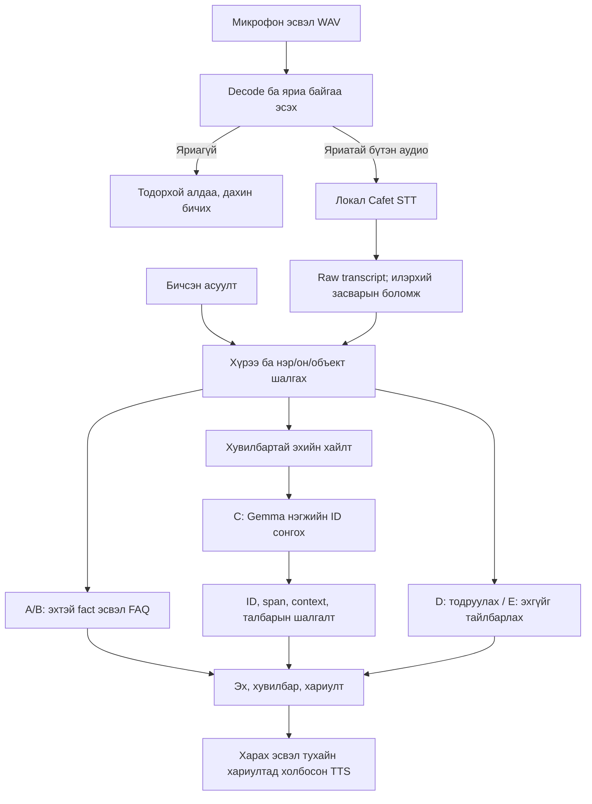

# Сургуулийн эх сурвалжид тулгуурласан Монгол хэлний бичгэн ба дуут мэдээллийн туслах: хэрэгжүүлэлт, тохиргооны харьцуулалт, хөгжүүлэлтийн үнэлгээ

**ДИПЛОМЫН АЖЛЫН ШИНЭЧИЛСЭН НООРОГ — 2026.10.28**

Боловсролын байгууллага: **[сургуулийн баталсан нэр, загвараар нөхнө]**\
Хөтөлбөр, тэнхим: **[нөхнө]**\
Гүйцэтгэсэн: **[оюутны овог, нэр]**\
Оюутны код: **[нөхнө]**\
Удирдагч: **[овог, нэр, зэрэг, цол]**\
Хот, он: **[баталсан нүүрний загвараар нөхнө]**

Энэхүү бичвэр нь 2026.10.28 хүртэлх код, царцаасан өгөгдөл, түүхий туршилт, аргын тэмдэглэлд тулгуурласан хөгжүүлэлтийн ноорог юм. §6.26-д 10.27-ны RAG багц, 10.28-ны нийтлэл ба нийлүүлсэн аудит; §6.27-д тэдгээр алдааны засвар, тусдаа 21 асуултын хосолсон шалгалт орсон. Өмнөх огноотой хэмжилтүүдийг тухайн үеийн нөхцөлөөр нь хадгалсан. Хүний хараат бус answer gold, өргөн хэрэглэгчийн даалгаврын судалгаа, байнгын hosting, model/runtime орсон бүтэн сэргээх ажиллагааг хэмжсэн үр дүн мэт нөхөөгүй. Сургуулийн албан загвар өгөөгүй учраас нүүр, бүлгийн дугаарлалт, эшлэлийн хэлбэрийг дараа нь тааруулна. Энэ нь багшаар хянагдсан эцсийн диплом эсвэл диплом бүрэн дууссан тухай мэдэгдэл биш.

## Хураангуй

Сургуулийн мэдээллийг Монгол хэлээр бичиж эсвэл дуугаар асуухад зөв үг таних, тохирох эх олох, асуултын он ба объектыг ялгах, шаардсан мэдээллийг бүрэн өгөх зэрэг өөр өөр асуудал үүсдэг. Энэ ажлын зорилго нь сургуулийн албан эхийн хязгаарласан сан дээр шууд хариулт, эхийн хэсгийн загвартай сонголт, тодруулга, татгалзлыг нэгтгэсэн бичгэн ба дуут туслах хэрэгжүүлж, алдааг үе шат бүрээр ялган шинжлэхэд оршино.

Систем нь URL, татсан огноо, хувилбар, SHA256, текстийн байрлалтай SQLite сан; 196 хайлтын хэсэг (145 HTML + 21 баримт + 30 client-tab); 40 fact, 30 FAQ; BM25/E5/RRF хайлт; A/B/C/D/E чиглүүлэлт; локал Cafet/Whisper-small; онлайн Батаа, Есүй TTS-ийг холбосон. Мэдлэгийн навигац 8 хүрээ, 33 сэдэвтэй; хайлтын эрэмбийг өөрчилдөг GraphRAG биш. C замд локал Gemma эхийн нэгжийн ID сонгож, сервер эхийн үгийг сэргээдэг. Иймээс эхийн membership ба асуултад утгаараа зөв, бүрэн хариулсан эсэхийг тусад нь шалгана.

Нэг хэлэгчийн баталгаажсан 13 хөгжүүлэлтийн бичлэгт суурь STT-ийн WER 36.02% буюу 67/186 үгийн, CER 16.90% буюу 184/1089 тэмдэгтийн алдаа хэвээр байна. Decoder, prompt болон өөр бэлэн жингийн түүхэн туршилтууд үндсэн сонголтыг солиогүй. Үүний дараа тус бүр 200 optimizer update-тай хоёр бодит LoRA сургалт хийсэн: эхний нийтийн өгөгдлийн туршилт суурь step0-г сонгосон; хоёр дахь synthetic-domain/replay хувилбар нь synthetic болон нийтийн уншсан ярианд бага ахицтай ч хүний 13 бичлэгт 77/186 буюу WER 41.40% болж муудсан. Аль алиныг нэвтрүүлээгүй; үндсэн систем гуравдагч талын Cafet жинг ашигласан хэвээр (§6.24–6.25). Хуучин 13 нь олон удаа үзсэн нэг хэлэгчийн хөгжүүлэлтийн багц тул шинэ хэлэгчийн ерөнхий чадварыг төлөөлөхгүй.

10.27-ны 42 хөгжүүлэлтийн шалгалтад үндсэн шаардлага хангасан тохиолдол 32-оос 42 болсон. Үүнд эхтэй 32 асуулт, зөв татгалзах 10 хяналт орсон; 42 мэдээлэлтэй хариулт гэж тооцохгүй. Эцсийн AI review-д өөр субъектын илүүдэл 0 боловч их илүүдэлтэй 9, бага илүүдэлтэй 6 үлдсэн. Ижил production context-ийн 20 найруулгад Gemma болон талбар шалгадаг BM25 хоёулаа 20/20 шаардсан мэдээлэл бүрэн; их илүүдэлтэй хариулт 6 ба 2 байв. Gemma-ийн нэмүү ашиг энэ багцаар нотлогдоогүй. Эдгээр нь танил сэдвийн, засварт ашигласан AI хөгжүүлэлтийн хэмжилт; хүний gold эсвэл heldout/general accuracy биш.

TTS нь бэлэн Батаа/Есүй хоолойд өгөх текст, тоо/он/товчлол, URL/identifier-ийн хамгаалалт, хариулттай холболтын инженерийн засвартай; өөрийн TTS жин сургаагүй. Түүхэн нэг хэрэглэгчийн зургаан үнэлгээ ба 10.21-ний нэг хөгжүүлэгчийн жижиг pilot-ийг тус тусын нөхцөлөөр хадгалсан (§6.16). 10.21-ний critical-slot дүн 12/14 → 11/14 байсан; дараах текст/аудионы засвараас шинэ хүний ойлгомжийн өсөлт батлагдаагүй.

10.27-ны локал суит 1513 шалгалт = 1512 PASS + 1 Windows-symlink SKIP; 10.28-ны нийтлэх үеийн нийтийн checkout-ийн 1513 = 1511 PASS + 2 SKIP байв. Нэмэлт SKIP нь хувийн эх байхгүйтэй холбоотой. Бэлэн project venv ашигласан тул шинэ компьютерт цэвэр суулгасан нотолгоо биш. Код GitHub-д нийтлэгдсэн ч хэрэглэгч bulk backup-ийг цуцалсан; шинэ хувийн аудио/DB/runtime/модель багцыг нийтлээгүй.

10.28-нд нийлүүлсэн аудит хоёр буруу, нэг дутуу хариулт тэмдэглэсэн (§6.26). Засварын тусдаа 21 асуултад 8 зөв/6 дутуу/7 алдаа → завсрын 20/0/1 → эцсийн 21/0/0 болсон (§6.27); 14 мэдээлэлтэй хариулт, 7 зөв татгалзалт/боломжийн хязгаарын тайлбар багтсан. Эцсийн 1534 автомат шалгалтаас 1533 PASS, нэг Windows-symlink SKIP. Эдгээр асуулт бүгд ажиглагдсан хөгжүүлэлтийн кейс; өмнөх 42-д нэмээгүй. Хоёр бага илүүдэл, цаашдын хүний үнэлгээ, шинэ бодит асуултын дуу, байнгын hosting, өөр орчинд бүрэн сэргээх болон багшийн эцсийн хяналт үлдсэн.

**Түлхүүр үг:** Монгол хэл, Whisper, эх сурвалжтай хариулт, мэдээллийн хайлт, SQLite, тодруулга, ярианы интерфэйс, хөгжүүлэлтийн үнэлгээ.

## 1. Удиртгал

### 1.1 Судалгааны асуудал

Сургуулийн элсэлт, сургалтын орчин, хамтын ажиллагаа, хураамжийн мэдээлэл нь нэг хуудас эсвэл нэг төрлийн баримтад бүрэн төвлөрдөггүй. Хэрэглэгч нэг өгүүлбэрт хоёр өөр үзүүлэлт асууж болно; мөн «хураамж», «танхим», «энэ он» зэрэг үг нь тодорхой объект, хугацаа шаардана. Систем зөв хуудас олсон ч өөр тэнхимийн тоо, өөр үйл явдлын огноо, жил ба сарын хэмжээг сольж хариулбал мэдээллийн үйлчилгээний зорилго биелэхгүй. Ийм алдааг зөвхөн хэлний загварын чадвар эсвэл STT-ийн алдаагаар тайлбарлах боломжгүй.

Дууны оролт нэмэгдэхэд хэлсэн үг ба асуух гэсэн утгын хооронд нэмэлт тодорхойгүй байдал үүсдэг. Жишээлбэл, программын нэр буруу танигдсан үед систем хамгийн ойролцоо албан нэрээр автоматаар орлуулбал хэрэглэгчийн асуултыг мэдэгдэлгүй өөрчилнө. Яриагүй оролтод ч модель бодит үг мэт текст гаргаж болохыг энэ төслийн локал оношлогоонд ажигласан. Нөгөө талаас ямар ч эргэлзээтэй асуултад татгалздаг систем нь эхэд байгаа мэдээллийг ашиглаж чадахгүй. Иймээс хариулах, тодруулах, татгалзах үйлдлийн зөв байдлыг хамтад нь авч үзнэ.

Асуудлыг нэг нийлмэл accuracy болгон тайлагнахад алдаа хаана үүссэнийг далдалдаг. Зөв transcript-тай боловч буруу эх сонгосон тохиолдол, зөв эхтэй боловч тооны хамрах хүрээг гээсэн хариулт, зөв тексттэй боловч хэрэглэгч ойлгохгүй дуудлагатай TTS нь тус тусдаа засвар шаардана. Энэ ажил оролтоос гаралт хүртэлх нотолгоог холбож, эдгээр ялгааг хадгалсан хөгжүүлэлт ба үнэлгээний арга санал болгож байна.

### 1.2 Зорилго, зорилтууд ба хувь нэмэр

Ерөнхий зорилго нь Шинэ Монгол Технологийн Коллежийн албан сайтаас хадгалсан хязгаарласан эхийн санд тулгуурлан Монгол хэлний бичгэн ба дуут асуултад эхтэй хариулах систем бүтээж, түүний сонголт, хамгаалалт, алдааг давтан шалгаж болох байдлаар үнэлэх юм. Зорилго нь бүх төрлийн асуултад хариулах, шинэ ASR сургах эсвэл хүн оролцохгүйгээр сургуулийн мэдээллийн үнэн зөвийг тогтоохыг агуулахгүй.

Үүний тулд эхийн хувилбар ба бүтэцтэй мэдээллийг холбох; FAQ-д нийцсэн шууд замыг хайлт ба загварын сонголтоос ялгах; дутуу нэр, он, хамрах хүрээнд тодруулга өгөх; аудио, raw transcript, хэрэглэгчийн илэрхий засварыг тусад нь хадгалах; үр дүн бүрийг код, модель, эх ба оролтын хэштэй холбох зорилтуудыг хэрэгжүүлэв. Судалгааны хувь нэмэр нь бэлэн компонентуудын оршин байгаад бус, тэдгээрийг сургуулийн Монгол асуултад хязгаарласан гэрээтэй холбосон шийдэл, ижил нөхцөлтэй харьцуулалт, амжилтгүй тохиргоо болон үлдсэн алдааны ил тод шинжилгээнд байна.

2026.10.16-нд хэрэглэгч багшийн шаардлагын хүрээг «Тохиргоо, системийн сайжруулалт ба харьцуулалт» гэж илэрхий тодруулсан. Иймээс энэ ажилд жин өөрчлөх fine-tuning заавал хийх зорилт нэмээгүй. Энэ хүрээний тодруулгыг дипломыг багш заавал хүлээн авна гэсэн баталгаа болгон тайлбарлахгүй. Үндсэн систем нь бусдын сургасан жингийн inference, тохиргооны харьцуулалт, системийн хамгаалалт, үнэлгээнд суурилна. 2026.10.26-нд хэрэглэгч raw STT-ийг цааш сайжруулахыг шаардсаны дагуу тус бүр 200-update decoder LoRA сургалтын хоёр туршилт хийсэн (§6.24–6.25); аль алийг үндсэн системд нэвтрүүлээгүй. Үүнийг багш fine-tuning заавал шаардсан гэсэн утгаар тайлбарлахгүй. Тодруулгын бүртгэл (локал файл: `runtime/stt-improvement-20261016/official-method-notes.json`).

### 1.3 Судалгааны асуултууд

Хэрэглэгчийн 10.27-ны шийдвэрээр ажлын гурван үр дүн нь I · сургуулийн мэдлэг/эхтэй хариулт, II · Монгол STT/TTS, III · нэгдсэн систем/үнэлгээ/диплом юм. Сонгосон инженерийн дараалал I → II; III-ийн шаардлагатай баталгаажуулалт, бичвэр тухайн хэсэгтэй хамт явна. Энэ нь сургуулийн албан дипломын бүлгийн загварыг орлохгүй.

Доорх RQ дугаарлалтыг [үндсэн төлөвлөгөө](../CORE/WEEKLY-PLAN-2026-2027.mn.md)-тэй ижил болгов. Эцсийн түүврийн хэмжээ, хүний онооны дүрэм, төхөөрөмжийн нөхцөлийг хэмжилтээс өмнө царцаана; одоогийн хөгжүүлэлтийн тоог эцсийн судалгааны хариу гэж өргөтгөхгүй.

| Асуулт | Шалгах зүйл | Одоогийн нотолгооны хүрээ |
|---|---|---|
| RQ1. Монгол дууны алдаа бодит сургуулийн асуултад хэр нөлөөлдөг вэ? | Typed/raw/хэрэглэгч зассан STT; WER/CER, нэр/тоо/он, зөв эх, task success, засах хугацаа | Нэг хэлэгчийн 13 development бичлэг, сөрөг decoder/сургалтын үр дүн; шинэ бодит асуултын pilot ба task хэмжилт үлдсэн |
| RQ2. Hybrid хайлт, бүтэцтэй талбар, Gemma тус бүр юу нэмдэг вэ? | Ижил corpus/context; BM25/E5/RRF; эх олсон эсэх, бүрэн байдал, эхийн дэмжлэг, зөв D/E, хугацаа | Түүхэн retrieval харьцуулалт, 42 dev QA, 20 context-ийн Gemma/BM25; хүний хараат бус шинэ үнэлгээ үлдсэн |
| RQ3. Дуугаар унших бэлтгэл болон хоолойн сонголт мэдээллийг зөв ойлгуулах уу? | Ижил хариултын өмнөх/дараах spoken text, Батаа/Есүй; сонссон нэр/тоо/он, ойлгомж, давталт | Түүхэн жижиг хүний pilot ба provider/decode шалгалт бий; шинэ хүний ойлгомжийн өсөлт нотлогдоогүй |
| RQ4. Агуулга шинэчлэгдсэн, өөр төхөөрөмжтэй үед систем найдвартай ажиллах уу? | Publish/rollback, cold/warm, laptop/phone, шинэ суулгалт; stale answer, timeout, p50/p95, сэргээх | Versioned admin, түр HTTPS/утасны суурь нотолгоо бий; байнгын hosting, өргөн төхөөрөмжийн болон өөр орчны сэргээх шалгалт үлдсэн |

### 1.4 Хамрах хүрээ ба хугацаа

Систем нь хадгалсан албан эхийн хүрээнд ажиллах прототип. Нэвтрэх эрхтэй мэдээлэл, бүх веб таб, бүх зураг/PDF-ийн бүрэн OCR, бодит цагийн бүртгэл, олон хэл, утасны дуудлага, автоном агент, ерөнхий олон ээлжийн LLM санах ой нь энэ хэмжсэн хувилбарын хамрах хүрээ биш. Дууны текстийг локал таньдаг боловч сонгосон хариултын TTS нь онлайн үйлчилгээ тул бүтэн системийг бүхэлдээ offline гэж нэрлэхгүй.

2026.10.07-ны анхны замын зураг түүхэн эхээрээ хадгалагдсан. Хэрэглэгч2026.10.26-нд11-р сарын10-ны demo/нооргийн зорилгыг цуцалж, өнөөдрөөс2027оны5-р сар хүртэл долоо хоног бүр хийх ажлын шинэ дараалал хүссэн. [Шинэ төлөвлөгөө](../CORE/WEEKLY-PLAN-2026-2027.mn.md) нь өгөгдөл, арга, бодит үнэлгээ, хүргэлт, бичвэрийг холбосон.2027.05.31 нь төлөвлөлтийн хязгаар, сургуулийн баталсан хамгаалалтын өдөр биш. Энэ бичвэр бэлтгэгдсэн нь хүний судалгаа болон хамгаалалтын шалгуур биелсэн гэсэн үг биш. [Анхны замын зураг](../ROADMAP-FINAL-2026-10-07.mn.md), [одоогийн явц](../CORE/ROADMAP-PROGRESS.mn.md).

## 2. Холбогдох судалгаа ба аргын үндэслэл

### 2.1 Монгол яриа таних ба бэлэн загвар ашиглах

Whisper нь олон хэл, олон даалгаврын weak supervision ашигласан ярианы загварын суурь ажил юм. Radford нарын өгүүлэлд benchmark-ийн сургалтын хосоор нэмэлт fine-tuning хийхгүйгээр үнэлэх нөхцөлийг авч үзсэн. Ийм нөхцөлд сайн ажилласан нь шинэ хэл, төхөөрөмж, домэйн бүрд ижил чанар өгөх баталгаа болохгүй. Манай систем Монгол хэлд тохируулан сургагдсан гуравдагч талын Cafet checkpoint ашиглаж байгаа тул анхны Whisper-ийн zero-shot үр дүнг өөрийн шууд хэмжилт мэт тайлагнахгүй. [Whisper эх өгүүлэл](https://arxiv.org/abs/2212.04356).

Халх Монгол ASR-ийн transliteration-aided transfer learning судалгаа нь нөөц багатай хэлд бичгийн дүрслэл ба дамжуулан сургалтыг тусдаа аргын сонголт болгон авч үздэг. Энэ нь Монгол хэлний бэлэн checkpoint сонгож хэмжихийн хэрэгцээг дэмжих судалгааны суурь боловч манайд уг сургалтын арга хэрэгжсэн гэсэн үг биш. wav2vec 2.0, XLS-R, MMS нь өөр төрлийн speech representation болон олон хэлний сургалтын чиглэлүүдийг төлөөлнө. Эдгээрийг боломжит аргын орон зайг ойлгоход ашигласан; шинэ жин татаж, эдгээрийн бүх аргыг харьцуулсан туршилт хийгээгүй. [Халх ASR](https://doi.org/10.3390/electronics14061137), [wav2vec 2.0](https://arxiv.org/abs/2006.11477), [XLS-R](https://arxiv.org/abs/2111.09296), [MMS](https://arxiv.org/abs/2305.13516).

FLEURS ба Common Voice зэрэг эхүүд нь ярианы өгөгдөл, хэл, баталгаажуулалт, benchmark-ийн нөхцөлийг тодорхойлоход тустай. Уншсан өгүүлбэрийн тестийг ресепшний аяндаа ярьсан, дуу чимээтэй нөхцөлтэй адилтгаж болохгүй. Манай pilot-д хэрэглэгч харагдсан асуултад хариулж ярьсан тул reference нь төлөвлөсөн асуултын бичвэр биш, бодитоор хэлсэн хариулт байх ёстой. Энэ ялгаа нь эхний үнэлгээний өгөгдлийг засах гол шалтгаан болсон. [FLEURS](https://arxiv.org/abs/2205.12446), [Common Voice](https://aclanthology.org/2020.lrec-1.520/).

### 2.2 Үгэн ба embedding хайлт

BM25 нь асуулт ба баримтын үгийн давтамж, ховор байдал, уртыг ашигласан тайлбарлаж болох суурь арга. Нэг үг олон давтагдах тусам оноо хязгааргүй шугаман нэмэгдэхгүй, баримтын урт мөн нөлөөлдөг. Монгол залгавар, товчлол, латин нэрийн ялгаа нь яг үгийн тааралтыг хүндрүүлдэг тул манай хэрэгжилт ил тод alias болон үгийн хувилбарын дүрэм нэмсэн. Үүнийг сурсан Монгол морфологийн бүрэн шинжээч гэж нэрлэхгүй. [Robertson, Zaragoza](https://www.staff.city.ac.uk/~sbrp622/papers/foundations_bm25_review.pdf).

Sentence-BERT нь өгүүлбэрийг vector болгон харьцуулах, DPR нь асуулт ба хэсгийг encoder-оор дүрслэн олох чиглэлийн суурь жишээнүүд юм. Multilingual E5-ийн бэлэн small хувилбарыг манай хөгжүүлэлтэд ашиглаж, `query: ` болон `passage: ` prefix, mask-aware mean pooling, L2 normalization-ийг хадгалсан. Энэ нь embedding-ийн оролтын жорыг баримталсан хэрэг болохоос Монгол сургуулийн асуултын чанарыг урьдчилан баталсан нөхцөл биш. [Sentence-BERT](https://aclanthology.org/D19-1410/), [DPR](https://aclanthology.org/2020.emnlp-main.550/), [E5](https://arxiv.org/abs/2402.05672).

BEIR нь домайн хоорондын retrieval харьцуулалт, MIRACL нь query–source relevance тэмдэглэгээтэй олон хэлний үнэлгээний жишээ болно. Эдгээрийн үндсэн сургамжийг манайд ижил corpus, ижил асуулт, ижил relevance дүрэмтэй baseline харьцуулахад ашиглав. BGE-M3 нь нэмэлт embedding чиглэл боловч одоогийн туршсан бүрэлдэхүүн биш. Dense загвар заавал BM25-ийг давна гэж үзээгүй нь манай хоёр өөр хэмжээтэй corpus-ийн дүнгээр чухал болох нь харагдсан. [BEIR](https://arxiv.org/abs/2104.08663), [MIRACL](https://aclanthology.org/2023.tacl-1.63/), [BGE-M3](https://arxiv.org/abs/2402.03216).

Хоёр эрэмбийг Reciprocal Rank Fusion буюу RRF-ээр нэгтгэвэл онооны хэмжээг probability болгон хүчээр тааруулах шаардлагагүй. RRF нь баримтын rank бүрд `1/(k+rank)` жин өгч нийлбэрлэдэг. Эх өгүүллийн туршилт `k=60` ашигласан бол манай царцаасан ablation `k=30`-тай байсан. Иймээс манай хэрэгжилтийг эх өгүүллийн туршилтыг бүхэлд нь давтсан гэж тайлбарлахгүй. [RRF эх өгүүлэл](https://cormack.uwaterloo.ca/cormacksigir09-rrf.pdf).

### 2.3 RAG ба эхийн хэсгийн хязгаарласан сонголт

Энэ ажлын хэрэгжилтийг нарийвчлан **хосолсон хайлт, LLM-ийн эх сонголтод тулгуурласан extractive асуулт–хариултын систем** гэж нэрлэнэ. SQLite нь мэдлэгийн эхийг хувилбартай хадгалж, BM25 ба multilingual E5 хайлтын эрэмбийг RRF нэгтгэнэ. Gemma нь C замд хайлтаар олдсон эхийн нэгжийн ID сонгоно; хэрэглэгчид үзүүлэх өгүүлбэрийг сервер эхээс үгчлэн сэргээнэ. Иймээс RAG-ийн эх хайж ашиглах зарчимд тулгуурласан боловч чөлөөт хариултын текст үүсгэдэг генератив архитектур гэж тайлагнахгүй. Шууд fact/FAQ ба багшийн бүтэцтэй картын зам LLM дуудахгүй. Олон LLM дуудлага нь чанарын ашиг гэсэн үг биш; LLM-гүй сонголттой харьцуулсан үр дүн ба хязгаарыг §6.14, §6.16–6.18-д хадгалсан.

Lewis нарын RAG нь параметрт мэдлэг ба гадаад баримтын хайлтыг нэгтгэсэн аргын суурь бүтээл. Тэдний өгүүлэлд retriever, generator-ийн сургалт ба үнэлгээ ордог учраас RAG гэсэн нэрийг «ямар ч сургалтгүй арга» гэж ерөнхийлөхгүй. Манай системд бэлэн retriever болон локал хэлний загварыг inference-д ашиглаж, сургуулийн шинэ мэдээллийг жинд бус, хувилбартай эхийн санд оруулна. [RAG эх өгүүлэл](https://arxiv.org/abs/2005.11401).

Одоогийн C зам нь чөлөөтэй найруулсан генератив тайлбарын өмнөхөөс нарийссан. Gemma эхийн нэгжийн ID-уудыг сонгоно; сервер зөвшөөрөгдсөн ID-г эхийн яг тексттэй холбож харуулна. Энэ нь бүтэцтэй сонголтын загвартай retrieval-assisted хариулт бөгөөд эх өгүүллийн RAG-Sequence/RAG-Token сургалтын архитектурыг хэрэгжүүлсэн хэрэг биш. Моделийн сонголт алдаж болох учраас эх үгчлэн таарсан эсэх, сонгосон хэсэг асуултад хамаатай эсэх, шаардсан бүх мэдээлэл байгаа эсэхийг тусад нь хэмжинэ.

Lost in the Middle нь холбогдох мэдээллийн байрлал ба context урттай холбоотой эмзэг байдлыг судалдаг. Үүнээс манай Gemma-ийн тодорхой алдааны шалтгааныг шууд батлахгүй. Харин илүү урт prompt өгөхөөс өмнө эх top-k-д орсон эсэх, тоо ба объект зөв зааглагдсан эсэх, чухал мөр дарагдсан эсэхийг шалгах инженерийн үндэслэл болгон ашигласан. [Lost in the Middle](https://aclanthology.org/2024.tacl-1.9/).

### 2.4 Хариулт, эшлэл, татгалзлын үнэлгээ

ALCE нь хариултын чанар ба эшлэлийн дэмжлэгийг ялган үнэлдэг. Хариултын бүх мэдэгдлийг эшилсэн эхүүд дэмжсэн эсэх болон хавсаргасан эх бүр хэрэгтэй эсэх нь өөр асуултууд юм. Манай эхийн хэсгийг шууд харуулдаг арга нь эхтэй яг таарах хэмжилтэд сайн байж болох ч буруу хэсгийг уртаар хуулсан хариулт хэрэглэгчийн асуултыг бүрэн шийдэхгүй. Иймээс ALCE-ийн хэмжүүрийг бүтнээр давтахын оронд уг ялгааг claim support, relevance, required-fact completeness гэсэн rubric-д хэрэглэв. [ALCE](https://aclanthology.org/2023.emnlp-main.398/).

RAGAs ба ARES нь context relevance, answer faithfulness, answer relevance зэрэг хэмжээсийг салгадаг автомат үнэлгээний жишээнүүд. ARES-ийн confidence interval тооцоолол нь хүний тэмдэглэгээтэй хосолдог; манай засварт оролцсон AI-ийн rubric оноог тийм статистикийн баталгаа гэж үзэхгүй. Монгол асуулт дээр хүний шүүлттэй нягтлаагүй judge-ийн оноо эцсийн gold биш. Энд эдгээр framework-ийн judge training, PPI эсвэл benchmark-ийг хэрэгжүүлээгүй. [RAGAs](https://aclanthology.org/2024.eacl-demo.16/), [ARES](https://aclanthology.org/2024.naacl-long.20/).

SQuAD-ийн answerable ба unanswerable асуултыг хамтатган үнэлэх санаа нь эхгүй үед төстэй текстээр таахгүй байхтай холбоотой. SelectiveNet нь хариулсан хамрах хувь ба тухайн доторх алдааны хамаарлыг авч үзэх тусдаа аргын эх болно. Манайд эдгээрийн сурсан classifier хэрэгжээгүй; харин буруу татгалзалт ба үндэслэлгүй хариултыг хамтад нь бүртгэх зарчим хэрэглэнэ. [SQuAD unanswerable](https://aclanthology.org/P18-2124/), [SelectiveNet](https://proceedings.mlr.press/v97/geifman19a.html).

### 2.5 TTS ба хүн–системийн харилцаа

VITS ба FastSpeech 2 нь текстээс яриа үүсгэх сургалтын архитектурын судалгаанууд. Манай хэрэглэсэн онлайн Монгол хоолойн дотоод архитектурыг эдгээр өгүүллээр тогтоогоогүй. MOSNet нь субъектив MOS-ийг таамаглах объектив арга боловч Монгол TTS-ийн хүний ойлгомжтой байдлыг автоматаар батлахгүй. Энэ ажлын synthesis/decode амжилт нь файл үүсэж уншигдсаныг л тогтооно; байгалийн дуудлага, нэр ба тооны ойлгомж, хүний MOS үнэлгээний оронд хэрэглэхгүй. [VITS](https://arxiv.org/abs/2106.06103), [FastSpeech 2](https://arxiv.org/abs/2006.04558), [MOSNet](https://www.isca-archive.org/interspeech_2019/lo19_interspeech.html).

Human-AI Interaction удирдамжийн чадвар ба алдааг илэрхийлэх, засварлах боломж өгөх зарчмыг raw transcript харах, хэрэглэгч өөрчлөлтөө илэрхий хэрэглэх, session reset хийх шийдэлд холбосон. Luger, Sellen нарын conversational agent-ийн хүлээлт ба бодит туршлагын зөрүүний асуудал нь чат харагдацтай болсон системийг ерөнхий ярианы туслах мэт ойлгуулахгүй байх шаардлагыг сануулна. Эдгээр эх нь өөрийн хэрэглэгчийн судалгааны оронд бус, түүнийг төлөвлөх үндэслэл болно. [Human-AI Interaction](https://www.microsoft.com/en-us/research/publication/guidelines-for-human-ai-interaction/), [Luger, Sellen](https://www.microsoft.com/en-us/research/wp-content/uploads/2016/08/p5286-luger.pdf).

Судалгааны бүртгэлд 20 гол, 6 нэмэлт өгүүлэл бий. Тэдгээрийн нэг хэсгийн арга, заримын metadata/abstract-ийг нягталсан; бүх 26-г бүтнээр уншсан гэсэн мэдэгдэл хийхгүй. Энэ бүлгийн нарийвчилсан хэрэглээг [уншлагын бүртгэл](../reports/research/RESEARCH-26-PAPERS.mn.md), [аргын тэмдэглэл](06-evaluation-interface-method-notes.mn.md)-тэй холбож хадгалсан.

### 2.6 2026.10.20-ны нэмэлт уншлага ба аргын сонголт

Анхны26 дээр түүнд ороогүй30 бүтээлийг нэмж,56 өөр өгүүллийн үндсэн текстийн уншлага,
арга/өгөгдөл/үнэлгээ/хязгаар/төслийн шийдвэрийг нэг бүрээр бүртгэв. Preprint ба published version,
FreshQA ба FreshLLMs-ийг давхар paper гэж тоолоогүй. Зарим нэмэлт эх өмнөх STT оношлогоонд
тааралдсан; тэдгээрийг шинэ нээлт гэж тайлагнахгүй. Бүх хавсралт, зургийн render, томьёоны
бие даасан баталгаа, туршилтын давталт болон оюутны өөрийн уншлагын баталгаа энэ хүрээнд орохгүй.
56 тусдаа тэмдэглэл ба анхдагч эхийн холбоос (локал файл: `papers/research-review-20261020/README.mn.md`).

SpecAugment, speed augmentation, Distil-Whisper нь сургалтын өгөгдөл ба жинтэй холбоотой.
Бэлэн жинтэй оролтын хурдыг өөрчилсөн манай туршилт тэдгээрийн augmentation сургалтыг давтсан
хэрэг биш. CB-Whisper-ийн KWS болон contextual pointer арга нэмэлт сурсан бүрэлдэхүүнтэй;
Whisper-ийг fine-tune хийгээгүй гэсэн тайлбар бүх pipeline сургалтгүй гэсэн утгагүй.
N-best-ийн зөв үг бүх боломжит гаралтад байхгүй бол reranking дангаараа түүнийг сэргээх баталгаа
болохгүй. Иймээс шинэ жин/сургалт эхлүүлэхийн оронд raw танилт, хэрэглэгчийн илэрхий засвар,
эцсийн task outcome-ийг тусдаа хэмжихээр сонгов. STT бүлгийн бүтээлүүд (локал файл: `papers/research-review-20261020/README.mn.md`).

Self-RAG, CRAG, Adaptive-RAG нь critic/router/reflection training эсвэл нэмэлт retrieval/web
ажиллагаатай тодорхой аргууд. Prompt-д дахин бод гэж нэмэх нь тэдгээрийг хэрэгжүүлсэн гэсэн
үг биш. REALM-ийн training-time stale index нь encoder өөрчлөгдөх асуудал; манай frozen E5
индексэд түүний сургалтын scheduler-ийг шууд хуулбарлахгүй. Atlas-ийн temporal index swap,
FreshLLMs-ийн огноотой нотолгоо нь шинэ мэдлэгийн эх/хугацаа ба хэрэглэгчийн асуусан оныг
ялгах үндэслэл болдог. Манай engineering сонголт нь хувилбартай staging/publish/rollback;
гадаад paper-ийн score-г Монгол системийн gain гэж тооцоогүй.

Text-normalization судалгаанд нийт token accuracy өндөр байсан ч тоо/хэмжих нэгжийн утгыг
өөрчлөх ховор алдаа үлддэг. Иймээс дэлгэцийн эхийг хэвээр хадгалж, зөвшөөрсөн тодорхой span-д
spoken хэлбэр бэлтгэх нь unconstrained LLM rewrite-ээс шалгаж болох contract өгнө. SOMOS/MOSNet-ийн
өөр distribution дээрх ялгаа нь автомат naturalness predictor-ийг Монгол хүний сонсголын оронд
хэрэглэхэд болгоомжтой хандах үндэслэл. Шинэ үнэлгээнд сонсогч нэр/он/дүн/утсыг юу гэж ойлгосныг
шууд тэмдэглэж, дуудлага ба хэвийн ярианы үнэлгээг тусад нь авна.

Data Cascades болон spoken-dialogue recovery судалгаа нь downstream model-ийг солихоос өмнө
өгөгдлийн гарал, өөрчлөлт, домэйны шалгалт, алдаанаас гарах үйлдлийг тодорхойлох ач холбогдлыг
тайлбарладаг. Тодорхой SQLite publish архитектур эсвэл манай quality gain-ийг тэдгээр paper
нотолсон гэж үзэхгүй. Хүргэлтийн engineering шийдвэр (локал файл: `CORE/DELIVERY-PLAN-2026-11-10.mn.md`).

## 3. Системийн шаардлага ба архитектур

### 3.1 Үндсэн урсгал

Хэрэглэгчийн бичсэн асуулт шууд чиглүүлэлтэд орно. Дууны оролтыг зөвшөөрөгдсөн формат, хэмжээ, хугацаагаар шалгаж, локал waveform болгон decode хийнэ. Бүх sample тэг эсвэл яриа илрээгүй бол transcript зохиохгүйгээр оролтыг буцаана. Яриа байгаа тохиолдолд бүтэн waveform-ийг тогтсон STT decoder-т дамжуулж, гарсан raw текстийг хэрэглэгчид харуулна. Raw текст болон хэрэглэгчийн илэрхий зассан текстийг ялгаж, дараагийн хүсэлтийн яг аль текстээр хайсныг хадгална.



Энэ зураг нь логик урсгал; үе шат бүр өөр модель сургадаг гэсэн утгагүй. Веб интерфэйс нь браузерт, Whisper/Gemma/хайлт нь компьютерт ажиллана. Одоогийн HTTP серверийг FastAPI хэрэгжилт гэж нэрлэхгүй. Стандарт HTTPS-ийг зөвшөөрсөн хоёр цагийн турш тусдаа loopback backend ба кодтой gateway-аар Cloudflare Quick Tunnel-д холбож туршсан; утсанд өөрийн сертификат суулгах шаардлагагүй. Энэ нь байнгын hosting эсвэл таблет дээр модель өөрөө ажиллаж буй шийдэл биш. Текст ба эхийн атлас нь дууны үйлчилгээ доголдсон үед ч мэдээлэл шалгах суурь болно.

### 3.2 A/B/C/D/E хариултын зам

| Зам | Одоогийн үүрэг | Гол нөхцөл |
|---|---|---|
| A | Fact-д холбогдсон хадгалсан хариулт эсвэл яг тодорхой эхийн шууд хэсэг | Объект, хүрээ, эхийн холбоо хангалттай; шинэ мэдээлэл зохиохгүй |
| B | Бэлэн FAQ-ийн эхтэй хариулт | Canonical асуулт эсвэл ил тод alias таарсан, package ба агуулгын хамгаалалт давсан |
| C | Олдсон эхийн нэгжүүдээс загвар сонгох, сервер үгчлэн сэргээх | Идэвхтэй эхийн зөв ID, зөв span/context, хязгаарласан schema ба уртын шалгалт |
| D | Утга, объект, он, танигдаагүй нэрийг тодруулах | Тодруулга нь хэрэглэгчийн нөхцөлийг мэдэгдэлгүй хасахгүй |
| E | Хамрагдсан эхэд мэдээлэл батлагдаагүй эсвэл үйлчилгээний тодорхой алдаа | Өөр оны эсвэл өөр объектын мэдээллийг орлуулахгүй; шалтгааныг тайлбарлана |

Эдгээр нь хэрэгжүүлэлтийн замын тодорхойлолт бөгөөд хүний баталсан universal gold label биш. A/B-д хэлний загвар хэрэггүй; C-г хэрэгтэй харагдуулахын тулд бодит бус асуулт зохиож нэмээгүй. Анхны fact/FAQ router-ийн C-г хаасан суурийг `ChatRAG` өргөтгөдөг тул нэг дэд модулийн «C disabled» тайлбарыг бүтэн системийн одоогийн төлөвтэй андуурахгүй. [Чиглүүлэгч](../question_router.py), [нэгтгэсэн урсгал](../rag_runtime.py).

### 3.3 Эхийн нэгжийн сонголтын гэрээ

Хайлтаас ирсэн эхүүдийг ID, source ID, эхлэх/дуусах offset, текст, шаардлагатай context ID-тай нэгжид хуваана. Gemma-ийн гаралт нь эдгээрээс зөвшөөрөгдсөн сонголт байх ёстой. Сервер үл мэдэгдэх, идэвхгүй, давхардсан эсвэл зөвшөөрсөн сангаас гадуурх ID, эвдэрсэн schema, зөрүүтэй span, буруу оны хүрээ, хэт урт хариултыг буцаана. Эхийн текстийг загварын бичсэн эшлэлээр орлуулахгүй.

Асуусан ил тод талбар орхигдсоныг илрүүлэх bounded screen нь зорилго, давтамж, суудал ба талбай, хугацааны хос, номын тоо ба программ эхэлсэн он зэрэг шаардлагад хэрэглэгддэг. Эхний сонголт дутуу бол хамгийн ихдээ нэг бүтэн replacement сонголт хийж, бүх эх/ID/context хамгаалалтыг дахин ажиллуулна. Нэг хүсэлтэд хамгийн ихдээ хоёр model POST, generation шатанд нийт 100 секундийн budget тавьсан. Энэ нь HTTP-ийн нийт хугацаа 100 секундээс бага гэсэн баталгаа биш: хайлт, queue болон бусад шат тусдаа хугацаатай.

Эдгээр шалгалт нь текст ба бүтцийн сахилга бат тогтооно. Гэвч асуултын утгыг бүрэн ойлгосон, бүх шаардлагыг семантикаар нотолсон гэсэн ерөнхий entailment баталгаа биш. Багшийн тоог зөв тэнхимтэй холбох, мэдээний он ба тэтгэлгийн эхлэх оныг ялгах, төлөвлөсөн үйлдлийг дууссан мэт болгохгүй байх нь exact span-аас цааш утгын шүүлт шаарддаг. [Сонголтын гэрээ](../evidence_contract.py), [хариултын хамгаалалт](../answer_contract.py), [эхийн талбар](../source_fields.py).

### 3.4 Тодруулга, засвар ба дууны хариу

Ерөнхий чатны түүх харагддаг боловч LLM-д бүх түүхийг сануулах механизм гэж үзэхгүй. D-ийн богино хариуг үргэлжлүүлэх тусдаа санах ой нь RAM-д хадгалах, 300 секунд хүчинтэй, 64 хүртэл entry, нэг удаагийн capability-тай. Тухайн тодруулга нь package/corpus болон өмнөх асуулттай холбоотой. Хугацаа дууссан, дахин ашигласан, өөр package-ийн token-ийг хүлээн авахгүй. Танихгүй богино хариуг өмнөх асуултын утгаар хүчээр нөхөхгүй. [Тодруулгын модуль](../clarification_context.py).

STT-ийн танигдаагүй нэрийг албан нэрээр автоматаар засахгүй. Нөхцөлүүдийг хадгалсан бүтэн асуулт санал болгож болох ч хэрэглэгчийн илэрхий сонголт шаардана. Ингэснээр raw-STT ба edited-STT ялгаа судалгаанд үлдэнэ. Онлайн TTS нь серверийн тодорхой response ID-д холбогдож, тэр хариултын ярих текстийг ашиглана; өөр хариултын ID/текстийн холбоосыг хүлээн авахгүй. Энэ нь сүлжээний үйлчилгээний тасалдлыг арилгахгүй боловч хэрэглэгчид харагдсан ба сонссон мэдээлэл зөрөх эрсдэлийг бууруулах хамгаалалт юм.

Микрофоны интерфэйс нь бичлэгийн live RMS ба clipping дохио, боломжтой төхөөрөмжид echo/noise/gain хүсэлт өгдөг. Эдгээр нь бичлэгийн нөхцөлийн туслах үзүүлэлт; ASR зөв эсэхийн calibrated confidence биш. Сервер raw текстийг өөрчлөхгүйгээр дуу сул, хэт чанга, decoder-ийн heuristic эргэлзээний мэдэгдэл өгнө. Нэмэлт LLM text-correction туршилт нь raw ASR-ээс тусдаа бөгөөд муудсан тул идэвхжээгүй.

TTS-д яг ижил normalized text+voice-г5 минут,6 entry,8MiB-ийн хязгаарт RAM-д дахин ашиглана. Дахин хүсэлт бүр тусдаа устгаж болох audio ID авдаг; provider miss ба cache hit-ийг ялган бүртгэнэ. Тоон мөнгөн дүнгийн хязгаарласан үгчилсэн хэлбэр, QR-ийн дуудлагын засвар, серверийн retrieval caption-ийг дуунаас хасах боловсруулалт нь дэлгэцийн эх/тоо/он/үндсэн агуулгыг дарж өөрчлөхгүй. `answer_llm_calls` нь хариултын Gemma сонголт, TTS алхмын `llm_calls=0` нь өөр үйлдэл гэдгийг metadata-д тусад нь өгнө. [Дууны runtime](../voice_runtime.py), [ярих текстийн боловсруулалт](../speech_text.py).

## 4. Өгөгдөл, хувилбар ба ашиглах бодлого

### 4.1 Веб эхийн сангийн хамрах хүрээ

Албан `nmct.edu.mn` сайтаас хадгалсан эхийн сан нь нэг мөчийн бүхэл вебийн хуулбар биш. Эхний цуглуулгын дараа чанар, түүх, сургалтын орчны хуудсууд нэмэгдэж, тэнхимийн зарим хуудас дахин татагдсан. Одоогийн идэвхтэй багцын тоог хуучин capture болон package-ийн нийт SQL мөртэй нийлүүлж тоолоогүй. Эхийг шинэчлэхэд өмнөх хувилбарыг дарж бичихгүй, шинэ capture/run холбоотой хадгална.

| Түвшин | Идэвхтэй хэмжсэн хүрээ | Тайлбар |
|---|---:|---|
| HTML хуудас | 75 | Хуучин capture-ийн нийт version тоо биш |
| Түүхий HTML chunk | 164 | Хайлтын passage-ийн тоотой адил биш |
| Баримтын asset | 5 | Нэг PDF, дөрвөн PNG |
| Хайлтанд орох хэсэг | 201 | 150 HTML + 21 баримтын хэсэг + 30 нэмэлт client-tab хэсэг |
| Бүтэцтэй source record | 14 | 11 өөр URL-ийн хувилбартай бүртгэл |
| Fact / FAQ | 40 / 30 | Сонгож бүтэцжүүлсэн багц; бүх corpus биш |

Баримтын 21 хэсэг нь хадгалсан PDF/зурагтай туслахын харьцуулсан сонгомол буулгалт юм. Бүтэн OCR эсвэл хүний gold transcription гэж нэрлэхгүй. Нэмэлт client-side табуудаас 30 хэсэг сонгож, placeholder болон огноо тодорхойгүй зарим статистикийг оруулаагүй. Үндсэн HTML ба нэмэлт табын татсан огноог тусад нь хадгалсан. Нэг шинэ capture-ийн огноогоор хуучин бүх хуудасны агуулгыг шинэчилсэн мэт тэмдэглээгүй. [Эхийн сангийн тайлбар](../CORE/WEBSITE-DATA.mn.md), 201 хэсгийн frozen snapshot (локал файл: `runtime/week04-coverage-20261015/indexed-passages.json`).

### 4.2 SQLite ба эхийн гарал

`website.db` нь хуудас, capture, chunk, crawl run, asset, холбоосын бүртгэл болон нэмэлт extraction-ийн түүхийг хадгалдаг. `content.db` нь эхийн хувилбар, fact, FAQ, citation, тэдгээрийн холбоог хадгалдаг. Fact нь текстийг дур мэдэн тасалсан мөр бус, эхийн заалт, утга, нэгж, хүрээ болон боломжтой хугацаатай холбоотой бүтэцтэй мэдээлэл. FAQ нь source/fact dependency-гаа хадгалдаг тул бэлэн хариултын гарал үүсэл буцаан олдоно.

Импортын өмнөх backup, version-той импорт, давтан импортын давхардалгүй байдал, foreign-key болон эхийн locator/hash шалгалтыг хэрэгжүүлсэн. Энэ нь агуулгын утга зөвийг өөрөө нотлохгүй. Харин хариулт ямар багц, ямар capture, ямар текстээс үүссэнийг тогтоох техникийн нөхцөл бүрдүүлнэ. Шинэ эхийн агуулга хуучин эхтэй зөрвөл хадгалсан хувилбар ба хамрах хугацаагаар нь тайлбарлах шаардлагатай. [Схем](../schemas/content.schema.json), [агуулгын сан](../content_store.py), [веб импорт](../CORE/website_corpus.py).

### 4.3 Албан эхийг ашиглах ба одоогийн үнэн зөв

Хэрэглэгч 2026.10.10-нд албан сайтад нийтлэгдсэн мэдээллийг төслийн хэрэглээнд ашиглахыг зөвшөөрсөн. Энэ шийдвэр normal API горимын policy-д хэрэгжсэн боловч DB дэх `draft` metadata-г сургуулийн ажилтан баталсан мэт `approved` болгож өөрчлөөгүй. Хэрэглэгчийн project acceptance, албан сайтад нийтлэгдсэн байдал, тухайн мэдээлэл өнөөдөр хүчинтэй эсэх, сургуулийн мэргэжилтний шалгалт нь дөрвөн өөр ойлголт юм. [Эх ашиглах бодлого](../project_policy.py).

Татсан огноо нь эхийн нийтэлсэн огноо биш. Эхэд хүчинтэй хугацаа байхгүй бол `valid_from/valid_until`-д зохиомол утга өгөхгүй. Өмнөх элсэлтийн мэдээг өнөөдөр бүртгэл нээлттэй гэсэн хариулт болгохгүй; асуусан оны эх байхгүй бол өөр оны мэдээлэл орлуулахгүй. Эхүүд өөр хоорондоо зөрсөн үед нэгийг нь чимээгүй сонгон «баталгаатай» болгохгүй. Энэ ажлын хариулах боломжийн үнэлгээ нь тухайн frozen эхийн багцад хамаарна; мэдээлэл сургуульд эсвэл бүтэн интернетэд огт байхгүйг батлахгүй.

### 4.4 STT ба асуултын үнэлгээний өгөгдөл

Анхны 20 WAV хадгалагдсан. Үүнээс q05-ыг хэрэглэгч хассан; q10, q13, q16, q17, q19, q20-ийн бүтэн reference баталгаажаагүй тул оноонд оруулаагүй. Одоогийн 13 reference нь хэлэгчийн баталгаатай боловч нэг хэсэгт ASR draft харж баталсан учраас confirmation bias-ийн эрсдэлтэй. Төлөвлөсөн асуулт ба хэлсэн хариулт өөр байсан эхний асуудлыг засаж, хуучин буруу reference-тэй оноог өнөөгийн чанарын нотолгоо болгоогүй. Одоогийн STT тайлан (локал файл: `reports/stt/STT-EVALUATION-2026-10-10.mn.md`).

Хариултын багцуудыг огноо ба гарал үүслээр ялгана. 10/15-ны анхны24 ба дараах16,10/16-нд бэлтгэсэн24,10/17-нд эхийг л харсан тусдаа AI-ийн бэлтгэсэн24 нь хоорондоо өөр багц юм. Reference, required facts, хориотой мэдэгдэл, эх, rubric-ийг тус бүрийн анхны гаралтаас өмнө царцаасан. Сүүлийн багцыг зохиосон AI нь production код ба хуучин хариултыг уншаагүй; энэ нь implementation-ээс тусгаарласан AI-ийн анхны шалгалт болохоос хүний gold биш.

Бүх багцын гаралтыг одоо үзэж, зарим алдаагаар код зассан тул тэдгээрийг observed development гэж үзнэ. «Анх гаралтаас өмнө царцаасан» нь «өнөөдөр ч хараагүй heldout» гэсэн үг биш. Анхны17/7 зэрэг үр дүнг дараах24 core pass-тай сольж бичихгүй; эцсийн хүний багцыг тусдаа бэлтгэх шаардлагатай. 10/16-ны шинэ24-ийн freeze (локал файл: `runtime/completion-20261016/evaluation/freeze-manifest.json`), 10/17-ны шинэ24-ийн freeze (локал файл: `runtime/core-finalization-20261017/independent-evaluation/preoutput-manifest.frozen.json`).

### 4.5 Хувийн өгөгдөл ба нийтэд дахин гаргах боломж

Хувийн бичлэг, бүтэн transcript, runtime, эхийн DB, түүхий snapshot-ийг public кодтой автоматаар нийтлээгүй. Хэрэглэгчийн тусгай зөвшөөрөлтэй q01–q03-ын demo хуулбар нь энэ дүрмийн зөвхөн тэр гурван бичлэгт хамаарах онцгой тохиолдол; бусад дууг нийтлэх зөвшөөрөл гэж өргөтгөхгүй. Private нотолгооны холбоосууд нь энэ ажлын локал хяналтад зориулагдсан бөгөөд public clone дээр бүгд ажиллахгүй.

STT нь локал; TTS-д сонгосон текст онлайн Edge үйлчилгээнд очдог. Зөвшөөрсөн түр нийтийн HTTPS үед хүсэлт, шинэ микрофоны аудио, хариулт нь Cloudflare-ээр дамжин локал backend-д хүрдэг; үүнийг бүрэн локал тээвэр гэж тайлбарлахгүй. Хуучин хувийн дуу, transcript/reference API нь gateway-аар хаалттай, session-д шинээр үүссэн audio ID л нээлттэй. Нэмэлт богино үгийн оношлогоонд хоёр ерөнхий үг ба сонгосон voice-ийг л гадна илгээж, аудиог loopback STT-д өгсөн. Ирээдүйн оролцогчийн судалгаанд зорилго, хадгалалт, гаднын TTS-д ямар текст очих, нийтлэх хүрээг урьдчилан тайлбарлах шаардлагатай. Одоогийн туршилтыг хүн оролцуулсан ёс зүйн зөвшөөрөлтэй хэрэглэгчийн судалгаа хийсэн мэт бичихгүй.

Public clone бүтэцтэй багцыг ачаалах боломжтой ч хувийн эхийн яг ижил corpus автоматаар дагалдахгүй (10.15-ны түүхэн индекс 201; одоогийн индекс 196 хэсэг). Албан сайт өөрчлөгдсөн үед дахин crawl хийх нь ижил byte snapshot үүсгэхгүй. Иймээс «код дахин ажиллана», «ижил бүтэцтэй агуулга үүсгэнэ», «энэ туршилтын яг ижил индекс ба гаралтыг дахин гаргана» гэсэн гурван түвшнийг ялгана. 2026.10.16-ны дараах бэлтгэлд private data-only backup-ийг тусгаарласан шинэ хавтаст сэргээж, corpus/package ID, capture bytes, индексийн тоо, SQL integrity/FK-г шалгасан. Энэ нь public корпусын тараалт болон model/runtime/device-ийн бүтэн deployment шалгалт биш; тэдгээр нь үлдсэн ажил хэвээр.

## 5. Үнэлгээний арга

### 5.1 Хэмжилтийн нэгж ба туршилтын ялгаа

Нэг туршилтын үр дүнг тайлбарлахын өмнө оролтын багц, reference, эхийн хувилбар, код, модель, decoding, онооны дүрэм нь аль болох тогтмол байх ёстой. Ижил нэртэй асуултын өөр waveform, шинэ reference эсвэл томорсон corpus-ийн оноог шууд өмнөхтэй харьцуулбал өөрчлөлтийн шалтгааныг ялгахгүй. Манай туршилт бүр шинэ output хавтас хэрэглэж, анхны түүхий гаралтыг дарж бичихгүй хадгалдаг. Тохиргоо болон hash-ийн шалгалт нь туршилтын correspondence-ийг хамгаалах боловч түүврийн төлөөлөх чадварыг нэмэхгүй.

| Туршилт | Оролт | Хэмжсэн үр дүн | Нэгтгэхгүй зүйл |
|---|---|---|---|
| STT model/decoder | Ижил 13 хүний WAV ба reference | Үг, тэмдэгтийн edit, нэр/тоо/он, шатны хугацаа | Синтетик бичлэг ба баталгаажаагүй зургаан reference |
| Retrieval ablation | Frozen 160 хэсэг, 30 зорилтот + 6 control асуулт | Заасан URL+phrase top-k-д орсон эсэх, MRR | Шинэ 201 хэсгийн хариултын accuracy |
| RAG хариултын хөгжүүлэлт | Frozen reference-тэй 24 ба 16 асуулт, 201 хэсэг | AI rubric, required facts, эхийн дэмжлэг, зам, LLM calls | Хүний хараат бус үнэлгээ, user task success |
| Ярианы оролтын хамгаалалт | 13 хүний + 4 синтетик + 2 яриагүй оролт | HTTP үр дүн, яриа илрэлт, raw текст хадгалагдсан эсэх | Бүх төрлийн бодит шуугианы баталгаа |
| Нэмэлт богино/сул дуу | 4 синтетик эх ба тэдгээрийн 0.1 gain хувилбар | Яриа хориглогдоогүй эсэх, тусдаа raw текст | Байгалийн богино ярианы benchmark, хүний WER |
| Дууны интеграц | 2 асуулт × 2 синтетик voice | STT, typed/raw зам, bound TTS, decode | Хүний даалгавар ба бодит D үргэлжлүүлэлтийн амжилт |
| Шинэ source-only AI шалгалт | 10/17-ны24 асуулт,30 эхийн эшлэл, frozen rubric | Анхны17/7 болон дараах observed development-г тусад нь | Human gold, ерөнхий accuracy |
| TTS-ийн хүний pilot | Нэг хүний зургаан clip-ийн self-report | Ойлгомж, дуудлага, хэвийн ярианы1–5 үнэлгээ | Population MOS, бүх дуудлагын баталгаа |
| Түр нийтийн HTTPS/утас | Зөвшөөрсөн2 цаг;27HTTP шалгалт;1утасны user self-report | Private API denial, бодит voice chain, суурь чат/мик/дуу | Байнгын hosting, timed field study, шинэ ASR accuracy |

### 5.2 WER, CER ба чухал мэдээллийн алдаа

WER-ийг reference-ийн нийт үгийн тоонд хуваасан хамгийн бага солилт, хасалт, нэмэлтийн тоогоор тооцно. CER-д ижил edit distance-ийг тэмдэгтээр хэрэглэнэ. Корпусын оноо нь бичлэг бүрийн хувийг энгийн дундажлах бус, нийт edit-ийг нийт reference уртад хуваасан харьцаа юм.

```text
WER = (үг солилт + үг хасалт + үг нэмэлт) / reference үгийн тоо
CER = (тэмдэгт солилт + тэмдэгт хасалт + тэмдэгт нэмэлт) / reference тэмдэгтийн тоо
```

`score.py` нь NFC, casefold, цэг тэмдгийг зай болгох хэвийнжүүлэлт хэрэглэнэ. CER-д зайг хасна; тоо ба тоог үгээр хэлсэн хувилбарыг автоматаар нэгтгэхгүй. Иймээс үг нийлж бичигдсэн үед CER бага боловч WER өндөр байж болно. 36.02% WER-ийг «утгын 63.98% зөв» гэж тайлбарлахгүй; WER нь утгын зөв байдлын шууд хувь биш. Яриагүй оролтын хоосон reference-ийг WER-ийн denominator болгохгүй, тусдаа хариуны үр дүнгээр үнэлнэ. [Онооны хэрэгжилт](../score.py).

Сургуулийн нэр, программын нэр, он, утас, огнооны өөрчлөлтийг нийт онооны хажууд бичлэг бүрээр нягтална. Нэг үгийн edit буурсан ч утасны дугаар зөв болсон гэж шууд дүгнэхгүй. Тоог үсгээр гаргасан нь дангаараа утгын алдаа биш тул literal digit шалгалтыг хүний сонсголын баталгаа болгон ашиглахгүй. Reference-д хэлсэн сургуулийн мэдээлэл нь ASR-ийн зөв харьцуулах текст болохоос сургуулийн fact-ийн үнэн зөвийг батлах эх биш.

### 5.3 Decoder-ийн хяналттай өөрчлөлт

Суурь тохиргоо нь `language=mn`, `task=transcribe`, `beam_size=5`, `temperature=0`, `condition_on_previous_text=False`, `without_timestamps=True`, `vad_filter=False`. CPU/int8 хүсэлттэй Cafet checkpoint, model asset ба revision-ийг тогтоосон. Хадгалсан CT2 жин нь FP16 artifact; runtime-ийн int8 compute хүсэлт ба файлд хадгалсан precision нь тусдаа. Жингийн үндсэн `model.bin` SHA256 нь `7a2a3f0a939addbd2ae9532dfb2b16590ecc3fbb145a214b784b05797e202843`; revision нь `d54c63a518d6dea7ab54a27c83d0b6b52bea3e9d`. Бодит CT2 compute type нь хэмжсэн гаралтуудад `int8_float32` гэж бүртгэгдсэн.

2026.10.16-ны харьцуулалтад хоёр өөр arm-ыг гаралтаас өмнө царцаав. Эхнийх нь beam5 дээр сургуулийн нэр, элсэлт, сургалтын төлбөр, тэтгэлэг, лаборатори, Koha гэсэн зургаан нэр томьёоны hotwords нэмсэн. Хоёр дахь нь hint нэмэхгүйгээр beam size-ийг 10 болгосон. Нэг arm-д нэг төрлийн өөрчлөлт хийж, reference-ийг inference-д дамжуулаагүй. Суурийн ижил хүний 13 raw гаралтыг дахин inference хийхгүй ашиглаж, синтетик ба яриагүй control-уудыг тусад нь хэмжсэн.

Нэр томьёог frozen 201 хэсгийн албан HTML эхээс шалгасан. Анхны төлөвлөгөөнд бичсэн гурван URL нь зургаан нэр томьёоны тавыг л шууд хамарсан; «тэтгэлэг» нь мөн frozen corpus-ийн `/career-center` хуудсанд байв. Энэ provenance-ийн зөрүүг нэмэлт бүртгэлээр тодруулж, frozen config/plan-ыг дараа нь засварлан анхны төлөвлөгөө бүрэн байсан мэт болгоогүй. Reference transcript-ээс үг, он, утас, хариултын агуулга авч hint болгоогүй. Гаралтын өмнөх төлөвлөгөө (локал файл: `runtime/stt-improvement-20261016/experiment-plan-frozen.json`), нэр томьёоны гарал (локал файл: `runtime/stt-improvement-20261016/glossary-provenance.json`).

Нэвтрүүлэх урьдчилсан дүрэм нь хүний WER ба CER хоёул муудахгүй, ядаж нэг нь хатуу сайжрах; бичлэгийн регресс, чухал нэр ба тоог шалгах; яриагүй control-д нэмэлт хийсвэр текст үүсгэхгүй байх явдал байв. Энэ дүрмийг гаралтыг хараад зөөлрүүлээгүй. Архивласан хэмжилтийн runner-ийг хадгалж, дараа нэмсэн JSON read/hash болон output ID-ийн preflight хамгаалалтыг өмнөх хэмжилтийн кодын hash гэж нэрлээгүй. Кодын freeze (локал файл: `runtime/stt-improvement-20261016/runner-freeze.json`), давхар аудит (локал файл: `runtime/stt-improvement-20261016/candidate-quality-audit-second.json`).

10/17-нд өгүүлбэрэн initial prompt, peak normalization-аар дээд+6dB gain, ижил хадгалсан FP16 жинг float32 compute, length penalty0.8 болон raw/gain гаралтыг avg-logprob-оор сонгох хөгжүүлэлтийн arm-уудыг тусдаа хадгалав. Нэмэлт Gemma guarded text-correction-д raw текст өгсөн; энэ нь аудионы decoder өөрчлөлт биш. Нэг хүний13 reference-ийг олон arm-д дахин ашиглаж байгаа тул сонголтын дараах дүнг unseen speaker-ийн баталгаа гэж тайлбарлахгүй. Бүх raw output, inference config, rejected arm-ыг хадгалсан. Өгүүлбэрэн prompt-ийн харьцуулалт (локал файл: `runtime/core-quality-20261017/stt-prompt-comparison.json`), дараах arm-уудын аудит (локал файл: `runtime/core-finalization-20261017/stt/final-audit.json`).

### 5.3.1 BuzzASR бэлэн checkpoint-ийн тусдаа bundle харьцуулалт

2026.10.18-нд хэрэглэгч BuzzASR/mongolian-ийн 3.08GB бэлэн жинг татаж, локал харьцуулахыг илэрхий зөвшөөрсөн. Хувийн аудио гадагш илгээхгүй, одоогийн жинг дарахгүй, өөрийн сургалт хийхгүй гэсэн хүрээг хадгалав. Pinned revision нь `185f1bf1f562ad4b1bdbfc71811fb165a9235416`; жин таталт дууссаны дараа SHA ба strict loading-ийн missing/unexpected/mismatched/error жагсаалтыг шалгаж, тусдаа INT8 artifact үүсгэсэн.

Шинэ tokenizer-ийн numeric ID-г шилжүүлэхгүйгээр 49081 мөрийн vocabulary байгуулж, эхийн жинг reshape хийгээгүй. Native128-mel feature extraction,16kHz бүтэн waveform, тогтсон mn/transcribe/no-timestamp prefix, greedy beam1, repetition penalty1.2, no-repeat3,224 generated-token cap хэрэглэв. Энэ нь шинэ checkpoint, tokenizer, metadata repair ба backend-ийг хамтад нь харьцуулсан bundle; Cafet-ийн ганц decoder параметрийн нөлөөг тусгаарласан туршилт биш.

Stage A нь 19 оролт,13 батлагдсан reference, хуучин normalization, тоо/он/нэрийн rubric-ийг гаралтаас өмнө царцаасан. Stage B нь татсан эх жин, хөрвүүлсэн artifact, эцсийн runner/scorer-ийн hash-ийг анхны inference-ээс өмнө холбосон. Inference row view-д reference байгаагүй. Unsafe/operational failure гарвал тухайн мөрийг хасахгүй, raw diagnostic ба accepted-empty оноог хоёул 13 denominator-т хадгалах дүрэмтэй. Хүний оноо муудахгүй, WER хатуу буурах, synthetic control муудахгүй, өмнө зөв байсан critical талбар алдагдахгүй гэсэн gate-ийг гаралт харсны дараа өөрчлөөгүй. Stage A (локал файл: `runtime/stt-buzz-comparison-20261018/evaluation/inputs-and-rubric-frozen.json`), Stage B (локал файл: `runtime/stt-buzz-comparison-20261018/evaluation/runner-and-artifacts-bound.json`).

### 5.3.2 Завсарлагаар хуваах ба native боломжит танилтын сонголт

Эхний тусдаа Cafet туршилтад 16 kHz waveform-ийн 20 ms цонхны RMS-ийг −45 dBFS босготой харьцуулсан. Ярианы үргэлжлэх хүрээ 12 секундээс урт үед дор хаяж 0.5 секунд үргэлжилсэн дотоод чимээгүй завсраас 8 секундэд хамгийн ойр цэгийг сонгосон; хэсэг бүр дор хаяж 3 секунд байна. Эхлэл, төгсгөлийг тайраагүй, давхцал үүсгээгүй, бүх sample-ийг дарааллаар хадгалсан. Хэсэг бүрийг өмнөх текстийн history-гүй тусдаа таньж, зөвхөн native гаралтуудыг залгасан. Тогтсон дүрэм 19 оролтоос нэг урт бичлэгийг 8.42 секунд дээр хуваасан; бусад 18 оролт суурийн API замаар орсон.

Хоёр дахь туршилтад stock faster-whisper beam 5-ийн үйлдлийг хадгалж, CT2-оос нэгийн оронд 5 native hypothesis авсан. Албан хадгалсан эхээс 12 нэрийг дүрмээр гаргаж, эхийн SHA ба байрлалаар баталгаажуулсан. Эхний танилт өмнөх 17 ярианы гаралттай яг таарсан үед л сонголт хийсэн. Боломжит өөр хариу нэг нэрийн хүрээнээс бусад compact prefix/suffix-ийг хадгалах, өмнөх зөв нэрийг гээхгүй байх, цифр/тоон үг өөрчлөхгүй байх, нэрийн character edit 25%-аас ихгүй байх ёстой. Acoustic avg logprob-ийн алдагдал 0.02-оос ихгүй, нэрийн бонусын нийт дээд хязгаар 0.01 байв. Энэ нь бүхэл native hypothesis сонгосон арга; текст засах эсвэл reference-ээр зөв хариу сонгох арга биш. Бүх дүрэм шинэ гаралтаас өмнө царцаагдсан; бүх 13 бичлэг өмнө ажиглагдсан development хэвээр.

Хуваалтын төлөвлөгөө (локал файл: `runtime/stt-buzz-comparison-20261018/resume-20261019/adaptive-audit/pause-chunk-v2/pause-chunk-plan-frozen.json`), native сонголтын төлөвлөгөө (локал файл: `runtime/stt-buzz-comparison-20261018/resume-20261019/adaptive-audit/nbest-prospective/nbest-plan-frozen.json`).

### 5.4 Яриа байгаа эсэхийн хамгаалалт

Өмнөх `vad_filter=True` туршилт нь ASR-д нөлөөлж, хөгжүүлэлтийн WER-ийг муутгасан учраас сонгоогүй. Шинэ хамгаалалт өөр үүрэгтэй: суусан faster-whisper 1.2.1-ийн packaged Silero-оор ярианы бүс байгаа эсэхийг л шалгана. Ямар ч бүсгүй бол Whisper ачаалахгүй, харин бүс байвал анхны бүтэн waveform-ийг суурь decoder-т өгнө. Бүсүүдээр тайрах, дахин эрэмбэлэх, тус бүрд нь дахин decoding хийхгүй. [Албан VAD хэрэгжилт](https://github.com/SYSTRAN/faster-whisper/blob/v1.2.1/faster_whisper/vad.py), [манай runtime](../voice_runtime.py).

Туршилтын өмнө detector-ийн default options-ийг царцаасан: threshold 0.5, `neg_threshold=None`, min speech 0 ms, max speech infinity, min silence 2000 ms, pad 400 ms. Эдгээрийг 13 хүний, 4 синтетик, 2 яриагүй оролтын үр дүнг харсны дараа тохируулаагүй. Нэмэлт богино/сул синтетик үр дүнгээр мөн threshold өөрчлөөгүй. Default сонголт нь энэ орчинд calibration хийсэн confidence гэсэн үг биш.

Яриагүй оролтод ямар текст гарсныг хэмжихээс гадна HTTP төлөв, `model_loaded`, model fingerprint, input SHA, ашигласан decoder-ийг бүртгэв. Шинэ сервер хүйтэн эхэлж, хоёр яриагүй оролтын дараа ч Whisper ачаалагдаагүй байх нь хамгаалалт inference-ээс өмнө ажилласныг кодын дараалалтай хамт нотолно. Detector-ийн алдааг «яриагүй» гэж нууцлахгүй, тодорхой 503 болгоно. Frozen VAD арга (локал файл: `runtime/stt-improvement-20261016/vad-presence-plan.json`), бодит HTTP аудит (локал файл: `runtime/stt-improvement-20261016/live-gate-integrity-audit.json`).

### 5.5 Хайлтын ба хариултын хэмжүүр

Хайлтын хөгжүүлэлтийн support@k нь тухайн асуултад заасан URL ба reference phrase эхний k хэсэгт хамт олдсон эсэхийг тоолно. Нэг асуултад бүх боломжит зөв эхийг бүрэн тэмдэглээгүй учраас энэ оноог exhaustive Recall@k гэж нэрлэхгүй. MRR@5 нь заасан эхний зөв хэсгийн reciprocal rank-ийг дундажлана; олдохгүй бол 0. Хайлтын score нь probability эсвэл эхийн үнэн зөвийн оноо биш.

Хариултад correctness, citation support, relevance, completeness, abstention, clarification, response appropriateness хэмжээсийг тусад нь хэрэглэв. «Хариултад байгаа мэдэгдэл нь эхийн span-тай яг таарч байна» гэсэн автомат шалгалт зөв хэсэг сонгосныг нотлохгүй. Required fact бүрийг хариултын үндсэн текст эсвэл тайлбарласан мессежид байгаа эсэхээр үнэлж, хавсаргасан урт эшлэлд байгаа утгаар үндсэн хариултын дутууг автоматаар нөхөж оноо өгөөгүй.

10/17-ны шинэ24-ийн анхны review-г эхээр л ажилласан тусдаа AI хийсэн; харин дараах засварын review-г implementation-д оролцсон AI хийсэн. Энэ хоёрын үнэлэгчийн хараат байдлыг ижил гэж тайлагнахгүй. Аль аль нь хүний бие даасан gold биш; `human_review` талбарууд null хэвээр. Core required-fact pass-ийг presentation/relevance-ийн бүрэн pass-тай адилтгахгүй. Анхны 24 болон 16-ын rubric, reference, эхийн snapshot-ийг дараах гаралтад тааруулан өөрчлөөгүй боловч хоёр rubric-ийн overall pass дүрэм ижил биш. 16-ын зарим зөв татгалзалт/тодруулга ерөнхий pass авч болох ч нэмэлт context fact дутуу хэвээр оноологддог. Иймээс overall хүснэгттэй хамт fact-level хүснэгтийг заавал тайлагнана.

### 5.6 Хугацаа, LLM хэрэглээ ба дахин шалгах нөхцөл

Үе шатны хугацааг model loading, decoding, queue, retrieval, generation, HTTP transfer, TTS synthesis, тоглуулалтын хугацаанаас ялгана. Интерактив нийт хугацаанд бичлэг хийх ба хэрэглэгч засах хугацаа ч орно. Нэг удаагийн batch-ийн дундаж эсвэл warm HTTP median-ийг бүх системийн latency гэж үзэхгүй. Эцсийн хэмжилтэд cold/warm нөхцөл, model cache, төхөөрөмж, оролтын урт, алдаатай хүсэлтийг тэмдэглэж, хангалттай давталттай медиан ба өндөр percentile-ийг тайлагнах шаардлагатай.

LLM calls-ийг хүсэлтийн тоотой хамт бүртгэнэ. C хариултын тоо ба LLM POST-ийн тоо тэнцэх албагүй: replacement эсвэл амжилтгүй оролдлого байж болно. Локал ажилласныг нөөцийн өртөггүй гэж тайлбарлахгүй. CPU/санах ойн peak болон token-based зардлын иж бүрэн хэмжилт одоогоор байхгүй тул ажлын ачаалал эсвэл мөнгөн зардал буурсан гэсэн дүгнэлт хийхгүй.

Хэмжилтийн өмнө диск дэх код, серверт импортлогдсон код, frozen code, model asset, эхийн snapshot-ийн хэшийг тулгана. Хуучин сервер шинэ кодын үр дүн мэт бүртгэгдэхээс хамгаалах энэ алхам нь урьд нь илэрсэн correspondence зөрүүг шийдсэн. STT collector мөн output/TTS/STT эхлэхээс өмнө voice-ийн loaded hash ба decoder-ийг шалгадаг. Кодын тестийн амжилт, бодит HTTP, түүхий үр дүнгийн аудит нь өөр түвшний нотолгоо тул нэгийнх нь оронд нөгөөг ашиглахгүй.

## 6. Хөгжүүлэлтийн үр дүн

### 6.1 Бэлэн Монгол STT-ийн өмнөх сонголт

Ижил 13 reference, CPU/int8, beam5, no-VAD, тогтсон text-only нөхцөлд дөрвөн бэлэн Монгол хувилбарыг харьцуулсан түүхэн хөгжүүлэлтийн үр дүнг хүснэгтэд үзүүлэв. Эдгээр нь өөр загварын нийтлэгчийн benchmark биш, төслийн ижил локал оролтын оноо юм. Cafet хамгийн бага WER/CER өгсөн учраас хөгжүүлэлтийн суурь болгосон; үүнээс бүх Монгол хэрэглэгчийн хувьд хамгийн сайн ASR гэсэн дүгнэлт гарахгүй.

| Загвар буюу өөрчлөлт | WER | CER | Нэг бичлэгийн STT хугацаа, дундаж |
|---|---:|---:|---:|
| Cafet/whisper-small-mongolian | 36.0% | 16.9% | 3.44 s |
| Blgn94/whisper-small-mn-v3 | 55.9% | 28.1% | 4.84 s |
| nrlt/whisper-mn-small-full2 | 71.5% | 31.1% | 4.04 s |
| Blgn94/whisper-large-v3-turbo-mn-lora | 54.8% | 23.6% | 10.55 s |
| Cafet + өмнөх ASR VAD | 41.9% | 18.9% | 3.89 s |
| Cafet + beam1 | 46.2% | 20.5% | 2.50 s |

Хугацаа нь model loading-оос тусдаа нэг удаагийн batch. Тухайн үеийн орчны бүртгэл Windows build 26200, Python 3.11.9, 12 logical processor, AMD64 Family 25 Model 117 Stepping 2 гэж тэмдэглэсэн; RAM peak болон таблетын гүйцэтгэл хэмжээгүй. Том нэртэй модель эсвэл beam1-ийн хурд нь энэ өгөгдлийн чанарыг нөхөөгүй. Түүхий харьцуулалтын нэгтгэл (локал файл: `results/stt-comparison-20261010/summary.json`), [орчны ба хэмжсэн хүрээний тайлбар](../CORE/WEEK03-DECISIONS.mn.md).

### 6.2 2026.10.16–18-ны STT тохиргооны харьцуулалт

Одоогийн confirmed 13 reference нь 186 үг, зайг хассан 1089 тэмдэгттэй. Суурь 67 word edit, 184 character edit өгсөн. Hotwords нэмэхэд 88 ба 251 болж, нийт 21 үгийн, 67 тэмдэгтийн нэмэлт алдаа үүсэв. Beam10-д бүх 13 хүний raw transcript суурьтай byte түвшинд ижил байв.

| Frozen тохиргоо | Word edit / reference | WER | Character edit / reference | CER | Үндсэн горимын шийдвэр |
|---|---:|---:|---:|---:|---|
| Beam5, hint-гүй | 67/186 | 36.02% | 184/1089 | 16.90% | Хадгалсан |
| Beam5 + эхээс авсан 6 hotword | 88/186 | 47.31% | 251/1089 | 23.05% | Муудсан тул нэвтрүүлээгүй |
| Beam10, hint-гүй | 67/186 | 36.02% | 184/1089 | 16.90% | Хатуу сайжралгүй тул нэвтрүүлээгүй |

Hotwords-ийн q01, q03, q06, q07, q12, q14, q15, q18 гэсэн найман бичлэгт үг ба тэмдэгтийн алдаа хоёул нэмэгдсэн. q03-д суурийн зөв таньсан оны prefix алдагдаж, q12-д эхний оны хэллэг орхигдсон. q15-д давталт болон Unicode replacement тэмдэг нэмэгдсэн. q04-ийн нийт edit бага зэрэг буурсан ч энэ нь ярьсан утасны дугаар зөв болсон нотолгоо биш. Нэр/тоо/оны нягтлал нь ерөнхий WER-ийн хажууд яагаад хэрэгтэйг эдгээр жишээ харуулна.

Тусдаа дөрвөн синтетик бичлэгт суурь ба beam10 WER 2/34, CER 8/192; hotwords WER 3/34, CER 9/192 байв. Koha нэр хоёр хоолойд зөв болоогүй, нэг хувилбарт төгсгөлийн нөхцөл нэмэлтээр алдагдсан. Яриагүй хоёр offline control-д гурван тохиргоо бүгд хоосон бус текст өгсөн. Иймээс decoder-ийн аль ч өөрчлөлтийг яриагүй оролтын шийдэл гэж үзээгүй. Paired бүх гаралт (локал файл: `runtime/stt-improvement-20261016/paired-comparison.json`), 170 шалгалтын давхар аудит (локал файл: `runtime/stt-improvement-20261016/candidate-quality-audit-second.json`).

10/17-ны өгүүлбэрэн initial prompt нь95/186 word edit,274/1089 character edit буюуWER51.08%,CER25.16% болж муудсан. Дараах таван arm мөн сонгох нөхцөл даваагүй. Хүснэгтийн post-correction мөрийг raw ASR-ийн WER гэж нэрлэхгүй.

| 10/17-ны нэмэлт хувилбар | WER | CER | Шийдвэр |
|---|---:|---:|---|
| Эхээс авсан өгүүлбэрэн initial prompt |51.08%|25.16%|Муудсан; нэвтрүүлээгүй|
| Peak normalization, дээд+6dB |39.25%|18.18%|Муудсан; нэвтрүүлээгүй|
| Ижил хадгалсан FP16 жинг float32 compute |40.32%|19.19%|Муудсан; нэвтрүүлээгүй|
| Avg-logprob-оор raw/gain сонгох |36.56%|17.54%|Муудсан; logprob нь correctness биш|
| Length penalty0.8 |36.02%|16.90%|Ижил; нэвтрүүлэх ашиггүй|
| Gemma guarded text-correction, ASR-ийн дараах тусдаа шат |36.56%|17.17%|Муудсан; идэвхжээгүй|

Сүүлийн таван arm-ын ажлын бүртгэлд57 шинэ Whisper inference,19 локал Gemma хүсэлт орсон. Энэ тоонд өмнөх өгүүлбэрэн prompt-ийн19 оролтын run орохгүй. Reference-ийг model prompt болгоогүй; суурь raw текстийг хүссэн үр дүн рүү засаж бичээгүй. Сонгоогүй arm, бүтэлгүй ба завсрын лог хадгалагдсан. Иймээс энэ checkpoint-д raw WER36.02%,CER16.90% хэвээр бөгөөд raw танилтын асуудлыг шийдсэн дүгнэлт гараагүй. Тусдаа prompt run (локал файл: `runtime/core-quality-20261017/stt-prompt-comparison.json`), тавын аудит (локал файл: `runtime/core-finalization-20261017/stt/final-audit.json`).

### 6.2.1 Нэмэлт11 candidate ба шинээр давтсан суурь

Raw алдааны шинжилгээнд67 word edit нь51 substitution,9 deletion,7 insertion байв. Алдаа зөвхөн зай, цэг тэмдгээр хязгаарлагдаагүй; нэр, үгийн авиалбар, он ба тооны зөрүү үлдсэн. q02-ийн нийлж бичигдсэн үг CER0 боловч WER25% өгсөн нь хэмжүүрийн нэг тодорхой ялгаа юм. Үүнийг засах нэрээр reference normalization эсвэл зөв хариуг model hint болгон өөрчлөөгүй. Бичлэг тус бүрийн оношлогоо (локал файл: `runtime/stt-final-push-20261017/diagnosis/baseline-diagnosis.json`).

Нэмэлт candidate бүрийг output-оос өмнө төлөвлөгөө, код, input/model/reference hash-тай царцаасан. Ижил13 хүний WAV,186 үг,1089 тэмдэгт дээр canonical NFC/casefold/цэг-тэмдэг normalization хэрэглэж, дөрвөн synthetic ба хоёр nonspeech control-ыг хүний denominator-оос тусгаарласан. ROVER мөр нь өмнөх raw гаралтуудын offline post-ASR consensus бөгөөд шинэ акустик decoder-ийн inference биш; тухайн мөрд19 оролтын бүтэн coverage байхгүй. Бусад10 candidate болон шинэ baseline нь19 оролттой.

| 10/17–18-ны нэмэлт candidate | Word edit /186 | WER | Character edit /1089 | CER | Шийдвэр |
|---|---:|---:|---:|---:|---|
| Outer-boundary conservative trim, дотоод пауз хэвээр |81|43.55%|208|19.10%|Муудсан; зөв оны prefix ч алдагдсан|
| Анхны HF FP32 жингээс offline CT2 FP32, int8 compute |80|43.01%|195|17.91%|Муудсан|
| Анхны HF FP32 жингээс offline CT2 FP32, float32 compute |74|39.78%|209|19.19%|Муудсан|
| Source generation config-ийн empty suppress_tokens |67|36.02%|184|16.90%|Суурьтай ижил; сайжралгүй|
| Timestamp token-ыг идэвхжүүлэх |87|46.77%|226|20.75%|Муудсан; оны regression|
| Хуучин checkpoint-ийн native decoder prefix |168|90.32%|899|82.55%|Муудсан; зөв Mongolian prefix-ийг орлохгүй|
| Feature padding parity хувилбар |76|40.86%|204|18.73%|Муудсан; оны regression|
| Length penalty1.2 |70|37.63%|189|17.36%|Муудсан|
| ROVER олон гаралтын offline consensus |69|37.10%|200|18.37%|Муудсан; post-ASR, controls incomplete|
| Beam3, бусад decoding хэвээр |67|36.02%|184|16.90%|Суурьтай ижил; нэвтрүүлэх чанарын ашиггүй|
| Анхны HF Transformers/torch CPU FP32 backend, зөв mn prefix |72|38.71%|200|18.37%|Муудсан; бүх control дууссан|
| Шинээр давтсан baseline beam5 |67|36.02%|184|16.90%|19/19 raw transcript түүхэн суурьтай ижил|

11 candidate-ийн есөд алдаа өсөж, хоёрт тоон дүн ижил байв; аль нь ч урьдчилсан strict-improvement нөхцөлийг даваагүй. Нийт WER/CER-ийн хажууд өмнө зөв байсан q03-ийн2026 оны хэллэг, нэр/тоо ба nonspeech гаралтыг тусад нь нягталсан. Raw nonspeech decoder output ба production presence gate-ийн HTTP400 хоёр өөр хэмжилт: candidate table нь gate-ийг давсан мэт ойлгогдохгүй. Сөрөг raw гаралтуудыг production-д нэвтрүүлээгүй. Бие даасан edit-distance дахин тооцоолол (локал файл: `runtime/stt-final-push-20261017/resume-20261018/read-only-audit-v2.json`), beam3 summary (локал файл: `runtime/stt-final-push-20261017/beam-policy/beam-3/summary.json`), шинэ paired baseline (локал файл: `runtime/stt-final-push-20261017/paired-baseline/raw/summary.json`).

Энэ удаагийн precision харьцуулалт өмнөх хадгалсан FP16 artifact-ийг float32 compute-д уншсан туршилтаас өөр. Компьютерт өмнө байсан966,995,080 byte HF FP32 source жинг offline хөрвүүлсэн CT2 FP32 model.bin нь967,072,097 byte болсон; эх safetensors SHA256 нь `0a14a3074fcaca61409749bf7976942b1f1a7b8582261cfbb2cef166a6cc4ed2`, шинэ CT2 model SHA256 нь `65f542f5eb31b44f9638906e4d517d9ac2463b12139ba70140a8484e170f2767`. Бусад таван tokenizer/config asset суурьтай byte ижил. Энэ нь өөрийн training эсвэл шинэ model download биш; source precision-ийн нөлөөг тусгаарлах local conversion юм. Conversion provenance (локал файл: `runtime/stt-final-push-20261017/original-precision/conversion-result.json`).

11дэх native HF candidate19/19 оролтоо дуусгаж, хүний13 бичлэгт72/186 word edit буюуWER38.71%,200/1089 character edit буюуCER18.37% өгсөн. Тусдаа дөрвөн synthetic control-д3/34 word edit,9/192 character edit, яриагүй хоёр оролтын2/2 нь хоосон бус гаралттай байв. Decoder-ийн448 token хязгаарт хүрсэн оролтын тоо1; энэ нь production presence gate-ээр зөвшөөрсөн гэсэн утгагүй. Бие даасан full-matrix edit-distance аудит source/model/code/input hash, strict model loading, зөв mn prefix ба token budget-ийг тулгаж, promotion gate даваагүйг баталсан. Нэг дор backend, source precision, feature extraction ба decoder implementation өөр тул дүнг нэг параметрийн causal effect гэж тайлбарлахгүй. Native HF final summary (локал файл: `runtime/stt-final-push-20261017/native-hf/summary.json`), хараат бус final аудит (локал файл: `runtime/stt-final-push-20261017/resume-20261018/native-hf-complete-independent.json`).

Ингэснээр энэ Cafet checkpoint-ийн local configuration/source-precision/backend харьцуулалтын нэмэлт11 candidate-ийн хэмжилтийн шат дууссан ч raw ASR-ийн зорилтот сайжрал олдоогүй. Үндсэн raw WER36.02%,CER16.90% хэвээр. Энэ нь бүх pretrained модель, бүх preprocessing эсвэл шинэ хэлэгчийн ярианд арга ашиггүйг батлахгүй. Шинэ checkpoint-ийн судалгаа эсвэл цаашдын raw ASR ажил нь дараагийн тусдаа freeze/туршилт болохоос энэ хүснэгтийн хэмжсэн амжилт биш.

### 6.2.2 2026.10.19 — BuzzASR-ийн анхны урьдчилан царцаасан харьцуулалт

Бүх 19 оролтод numeric token output хадгалагдаж, runtime failure болон unsafe rejection0 байв. Гэвч operational completion нь зөв танилтыг батлаагүй. Ижил 13 хүний reference нь 186 үг/1089 тэмдэгт хэвээр бөгөөд тоог үгээр эсвэл цифрээр нэгтгэн оноо өсгөөгүй.

| Багц | Cafet word/character edit | Buzz INT8 word/character edit | Buzz WER/CER | Шийдвэр |
|---|---:|---:|---:|---|
| Нэг хэлэгчийн 13 development WAV |67/186;184/1089|86/186;309/1089|46.24%;28.37%|Суурь 36.02%;16.90%-аас муудсан|
| Тусдаа 4 synthetic control |2/34;8/192|12/34;19/192|35.29%;9.90%|Control мөн муудсан|
| Silence/noise2 control |2/2 хоосон бус|2/2 хоосон бус|WER тооцохгүй|Зохиомол өгүүлбэр хэвээр|

Хараат бус full-matrix edit-distance тооцоо prospective scorer-ийн мөр бүрийн raw/accepted оноотой таарсан. Бүх 19 WAV-ийн source SHA болон дахин decode хийсэн бүтэн waveform-ийн SHA/sample count таарсан; тайрах, gain, reference prompt хэрэглээгүй. Нэг бичлэгийн хүний танилтын медиан 12.53s, хязгаар 9.23–16.47s байсан. Model initialization14.47s тусдаа; энэ нь нэг CPU batch-ийн хугацаа болохоос давтан latency benchmark биш.

Чухал regression нь өмнө зөв байсан 2026 оныг 2020 болгох, Сакура компанийн нэрийг гажуудуулах, үгчлэн хэлсэн мөнгөн дүнгээс сая/зуун нэгжийг орхих гэсэн гурван мөрт илэрсэн. Хоёр бичлэгийн зай/огноо сайжирсан нь нийт оноо болон эдгээр алдааг нөхөөгүй. Silence/noise-д хоосон бус гаралтын тоо нэмэгдээгүй gate тэнцсэн ч өмнөх суурь өөрөө 2/2 hallucination-тай тул үүнийг яриагүй оролтыг зөв таньдаг гэсэн үр дүн болгоогүй. Production presence gate-ийн HTTP хамгаалалттай энэ raw control-ийг хольж тооцохгүй.

Шинэ bundle-ийг үндсэн горимд нэвтрүүлээгүй; ялсан тохиргооны fresh-process repeat хийх нөхцөл үүсээгүй. Эхний бүх гаралт, сөрөг дүн хадгалагдсан. Эх FP16 жин ба INT8 хувилбарыг хоёр бичлэгээр тулгахад бүх text token ID, waveform болон анхны feature яг таарсан; эх загварт мөн буруу он гарсан. Энэ хоёр алдааны дан шалтгааныг INT8 гэж үзэх үндэсгүй. Native шалгалт санах ойн paging-д өртсөн тул хугацааг нь хэрэглээний хурд гэж тооцоогүй. Энэ хоёр бичлэгийн оношлогоог 13 хүний бүтэн шинэ cohort-ийн accuracy гэж өргөтгөхгүй. Анхны 19 үр дүн (локал файл: `runtime/stt-buzz-comparison-20261018/candidate-first/evaluation.json`), хараат бус тооцоо (локал файл: `runtime/stt-buzz-comparison-20261018/resume-20261019/evaluation-audit/candidate-first-independent.json`), утга ба хугацааны аудит (локал файл: `runtime/stt-buzz-comparison-20261018/resume-20261019/evaluation-audit/candidate-first-manual-and-latency-review.json`).

Эх жин 3080001376 байт, SHA256`f462f2725023a4948788ec707d39758d34ac341714c3133b2d46b0f4aeffd4a7`; INT8 model.bin1547750237 байт, SHA256`ed7f0d86a66d692b52a47440000ac1784cb4682e0c1177bd5fc371ea55aa9407`. Stage A SHA`de8eeed2adb68f3dee8c97ef1729086cb13edd36df6d1e9da9308261043b0047`, Stage B SHA`4b90c9841040124d929700377be4532af1084c59cfbbe73d301d0312d9c5f37a`. Энэ phase-д хэрэглэгчийн зөвшөөрсөн шинэ бэлэн жингийн таталт 1, offline INT8 conversion1, өөрийн training0, хувийн аудионы upload0. Хөрвүүлэлтийн баталгаа (локал файл: `runtime/stt-next-20261019/cleanup-buzz/archived-metadata/models/faster-whisper-buzz-mn-int8/buzz-conversion-proof.json`).

### 6.2.3 Cafet-ийн нэмэлт хоёр туршилт

| Тохиргоо | Хүний 13 бичлэгийн үг/тэмдэгтийн алдаа | 4 synthetic-ийн алдаа | Үндсэн горимд оруулсан эсэх |
|---|---:|---:|---|
| Суурь |67/186;184/1089|2/34;8/192|Одоогийн горим|
| Дотоод завсарлагаар тусдаа таних |67/186;184/1089|2/34;8/192|Үгүй; сайжралгүй|
| Native 5 танилт ба эхийн нэрийн сонголт |67/186;184/1089|2/34;8/192|Үгүй; бүгд rank 1 хэвээр|

Завсарлагаар хуваасан бичлэгийн текст өөрчлөгдсөн ч алдааны тоо буураагүй. Бүх waveform-ийг дахин залгахад анхны decoded sample-ийн SHA яг таарсан. N-best туршилтын 95 token sequence, tokenizer decode, acoustic онооны хэвийнжүүлэлт, 19 waveform болон 80×3000 mel-ийн SHA-г хараат бус шалгалтаар тулгасан. 85 reference-тэй hypothesis-ийг тусдаа DP хэрэгжилтээр оноолсон; 10 nonspeech hypothesis-д WER тооцоогүй. Альтернативуудын аль нь ч нэмэлт эхийн нэрийн match өгөөгүй тул selector 19 оролтод бүгдэд нь native эхний хариуг хадгалсан. Үр дүнг харсны дараа нэрийн жагсаалт, босгыг тааруулаагүй.

Reference-ийг зөвхөн гаралтын дараа ашигласан oracle шинжилгээнд үгийн хамгийн бага боломжит алдаа 58/186 буюу 31.18%, тэмдэгтийнх 166/1089 буюу 15.24% байв. Энэ хоёр доод хязгаар өөр rank сонгож болно. Эдгээр нь бодит системийн оноо биш; зөв reference-гүйгээр хүрсэн үр дүн гэж тайлагнахгүй. Одоогийн decoder-ийн эхний таван хариунаас сонгоход ч урт бичлэгийн гол алдаа үлдэж байна.

Хуваалтын үнэлгээ (локал файл: `runtime/stt-buzz-comparison-20261018/resume-20261019/adaptive-audit/pause-chunk-v2/pause-chunk-first-evaluation.json`), native сонголтын үнэлгээ (локал файл: `runtime/stt-buzz-comparison-20261018/resume-20261019/adaptive-audit/nbest-prospective/first-all19-evaluation.json`), хараат бус token/feature/онооны аудит (локал файл: `runtime/stt-buzz-comparison-20261018/resume-20261019/adaptive-audit/nbest-prospective/independent-complete-final-audit.json`).

<!-- continuation-experiment-results-20261019:start -->
### 6.2.4 Цэвэрлэгээний дараах tempo, Gemma ба нэрийн decoder-ийн харьцуулалт

Энэ тусдаа phase-д шинэ жин татаж, өөрийн жинг сургаагүй. Ижил13 батлагдсан хүний development WAV,186үг/1089тэмдэгтийг хадгалж, дөрвөн synthetic болон хоёр nonspeech control-ийг тусад нь тооцов. Нормчлолд тоо хэвээр; шинэ arm-ын үр дүнгээр reference болон мөр бүрийн сонголтыг өөрчлөөгүй.

| Хувилбар | Human word edit | Human character edit | Тайлбар |
|---|---:|---:|---|
| Шинээр давтсан Cafet CT2 суурь |67|184|17 speech текст түүхэн суурьтай яг таарсан|
| Pitch хадгалсан tempo0.9 |77|222|Муудсан; нэвтрүүлээгүй|
| Pitch хадгалсан tempo1.1 |79|218|Муудсан; өмнөх нэр/он/Internet үг алдагдсан|
| Локал Gemma whole-hypothesis ID сонголт |67|184|19valid,0fallback,0өөрчлөлт; raw акустик сайжрал биш|
| Шинээр давтсан native HF, trie0 |72|200|Ижил backend-ийн causal суурь; CT2-оос тусдаа|
| Native HF, entity бүрд1nat бүхий trie |73|202|Бүх promotion gate тэнцээгүй; нэвтрүүлээгүй|

Эхний uniform prototype-д албан эхийн48 token path1–25урттай байсан. Ижил Sakura нэр латин, кириллээр өөр урттай болох тул token бүрд ижил reward өгөх нь representation-ийн давуу тал үүсгэнэ. Үүнийг **бодит candidate inference-ээс өмнө**, хувийн reference ашиглалгүй засав: бүтэн entity occurrence-д1nat, дутуу path-дk/K credit өгч тасарвал буцаана. Uniform prototype-ийн candidate inference0; эцсийн weighted хувилбар10механик тест, өөрөөр бичсэн Fraction interval oracle-ийн2000case/10000delta шалгалтад тэнцсэн. Энэ нь [Liu нарын §2.3](https://arxiv.org/html/2508.17796v1)-аас санаа авсан бие даасан, source-only phrase хувилбар; full TTS multi-pronunciation reproduction биш.

Fresh HF baseline-ийн19 raw/protocol/loading/parity SHA, prefix, features, model/config, installed code адил гэдгийг binding-ээр баталж explicit reuse хийсэн. Candidate-ийг ижил HF-тэй харьцуулахын зэрэгцээ production-ийн67/184 CT2-ийг давах тусдаа шалгуур тавив. Raw diagnostic ба алдаатай гаралтыг хоосон accepted text болгосон оноог тусад нь хадгалсан: candidate accepted нь73/202алдаа. Decoder error/cap-тай хүний мөрийг13-ын denominator-оос хасаагүй; nonspeech-ийг WER denominator болгоогүй. Critical loss бүртгэл:{"q02": ["school_name"], "q03": ["year2026"]}; cap-тэй control:silence-3s.

Бүх19-ийн frozen evaluation (локал файл: `runtime/stt-next-20261019/design-audit/trie-experiment-v2/trie-first-evaluation.json`), tempo-ийн хараат бус аудит (локал файл: `runtime/stt-next-20261019/failure-audit/tempo09-tempo11-independent-audit.json`), Gemma provider/sanity аудит (локал файл: `runtime/stt-next-20261019/failure-audit/gemma-first19-independent-provider-audit.json`). Аль ч арга бүх урьдчилан тогтоосон шалгуурыг хангаагүй тул хамгийн сайн raw суурьWER36.02%,CER16.90% хэвээр. Энэ нь бүх боломжит аргыг шавхсан эсвэл шалтгааныг нэг хүчин зүйлээр баталсан гэсэн үг биш.

Хэрэглэгчийн хүсэлтээр Buzz-ийн жин, таталтын хэсэг болон бусад баталгаажсан давхардсан artifact-аас13,400,245,037байт хэмжээтэй файл устгав. Жижиг metadata, source SHA, сөрөг үр дүнг хадгалж, conversion proof-ийн холбоосыг архив руу зассан. Идэвхтэй Cafet/E5/Gemma, эх roadmap, хоёр DB-ийн SHA өөрчлөгдөөгүй. Устгалын бие даасан бүртгэл (локал файл: `runtime/stt-next-20261019/storage-audit/completed-cleanup-independent-audit.json`). Үүнийг дискний free-space-ийн тусдаа хэмжсэн өсөлт гэж тооцоогүй.

Цэвэрлэгээний дараа705/705локал тест89.627s,dependency check,серверийн12loadedcodeSHA шалгалт тэнцсэн. Энэ нь голдуу mock/local HTTP contract шалгалт; хүний сонсгол болон raw ASR accuracy биш. Төслийн шалгалтын нотолгоо (локал файл: `runtime/stt-next-20261019/verification/post-cleanup-project-sanity.json`), phase checkpoint (локал файл: `runtime/stt-next-20261019/completion-checkpoint.json`).

Бодит сервер дээр цэвэрлэгээний дараа нийтлэхийг өмнө зөвшөөрсөнq01→локал STT→raw RAG C(1Gemma)→тэр response-д холбосон TTS ажиллав. MP3-ийг decode хийхэд74.688секундын аудио байв; энэ нь service latency биш. Шуугиан400,хуучирсан responseID409,12loadedmoduleSHA таарсан. Шинэ микрофоны бичлэг, хүний сонсгол эсвэл ASR improvement гэж тооцоогүй. Шинэ live chain proof (локал файл: `runtime/stt-next-20261019/live-smoke/proof.json`).
<!-- continuation-experiment-results-20261019:end -->

### 6.3 Яриагүй оролтын өмнө/дараах бодит HTTP

Хуучин сервер exact-zero WAV-ийг аль хэдийн HTTP400 `audio_silent` гэж хориглодог байсан. Харин гурван секундийн бага Gaussian noise-д HTTP200 өгч, «машинаас өгөөд байна» гэсэн утгагүй transcript гаргасан. Шинэ хамгаалалтын дараа мөн exact-zero 400 хэвээр, мөн noise 400 `audio_no_speech` болсон. Энэ хоёрын ялгааг хадгалж, өмнө нь байгаагүй exact-zero live алдааг зохиож тайлагнаагүй.

| Оролтын төрөл | Тусдаа оролтын тоо | Шинэ live үр дүн | Ямар дүгнэлт хийж болох вэ? |
|---|---:|---|---|
| Хүний confirmed яриа | 13 | 13/13 HTTP200 | Энэ cohort-ийн яриаг хориглоогүй, raw текст суурьтай ижил |
| Батаа/Есүй синтетик яриа | 4 | 4/4 HTTP200 | Эдгээр synthetic clip-д gate нэвтэрсэн |
| Exact-zero silence | 1 | HTTP400, өмнө мөн 400 | Өмнөх хамгаалалт хэвээр |
| Nonzero Gaussian noise | 1 | Өмнө 200+текст, дараа 400 | Энэ тодорхой noise оролтыг Whisper-ээс өмнө хориглосон |

Хоёр яриагүй оролтын дараах status-д `model_loaded=False`; ярианы дараа verified loaded fingerprint ба `int8_float32` гарсан. 17 зөвшөөрсөн оролтод input SHA, бүтэн audio duration, beam5/nohint decoder, voice-ийн хоёр loaded hash таарч, 13 хүний болон дөрвөн синтетик текст суурьтай яг ижил байв. RAG-ийн найман loaded hash мөн диск ба freeze-тэй таарсан. Энэ нь pipeline-ийн хамгаалалт нэмэгдсэнийг нотлох боловч ярианы WER буурсныг нотлохгүй. Before HTTP (локал файл: `runtime/stt-improvement-20261016/live-stt-before-gate.json`), after HTTP (локал файл: `runtime/stt-improvement-20261016/live-stt-after-gate.json`), 195 шалгалтын аудит (локал файл: `runtime/stt-improvement-20261016/live-gate-integrity-audit.json`).

Нэмэлт оношлогоонд «Элсэлтийнх», «Тийм» гэсэн хоёр ерөнхий үгийг Батаа/Есүй хоолойгоор үүсгээд, эх дөрвөн WAV болон PCM-ийг 0.1 gain-аар сулруулсан дөрвөн хувилбарыг live STT-д өгсөн. Найман оролт бүгд нэвтэрсэн; clip тус бүр 1.872 секунд байсан тул секундээс богино input туршсан гэж хэлэхгүй. «Тийм» дөрвөн гаралт literal зөв; «Элсэлтийнх» дөрөв өөр алдаатай хэвээр байв. Энэ нь gate acceptance ба transcript correctness хоёр тусдаа гэдгийг харуулна. Тусдаа raw үр дүн (локал файл: `runtime/stt-improvement-20261016/short-reply-controls/results.json`).

### 6.4 Хайлтын ablation

Анхны таван FAQ-ийн 15 proposed асуултад BM25 top1 10/15, E5 14/15 байсан. Дараах 160 passage-ийн илүү том corpus-д 30 зорилтот асуулт, гурван no-candidate, гурван router control ашиглахад дан E5-ийн дүн харьцангуй бага болсон. Хоёр туршилтын corpus, асуулт, label ялгаатай тул үүнийг модель гэнэт муудсан эсвэл сайжирсан мэт тайлбарлахгүй.

| 160 passage, ижил 30 зорилтот асуулт | Support@1 | Support@3 | Support@5 | MRR@5 |
|---|---:|---:|---:|---:|
| BM25 | 20/30 | 27/30 | 27/30 | 0.7722 |
| E5 | 7/30 | 16/30 | 23/30 | 0.4272 |
| RRF | 20/30 | 28/30 | 28/30 | 0.7667 |
| RRF + anchor/category дүрэм | 22/30 | 29/30 | 30/30 | 0.8400 |
| Тухайн production эрэмбэ, нэмэлт guard-тай | 22/30 | 29/30 | 30/30 | 0.8400 |

Нэмэлт дүрэмтэй top5-д бүх 30 target олдсон нь 36 асуулт бүгд зөв хариулагдсан гэсэн үг биш. Зургаан control энэ denominator-д ороогүй; заасан нэг URL+phrase нь бүх relevant эхийн gold биш. Дүрмүүдийг энэ багцаар тохируулсан тул хараагүй асуултад мөн ийм дүн гарахыг батлахгүй. Одоогийн 201 passage-д энэ хүснэгтийн бүх армыг шинэ хараат бус туршилтаар давтсан дүн хараахан байхгүй. Frozen ablation (локал файл: `runtime/retrieval-ablation-20261013/results.json`), [аргын тайлбар](05-retrieval-method-notes.mn.md).

### 6.5 Хариултын түүхэн24 ба16-ийн хөгжүүлэлтийн чанар

24 асуултын анхны AI review нь 8 pass, 6 partial, 10 fail байв. Эх олдсон ч тоо ба объектын хүрээ өөрчлөгдөх, төлөвлөснийг гүйцэтгэсэн мэт хариулах, ерөнхий шаардлагыг өөр хөтөлбөрт шилжүүлэх алдаа гарсан. Дараах published semantic засварт 20/3/1, локал V6-д 21/3/0 болсон. Эдгээр нь ижил ажигласан асуултад хөгжүүлэлтийн засварын дараах дүн; хүний хараат бус accuracy-ийн өсөлт гэж нэрлэхгүй.

| Багц ба үе | Overall AI rubric | Required facts | Статус |
|---|---|---|---|
| 24, анхны untuned | 8 pass / 6 partial / 10 fail | Анхны raw ба review хадгалсан | Дараа нь засварт хэрэглэсэн |
| Ижил 24, published semantic checkpoint | 20 / 3 / 1 | Тухайн checkpoint-ийн review | Development |
| Ижил 24, локал V6 | 21 / 3 / 0 | 29/29 pass | Development; human review 0 |
| Дараах 16, анхны frozen run | 5 / 6 / 5 | Анхны reference ба review хадгалсан | Одоо outputs ажиглагдсан |
| Ижил 16, локал V6 | 16 overall pass | 40 pass / 2 partial / 2 fail, нийт 44 | Development; human review 0 |

24-ийн үлдсэн гурван partial нь материаллаг хамааралгүй нэмэлт эсвэл давхардсан хэсгээс үүдэлтэй. 16-ын ерөнхий дүн бүхэл pass болсон ч хариултын relevance зургаад, response appropriateness долоод partial хэвээр байв. Танхимын объектын тодорхой холбоо, сарын цэсийн context, магадлан итгэмжлэлийн үргэлжилж буй төлөвийн context бүрэн тусгагдаагүй. Анхны 16-ын нэг fact pass→partial, өөр нэг нь pass→fail болсон регрессийг хадгалсан. Иймээс 16/16-г «100% зөв, бүрэн систем» гэж гарчиглах нь буруу.

V6-ийн 24 хүсэлтэд 13C/1A/4D/6E, 14 LLM call; 16-д 11C/2D/3E, 14 LLM call бүртгэгдсэн. Хоёр багцын generated C claim 45/45 нь эхийн span-тай яг таарсан; нэг deterministic A extract-ийг generated claim-д нэмээгүй. Нийт 40 хүсэлтэд provider failure бүртгэгдээгүй боловч энэ нь үйлчилгээ цаашид алдахгүй гэсэн баталгаа биш. 24-ийн raw (локал файл: `runtime/continuation-five-20261015/answers24-v6-development.json`), 24-ийн review (локал файл: `runtime/continuation-five-20261015/reviewed24-v6-development.json`), 16-ийн raw (локал файл: `runtime/continuation-five-20261015/answers16-v6-development.json`), 16-ийн review (локал файл: `runtime/continuation-five-20261015/reviewed16-v6-development.json`).

Эхийн literal талбарын шалгалт, acronym eligibility-ийн эцсийн guard, өөр heading-ийн хуучин context өвлөхийг хаасан зааглал, үйл явдлын огнооны холбоо, named department-ийн scope зэрэг засвар нь тодорхой хөгжүүлэлтийн алдааг бууруулсан. Өргөн title boost болон муудсан prompt хувилбаруудыг нэвтрүүлээгүй. Үр дүн нь bounded засварын ашигтайг харуулах боловч бүх Монгол хэллэгийн утгын шинжилгээ шийдэгдсэн гэсэн нотолгоо биш. V6 freeze ба бүрэн байдлын аудит (локал файл: `runtime/continuation-five-20261015/final-integrity-v6-audit.json`).

### 6.6 Дараагийн хоёр шинэ24-ийн хэмжилт

10/16-нд царцаасан шинэ24-ийн анхны бэлэн сервисийн AI review13 зөв,5 дутуу,6 алдаатай байв. 10/17-ны засварын дараа энэ багцын core rubric24 pass,50/50 required fact pass болсон;4 хариултад урт, давхардсан эсвэл илүү background-ийн presentation/relevance partial үлдсэн. Эцсийн raw-д18C/3D/3E,20 бодит LLM call,31 үгчлэн claim span бүртгэгдсэн. Энэ нь тухайн ажигласан development багцын үр дүн юм. Final shipping raw (локал файл: `runtime/core-quality-20261017/new24-development-live-shipping.json`), review (локал файл: `runtime/core-quality-20261017/new24-development-reviewed.json`).

Үүний дараа source-only тусдаа AI шинэ24 асуулт,30 эшлэл, required-fact rubric-г гаралтаас өмнө царцаасан. 18 нь эхтэй хариулах,2 нь тодруулах,4 нь батлагдаагүй талбарт татгалзах кейс байв. Анхны24HTTP хүсэлт бүгд200 болсон ч AI review17 зөв,7 алдаатай:18 supported-оос15 зөв/3 алдаатай,2 clarify хоёул алдаатай,4 unsupported-оос2 зөв/2 алдаатай. Зөв эшлэл18 supported асуултад бүгд retrieved байсан;28/28 claim эхтэй үгчлэн таарсан. Ингэснээр retrieval ба quote membership амжилттай байхад ч буруу тэнхим/заалт сонгох, шаардсан шинжийг орхих, тодруулахгүй хариулах алдаа гарч болох нь харагдсан.

| 10/17 source-only шинэ24-ийн үе | Core AI дүн | Presentation/relevance | Хэмжилтийн утга |
|---|---|---|---|
| Анхны frozen run |17 зөв /7 алдаатай|Анхны full review хадгалсан|Implementation уншаагүй тусдаа AI; human gold биш|
| Ижил багцаар засварласны дараа |24 core pass|9 partial|Observed/tuned development; хүний/heldout/general accuracy биш|
| Өмнөх шинэ24-ийн final regression |24 core pass;50/50 required fact|4 partial|Өмнөх ажигласан development-г эвдээгүйг шалгасан|

Засвар нь тэнхимийн хүрээ, гэрээний үр дагавар, хоёр түүхэн он, нэрлээгүй тэтгэлэг/тэнхим, unsupported цаг/тоноглол, мэдээний байршил зэрэг ерөнхий шалгуурыг сайжруулсан. Source-only багцын эцсийн development raw17C/1A/2D/4E,18 бодит LLM call;24 claim span,21 frozen snapshot citation,7 package citation таарсан. Хамааралгүй background/гарчиг зэрэг9 presentation partial нь core pass-ийг100% чанар болгон дүгнэхгүй байх шалтгаан юм. Анхны frozen questions/references/rubric/raw/review-г өөрчлөлгүй хадгалж, дараах review-г тусад нь бичсэн. Бүх human answer review=null.

Анхны HTTP wall median2492.03ms, min217.53ms, max/эхний13036.17ms нь нэг удаагийн mixed-route run; cold/warm benchmark эсвэл хэрэглэгчийн нийт хугацаа биш. Pre-output freeze (локал файл: `runtime/core-finalization-20261017/independent-evaluation/preoutput-manifest.frozen.json`), анхны raw (локал файл: `runtime/core-finalization-20261017/independent-evaluation/first-live-outputs.json`), анхны review (локал файл: `runtime/core-finalization-20261017/independent-evaluation/first-ai-reviewed.frozen.json`), final development review (локал файл: `runtime/core-finalization-20261017/independent-evaluation/development-v3-reviewed.json`), өмнөх24-ийн regression (локал файл: `runtime/core-finalization-20261017/regression-previous24-final-reviewed.json`).

### 6.7 Синтетик бүтэн урсгал

V6-ийн хоёр асуулт × хоёр хоолойн яг ижил дөрвөн WAV-аар STT → typed/raw RAG → тухайн хариултад холбосон TTS → decode урсгал 4/4 техникийн хувьд дууссан. Typed асуултын smoke шалгалт 4/4, raw transcript-ийн анхны шалгуур 2/4 байв. Raw дөрвөн хариу D болж, Koha-г «ков/коо» гэж таньсан хоёр тохиолдолд эхний хүлээсэн C үр дүн гараагүй. Анхны шалгуурыг үр дүнд тааруулан D болгож өөрчлөөд оноо өсгөөгүй.

Зөвлөсөн бүтэн асуултын засварыг хэрэглэгч илэрхий сонгосныг HTTP-ээр дуурайлгасан хоёр тохиолдолд номын тоо ба он гарсан. Энэ нь жинхэнэ хэрэглэгч өөрөө засварласан edited-STT туршилт биш. Онлайн TTS рүү тухайн D-ийн ерөнхий текстүүд очсон; синтетик WAV-ийг локал STT-д өгсөн. Үүссэн аудиог decode хийсэн боловч хүний шинэ сонсголын чанарын оноо аваагүй. Дууны raw багц (локал файл: `runtime/continuation-five-20261015/voice-loop-v6/results.json`), тусдаа аудит (локал файл: `runtime/continuation-five-20261015/final-voice-v6-audit.json`).

### 6.8 TTS-ийн үйлчилгээ, дахин ашиглалт ба хүний pilot

Батаа/Есүй, A/C хариултын зургаан provider хүсэлт ба зургаан cache hit-д12 clip decode шалгасан. Эдгээр жишээнд анхны HTTP0.9217–8.9463s, давтан0.0554–0.1109s; exact text+voice хосын audio SHA ижил, request бүр тусдаа audio ID-тай байв. Энэ хугацаанд аудио татах/decode, хүний тоглуулах ба сүлжээний бүх хугацаа ороогүй. Нэг удаагийн зургаан хосыг бүх хүсэлтийн баталгаатай speedup гэж өргөтгөхгүй. TTS live proof (локал файл: `runtime/core-quality-20261017/tts-live-proof.json`), эцсийн bound metadata proof (локал файл: `runtime/core-quality-20261017/tts-final-live-proof.json`).

Нэг хэрэглэгч сургуулийн тексттэй зургаан frozen clip-ийг сонссон гэж илэрхий тэмдэглэн, браузерт1–5 үнэлгээ хадгалж, чатад хадгалснаа баталсан. Үр дүн нь нэг хүн, зургаан clip, хоёр voice; ойлгомж дундаж4/5, дуудлага4/5, хэвийн яриа4.5/5 байв. Энэ нь blind болон population MOS судалгаа биш. Зургаан хүний түүвэр гэж тооцоогүй; player-ийн ended event тавд бүртгэгдсэн бөгөөд нэг clip-д бүрэн playback telemetry байхгүй. Хүний self-report ба player event-ийг тусдаа баримтаар хадгалав.

Саналд тулгуурлан QR кодыг «кью ар код» болгож, серверийн retrieval timestamp/эхийн техникийн caption-ийг дуунд уншихгүй болгосон. Эхийн гарчиг, он, нөхцөл, тоо, үндсэн текст дэлгэцэд хадгалагдана. Зассан хураамжийн19.56s MP3 decode болсон; энэ дараах хувилбарт хүний дахин оноо аваагүй тул өмнөх оноог шинэ хувилбарын MOS гэж шилжүүлээгүй. Хүний pilot-ийн хураангуй (локал файл: `runtime/core-finalization-20261017/listening/human-summary.json`), зургаан clip-ийн manifest (локал файл: `runtime/core-finalization-20261017/listening/manifest.json`), хүний саналын дараах proof (локал файл: `runtime/core-finalization-20261017/https/current-release-proof.json`).

### 6.9 Стандарт HTTPS ба утасны суурь шалгалт

Хэрэглэгч Cloudflare-ээр дамжих payload ба зөвшөөрөгдсөн функцуудын хүрээнд хоёр цаг нээхийг илэрхий зөвшөөрсний дараа стандарт HTTPS туршилт ажиллуулсан. Хувийн кодтой cookie, яг Host/Origin, allowlist, body/rate limit, тусдаа loopback backend, session audio ID, автомат expiry-тай gateway ашиглав. Хуучин хувийн дуу, transcript/reference API, local review API нь хаалттай. Тусгай CA суулгах, firewall өөрчлөх шаардлагагүй. Хугацаатай demo-г байнгын нийтэд хүргэлт гэж нэрлэхгүй. [Gateway](../tools/serve_public_demo.py), [хугацаа ба owned-process launcher](../tools/start_public_demo.py).

Нийтийн TLS хаягаар27 бодит HTTP шалгалт хийж, зөвшөөрөлгүй хүсэлт болон хувийн API/хуучин аудио хаагдах, зөвшөөрсөн q01 upload→локал Whisper→raw RAG C урсгал, A-хураамжийн response-bound TTS ба MP3 decode ажиллахыг шалгасан. Туршилтын хугацаа7200s; manifest-д2026.10.17 21:32:47 Улаанбаатарын цагаар дуусахаар бүртгэгдсэн. Энэ бичвэр нь тухайн холбоос одоо хүртэл идэвхтэй гэсэн баталгаа биш. Capability token ба холбоосыг ноорогт оруулаагүй. 27 бодит шалгалт (локал файл: `runtime/core-finalization-20261017/https/public-live-proof.json`), эцсийн release-ийн proof (локал файл: `runtime/core-finalization-20261017/https/current-release-proof.json`).

Хэрэглэгч утсан дээр «Чат, микрофон, дуу ажилласан» гэж баталсан. Өмнөх контекстэд Android төхөөрөмж бэлэн гэсэн боловч browser telemetry, browser хувилбар, яг performed timestamp, орчны шуугиан, task duration байхгүй. Үүнийг нэг төхөөрөмжийн functional self-report гэж бүртгэж, бие даасан observer verification, шинэ WER/CER, transcript reference эсвэл timed usability study гэж тайлбарлаагүй. Хэрэглэгчийн баталгаа (локал файл: `runtime/core-finalization-20261017/phone-user-confirmation.json`), бүртгэлийн нийцлийн шалгалт (локал файл: `runtime/core-finalization-20261017/phone-confirmation-verification.json`).

### 6.10 Инженерийн шалгалт ба public export

10/18-ны ижил production кодын давтан бүтэн шалгалтад705 локал автомат тест87.842s-д тэнцсэн. Өмнөх10/17 run705PASS91.453s байсан; эдгээрийг нэг удаагийн1410 тестийн run гэж нийлүүлээгүй. 10/18-ны локал log (локал файл: `runtime/stt-final-push-20261017/verification/tests-local.log`).

10/18-ны эцсийн194 public source file-ийг private өгөгдөлгүй `verification/public-export-release` хавтаст гаргаж, **тухайн export-ийн cwd-ээс**705 тест ажиллуулахад704 тэнцэн, хувийн эх шаардсан1 алгасагдсан;80.963s зарцуулсан. Project-ийн existing `.venv-modeltools` орчныг дахин ашигласан тул үүнийг шинэ GitHub remote clone, clean dependency installation эсвэл model/runtime-тай бүтэн reproducibility гэж нэрлэхгүй. Public source-ийн194 hash,12 loaded module hash, private path exclusions, original roadmap ба хоёр DB-ийн immutable hash нь verification proof-д хадгалагдсан. Эцсийн public export log (локал файл: `runtime/stt-final-push-20261017/verification/tests-public-export-release.log`), 10/18 release verification (локал файл: `runtime/stt-final-push-20261017/verification/verification-release.json`).

Өмнөх10/17 public export-ийн705run/704PASS/1privateSKIP85.132s дүн түүхэн нотолгоо хэвээр. Өмнөх590/615/651 checkpoint нь өөр кодын үеийн үр дүн; шинэ705 тоотой нэг run болгон нийлүүлээгүй. 10/17-ны public export log (локал файл: `runtime/core-finalization-20261017/tests-public-export-release.log`), 10/17-ны release proof (локал файл: `runtime/core-finalization-20261017/verification-release.json`).

Шалгалтууд нь импорт, source guard, query scope, schema/ID, retry, provider failure, deadline, clarification replay/reset, audio format, provenance, ярианы хамгаалалт, public gateway ба launcher-ийн нөхцөлийг хамарсан. Loaded12 artifact hash нь хэмжсэн кодтой, original roadmap/хоёр SQLite ба frozen evaluation input-ууд өмнөх хэштэй таарсан. Phone confirmation-ийн дараах дөрвөн өөрчлөлт documentation/status-only; immutable pre-phone export snapshot-ийг өөрчлөлгүй хадгалж, кодын byte нийцлийг тусад нь шалгасан.

10/18-нд сервэрийн ажиллагааг сэргээсний дараа нийтлэхийг зөвшөөрсөн q01 аудиог локал Whisper-д өгч, raw асуултаар C замд нэг Gemma сонголт хийлгэн, тэр хариултад холбогдсон TTS-ийг decode шалгасан. Үүссэн MP3-ийн decoded duration74.688s байсан; энэ нь HTTP response latency эсвэл хэрэглэгчийн даалгаврын хугацаа биш. Nonzero noise400, хуучирсан response ID409,12 loaded module hash-ийн нийцэл мөн батлагдсан. Энэ smoke нь q01-ийн шинэ хүний reference/ASR improvement биш; өмнөх баталгаатай аудиог ашигласан интеграцын шалгалт юм. Бодит local chain proof (локал файл: `runtime/stt-final-push-20261017/resume-20261018/live-smoke-after-runtime-restart/proof.json`).

Эхний smoke оролдлого Ollama-ийн manifest-д sandbox access denied, Edge outbound хүрэлцээгүй нөхцөлд бүтэлгүйтсэн логтой хэвээр. Төслийн эзэмшлийн process identity-г шалгаж, restricted launch-ээс гадуур сервисүүдийг дахин ажиллуулсны дараах smoke тэнцсэн. Production кодыг энэ алдааг нуухын тулд өөрчлөөгүй; анхны failure-ийг амжилттай run-аар дарж устгаагүй. Энэ нь байнгын hosting эсвэл production-ийн нийт найдвартай байдлын хэмжилт биш.

Өмнөх desktop/mobile browser нотолгоо тухайн checkpoint-доо хүчинтэй. 10/17-нд browser inventory хоосон тул шинэ render/mobile/playback-г автомат харааны QA-аар хүлээн авсан гэж хэлэхгүй. Static HTML/JavaScript ба HTTP урсгалын шалгалт, хүний утасны self-report нь өөр нотолгооны түвшинтэй. Тестийн тоо нь хэрэглэгчийн асуултын түүвэр эсвэл дипломын гүйцэтгэлийн хувь биш. Data-only backup/isolated restore шалгасан боловч model/runtime орсон бүтэн сэргээх ба corpus201-тэй end-to-end шинээр гаргалт үлдсэн.

### 6.11 2026.10.20 — шинэчлэгдсэн эхийг харах ба тусдаа сэргээх шалгалт

Main DB-ийн mtime/size-д түшиглэсэн warm-cache shortcut нь committed WAL бичилтийг алгасаж
болохыг бодит SQLite fixture дээр баталсан. Шинэ run-ийн төлбөрийн текст болон хүчинтэй
хугацаа дууссан эх хоёр хоёул хуучнаараа харагдсан pre-fix fail хадгалагдсан. WAL байгаа үед
шинэ consistent read snapshot авч, actual corpus fingerprint өөрчлөгдөөгүй үед dense vector-ийг
хадгалдаг болгосон. Existing immutable-version importer-ийн хүрээнд хэрэгжүүлсэн; in-place
title/text mutation эсвэл бүх filesystem race-г шийдсэн гэж үзэхгүй.

Шинэ4 regression-тэй module22 тест тэнцсэн; тусдаа reviewer мөн22 тэнцүүлсэн.
Бүтэн709 локал тест87.437s-д тэнцэж, live loaded12 code hash дискпен таарсан.
Бодит3 functional HTTP хүсэлтийн route C/D/D, нийт1 Gemma дуудалт байв.
Энэ нь answer correctness-ийн хүний үнэлгээ эсвэл raw ASR improvement биш.
Full tests (локал файл: `runtime/foundation-20261020/verification/full-unit-tests.json`),
live HTTP (локал файл: `runtime/foundation-20261020/verification/live-functional.json`),
тусдаа review (локал файл: `runtime/foundation-20261020/literature/tts-hci/wal-review.json`).

Data-only backup341файл/104,464,827байтыг тусдаа хавтаст сэргээхэд corpus/package ID,
201 хайлтын хэсэг,14 source record/40 fact/30 FAQ таарсан. Эх сангууд өөрчлөгдөөгүй,
model/audio хуулалт ба model inference хийгээгүй. Энэ нь weights/runtime/dependencies орсон
бүтэн clean-machine reproduction биш. Backup нь release publish/rollback manager-ийн оронд
тооцогдохгүй; explicit active bundle ба admin panel дараагийн ажил хэвээр.
Restore proof (локал файл: `runtime/foundation-20261020/isolated-restore/restore-report.json`),
[SQLite WAL-ийн тайлбар](https://www.sqlite.org/wal.html).

<!-- delivery-results-20261021:start -->
### 6.12 2026.10.21 — Мэдээллийн хувилбар, оролтын гарал ба TTS хэлбэржилт

Тусдаа staged website/contentDB хос, capture/hash inventory, өөрчлөлтийн diff, integrity/FK,
seal шалгалтын дараах explicit publish/rollback болон локал admin хэрэгжүүлсэн. Нэг atomic pointer
sealed хосыг сонгоно; SQLite хоёр санг нэг cross-database transaction болгосон гэж үзэхгүй.
Нийтлэх/буцаах бүр шинэ activation nonce үүсгэж, хуучин TTS болон тодруулгын capability-г хориглоно.
Actual23HTTP-д no-op үндсэн release, холбоо барих FAQ-ийн нэг ижил утгатай асуулт нэмсэн release,
нийтлэх, буцаах, хуучин хүсэлтийн409 болон atlas/chat-ийн шинэ өгөгдлийг шалгасан.
Сургуулийн тоо, хариултын эхийг өөрчлөөгүй; эх хоёр DB, immutable roadmap-ийн SHA хэвээр.
Seal нь operator-ийн засварын утгын зөвийг автоматаар баталдаггүй.

STT-ийн серверт хадгалсан transcriptID нь raw ба илгээсэн текстийг асуулт бүрд тусад нь холбоно.
Ингэснээр зассан текстийг raw ASR-ийн чанар мэт оноолохгүй. Зөвшөөрсөн public аудионы нэг functional
оролт raw C ба edited C болж, тус бүр локал Gemma-ийн эх сонголт болон хариултад холбогдсон TTS
ажилласан. Хоёр MP3-ийн decoded урт 55.248s/43.584s.
Энэ нь pipeline smoke бөгөөд шинэ ASR benchmark, хүний answer correctness биш.

TTS-д standalone2000–2099оны хэлбэр, шошготой8оронтой утсыг digits4+4 бүлгээр унших bounded
хэлбэржилт нэмсэн. Дэлгэц/эх/raw STT өөрчлөгдөхгүй. Бүтэн огноо, онуудын range,
олон улсын prefix-тэй эсвэл эргэлзээтэй утсыг literal хэвээр хадгална. Constructed12offline
value-preservation case, хоёр хоолойн3case×before/after12MP3 decode тэнцсэн. Хүний шинэ
сонсголын үнэлгээ, MOS, raw STT gain хэмжээгүй.

Локал бүтэн787тест 149.976s-д, тусдаа backend100тест тэнцсэн. Admin17/chat11JS mock
шалгалт тэнцсэн; браузер unavailable тул screenshot-тай visual QA хийгдээгүй. Offline хүргэлтийн
preflight7/7 нь dependency/modelSHA/source integrity/route boundary-г шалгасан; байнгын
host/domain/TLS эсвэл clean-machine install-ийн баталгаа биш.

Нотолгоо: releaseHTTP (локал файл: `runtime/delivery-implementation-20261021/live-release-flow-final.json`),
actualvoice (локал файл: `runtime/delivery-implementation-20261021/live-voice-flow/results-final.json`),
pairedTTS (локал файл: `runtime/delivery-implementation-20261020/voice/paired-audio/results.json`),
fulltests (локал файл: `runtime/delivery-implementation-20261021/verification/full-unit-tests-shipping-final.json`),
deliverypreflight (локал файл: `runtime/delivery-implementation-20261021/delivery-readiness.json`).
<!-- delivery-results-20261021:end -->

<!-- rag-wording-results-20261021:start -->
### 6.13 2026.10.21 — Шинэ найруулгад илэрсэн утгын алдаа ба засвар

Тусдаа AI хадгалсан эхийг харж, гаралтаас өмнө найман өөр найруулгатай асуулт, эшлэл,
шаардсан талбаруудыг царцаасан. Анхны бодит HTTP шалгалтад AI6зөв/2алдаа байв.
«Сургалтын мөнгө … сарын төлбөр» асуултад олимпиадын хөнгөлөлт, «бүртгэлийн мөнгийг
аль данс руу» гэдэгт дадлагын хуваарь сонгосон. Энэ нь үгчлэн хуулсан эх буруу сэдэвтэй
байж болдгийг дахин харуулсан.

Shared tuition intent-д хязгаарласан мөнгө хэллэг, жилийн/сарын ялгааг нэмсэн.
Тэтгэлэг, дотуур байр, хоол, буцаалт, хөнгөлөлт, тусгай бүлэг, хувааж төлөх хуваарь,
өнөөдрийн үнэ зэрэгт жилийн дүнг автоматаар шилжүүлэхгүй. Бүртгэлийн төлбөрийн account
асуултад элсэлт/олимпиадын төрлийг тодруулж, дансны хүсэлтийг follow-up-д хадгална.
Зөвхөн хураамж эсвэл утасны дугаар байгаа нь банкны дансны дугаарын эх болохгүй.
165зорилтот тестэд зохиомол өөр дүн, үгүйсгэл, өөр зардал, дутуу account болон бодит
HTTP тодруулгын regression орсон.

Засварт ашигласан ижил наймын давталт AI8зөв болсон:2A/3C/1D/2E,3Gemma дуудалт.
Энэ нь шинэ хараат бус accuracy, хүний gold биш. Анхны reference/raw/review-ийн SHA
өөрчлөгдөөгүй;15loadedкодын SHA өмнө/дараа таарсан. RawSTT хэмжилт шинэчлээгүй.
Ингэснээр энэ хоёр хөгжүүлэлтийн алдаа засагдсаныг дүгнэх бөгөөд бүх мөнгөний
Монгол хэллэг, өргөн хэрэглэгчийн чанарыг шийдсэн гэж дүгнэхгүй.

Анхны үнэлгээ (локал файл: `runtime/delivery-implementation-20261021/rag-independent/first-run-reviewed.json`),
засварын дараах AI үнэлгээ (локал файл: `runtime/delivery-implementation-20261021/rag-independent/development-run-reviewed.json`),
зорилтот тест (локал файл: `runtime/delivery-implementation-20261021/rag-independent/development-patch-proof.json`).
<!-- rag-wording-results-20261021:end -->

<!-- quality-media-results-20261021:start -->
### 6.14 2026.10.21 — LLM-ийн эх сонголтыг ижил эхтэй харьцуулсан нь

LLM бодитоор ажилласан эсэх болон тэр нь хариултад ашиг өгсөн эсэхийг тусдаа
асуулт гэж үзэв. Өмнө судалсан corpus-оос8шинэ найруулгатай асуулт, required slot,
literal fragment, reference эшлэлийг гаралтаас өмнө бэлтгэж, дээд5эх болон selectable
unit-уудыг царцаав. Шаардсан бүх literal fragment frozen unit-уудад байсан.
Тэдгээр ижил эх дээр production Gemma selector, BM25-ийн хамгийн өндөр1unit,
хамгийн өндөр3unit гэсэн гурван аргыг ижил context/field/number guard,
1800-character/6-claim resolver, эхийг сэргээх renderer ба speech budget-тай харьцуулав.
Selector-д reference/slot/оноог өгөөгүй. Gemma нийт8хүсэлттэй, repair0байв.

| Сонголт | Бүтцийн шалгалт зөвшөөрсөн | Бүх literal slot орсон | AI бүрэн / дутуу / хариултгүй | Хамааралгүй хэсэгтэй |
|---|---:|---:|---|---:|
| Gemma | 7/8 | 4/8 | 4 / 3 / 1 | 4/8 |
| BM25 best1 | 6/8 | 3/8 | 3 / 3 / 2 | 1/8 |
| BM25 best3 | 8/8 | 5/8 | 5 / 3 / 0 | 7/8 |

Best1 нь олон талбар шаардсан асуултад хэт бага төсөвтэй байж болно; best3 нь Gemma-тай
ижил дээд3IDтөсөвтэй ч илүү хамааралгүй мэдээлэл нэмсэн. Аль аль нь бүх LLM-гүй аргыг
төлөөлөхгүй. Gemma production repair-тай pipeline ба fixed lexical pipeline-ийг
харьцуулсан болохоос жингийн дан causal ablation биш; нийт чатны router/FAQ оролцоогүй.
Сонголт+render median Gemma1725.25ms,best1 6.90ms,best3 5.97ms. Gemma-ийн анхны
cold хүсэлт17.91s; retrieval/STT/TTS-ийг оруулаагүй энэ жижиг run-ийг тогтвортой
end-to-end latency benchmark гэж нэрлэхгүй.

Энэ туршилт **Gemma-ийн чанарын давуу талыг батлаагүй**. Бүтцийн зөвшөөрөл ба literal
slot нь утгын үнэлгээг орлохгүй. 24гаралтын эхтэй харьцуулсан AI уншлага нь хүний
accuracy биш. Хоёр урсгалын чиглэл, онлайн хэлбэр, TTRC нэр зэрэг omission үлдсэн;
зөв unit байсан тул corpus байхгүй гэж тайлбарлахгүй. Бүх8одоо observed development.
Үр дүнг харсны дараа runtime/prompt тохируулаагүй, model-ийг дахин дуудаагүй.
Анхны оролт, гаралт ба дэлгэрэнгүй хязгаар (локал файл: `runtime/quality-media-20261021/llm-comparison/README.mn.md`).

### 6.15 2026.10.21 — Зурагтай багшийн танилцуулга ба хүний үнэлгээний ажиллагаа

Хэрэглэгчийн хүсэлтээр албан компьютерийн ухааны тэнхимийн шинэ capture дахь нэр,
үүрэг, image холбоостой хоёр record-оос багшийн карт гаргав. Placeholder гэсэн
filename-тай зургуудыг хассан. Энэ нь publisher-ийн нэр–зураг холбоос; face recognition,
дүр төрхийн хараат бус баталгаа биш. Товч мэдээлэл хоосон үед шинэ намтар зохиогоогүй.
Structured field-үүдийг нэгтгэснийг тасралтгүй эхийн эшлэл гэж нэрлэхгүй.
Шинэ10.21capture-ийг201RAGхэсэг/хуучинDB-д дуугүй нэгтгээгүй. Зургийг яг эхийн hash,
багц, тухайн хариултын capability-д холбосон; эх солигдоход хуучин TTS-ийг хориглоно.
Нэргүй багшийн хүсэлт тодруулгатай; жагсаасан хоёр нь нийт багшийн бүрэн жагсаалт биш.

Бүтэн841тест160.893s-д тэнцэж, тестийн үед код өөрчлөгдөөгүй. Бодит12HTTP-д хоёр зураг,
16loadedкодын SHA, буруу багшийн хариултаар дуу авахад409, хэвийн FAQ ажиллагааг шалгав.
Багшийн хариултын нэг MP3 3.792s decode болсон. Renderer-ийн12JavaScript шалгалт нь
браузерт харагдах байдлын бодит screenshot шалгалт биш; CUA browser unavailable байв.

Хүний үнэлгээний тусдаа локал хэрэгсэлд аргыг нуусан24хариулт, constructed12сонсголын
жишээ, шинэ асуултын typed/raw/илэрхий edited даалгавар бэлэн. Үнэлгээ, сонссон утга,
зөвшөөрөл ба хөгжүүлэлтэд оролцсон self-report-ийг тусдаа event болгон хадгална.
Хариултын бодит эшлэл ба assistant reference-ийг ялгаж харуулна. Нэг асуултын гурван
нөхцөлийн дарааллын нөлөөтэй, жижиг paired task болохоос randomized study биш.
Өөрийн асуух санаа/зассан текстийг actual audio-ийн gold transcript болгохгүй.
Шинэ бодит хүний event0байгаа тул хүний accuracy, MOS, rawSTT gain тооцоогүй.
Хэрэгслийн21тест ба тусдаа21тест, live GET framing/page-byte correspondence тэнцсэн.
[Хүний шалгалтын заавар](../CORE/HUMAN-QUALITY-CHECK.mn.md),
техникийн live нотолгоо (локал файл: `runtime/quality-media-20261021/live-teacher-proof.json`).
<!-- quality-media-results-20261021:end -->

<!-- human-feedback-results-20261021:start -->
### 6.16 2026.10.21 — Хадгалсан хүний pilot ба тусдаа хөгжүүлэлтийн засвар

6.14–6.15 дахь хүний дүн0нь04:32UTC, хариу ирэхээс өмнөх checkpoint юм.
Дараа нь нэг оролцогч зөвшөөрөл өгч, хөгжүүлэлтэд оролцсоноо тэмдэглэн12сонсгол,
8асуултын3хувилбарын24үнэлгээ,нэг шинэ санааны3нөхцөлийн task хадгалсан.
Нийт49event-ийн дараалал, SHA chain, frozenreview/audio/upload hash таарсан.
Hash chain нь хүний identity/authentication баталгаа биш. Энэ нь N=1хөгжүүлэгчийн
self-report; хараат бус gold,24тусдаа асуулт/оролцогч эсвэл population accuracy биш.

| Арга | Утгын зөв байдал: зөв / хэсэгчлэн / буруу | Бүрэн байдал: бүрэн / дутуу / хангалтгүй | Эшлэл: дэмжсэн / хэсэгчилсэн / дэмжээгүй |
|---|---|---|---|
| Gemma | 1 / 5 / 2 | 1 / 5 / 2 | 2 / 4 / 2 |
| BM25 best1 | 4 / 2 / 2 | 3 / 4 / 1 | 3 / 4 / 1 |
| BM25 best3 | 5 / 1 / 2 | 3 / 4 / 1 | 4 / 3 / 1 |

Хүн харах бүх талбар нь яг ижил3хосын2хос өөр оноотой байв. Аль ч үнэлгээг
засаагүй, хасаагүй; rubric-ийн ойлголт, дараалал, ядралт зэрэг хэмжээгүй нөлөөтэй
reliability flag гэж үзэв. AI ба хүний completeness label их зөрсөн; AI оноогоор
хүний дүнг дараагүй. Энэ pilot Gemma-ийн чанарын давуу талыг батлаагүй.

Constructed6clip/arm буюу нийт12дууны14critical slot/arm-д exactтааралт
12/14→11/14 байв. Тоо16/16,нэгж4/4,үгүйсгэл3/4,зохиомол нэр0/4.
Нэг хүний ойлгомжийн дундаж4.00→3.33,жам ёсны байдал3.83→3.00;
populationMOS,significance биш. Өмнөх хэлбэржилтийн TTS gain батлагдаагүй.
Тодорхойгүй цэг/үсгийг зөв утгаар таамгаар нөхөөгүй.

Нэг task-д typedE/амжилтгүй,rawC/хэсэгчилсэн,илэрхий баталсанC/амжилттай гэсэн
self-report хадгалагдав. Бичсэн санаанд spelling difference байсан бол raw ба
баталсан текст яг ижил, бодит manualedit0байв. Бодит дараалал typed→баталсан→raw;
4TTSхүсэлтээс2шинэprovider,2cache. Эндээс edit gain, randomised causal effect,
шинэ ASR WER гаргахгүй. Асуух санаа нь аудионы gold transcript биш.

Хүний тэмдэглэсэн алдаанд үндэслэн query/raw/STT/эхийг солихгүй3exact search
spelling alias, зөвхөн дууны copy-д ЕБС/ЕБС-ийн2хэлбэрийн бүтэн уншлага нэмэв.
Энэ нь observed-development засвар; анхны human pilot/MP3/үнэлгээг өөрчлөөгүй.
Засварын дараах хүний сонсголын оноо null хэвээр. Код шинэчлэхэд өмнөх release-ийн
installed-codehash зөрсөн; хамгаалалтыг тойрохгүйгээр хуучин data/seal-ийг
байтаар шалгаад шинэ staging→validate→publish болгож ижил logical өгөгдлийг идэвхжүүлэв.
Ordinaryresolve/serve нь хуучин codehash-ийг автоматаар зөвшөөрөхгүй.

Хүний хариултын нэгтгэл (локал файл: `runtime/quality-media-20261021/human-results-20261021/answer-review-analysis.mn.md`),
сонсголын нэгтгэл (локал файл: `runtime/quality-media-20261021/human-results-20261021/listening-summary.mn.md`),
засварын бодит proof (локал файл: `runtime/human-feedback-20261021/live-feedback-fixes.json`).
<!-- human-feedback-results-20261021:end -->

### 6.17 2026.10.21 — RAG-ийн бүрэн байдлын алдааг хөгжүүлэлтийн багц дээр зассан нь

6.15–6.16-д ашигласан 8 асуулт, гаралтаас өмнө бэлтгэсэн reference, required slot,
candidate эхийг хадгалж, илэрсэн алдаанд чиглэсэн хөгжүүлэлтийн засвар хийсэн.
Асуултуудын гаралтыг аль хэдийн харсан тул энэ давталтыг held-out үнэлгээ гэж үзээгүй.
Анхны хүний 49 event болон анхны загварын гаралтыг өөрчлөөгүй.

Нэгдүгээрт, эхийн `•` жагсаалтын том үсгээр эхэлсэн мөрийг гарчиг гэж андуурдаг
таслалтыг зассан. Хоёрдугаарт, сонгосон хэсэг асуултын шаардсан оныг агуулаагүй бол
серверийн ижил шалгалтад тэнцэх нэг/хоёр хэсгийн хязгаарласан хувилбараас нэг удаа
дахин сонгуулна. Хос сонголт нь эхний сонгосон хэсгээс дор хаяж нэгийг агуулна;
эхийн хэмжээ, мэдэгдлийн тоо, дууны budget, тоон/талбарын шалгалт хэвээр.
Гуравдугаарт, үйлдвэрлэлийн ба танилцах дадлагын байгууллагыг хамт асуухад тус
бүрийн гарчигтай жагсаалтыг шаарддаг болсон. Үгүйсгэсэн гарчиг нь эерэг баталгаа биш.
Загварт reference-ийн хариуг өгөөгүй; эхийн ID сонголт хийж, сервер эхийг үгчлэн сэргээнэ.

| Арга, тус бүр 8 асуулт | Анхны AI бүрэн / дутуу / алдаатай буюу хариултгүй | Дараах AI |
|---|---|---|
| Gemma | 4 / 3 / 1 | 6 / 2 / 0 |
| BM25 best1 | 3 / 3 / 2 | 3 / 2 / 3 |
| BM25 best3 | 5 / 3 / 0 | 6 / 2 / 0 |

Эцсийн давталтад Gemma 8 асуултад 9 удаа дуудагдсан. Нийт 24 хариултын 49/49
мэдэгдэл эхийн яг хэсэгтэй таарсан. AI нь V2-ийн бүх 24 хариултыг reference/эхтэй
тулгаж уншсан; эцсийн V3-ийн 24 `common_output` объект бүхэлдээ ижил байгааг
тусдаа шалгасан тул шошгыг шилжүүлсэн. Үүнийг шинэ хүний үнэлгээ гэж тооцоогүй.
Нэг хэсэг сонгодог best1-ийн нэг дутуу хариулт шинэ хамгаалалтаар хариултгүй болсон
нь бүрэн байдлыг шаардахын өртөг юм. Best3 мөн 6/8 бүрэн тул Gemma-ийн ерөнхий
давуу тал тогтоогдоогүй; хамааралгүй агуулгатай тохиолдол Gemma 3/8, best3 7/8 байв.

Чанарын хоёр урсгалын доороос дээш/дээрээс доош чиглэлийн холбоо, гурван сургалтын онлайн хэлбэрийг орхих
хоёр partial үлдсэн. Нэг Gemma хариултад үйлдвэрлэлийн жагсаалт давтагдсан.
Эхийн membership, талбарын хамгаалалт нь ерөнхий semantic entailment шалгалт биш.

Шинэ кодын 882 тест 169.776 секундэд тэнцэж, тестийн үед код өөрчлөгдөөгүй.
Бодит серверийн 10 HTTP шалгалтад зассан хоёр асуулт шаардсан мэдээллээ агуулсан;
нийт 3 Gemma дуудлага, 16 ачаалсан кодын hash таарсан. Хариулттай холбосон нэг
TTS provider хүсэлтийн MP3 27.576 секундээр decode болсон. Хуучин response ID,
эхгүй ирээдүйн төлбөр, багшийн зураг, хэвийн FAQ-ийн regression тэнцсэн.
Энэ үе шатанд шинэ STT inference, модель таталт, жин сургах ажил хийгээгүй.
Raw STT WER 36.02% ба хүний өмнөх pilot хэвээр; засварын дараах хүний чанарын
оноо байхгүй. 201 RAG хэсэг, 40 fact, 30 FAQ болон тусдаа хоёр багшийн зураг өөрчлөгдөөгүй.

Нотолгоо: үе шатны бүртгэл (локал файл: `runtime/rag-completeness-20261021/README.mn.md`),
AI review (локал файл: `runtime/rag-completeness-20261021/development-replay-v3/ai-review.json`),
бүтэн тест (локал файл: `runtime/rag-completeness-20261021/verification/full-unit-tests-shipping.json`),
бодит сервер (локал файл: `runtime/rag-completeness-20261021/live-rag-proof.json`).

### 6.18 2026.10.21 — Эхийн бүтэц хадгалсан засвар ба хамгаалалттай ASR fusion

Хоёр үлдсэн RAG omission-д зөв эх candidate-д байв. Нэг нь хоёр урсгалын
чиглэл–нэрийн diagram-card холбоо, нөгөө нь компанийн гарчгийн дараах «тус компани»
хэмээх хамааралтай paragraph дахь3хичээл–онлайн хэлбэрийн холбоо байлаа. Эхийн
contiguous span-ийг бүтцээр нь хадгалж, хоёр талбарын completeness screen нэмсэн.
Компанийн бодит нэр, хичээлийн нэр, он, reference хариуг кодод хадгалаагүй.
Өөр компани, завсрын гарчиг, үгүйсгэл, давхардсан чиглэл, budget-ийн15control тэнцсэн.

Ижил8observed-development асуултад AI completeness: Gemma8/8,best1 4/8,best3 8/8.
Бүх24гаралтыг reference/эхтэй тулгаж уншсан;46/46эшлэл эхийн яг хэсэгт таарсан.
Gemma-д2/8хамааралгүй нэмэлт,2/8давталт;best3-д7/8ба3/8үлдсэн. Best1-ийн өмнөх
нэг чиглэлгүй partial шинэ guard-аар хариултгүй болсон. Бүрэн байдал нь relevance,
товч байдал, хүний correctness-ийг орлохгүй; Gemma-ийн ерөнхий давуу тал тогтоогоогүй.
Эцсийн давталт9Gemmaдуудлагатай. Анхны reference,гаралт,хүний49event хэвээр.

897тест167.919секундэд тэнцэж,код өөрчлөгдөөгүй. Ачаалсан серверийн10HTTPшалгалт,
2Gemmaдуудлага,16loadedSHA,нэг TTS59.640секундын decode тэнцсэн. ARC-ийн онгүй
асуултанд existing missing-yearDгарсан тул Cшалгалтад2025–2026оныг илэрхий заасан;
router-ийн тэр хамгаалалтыг хасаагүй. Эхний Dүр дүнг мөн хадгалсан.

ASR-д өмнө хадгалсан4моделийн ижил13бичлэгийн гаралтыг ашиглан нэг fixed fusion
arm царцааж шалгасан. Cafet-ийн үгийн тоо/дарааллыг хадгалж,бусад3модель ижил
nonemptytoken санал болгосон substitution баганад л солих бөгөөд тоо/үгүйсгэл ба
хөрш үгийг хамгаалсан. Insertion/deletion0.14механиктест тэнцсэн. Нэгүгийн өөрчлөлтөөр
67→67wordedit,184→183characteredit болсон тул WERбуураагүй,нэвтрүүлээгүй.
Энэ нь нэгмоделийн rawшинэгаралт биш;шинэ modelinference0.

Тусдаа pipelineаудитаар13бичлэгийн CLIба вэбийн16kmono decode sampleбүрээр ижил,
tokenprefix/featureconfigзөрүү илрээгүй. Энэ нь бүх acousticалдааны шалтгааныг тогтоосон
гэсэн үг биш. RawWER36.02%,CER16.90%хэвээр;post-fixхүнийонооnull.

Нотолгоо: үе шат (локал файл: `runtime/core-next-20261021/README.mn.md`),
RAGraw (локал файл: `runtime/core-next-20261021/observed-replay/first-run.json`),
AIreview (локал файл: `runtime/core-next-20261021/observed-replay/ai-review.json`),
fusion (локал файл: `runtime/core-next-20261021/stt/consensus/evaluation.json`).

### 6.19 2026.10.22 — Бие даасан аудитын дараах эхийн ба үйл явдлын засвар

Аудитын гурван reproduction-ийг баталгаажуулж засав: физик мөрийн дундах excerpt зааг, хэлбэрийн хүсэлт completeness шаардлагыг арилгадаг завсар, хэт урт paragraph хасагдсаны дараах continuation өөр хэсэгт холбогдох завсар. Түүхийн асуултад зөв эх top-k-д байсан ч тэтгэлгийн өөр үйл явдал сонгогдсон тул сургуулийн үүсэлтийн объект, эерэг үйл явдал, огноо ба анхны оюутан/бүлгийн тоог нэг хязгаарласан холбоонд шалгах дүрэм нэмсэн. Үйл явдлын хариуны бодит он/тоог кодод бичээгүй. Нэрлэсэн өөр сургууль, сургуулийн байгуулсан клуб, төлөвлөгөө/няцаалт, өөр үеийн тоо зэрэг 30 зохиомол probe тэнцсэн. Энэ нь ерөнхий entailment шалгагчийн баталгаа биш.

Индексийг бүтэн физик мөрөөр зааглахад 201→196 (145HTML+21баримт+30таб) болсон; эхDB ба40fact/30FAQөөрчлөгдөөгүй. Strict тасархай зааг26→0. /departments-ийн2505ба3021тэмдэгтийн хэт урт хоёр мөрөөс5530нийт/4876зайнаас бусад тэмдэгтийн хамралт хасагдсан өртгийг бүртгэв. Хуучин seal-ийг өөрчлөөгүй; хуучин кодын SHA-тай таарах summary-г давтаад, шинэ кодоор тусдаа validation хийж CAS activation хэрэглэв. Coverage буурсныг чанарын өсөлт гэж тайлбарлаагүй.

Эхний26асуултын давталтад Sakura асуулт хариултгүй болсон. Үүнийг хадгалж, компанийн explicit нэртэй тайлбар ба залгаа «тус компани», «Тухайлбал» холбоог бүтэн source span/physical predecessor хүрээнд хадгалснаар дахин шалгахад C хариулттай болсон. Эцсийн949автомат тест129.069секундэд тэнцэж, код drift0. Аудитын20асуулт+6найруулгын бодит давталт C16/D3/A3/E4,19Gemmaдуудлага,34/34эшлэл exactsource. Сургуулийн үүсэлтийн4найруулга зөв түүхийн эхтэй; үндсэн асуултын огноо/93оюутан/3бүлэг бүрэн. Энэ нь26/26correctness буюу шинэ хүний accuracy биш; илүүдэл/давхардсан агуулга хэвээр.

16loadedкодынhashтаарсан,хариултад холбогдсонTTS24.360sdecode,хуучинresponse409,багшийнзураг200,FAQ0LLM,хүнийүнэлгээний8790сервер200батлагдав. Хүний49event/эхDB/immutable roadmap хэвээр. ШинэSTTinference/таталт/сургалт0, rawWER36.02% ба шинэ хүний онооnull. Тест/бодит гаралт/хязгаар (локал файл: `runtime/audit-fixes-20261021/README.mn.md`).

### 6.20 2026.10.22 — Давхцсан эх ба ярианы хүсэлтийн сэргэлт

**981 автомат тест тэнцсэн, 137.376 секунд. Шинэ код чатад ажиллана.** Ижил URL, хувилбар, физик байрлалтай HTML эхийн давхцсан хуулбарыг нэг удаа харуулна. Өөр он, өөр хуудас, өөр байрлалын ижил үгийг автоматаар устгахгүй. Байгуулагдсан оныг асуусан хоёр богино хэлбэр болон хоёр урсгалын чиглэл–нэрийн тодорхой хэлбэрт л анхны сонголтын бүрэн subset-ийг шалгаж хэрэглэнэ. Нэмэлт асуулт, нөхцөл, танигдаагүй талбарт анхны сонголтыг хадгална. Эхийн үгийг шинээр найруулахгүй, нэмэлт LLM дуудахгүй.

Ижил эх, ижил root сонголттой **16 observed-development C хариулт** дээр эшлэл **34→29**, дэлгэцийн текст **9102→8007**, унших текст **9009→7934 тэмдэгт** болсон. Гурван хариулт өөрчлөгдөж, эхийн үгчлэн нийцэл болон танигдсан шаардсан талбарууд хадгалагдсан. Энэ нь шинэ хүний accuracy биш; хамааралгүй болон өөр байрлалд давтагдсан агуулга үлдсэн. Эцсийн 26 API асуулт C16/D3/A3/E4, 20 Gemma дуудлага, 29 үгчлэн эшлэлтэй; шинэ model сонголт нь fixed-root туршилттай адил нөхцөл биш.

**STT хэрэглээ:** браузерийн хүлээлт 120 секундээр хязгаарлагдана. Timeout/reset/аудио солих үед хуучин хүсэлт шинэ текстийг дарж бичихгүй; дахин оролдох, бичиж асуух боломж сэргэнэ. Цэвэрлэгээний ID-г амжилттай хариу иртэл хадгалж, normal/pagehide замд 100-аар багцална. Бүтээгдэхүүний жинхэнэ JavaScript handler-ийн 13 сценарий тэнцсэн. Энэ нь бодит браузерийн visual/device QA биш; server inference-ийг зогсоосон гэж хэлэхгүй.

**TTS:** ижил мониторингийн асуулт/Батаа хоолойн хос туршилтад дэлгэцийн текст 614→318, унших текст 606→314 тэмдэгт; decoded audio 34.368→19.536 секунд болсон. Чиглэл–нэрийн control дээр өмнөх LLM сонголт аль хэдийн товч байсан: 352 тэмдэгт, 28.248 секунд өмнө/дараа ижил. Иймээс бүх хариултын latency эсвэл дуудлага сайжирсан гэж дүгнэхгүй. Хүний шинэ сонсголын оноо байхгүй.

Дуу бэлтгэх зуур content/багшийн эх солигдвол stale409 буцаахын өмнө зөвхөн шинээр үүссэн, хэрэглэгчид буцаагаагүй аудиог устгана. Бодит түр файлтай 3 race/control тестээр хуучин болон өөр session-ийн файл хадгалагдсан. Offline readiness 7/7 PASS; байнгын HTTPS эсвэл шинэ компьютерт бүтэн суулгалтын баталгаа биш.

**Raw STT WER 36.02% хэвээр.** Энэ үеийн STT inference, таталт, өөрийн сургалт 0. Хүний 49 event, эх DB, immutable roadmap, 196 индекс/40 fact/30 FAQ өөрчлөгдөөгүй. [Кодын тайлбар](../CORE/CORE-FILES.mn.md) · Нотолгоо (локал файл: `runtime/answer-refinement-20261022/README.mn.md`) · [Чат](http://127.0.0.1:8765/). Доорх checkpoint-үүд түүхэн хэмжилт.


### 6.21 2026.10.23 — DOM зааг ба хязгаарласан RAG талбарын хамгаалалт

Хавтгай текстэд өөр HTML section-уудын label, жагсаалт нь нэг paragraph unit-д нийлсэн алдааг эхийн DOM заагаар багасгав. Хадгалсан HTML-ийн hash болон canonical текстийг бүхэлд нь баталж, зөвхөн эхийн яг offset дахь заагийг дамжуулсан. Shared text байгаа дотоод card group-ийг задлаагүй; source DB,196 индексийн мөр/ID, өмнө сонгож болох nonspace хамралт хэвээр. Субъект, нөхцөл, он, тооны зөв холбоог зөвхөн DOM-оор бүрэн батлах боломжгүй.

Ижил20observed-development асуулт, ижил retrieval pool, Gemma, decoder тохиргооны харьцуулалтад бүх literal шаардлага19/20→20/20, дэлгэцийн текст9575→7619тэмдэгт;9хариулт өөрчлөгдсөн. Программ нэрийн тийн ялгалыг таньснаар шинэ найруулгын номын нийт тооны omission арилсан. Зорилгын богино grammar дээр бүх guard-ыг нэвтрүүлсэн subset л хэрэглэнэ; өөр субъектын predicate болон өнгөрсөн үйлдлийг зорилго гэж үзэх хоёр synthetic доголдлыг гаргаж зассан. Энэ нь шинэ хүний accuracy, held-out үнэлгээ эсвэл LLM-ийн ерөнхий давуу тал биш. Дуудлага24→25 учир хурд/зардлын өсөлт гэж дүгнээгүй.

1039нийлмэл локал тест166.943s;30live API C20/D3/A3/E4/24LLM;17loadedartifact SHA таарсан. Бүх эшлэл эхийн яг span, prewrittenliteral шаардлагууд хадгалагдсан. Shared subject/following condition-ийн ерөнхий асуудал, зарим илүү сонголт үлдсэн. Pairedraw (локал файл: `runtime/rag-focus-20261023/paired-results-release.json`), Live (локал файл: `runtime/rag-focus-20261023/live-results-release.json`), Tests (локал файл: `runtime/rag-focus-20261023/full-tests-release.json`). STT/TTS inference ба сургалт0.

### 6.22 2026.10.23 — Эхтэй сэдэвчилсэн мэдлэгийн мод

Сургуулийн тухай,элсэлт,сургалт/тэнхим,оюутны амьдрал,карьер/хамтын ажиллагаа,мэдээ/арга хэмжээ,холбоо барих мэдээллийг33сэдэвт хөгжүүлэлтийн ангиллаар зохион байгуулав. Холбоо нь topic_contains;тэнхимийг сургуулийн нэгтөрөл,is_a гэж загварчлаагүй.75хуудас/196passage/14source-version/40fact/30FAQг тус бүр нэг primary topic-д хадгалж,олон сэдвийн хамаарлыг cross-link-ээр илэрхийлэв. URL/version/SHA/огноо/locator,approval/validity хэвээр. Номын сангийн label offset-той source-link байгааг structured fact0-оос ялгаж үзүүлсэн.

15давхцаагүй өгүүллийн substantive үндсэн эх,хавсралттай бүтээлүүдийн хавсралтыг уншиж,хувилбар,хамрах хүрээг бүртгэсэн. Hearst/OntoClean/Gruber/Guarino/TaxoGen нь schema/сэдэв/харилцааны ялгааг;RAPTOR/GraphRAG/HippoRAG/LightRAG/ToG нь мод,графийн өөр бүтэц ба хязгаарыг;Lewis/Gao/Self-RAG/CRAG/IRCoT нь эхийн мөрдөлт,хайлт/хариултын тусдаа үнэлгээг үндэслэхэд хэрэглэгдсэн. [15эхийннэгтгэл](08-knowledge-tree-research.mn.md). Энэ нь эдгээр алгоритмыг бүрэн хэрэгжүүлсэн,сургуулийнaccuracyөссөн,өгүүллийнтуршилтыгдавтсан гэсэн мэдэгдэл биш.

11focusedtreeтест,15хөндлөн integrity шалгалтаар циклгүй/нэгroot/uniqueID/нийлбэр/эхийн hash/77source_ref/dangling0/readonly байдлыг шалгасан. Сургуулийн ангиллын semantic бүрэн байдал болон хүчинтэй байдлыг энэ бүтцийн шалгалтаар батлахгүй. Модыг унших/coverageaudit-д хэрэглэж,одоогийнRAG эрэмбийг хэвээр хадгалсан. Tree routing-ийг нэвтрүүлэхээс өмнө ижилbudgetтайflat/tree/fallback retrieval-ийг шинэreference-ээр харьцуулах протокол бэлэн.

### 6.23 2026.10.25 — Найруулгын ерөнхийжилт, Whisper-ийн харьцуулалт ба TTS товчлол

**Эцсийн 1,262 автомат тест 201.278 секундэд тэнцсэн.** Өмнөх `8f400a1` шинэчлэл GitHub-д баталгаажсан. Энэ нэмэлт ажлын эхний 1,253 тестийн явцад код өөрчлөгдсөн тул түүнийг эцсийн checkpoint болгоогүй. Дараагийн 1,255 тест нэг бодит алдаа илрүүлсэн: «аль давхарт» гэдгийг албаны нэрийн хэсэг гэж ойлгожээ. Үүнийг зассан 1,256 тест, дууны нэмэлттэй 1,261 тест тэнцсэн. Дараа нь албаны өөрийн эх байгаа үед нэмэлт сэдвийн эхийг хасаж болохыг regression тестээр баталж зассан; эцсийн 1,262 тест тэнцсэн. Завсрын лог, анхны гаралтууд хадгалагдсан.

**RAG.** Гаралтаас өмнө царцаасан 9 шинэ найруулгыг өмнө, дараа нь бодит API-д илгээсэн. StoD-ийн платформ, механикийн курс бүрийн тоо орхигдох алдааг асуултын талбар, үгийн дараалал, тийн ялгалыг тусад нь таньдаг хязгаарласан логикоор засав. Sakura-ийн эх платформын нэр заагаагүйг ил тод мэдэгдэнэ. Албаны бүтэн нэр, өөрийн давхар ба утсыг хамтад нь батлах бүртгэл шаардана; Hub-ийн давхар, сургуулийн ерөнхий утсаар орлуулахгүй. Үгүйсгэл, он, тоо эсвэл нэмэлт хүсэлтийг хасаж өөр асуултад хариулахгүй. Энэ нь бүх асуултын утгыг зөв ойлгодог баталгаа биш.

Шинэ 9 асуултын үр дүн: **2 бүтэн, эх дутууг мэдэгдсэн 1 хэсэгчилсэн, эхгүй эсвэл хүрээ тодорхойгүйг мэдэгдсэн 6**. Хүлээсэн ажиллагааны 9 шалгалт тэнцсэн; 9 бүтэн зөв хариулт, хүний эсвэл ерөнхий accuracy гэж үзэхгүй. Тухайн багцын C4/E5 зам A3/E6 болж, LLM дуудлага 4-өөс 0 болсон. Үүгээр бүх асуултад LLM хэрэггүй гэж дүгнэхгүй. Зургаан claim эхийн яг хэсэгтэй. Эцсийн кодтой сервер дээр өмнөх 12 RAG асуултыг дахин илгээхэд хариултууд хадгалагдаж, бүх 20 ачаалсан файлын SHA таарсан.

**Whisper/STT.** Ганц сургуулийн нэртэй `initial_prompt` нь өмнөх урт жагсаалттай prompt-оос жагсаалтыг хассан харьцуулалт; шинэ механизм эсвэл жингийн сургалт биш. Ижил 13 reference дээр үгийн алдаа 67-оос 87, тэмдэгтийн алдаа 184-өөс 249 болж муудсан: WER 36.02% → 46.77%, CER 16.90% → 22.87%. Дөрвөн синтетик ярианы алдаа мөн өсөж, өмнө зөв байсан он, давхар алдагдсан. Яриагүй хоёр raw гаралт хийсвэр тексттэй хэвээр; системийн Silero хамгаалалтыг үүнээс тусад нь ялгасан. Шинэ 19 локал decode хийж, baseline inference-ийг давтаагүй. Үндсэн агент түүхий файлуудаас өөр edit алгоритмаар дахин тоолсон. Нэвтрүүлээгүй тул **үндсэн raw WER 36.02% хэвээр**. Өөрийн сургалт, шинэ модель таталт хийгээгүй.

**TTS.** Боловсролын ойрын өгүүлбэрт байгаа тоотой «кр цаг», «кр.цаг»-ийг зөвхөн дууны текстэд «кредит цаг» болгон дэлгэнэ. Дэлгэцийн эх, тоо, citation хэвээр. URL, ID, тоон муж, танихгүй нөхцөл болон боловсролын бус хэрэглээг өөрчлөхгүй. Нэршлийг NMCT-ийн химийн эх, НССДС-ийн кредит цагийн заавартай тулгасан. Ижил Батаа хоолойтой өмнөх, дараах хоёр бодит provider хүсэлтийн MP3 нь 8.544 ба 8.736 секундээр decode тэнцсэн. Дараах дуу хариултын ID болон эхтэй текстдээ холбогдсон. Ижил тексттэй шинэ хариултын дуу Brave дээр 8.736 секунд дуустал тоглосон. Хос харьцуулалтын хоёр болон эцсийн браузерийн нэг, нийт гурван provider хүсэлт хийсэн. TTS-ийн нейрон жинг сургаагүй, хүний шинэ сонсголын чанарын өсөлт хэмжээгүй.

**Түр зураг.** Тусгаарласан жишээ 9 хайрцаг, 8 сумтай SVG урсгал, «ШМТК → 5 бүлэг → эхүүд» гэсэн холбоостой модтой болсон. Python-ийн 7 тест, SVG renderer-ийн 11, HTTP-ийн 14, бодит Brave-ийн 6 шалгалт тэнцсэн. Үндсэн 33 сэдэв, 16 хайрцагтай урсгал болон моделийн тохиргоонд энэ түр жишээг нэгтгээгүй. Дан BM25 хайлтын нэр дэвшигч нь генератив RAG, LLM-ийн шударга харьцуулалт эсвэл модель доторх нейроны зураг биш.

196 эхийн мөр, анхны roadmap, хоёр DB, хүний 52 файл хэвээр. Албаны давхар, тусгай утас болон эхгүй платформын нэрийг зохиогоогүй. Багшийн «5» гэсэн summary ба 4 profile-ийн зөрүү, хараат бус хүний үнэлгээ, байнгын HTTPS, өөр компьютерт цэвэр сэргээх ажиллагаа, дипломын эцсийн хяналт үлдсэн.


### 6.24 2026.10.26 — Нийтийн өгөгдлөөр decoder LoRA сургах сөрөг үр дүн

Энэ нь prompt, текст засвар эсвэл хөрвүүлэлтээс өөр, бодит supervised жингийн туршилт. Эх Cafet FP32 жинг болон encoder-ийг царцааж, decoder-ийн self/cross attention q/v-ийн 48 проекцод rank8, alpha16, dropout0.05 LoRA нэмэв. Сурах параметр589,824; seed42, AdamW learning rate0.0001, batch1×accumulation8, warmup20, нийт200 optimizer update. RTX5050/CUDA12.8/BF16 дээр 1,600 train sample presentation боловсруулсан. Бүх алхмын loss/gradient finite, adapter-ийн96 tensor өөрчлөгдсөн; энэ нь сургалт болсны нотолгоо болохоос чанарын өсөлт биш.

Google/FLEURS mn_mn-ийн pinned revision-ээс model output-оос өмнө256train/32validation/32test сонгосон. Текст, эх өгүүлбэрийн ID, аудионы SHA давхцаагүй. Хувийн13-ыг сургалт/сонголтод ашиглаагүй. Public validation-ийн үгийн алдаа → тэмдэгтийн алдаа → эрт алхам гэсэн урьдчилсан дүрмээр0/100/200-оос сонгов. Доорх нь ижил GPU/HF/BF16 хэмжилт; CPU INT8 болон хувийн13-тай хольж харьцуулахгүй.

| Public validation32, 523үг/3158тэмдэгт | Үгийн алдаа | Тэмдэгтийн алдаа |
|---|---:|---:|
| Сургалтын өмнөх step0 | 13 | 16 |
| Step100 | 18 | 41 |
| Step200 | 22 | 64 |

Дүрэм step0-г сонгосон. Экспортолсон модель эхийн `0a14a3074fcaca61409749bf7976942b1f1a7b8582261cfbb2cef166a6cc4ed2` SHA-тай яг ижил; бие даасан byte/LoRA арифметикийн аудит431 бусад tensor,48 проекцыг тулгасан. Нэвтрүүлээгүй, хувийн baseline-ийг дахин танилт хийгээгүй. Үндсэн нэг хэлэгчийн13 development бичлэгийн WER36.02%/CER16.90% хэвээр.

Нийтийн өөрийн CPU INT8 суурь validation14/523үг,19/3158тэмдэгт; test26/597үг,48/3577тэмдэгтийн алдаатай байв. Энэ read-speech багцад сайн байгааг хувийн чөлөөт ярианы сайжрал гэж үзэхгүй. Raw public reference-ийн32/32 нь том үсэг, цэг тэмдэгтэй, харин суурийн гаралт32/32 нь тэдгээргүй байсан тул loss бууралт formatting сурсан хэсэгтэй байж болно. Үүгээр бүх алдааны шалтгааныг батлаагүй. Official validation/test бүхэлдээ male metadata-тай, эх моделийн pretraining overlap тодорхойгүй; ерөнхий хүн амын accuracy гэж тайлагнахгүй.

Нотолгоо: царцаасан протокол (локал файл: `runtime/stt-weight-adaptation-20261025/run-001/protocol-frozen.json`), эхний summary (локал файл: `runtime/stt-weight-adaptation-20261025/run-001/summary.json`), бие даасан эцсийн хяналт (локал файл: `runtime/stt-weight-adaptation-20261025/run-001/independent-review-before-domain-reserve.json`), жингийн аудит (локал файл: `runtime/stt-weight-adaptation-20261025/run-001/independent-weight-export-audit.json`). Дараагийн тусдаа synthetic domain/replay туршилт мөн дууссан; түүний үр дүнг §6.25-д ялгаж тайлагнав.
### 6.25 2026.10.26 — Synthetic domain сургалтын ахиц бодит ярианд шилжээгүй

Дараагийн тусдаа туршилтыг шинэ аудио/model output-оос өмнө тогтоов. Нийтийн эхийн нэршилтэй64train/16validation асуултыг хоёр TTS хоолойгоор128/32клип болгож,128бодит FLEURS train replay-тай хольсон. Асуултын зохиогч хувийн13 audio/reference-ийг ашиглаагүй; synthetic pronunciation-ийг хүн батлаагүй. Train-label-ийн том/жижиг үсэг, цэг тэмдэгтийг нормчилсон ч evaluation reference болон WER/CER дүрмийг өөрчлөөгүй. Fresh Cafet, decoder-only48projection/589,824параметр,lr0.00003,seed42,batch1×accum8,200update/1600оролт ашигласан.

Checkpoint0/100/200-ыг synthetic-domain үгийн алдаа → нийтийн бодит validation үгийн алдаа → хоёр багцын тэмдэгтийн нийлбэр → эрт алхам гэсэн урьдчилсан дүрмээр сонгосон. Хувийн13 болон public test-ийг сонголтод ашиглаагүй. Synthetic validation-ийн61/127 үг/тэмдэгтийн алдаа45/99 болж,step200 сонгогдов. Энэ нь шинэ хүний ярианы accuracy биш.

| Ижил CPU INT8 decoder-ийн paired багц | Суурь үг/тэмдэгт | Candidate үг/тэмдэгт |
|---|---:|---:|
| Нийтийн бодит test32 | 26/48 | 24/40 |
| Хувийн өмнө ажигласан13 | 67/184 | 77/221 |
| Өмнөх synthetic control4 | 2/8 | 3/9 |

Хувийн13-ын WER36.02%→41.40%, CER16.90%→20.29% болж муудсан. q03-ийн өмнө зөв2026он хасагдсан; q06-ийн давхар болонq08-ийнSakura/Internet хадгалагдсан ч exact шалгалт унасан. 48проекцын нийлүүлэлт,431бусадtensor-ийн byte хадгалалт,4CT2asset-ийн ижил байдал,83шинэ+64publicсуурь+19түүхэн, нийт166raw гаралтын бие даасан тоолол тэнцсэн. Иймд сурсан жин ба бодит харьцуулалт бүрдсэн боловч нэвтрүүлэх чанарын шалгуур унасан: үндсэн систем анхны жингээ хадгалсан.

Нийтийн уншсан болон synthetic ярианы бага ахиц нь энэ хүний бодит ярианд шилжээгүй. Хэлэгч, даалгавар, орчин, нэр/тооны тархалтын аль нь дангаараа шалтгаан болсныг энэ туршилт тогтоохгүй. Одоогийн хувийн pilot нь нэг canonical speaker-ийн dev-only, evaluation-only асуултын аудио ба хүн сонсож баталсан reference цуглуулах горимтой; уг зөвшөөрлөөр жин сургахгүй. Бодит шинэ pilot бичлэг/reference 0 хэвээр. Нийтийн эсвэл олон хэлэгчийн тусдаа сургалт/үнэлгээ нэмбэл түүний ашиглах эрх, train/dev/test ба хэлэгчийн тусгаарлалтыг тусад нь тогтооно. Сценарий/validator/audio бэлтгэл нь шинэ хүний судалгаа эсвэл ASR gain өөрөө биш.

Нотолгоо: domain summary (локал файл: `runtime/stt-domain-reserve-20261026/run-001/summary.json`), CPU paired дүн (локал файл: `runtime/stt-weight-adaptation-20261025/ct2-evaluation/domain-comparison-first.json`), бие даасан CPU тоолол (локал файл: `runtime/stt-domain-reserve-20261026/run-001/independent-cpu-outcome-review.json`), critical хяналт (локал файл: `runtime/stt-domain-reserve-20261026/private-critical-review.json`), нэвтрүүлэхгүй гэсэн шийдвэр (локал файл: `runtime/stt-domain-reserve-20261026/run-001/promotion-decision.json`).

### 6.26 2026.10.27–10.28 — Эхийн бүрэн байдал, Gemma/BM25 ба нийтлэлийн аудит

Энэ багц нь I хэсгийн тодорхой хөгжүүлэлтийн ажил. Найман мэдээллийн хүрээ, 33 сэдвийн навигац, эхийн эзэн/он/шаардсан талбарын шалгалт, ижил эшлэлийг нэг удаа харуулах засварууд нийтлэгдсэн. Тоо, хичээл, компани, огнооны хариуг кодод тогтмол бичээгүй. Шууд fact/FAQ ба эхийн бүтцийн зам Gemma-г дуудахгүй байж болно; C замд Gemma эхийн ID сонгосон хэвээр.

42 QA-ийн эхний AI review 32 зөв / 2 дутуу / 8 алдаа, эцсийнх 42 / 0 / 0. Үүнд 32 эхтэй асуулт, 10 зөв татгалзах хяналт орсон; 24 шинэ найруулга нь танил сэдвийн хувилбар. Эцсийн өөр субъектын илүүдэл 0; их илүүдэлтэй 9, бага илүүдэлтэй 6 үлдсэн. Reviewer хөгжүүлэлтэд оролцсон; хүний эсвэл шинэ хэрэглэгчийн нийт accuracy биш. Бүх анхны, завсрын, регрессийн гаралтыг хадгалсан.

Бодит ChatRAG хайлт, дутуу талбарын нэмэлт хайлтын дараах ижил 20 production context дээр дөрвөн selector-ийн 80 гаралтыг харьцуулсан. Нэгж, provenance, шаардсан талбар, уртын шалгалт, renderer ижил; selector-д reference өгсөнгүй. Зөвхөн сонголтын шатны харьцуулалт тул retrieval-ээс эхэлсэн бүтэн урсгалын latency/accuracy гэж үзэхгүй.

| Selector | Шаардсан мэдээлэл бүрэн | Өөр субъектын илүүдэл | Их илүүдэл | LLM дуудалт |
|---|---:|---:|---:|---:|
| Gemma | 20/20 | 0 | 6 | 25 |
| BM25 top1 | 13/20 | 0 | 2 | 0 |
| BM25 top3 | 17/20 | 5 | 15 | 0 |
| Талбар шалгадаг BM25 | 20/20 | 0 | 2 | 0 |

Gemma-ийн нэмүү ашиг энэ багцаар нотлогдоогүй. 20/20 талбар бүрэн гэдэг нь 20 төгс, товч хариулт гэсэн үг биш. LLM-гүй arm нь хувийн харьцуулалтын runner-д байгаа; үндсэн системийн Gemma-г сольсонгүй.

Эцсийн локал суит 1513 = 1512 PASS + 1 Windows-symlink SKIP, 181.931 секунд; 200 код/хөрөнгийн hash өөрчлөлт 0. 10.28-ны нийтлэх үеийн нийтийн checkout-ийн 1513 = 1511 PASS + 2 SKIP, 207.461 секунд; хувийн эх байхгүйгээс нэг нэмэлт SKIP. Project venv-г дахин ашигласан тул цэвэр компьютерт суулгасан шалгалт биш. Кодын үндсэн нийтлэл `d20716b`, явц/цэвэрлэгээний нийтлэл `f1f19e8`; шинэ bulk backup-ийг хэрэглэгч цуцалсан.

10.28-нд хэрэглэгчийн нийлүүлсэн тусдаа аудит зургаан API шалгалтын дөрөв нь гол шаардлага хангасан, хоёр нь хамаарахгүй хариулттай гэж тэмдэглэсэн. Бүртгэлийн мөнгөө шилжүүлэхэд оюутан болсон эсэхийг асуухад Олимпиадын чөлөөлөх нөхцөл, хувийн голч асуухад Японд дэвших ерөнхий шаардлага буцаажээ. Браузерийн тусдаа бүртгэлийн асуулт 1–2 алхмыг өгсөн ч 3. «Хувийн хэсэг»-ийг орхисон. Нууц дүн ил болсон тохиолдол биш; хувийн бүртгэлгүйгээ зөв хэлээгүй алдаа. Эдгээрийг өмнөх 42-д нэмж нэг хувь гаргахгүй. Засварт ашигласан мөчөөс хөгжүүлэлтийн кейс гэж бүртгэж, эхний буруу гаралтыг хэвээр хадгална. Засварын шинэ дүнг [үндсэн явц](../CORE/ROADMAP-PROGRESS.mn.md)-д тусдаа багцаар бүртгэнэ.

Нотолгоо: локал 42 QA review (локал файл: `runtime/rag-context-ablation-20261027/review-qa-reviewed.json`), ижил context-ийн харьцуулалт (локал файл: `runtime/rag-context-ablation-20261027/comparison-ai-review-reviewed.json`), локал суит (локал файл: `runtime/rag-context-ablation-20261027/full-tests-reviewed-final.json`), нийтлэх үеийн шалгалт (локал файл: `runtime/github-publication-20261028/code-publication-proof.json`). Runtime файлууд GitHub-ийн checkout-д автоматаар ирэхгүй. Нийлүүлсэн аудитын анхны эхийг өөрийн шинэ туршилт мэт нэрлэхгүй.

### 6.27 2026.10.28 — шинэ аудитын засвар, хосолсон шалгалт ба STT сонголтын тодруулга

Нийлүүлсэн аудитын бүртгэл/элсэх эрх, хувийн голч, онлайн бүртгэлийн алхмын асуудлыг засаж, тусдаа21асуулт дээр өмнөх8зөв/6дутуу/7алдаа→завсрын20/0/1→эцсийн21/0/0гарсан.14нь мэдээлэлтэй хариулт,7нь зөв татгалзалт/боломжийн хязгаарын тайлбар;2бага илүүдэл үлдсэн. Завсрын төлсөн-бол нөхцөлийг хувийн төлбөр гэж андуурсан регресс хадгалагдсан. AI эхтэй тулгалт, хүний/heldout/general accuracy биш. Өмнөх42болон20context-ийн туршилтад нэмээгүй. Эцсийн1534суит=1533PASS/1Windows-symlinkSKIP,181.541s,203sourceSHA drift0. Энэ багцын браузерийн бодит visualQA дуусаагүй; API/renderer-ээс ялгана. [Нэгдсэн тайлан](../CORE/AUDIT-FOLLOWUP-2026-10-28.mn.md).

Өмнөх13хүний хадгалсан text-ийн alignment: суурьS51/D9/I7=67,татгалзсанcandidateS55/D17/I5=77,ижил186referenceword. Тэнцүүalignment-ийг диагональ→хасалт→нэмэлтээр сонгосон; төрөл тус бүр tie-dependent. Шинэ аудио/reference сонссон баталгаа, шинэ inference/gain биш. RawWER36.02%хэвээр.

Whisper-ийг заавал сургах нь төлөвлөгөөний амжилтын шаардлага биш. Gemini зэрэг онлайнSTT-г ижилaudio/reference,criticalfields,хугацаа,зардал,RAGtask-аар харьцуулах бэлтгэлийг баримтжуулсан. Албан баримтын mn-MN жагсаалт нь манай accuracy биш; Cloud-ийн Монгол хэлExperimental. Энэ багцад Gemini API/аудио дамжуулалт/providerөөрчлөлт0. [Сонгосон баримт ба протокол](04-training-inference-evaluation.mn.md), [багштай тодруулах асуултууд](../CORE/TEACHER-QUESTIONS.mn.md). Багшийн шийдвэр pending; инженерийн ажлыг зогсоохгүй.


## 7. Хэлэлцүүлэг

### 7.1 Эх хадгалах нь зөв хариулахтай ямар холбоотой вэ?

Энэ ажлын хамгийн чухал ялгаа нь эхийн гарал, literal дэмжлэг, асуултад нийцэл, бүрэн байдал юм. Source ID ба offset зөв байх нь хариултыг шалгах боломж олгодог. Харин сонгосон span өөр үйл явдал эсвэл өөр тэнхимийн тухай бол үгчлэн хуулсан хариулт ч буруу болно. Түүхэн45/45 exact claim ба40/44 required fact pass, мөн шинэ source-only24-ийн анхны28/28 exact claim-тай зэрэгцсэн17 зөв/7 алдаатай дүн нь техникийн provenance ба хэрэглэгчийн мэдээллийн хэрэгцээний ялгааг харуулж байна. Дараах24 core pass-ийн хажууд9 presentation partial үлдсэн нь required fact бүрэн байх ба хэрэглэхэд товч, хамааралтай байх чанар ч ялгаатайг тодруулна.

C замыг ID сонголт болгон хязгаарласнаар загварын шинээр зохиосон эшлэлийг сервер хүлээн авахгүй болсон. Гэвч энэ нь загвартай холбоотой бүх эрсдэлийг арилгаагүй, гол эрсдэлийг эхийн зөв сонголт, шаардлагатай context, асуултын олон талбарын бүрэн байдалд төвлөрүүлсэн. Ийм архитектурын үр дүнг зөвхөн hallucinated quote-ийн тоогоор хэмжвэл хариултын чанарыг хэт үнэлнэ. Эцсийн үнэлгээнд эхтэй дэмжигдээгүй мэдэгдлийн хувь ба эхэд байгаа боловч орхигдсон мэдээллийг зэрэг шалгах шаардлагатай.

Тодорхой лабораторийн нэрс ба багтаамж нэг бүрэн эхэд байхад A-аар шууд буцаах нь заавал C ашиглахаас илүү тогтвортой хөгжүүлэлтийн шийдэл байв. Энэ нь бүх асуултыг deterministic дүрэмд оруулж болно гэсэн үг биш. Шууд замын хамрах хүрээг баримттай тодорхойлж, C-ийн нэмэлт ашиг үнэхээр шаардагдах асуулт ба өөрийн хязгаарлалтыг ялгах хэрэгтэй. Одоогоор бүх асуултад генераци хэрэглэсэн горимтой хүний blind харьцуулалт байхгүй тул router LLM хэрэглээг чанар алдалгүй хэдэн хувь бууруулсан гэж дүгнэхгүй.

### 7.2 Decoder-ийн сөрөг үр дүнгийн ач холбогдол

Сургуулийн нэр томьёо нэмэх нь нэрийн алдааг бууруулна гэсэн таамаг энэ 13 бичлэгт биелээгүй. Hotwords-ийн нийлбэр алдаа өсөхөөс гадна өмнө зөв байсан оны prefix алдагдсан. Beam10 нь илүү өргөн хайлт хийсэн ч ижил transcript өгсөн. Тиймээс «сайжруулалт хийсэн» гэхийн тулд зөвхөн параметр өөрчилсөн эсвэл модель томруулсан байх хангалтгүй. Урьдчилан тогтоосон нөхцөлийг давахгүй хувилбарыг хэрэглэхгүй үлдээх нь хэмжилтэд тулгуурласан сонголт юм.

Энэ муудсан дүн бүх hotwords эсвэл audio preprocessing арга ашиггүйг батлахгүй. Яг энэ model, prompt/gain/compute/selector тохиргоо, нэг хэлэгчийн13 бичлэгт хамаарна. Өгүүлбэрэн initial prompt бас муудсан; float32 compute, gain эсвэл local Gemma correction нь автоматаар чанар нэмээгүй. Avg-logprob-оор гаралт сонгох дүн муудсан нь decoder score-г calibrated correctness гэж үзэж болохгүйг сануулна. Нэмэлт11 candidate-д preprocessing, source precision, token suppression/prefix, feature padding, beam/length, native HF backend ба offline consensus-ийг тусад нь шалгасан ч ес нь муудаж, хоёр нь суурьтай ижил байв. Source precision-ийг хадгалж offline хөрвүүлсэн туршилт ч дээрдээгүй нь өмнөх float32 compute үр дүнг анхны FP32 жинтэй андуурах эрсдэлийг арилгасан. Шинэ baseline19/19 raw transcript түүхэн суурьтай ижил байсан тул энэ хүрээнд суурь өөрчлөгдсөнөөс үүссэн хиймэл ялгаа ажиглагдаагүй. Нэг өгөгдөл дээр олон candidate туршсан учраас аль нэг үгийн сайжралыг сонгон ерөнхий raw ASR ахиц гэж нэрлээгүй. Дараагийн arm бүр тусдаа frozen config, raw гаралт, regression/control шалгалт шаардана. Дээрх decoder/тохиргооны сөрөг үр дүнгүүд өөрийн training биш. Харин 2026.10.26-ны тусдаа 200-update LoRA сургалт бодитоор хийгдсэн ч validation муудсан тул сурсан adapter-ийг нэвтрүүлээгүй (§6.24).

Buzz-ийн тусдаа bundle муудсан нь том pretrained checkpoint эсвэл Монгол tokenizer өөрөө энэ сургуулийн нэг хэлэгчийн ярианд заавал давуу бишийг харуулсан. Нийтлэгчийн өөр corpus дээрх оноог манай локал өгөгдлийн оноо гэж ашиглаагүй. Анхны шинэ checkpoint-ийн13 хүний дүн46.24%/28.37%, critical regression3 мөр тул production сонголт Cafet хэвээр. Хоёрхон clip-ийн native-HF fidelity оношлогоо нь хөрвүүлэлтийн нөлөөг шинжлэх тусдаа хязгаарлагдсан алхам; бүтэн cohort-ийн шинэ model ranking биш. Муудсан bundle-ээс хэдэн зөв үгийг түүж per-clip model choice хийх, reference-ээр transcript засах замаар raw ASR сайжирсан гэсэн дүгнэлт гаргаагүй. Өмнөх11 candidate-ийн phase болон энэ шинэ жинтэй туршилтын тоо, таталт/сургалтын бүртгэл тусдаа үлдэнэ.

Завсарлагаар тусдаа таних ба эхийн нэрээр native танилтаас сонгох хоёр нэмэлт арга мөн raw алдааг бууруулаагүй. Иймд эдгээрийн төвөг, нэмэлт хугацааг үндсэн горимд нэмээгүй. Reference oracle-ийн бага оноог бодит сайжрал болгон ашиглах нь үнэлгээний алдаа болно. Дараагийн чанарын шийдвэрт өөр хэлэгч, микрофон, шуугиантай шинэ reference болон тусад нь тогтоосон үнэлгээ шаардлагатай; ажигласан 13 бичлэг дээр босго үргэлжлүүлэн тааруулах нь ерөнхий чанарыг батлахгүй.

### 7.3 Ярианы хамгаалалтын ашиг ба үлдэх эрсдэл

Яриагүй Gaussian noise-ийн өмнө/дараах HTTP ялгаа нь системийн тодорхой сайжруулалт юм: өмнө transcript болгон хадгалсан оролтыг одоо STT-ээс өмнө буцааж байна. Хүний ижил 13 бичлэгийн raw текст өөрчлөгдөөгүй нь хамгаалалт ASR decoder-ийн сайжрал биш гэдгийг тодруулна. Нэмэлт normal/quiet найман синтетик clip нэвтэрсэн нь маш хязгаарласан false-rejection оношлогоо болохоос жинхэнэ сул яриа, өөр микрофон, аялга, тасархай богино үгсийн баталгаа биш.

Яриа илрэх ба зөв текст танигдах нь өөр даалгавар. «Элсэлтийнх» гэсэн синтетик үг gate-ээр нэвтэрсэн ч дөрвөн удаа буруу бичигдсэн. Мөн noise дотор богино яриа байгаа бол presence gate нэвтрүүлж, дараах Whisper буруу эсвэл нэмэлт үг гаргаж болно. Иймээс transcript-ийг хэрэглэгч харах, засвараа илэрхий хэрэглэх боломжийг detector нэмэгдсэн гээд хасах үндэслэлгүй.

### 7.4 RQ-уудын одоогийн хариу

RQ1-д нэг хэлэгчийн 13 бичлэгийн raw STT алдаа, critical нэр/тоо/он болон сөрөг candidate-ийн дүн бий. Typed/raw/зассан нөхцөлийн өргөн task харьцуулалт, шинэ асуултын хүний баталсан reference үлдсэн. Hint/beam/gain/сургалтын ажлыг raw ASR gain гэж нэрлээгүй.

RQ2-д эхийн хувилбар/locator/hash, хөгжүүлэлтийн target retrieval ба 42 QA, ижил 20 context-ийн Gemma/BM25 харьцуулалт бий. Эхийн яг span ба асуултад бүрэн хариулсан байдал адил биш; Gemma-ийн нэмүү ашиг одоогийн багцад нотлогдоогүй. Шинэ найруулгын аудитын алдаа ба хүний хараат бус үнэлгээний хязгаарыг хадгална.

RQ3-д spoken-text хамгаалалт, synthesis/decode ба түүхэн жижиг хүний pilot бий. 10.21-ний critical-slot 12/14 → 11/14, дараах шинэ хүний paired оноо байхгүй тул ойлгомж өссөн гэж дүгнэхгүй.

RQ4-д versioned publish/rollback, суурь HTTPS/утасны self-report, серверийн hash шалгалт бий. Байнгын hosting, өөр орчинд model/runtime-тай сэргээх, тогтсон cold/warm p50/p95 ба өргөн төхөөрөмжийн task үр дүн үлдсэн. Суурь ажиллагааг хэрэглэгчийн нийт амжилтын өсөлт гэж тайлбарлахгүй.

## 8. Хүчин төгөлдөр байдлын эрсдэл ба хязгаарлалт

### 8.1 Дотоод хүчин төгөлдөр байдал

Код, сервер, эх ба модель таараагүй үед гаралтыг одоогийн хувилбарт хамааруулж болохгүй. Төслийн явцад ийм зөрүүг илрүүлсэн тул loaded hash preflight нэмсэн; түүхэн буруу correspondence-тэй гаралтыг эцсийн үр дүнгээр нэрлэхээ больсон. Гэсэн ч серверийн өөрийн status нь гаднын хараат бус attestation биш. Аудит нь хадгалсан byte, response, логийн дотоод нийцлийг шалгадаг; provider талын тусдаа billing trace эсвэл аппаратын бүрэн баталгаажуулалт хийгээгүй.

10/16–17-ны эхний тохиргооны харьцуулалтад хуучин хүний суурь гаралтыг дахин inference хийхгүй ашигласан. 10/18-нд шинэ paired baseline inference хийж19/19 raw transcript ижил болохыг тусад нь баталсан. Модель, revision, dependency хувилбар, audio/reference, decoder-ийг тулгасан нь энэ хэрэглээг үндэслэдэг. Гэвч нэг удаагийн хуучин ба шинэ run-ийн хугацааны ялгааг тогтвортой speedup гэж дүгнэхгүй. Model cache, CPU-ийн ачаалал, эхлэх хугацаа болон үйлчилгээний бэлэн байдал нөлөөлж болно.

### 8.2 Хэмжүүрийн хүчин төгөлдөр байдал

WER/CER нь танигдсан текстийн edit, support@k нь заасан эх олдсон эсэх, exact span нь эхийн membership, overall AI rubric нь урьдчилан бичсэн онооны дүрэм юм. Эдгээрийн аль нь ч ганцаараа хэрэглэгч зөв мэдээллээ авч ойлгосон эсэхийг хэмжихгүй. 16 overall pass ба 2 partial/2 fail fact-ийг хамт тайлагнах нь хэмжүүр сонголт дүгнэлтэд хэр нөлөөлдгийг харуулна.

Генератороос ирсэн өгүүлбэрийг verbatim source болгон буцаах нь шинээр зохиосон текстийг шалгах даалгаврыг өөрчилсөн. Ийм аргыг чөлөөт генератив RAG-ийн бүх үр дүнтэй нэг хэмжүүрээр шууд эрэмбэлж болохгүй. Системийн зорилго нь одоогийн хувилбарт хэрэгтэй эхийг сонгож, хүрээг нь хадгалах болсон гэдгийг бүх үр дүнгийн тайлбарт тогтвортой хадгална.

### 8.3 Гадаад хүчин төгөлдөр байдал

ASR-ийн 13 бичлэг нэг хэлэгчийн хөгжүүлэлтийн өгөгдөл. Өөр хэлэгч, нас, аялга, микрофон, өрөө, шуугиан, аяндаа ярьсан нөхцөлийг төлөөлөхгүй. Тусдаа синтетик дуу нь өөрийн текст, тогтмол хоолойгоос үүссэн учраас хүний байгалийн ярианы алдааны тархалттай адил биш. Quiet gain-ийн дөрвөн хувилбар нь шинэ дөрвөн хэлэгч эсвэл бие даасан ажиглалт биш; ижил дөрвөн synthetic эхийн хувиргалт юм.

Түүхэн24/16 болон дараагийн хоёр шинэ24-ийг AI зохиож, AI эхтэй тулган үнэлсэн. Сүүлийн24-ийн анхны source-only AI шалгалт implementation-ээс тусгаарлагдсан байсан ч дараах гаралтаар засвар хийснээр одоо тэр багц мөн development болсон. Хуучин асуулт, атрибутын шинэ найруулга, олон arm-аар дахин ашигласан кейсүүдийн нөлөө бий. Эдгээрийн ахицыг production-ийн ерөнхий чанарыг хэмжих хүний хараат бус түүвэр гэж үзэхгүй. Хүний protocol-гүйгээр statistical significance, confidence interval, нийт хэрэглэгчийн accuracy тайлагнахгүй.

Вебийн 75 хуудас ба одоогийн 196 хэсэг нь зөвхөн сонгосон хувилбарын bounded corpus. Бүх client tab, PDF/зураг, логинтой мэдээлэл хамрагдаагүй; албан сайтын мэдээлэл хуучирсан байж болно. Эхэд ил тод байхгүй хүчинтэй хугацаа, мэдээллийн ажилтны аман баталгаа, өнөөдрийн бодит хуваарийг inference-ээр нөхөөгүй. Тиймээс E-ийн утга нь «энэ багцад батлагдаагүй» болохоос «үнэн хэрэгтээ байхгүй» биш.

### 8.4 Үнэлэгч ба өгөгдлийн нөлөө

STT-ийн reference баталгаажуулалт model draft харсан байж болох; зарим reference-ийг бүрэн бус болох нь тогтоогдоод онооноос хассан. Сүүлд reference засагдаж нийт WER өөрчлөгдсөн дүнг модель сайжирсан гэж тооцоогүй. Сургуулийн fact ба хэлсэн үгийн үнэн зөвийг ялгах нь reference-ийн алдааг багасгах үндсэн шаардлага юм.

Хариултын засварын дараах AI үнэлэгч implementation-д оролцсон тул өөрийн хийсэн засварыг зөв гэж үзэх bias үүсч болно. Сүүлийн source-only AI-ийн анхны review нь тусдаа боловч хүний домэйны мэргэжилтэн, бие даасан human annotation биш. Frozen rubric ба raw лог нь дараа нь шалгах боломж бүрдүүлдэг ч хараат бус annotation-ийн оронд хүрэлцэхгүй. Хүний үнэлгээнд кодын хувилбар, AI-ийн өмнөх оноог харахгүй үнэлэх, зөрүүг тусад нь хэлэлцэх арга шаардлагатай.

### 8.5 Ашиглалт ба хүргэлтийн хязгаар

Онлайн TTS нь сүлжээ, үйлчилгээний өөрчлөлтөөс хамаарна. Хамаарал суусан, өмнө MP3 үүссэн нь үйлчилгээ яг одоо ажиллана гэсэн баталгаа биш. Нэг хүний6clip self-report нь бодит боловч бүх Монгол нэр, товчлол, тоо, огнооны ойлгомж, хүн амын MOS-ийг төлөөлөхгүй. QR/caption засварын дараах хүний дахин оноо байхгүй. Response-bound текст ба audio decode нь сонсогч агуулгыг зөв ойлгосон эсэхийг дангаараа тогтоохгүй.

Стандарт HTTPS-ийн27 бодит шалгалт, утасны чат/микрофон/дууны basic self-report бий; үүнийг хийгдээгүй гэж тайлагнахгүй. Харин browser telemetry, timed field task, олон төхөөрөмж/сүлжээ/шуугиан, урт session, provider failure-ийн хүний үр дүн хэмжээгүй. Түр tunnel-ийн хугацаа дуусахад холбоос ажиллахгүй; энэ нь байнгын hosting-ийн шийдэл биш. Компьютер дээрх Whisper/Gemma-г утсанд ажиллаж буй модель гэж үзэхгүй.

Private өгөгдлийн data-only backup ба тусгаарласан restore шалгалт тэнцсэн. Model/runtime, dependency-г шинээр суулгасан бүтэн restore,201 passage-тэй public end-to-end reproduction бүрэн дуусаагүй. Public export нь reused venv-тай бөгөөд private source test-ийг алгассан. Өмнөх desktop/mobile browser нотолгоо шинэ10/17 render-ийн харааны QA-г орлохгүй. Operational checklist5/8 ба Week3 engineering6/6 нь тухайн шалгуурын тоолол; дипломын нийт хувь, зарцуулсан цаг эсвэл шинжлэх ухааны баталгааны хувь биш.

## 9. Эцсийн хүний судалгааны гүйцэтгэх арга — өргөн trial-ийн үр дүн хэмжээгүй

### 9.1 Шинэ асуулт ба хүний reference

Дараагийн хүний чанарын үнэлгээнд түүхэн24/16,10/16 ба10/17-ны ажигласан шинэ24 багцууд, өмнөх атрибутын шууд парафразаас ялгаатай шинэ хэрэглэгчийн зорилготой асуултыг кодын үр дүнгээс өмнө бэлтгэнэ. Асуулт бүрт answerability, зөв эхийн хувилбар, required facts, хориглосон дүгнэлт, хүлээгдэж буй тодруулгын хүрээг тодорхойлно. Эхэд мэдээлэлгүй ба он/объект дутуу control-уудыг answerable асуулттай хамт оруулна. Үр дүнг үзсэний дараа асуулт эсвэл онооны дүрэм өөрчилбөл тухайн багцыг хөгжүүлэлт болгож, анхны гаралтыг хадгална.

AI зохиосон шинэ асуулт гаралт хараагүй байж болох ч хүний баталсан gold биш. Хүний эцсийн protocol-д эхийн утгыг ойлгох үнэлэгч reference ба rubric-ийг загварын гаралтаас өмнө нягтлах шаардлагатай. Үнэлэгчдийн тоо, түүврийн хэмжээ, маргаан шийдэх арга, acceptance threshold-ийг батлаагүй байхад зохиомол утга бөглөхгүй. Нэмэлт асуултын сан бэлэн болсон нь тухайн хүний ажил хийгдсэн гэсэн нотолгоо болохгүй.

Энэ нооргийг бэлтгэх явцад шинэ 24 source-bounded оношлогооны reference болон хүний судалгааны протокол (локал файл: `runtime/completion-20261016/human-study-prepared/protocol.mn.md`) бэлтгэгдсэн. Бэлтгэлийн manifest (локал файл: `runtime/completion-20261016/human-study-prepared/manifest.json`)-д тэр бэлтгэсэн гурван-нөхцөлийн protocol дотор бодит оролцогч, дууссан trial, хүний хариултын review, сонсголын үнэлгээ бүгд0; тусдаа10/17-ны нэг хүний6TTS pilot ба утасны self-report энэ хоосон protocol-ийн72 trial-г бөглөсөн гэсэн үг биш; recruitment target ба sample-size justification нь null байна. P001–P003 нь гурван counterbalance бүлгийн хоосон slot, 72 trial нь бөглөөгүй материал болохоос гурван хүн туршилтад оролцсон эсвэл N=3 хангалттай гэсэн дүгнэлт биш. Шинэ assistant-authored reference-ийг human gold болон эцсийн heldout accuracy гэж нэрлэхгүй.

### 9.2 Зөв текст, raw-STT, илэрхий зассан-STT харьцуулалт

Нэг даалгаврыг гурван нөхцөлд харьцуулж болно. Нэгдүгээрт, хүний баталгаатай зөв бичвэрээр асуух нь STT-ээс хойших системийн суурь алдааг харуулна. Хоёрдугаарт, аудионы raw-STT-ийг өөрчлөхгүй ашиглаж танилтын алдаа retrieval ба хариултад хэр дамжсаныг хэмжинэ. Гуравдугаарт, хэрэглэгч transcript-ийг харж, өөрийн илэрхий засвараа хэрэглэсэн нөхцөлд хариултын болон хэрэглэгчийн засах үйлдлийн үр дүнг хэмжинэ. Raw ба edited текст, хэрэглэхийн өмнөх/дараах төлөв, хугацааг тусад нь хадгална.

Нөхцөлүүдийн дараалал нь өмнөх хариултыг цээжилсэн нөлөө үүсгэж болох тул төлөвлөлтөд дараалал солих эсвэл тохирох task allocation шаардлагатай. Аудио бүрт бие даасан бүтэн transcript бэлтгэж, моделийн draft-ийг зөв reference-ийн эх үүсвэр болгохоос зайлсхийнэ. Нэг хүний эсвэл нэг асуултын хувилбарыг олон бие даасан хүн мэт тоолж statistical power нэмэгдүүлсэн гэж тайлагнахгүй.

Одоогийн бэлтгэсэн protocol нь нэг оролцогчид нэг кейсийг нэг удаа өгч, кейс–condition оноолтыг бүлгээр ээлжлүүлэхээр зохион байгуулсан. Ийм дизайнтай raw ба edited trial-д нэг аудиог дахин ашиглахгүй тул ижил waveform-ийн decoder сайжралыг дангаар тусгаарласан paired WER туршилт гэж тайлбарлахгүй. §5.3-ын ижил WAV-тай decoder харьцуулалт, энэ бүлгийн хүний харилцан үйлдлийн харьцуулалт нь өөр туршилтын нэгжтэй хэвээр байна.

Чанарын үр дүнг үг танилтын алдаа, зөв эхийн retrieval, route, answer correctness, completeness, зөв татгалзалт/тодруулга гэсэн шат бүрээр тэмдэглэнэ. Нэг raw transcript-ийн алдаа эхний тексттэй туршилтад давхар байсан бол бүх алдааг ASR-д хамааруулахгүй. Харин зөв текстийн суурь амжилттай, raw нөхцөлд алдаа гарсан бол өөрчлөгдсөн нэр, он, объект, хэллэгийн аль нь downstream алдааг өдөөсөн эсэхийг нягтална.

### 9.3 Хүний даалгавар, TTS ба төхөөрөмж

Даалгаврын амжилтыг хэрэглэгч зөв мэдээлэлд хүрч, тайлбарлаж эсвэл шаардсан үйлдлээ хийж чадсан эсэхээр урьдчилан тодорхойлно. Зөвхөн «хариулт гарсан» гэдгийг амжилт гэж үзэхгүй. Хугацаа, дахин асуулт, transcript засвар, эх нээсэн байдал, хүний тусламж шаардсан эсэх болон оролцогчийн санал нь туршилтын зорилготой холбоотой нэмэлт хэмжүүр болно. 10.21-ний нэг хөгжүүлэгчийн нэг task-д гурван success self-report болон серверийн үе шатны хугацаа бүртгэгдсэн. Харин хүний нийт ажиллах хугацаа, өргөн timed usability эсвэл causal харьцуулалт хэмжээгүй; edit0 ба дарааллын нөлөөтэй pilot-ийг тийм судалгаатай адилтгахгүй.

TTS-ийн сонсголын rubric-д ерөнхий ойлгомж, сургуулийн нэр, программын товчлол, тоо/огноо, тасалдал ба зохистой хурдыг ялгана. MOS ашиглахаар шийдвэл онооны шатлал, асуулт, сонсох нөхцөл, оролцогч, давталтын дизайныг эхэлж тогтооно. Нэг сэтгэгдэл эсвэл автоматаар decode болсон MP3-г MOS болгохгүй. Сонсох үеийн текстийг харах эсэх нь ойлгомжийн оноонд нөлөөлөх тул мөн тэмдэглэнэ.

Түр HTTPS ба утасны суурь урсгал ажилласныг баталсны дараах өргөн төхөөрөмжийн туршилтад файл оруулах, бичлэг зогсоох, дуу тоглох үед дахин бичих, шинэ чат, үйлчилгээ тасрах, cold start, сэргээх зэрэг урсгалыг бодитоор шалгана. Төхөөрөмжийн төрөл, browser хувилбар, сүлжээ, микрофон, орчны шуугианыг бүртгэнэ. Одоогийн Windows локал сервер дээр ажилласныг таблетын гүйцэтгэлийн үр дүн гэж тооцохгүй.

### 9.4 Дахин гаргах ба тайлагнах хэлбэр

Эцсийн код, dependency, model revision/asset hash, corpus snapshot, reference, rubric-ийг measurement-ийн өмнө царцаана. Public болон private нотолгоог ялгаж, нийтэд өгөх боломжгүй өгөгдлийн оронд schema, метадата, оноо дахин тооцох хэрэгсэл, зөвшөөрөгдсөн demo-г баримтжуулна. Backup-аас сэргээсний дараа тоо ба FK шалгах төдий бус, эхийн ID→locator→яг текстийн холбоо болон бодит асуултын урсгалыг шалгах шаардлагатай.

Үр дүнг амжилттай, алдаатай, дутуу бүх хүсэлттэй нь тайлагнана. Хүний үнэлгээний өөрчлөлт, reference-ийн засвар, production-д оруулаагүй муудсан arm, provider failure, browser/device-ийн хаагдсан шалгалтыг хадгална. Нийлмэл нэг хувь гаргахаас илүү RQ бүрт тохирох denominator, түүхий файлын холбоос, хэмжээгүй зүйлсийг үзүүлэх нь энэ ажлын нотолгооны үндсэн зарчим юм.

## 10. Дүгнэлт

Сургуулийн хувилбартай эх,40fact/30FAQ,196 хайлтын хэсэг, хязгаарласан retrieval/route, локал Монгол STT, raw transcript-ийн илэрхий засвар, response-bound онлайн TTS бүхий бичгэн/дуут прототип хэрэгжүүлсэн. C замд Gemma эхийн нэгжийн ID сонгож, сервер эхийн текстийг сэргээдэг. Loaded-code/model correspondence, source ID/offset, тусдаа үе шатны лог нь хариултыг буцаан шалгах инженерийн үндэс болсон.

Нэг хэлэгчийн 13 хөгжүүлэлтийн бичлэгт raw STT-ийн WER 67/186 = 36.02%, CER 184/1089 = 16.90% хэвээр. Түүхэн decoder/prompt болон өөр бэлэн жингийн туршилтуудыг (§6.18–6.23) хоёр бодит LoRA сургалтаас ялгана: 200-update нийтийн өгөгдлийн эхнийх суурь step0-г сонгосон; 200-update synthetic-domain/replay хувилбар хүний бичлэгт 77/186 = 41.40% болж муудсан тул нэвтрүүлээгүй (§6.24–6.25). Системийн яриа байгаа эсэхийн хамгаалалт, хэрэглэгчийн transcript засвар, эхийн нэрээр санал өгөх нь raw ASR-ийн жингийн өсөлт биш. Шинэ хувийн pilot нь dev/evaluation-only; бодит бичлэг/reference бэлтгэгдсэн мэт тайлагнахгүй.

RAG-ийн 10.27-ны 42 хөгжүүлэлтийн QA үндсэн шалгуураар 32 зөвөөс 42 болсон ч их илүүдэлтэй 9, бага илүүдэлтэй 6 хариулт үлдсэн. Ижил 20 context-д Gemma болон талбар шалгадаг BM25 20/20 хүссэн мэдээлэл бүрэн байсан тул Gemma-ийн давуу тал нотлогдоогүй. Дараах аудитын алдааг зассан тусдаа 21 шалгалт 8/6/7→20/0/1→21/0/0 болсон; 14 хариулт, 7 зөв хязгаар, хоёр бага илүүдэлтэй (§6.27). Одоогийн кодын 1534 тестээс 1533 PASS, нэг Windows-symlink SKIP. Түүхэн 24/16, 42, 20 context болон завсрын сөрөг дүнг хадгалсан. Хүний gold/heldout/general accuracy гэж нэрлэхгүй; ашигласан багцууд хөгжүүлэлтийн хэвээр.

Нэг хэрэглэгчийн зургаан TTS clip-ийн үнэлгээ ойлгомж4/5, дуудлага4/5, хэвийн яриа4.5/5 байсан. QR/caption саналд засвар хийж, дараах аудиог decode шалгасан; хүний дахин оноог зохиомлоор нөхөөгүй. Зөвшөөрсөн хоёр цагийн стандарт HTTPS-ийн27 бодит HTTP шалгалт, утсан дээр чат/микрофон/дуу ажилласан self-report нь суурь дууны хүргэлтийг баталсан. 10/18-ны705 локал тест87.842s, тусдаа194source-file export-ийн705run/704PASS/1private-sourceSKIP80.963s нь инженерийн тодорхой нөхцөлийг дэмждэг; population MOS, байнгын hosting эсвэл хэрэглэгчийн task success-ийг орлохгүй.

Ингэснээр хэмжилтэд тулгуурласан сонголт, бүтэн техникийн урсгал, эх ба алдааны аудит бүхий прототипийн нотолгоо бүрдсэн. Raw ASR-ийн алдаа, хүний бие даасан answer review, өргөн typed/raw/explicit-edited харьцуулалтын судалгаа, байнгын хүргэлт, model/runtime орсон бүтэн reproduction ба багшийн дипломын хяналт үлдсэн. Эдгээрийг хэмжиж дуусгалгүй бүх диплом дууссан гэж дүгнэхгүй. Хэрэглэгч11.10-ны зорилгыг цуцалсан;2027.05хүртэлх шинэ долоо хоногийн төлөвлөгөөг мөрдөнө. Хуваарийн огноог хэмжилтгүй completion хувь болгож хөрвүүлэхгүй.

## Ашигласан бүтээл, техникийн анхдагч эх

Доорх нь нооргийн ишлэлийн жагсаалт. Жил нь төслийн бүртгэлд ашигласан өгүүлэл/урьдчилсан хэвлэлийн хувилбарыг дагана; сургуулийн шаардсан загварт оруулахдаа хэвлэлийн эцсийн мэдээлэл, бүх зохиогчийн бичлэгийг [BibTeX бүртгэл](references-development.bib)-тэй тулган нэг мөр болгоно. 20 гол, 6 нэмэлт өгүүллийн бүх хэсгийг бүтнээр уншсан гэсэн утгагүй; уншлагын хүрээ [бүртгэлд](../reports/research/RESEARCH-26-PAPERS.mn.md) тусдаа байна.

1. Radford, A. нар. (2022). [Robust Speech Recognition via Large-Scale Weak Supervision](https://arxiv.org/abs/2212.04356).
2. Mengke, D., Meng, Y., Mihajlik, P. (2025). [Transliteration-Aided Transfer Learning for Low-Resource ASR: A Case Study on Khalkha Mongolian](https://doi.org/10.3390/electronics14061137).
3. Lewis, P. нар. (2020). [Retrieval-Augmented Generation for Knowledge-Intensive NLP Tasks](https://arxiv.org/abs/2005.11401).
4. Baevski, A. нар. (2020). [wav2vec 2.0: A Framework for Self-Supervised Learning of Speech Representations](https://arxiv.org/abs/2006.11477).
5. Babu, A. нар. (2021). [XLS-R: Self-supervised Cross-lingual Speech Representation Learning at Scale](https://arxiv.org/abs/2111.09296).
6. Conneau, A. нар. (2022). [FLEURS: Few-shot Learning Evaluation of Universal Representations of Speech](https://arxiv.org/abs/2205.12446).
7. Kim, J., Kong, J., Son, J. (2021). [Conditional Variational Autoencoder with Adversarial Learning for End-to-End Text-to-Speech](https://arxiv.org/abs/2106.06103).
8. Ren, Y. нар. (2020). [FastSpeech 2: Fast and High-Quality End-to-End Text to Speech](https://arxiv.org/abs/2006.04558).
9. Lo, C.-C. нар. (2019). [MOSNet: Deep Learning-Based Objective Assessment for Voice Conversion](https://www.isca-archive.org/interspeech_2019/lo19_interspeech.html).
10. Robertson, S., Zaragoza, H. (2009). [The Probabilistic Relevance Framework: BM25 and Beyond](https://doi.org/10.1561/1500000019).
11. Reimers, N., Gurevych, I. (2019). [Sentence-BERT: Sentence Embeddings using Siamese BERT-Networks](https://aclanthology.org/D19-1410/).
12. Karpukhin, V. нар. (2020). [Dense Passage Retrieval for Open-Domain Question Answering](https://aclanthology.org/2020.emnlp-main.550/).
13. Thakur, N. нар. (2021). [BEIR: A Heterogenous Benchmark for Zero-shot Evaluation of Information Retrieval Models](https://arxiv.org/abs/2104.08663).
14. Wang, L. нар. (2024). [Multilingual E5 Text Embeddings: A Technical Report](https://arxiv.org/abs/2402.05672).
15. Liu, N. F. нар. (2024). [Lost in the Middle: How Language Models Use Long Contexts](https://aclanthology.org/2024.tacl-1.9/).
16. Gao, T., Yen, H., Yu, J., Chen, D. (2023). [Enabling Large Language Models to Generate Text with Citations](https://aclanthology.org/2023.emnlp-main.398/).
17. Rajpurkar, P., Jia, R., Liang, P. (2018). [Know What You Don’t Know: Unanswerable Questions for SQuAD](https://aclanthology.org/P18-2124/).
18. Es, S., James, J., Espinosa-Anke, L., Schockaert, S. (2024). [RAGAs: Automated Evaluation of Retrieval Augmented Generation](https://aclanthology.org/2024.eacl-demo.16/).
19. Amershi, S. нар. (2019). [Guidelines for Human-AI Interaction](https://www.microsoft.com/en-us/research/publication/guidelines-for-human-ai-interaction/).
20. Luger, E., Sellen, A. (2016). [Like Having a Really Bad PA: The Gulf between User Expectation and Experience of Conversational Agents](https://www.microsoft.com/en-us/research/wp-content/uploads/2016/08/p5286-luger.pdf).
21. Ardila, R. нар. (2020). [Common Voice: A Massively-Multilingual Speech Corpus](https://aclanthology.org/2020.lrec-1.520/).
22. Pratap, V. нар. (2023). [Scaling Speech Technology to 1,000+ Languages](https://arxiv.org/abs/2305.13516).
23. Chen, J. нар. (2024). [M3-Embedding: Multi-Linguality, Multi-Functionality, Multi-Granularity Text Embeddings Through Self-Knowledge Distillation](https://arxiv.org/abs/2402.03216).
24. Saad-Falcon, J. нар. (2024). [ARES: An Automated Evaluation Framework for Retrieval-Augmented Generation Systems](https://aclanthology.org/2024.naacl-long.20/).
25. Geifman, Y., El-Yaniv, R. (2019). [SelectiveNet: A Deep Neural Network with an Integrated Reject Option](https://proceedings.mlr.press/v97/geifman19a.html).
26. Zhang, X. нар. (2023). [MIRACL: A Multilingual Retrieval Dataset Covering 18 Diverse Languages](https://aclanthology.org/2023.tacl-1.63/).
27. Cormack, G. V., Clarke, C. L. A., Buettcher, S. (2009). [Reciprocal Rank Fusion Outperforms Condorcet and Individual Rank Learning Methods](https://cormack.uwaterloo.ca/cormacksigir09-rrf.pdf).
28. Cafet. [whisper-small-mongolian model card](https://huggingface.co/Cafet/whisper-small-mongolian). Ашигласан revision ба хөрвүүлсэн asset-ийн hash-ийг §5.3 болон локал manifest-д хадгалсан; нийтлэгчийн сургалтыг өөрийнх гэж үзээгүй.
29. SYSTRAN. [faster-whisper 1.2.1 transcription implementation](https://github.com/SYSTRAN/faster-whisper/blob/v1.2.1/faster_whisper/transcribe.py) ба [VAD implementation](https://github.com/SYSTRAN/faster-whisper/blob/v1.2.1/faster_whisper/vad.py). Техникийн эх; 2026.10.16-нд хувилбарын хүрээнд нягталсан.
30. intfloat. [multilingual-e5-small, pinned revision 614241f622f53c4eeff9890bdc4f31cfecc418b3](https://huggingface.co/intfloat/multilingual-e5-small/tree/614241f622f53c4eeff9890bdc4f31cfecc418b3). Ашиглалтын техникийн эх.

31. Liu, C., Peng, Y., Chng, E. S. (2025). [Zero-shot Context Biasing with Trie-based Decoding using Synthetic Multi-Pronunciation](https://arxiv.org/abs/2508.17796v1). §2–4-ийн сонгосон арга/үр дүнг уншсан; Монгол төслийн оноо биш.

## Хавсралт А. Дүгнэлт ба локал нотолгооны холбоо

Энэ хүснэгт нь дипломын эцсийн appendix хэлбэр биш, нооргийг нягтлах хяналтын зам юм. Private файлыг public-д нийтлэх амлалт агуулахгүй. Хянагч тухайн мөрийн код/өгөгдөл/хязгаарлалтыг хамт уншиж байж дүгнэлтийг үнэлнэ.

| Ноорогт ашигласан нотолгоо | Локал эх | Гол хязгаар |
|---|---|---|
| 75 HTML, 5 asset, 201 индекс; 14/40/30 бүтэцтэй багц | V6 integrity (локал файл: `runtime/continuation-five-20261015/final-integrity-v6-audit.json`), [эхийн тайлбар](../CORE/WEBSITE-DATA.mn.md) | Бүх сайт биш; current ба historical row ялгаатай |
| 160 passage-ийн BM25/E5/RRF хүснэгт | Ablation results (локал файл: `runtime/retrieval-ablation-20261013/results.json`) | 30 target/6 control; development; 201 corpus-ийн шинэ benchmark биш |
| 24-ийн 21/3/0 ба 29 fact | Review24 V6 (локал файл: `runtime/continuation-five-20261015/reviewed24-v6-development.json`) | AI involved reviewer; human 0 |
| 16 overall pass, 40/2/2 fact | Review16 V6 (локал файл: `runtime/continuation-five-20261015/reviewed16-v6-development.json`) | 44 fact; overall100% accuracy биш; regressions хадгалсан |
| 45 generated claim exact span; A тусдаа | Integrity V6 (локал файл: `runtime/continuation-five-20261015/final-integrity-v6-audit.json`) | Exact membership нь semantic correctness биш |
| 13 reference, дөрвөн STT модель | STT comparison (локал файл: `results/stt-comparison-20261010/summary.json`), тайлан (локал файл: `reports/stt/STT-EVALUATION-2026-10-10.mn.md`) | Нэг хэлэгч; ASR draft confirmation bias |
| Hotwords47.31/23.05, beam10 ижил | Paired comparison (локал файл: `runtime/stt-improvement-20261016/paired-comparison.json`), second audit (локал файл: `runtime/stt-improvement-20261016/candidate-quality-audit-second.json`) | Хоёр candidate rejected; 44 шинэ output, 13 baseline reused |
| Нэр томьёоны эхийн гарал | Glossary provenance (локал файл: `runtime/stt-improvement-20261016/glossary-provenance.json`) | Анхны 3 URL5/6; /career-center нэмэлт эхийг ил тод тайлбарласан |
| Яриа17pass, nonspeech2reject | Live after (локал файл: `runtime/stt-improvement-20261016/live-stt-after-gate.json`), live audit (локал файл: `runtime/stt-improvement-20261016/live-gate-integrity-audit.json`) | Silence өмнө ч rejected; ганц Gaussian noise |
| Нэмэлт8 synthetic gatepass | Short/quiet results (локал файл: `runtime/stt-improvement-20261016/short-reply-controls/results.json`) | Бүгд1.872s; 8/8 STT accuracy биш |
| Синтетик бүтэн урсгал4/4, raw smoke2/4 | Voice V6 (локал файл: `runtime/continuation-five-20261015/voice-loop-v6/results.json`), voice audit (локал файл: `runtime/continuation-five-20261015/final-voice-v6-audit.json`) | Хүний listening/task study биш |
| 590 автомат тест, түүхэн checkpoint | Final log (локал файл: `runtime/stt-improvement-20261016/tests-final-v2.txt`) | Шинэ705 run-тай нэгтгээгүй |
| Initial prompt ба дараах5 STT arm | Prompt comparison (локал файл: `runtime/core-quality-20261017/stt-prompt-comparison.json`), final audit (локал файл: `runtime/core-finalization-20261017/stt/final-audit.json`) | Raw ба post-correction тусдаа; baseline36.02/16.90хэвээр |
| Source-only24 анхны17/7 | First frozen review (локал файл: `runtime/core-finalization-20261017/independent-evaluation/first-ai-reviewed.frozen.json`) | Тусдаа AI; human gold биш; одоо observed |
| Source-only24 дараах24corepass/9presentationpartial | Development final review (локал файл: `runtime/core-finalization-20261017/independent-evaluation/development-v3-reviewed.json`) | Implementer review; human answer review=null |
| Өмнөх шинэ24 regression24corepass/50facts/4partial | Regression final review (локал файл: `runtime/core-finalization-20261017/regression-previous24-final-reviewed.json`) | Observed development |
| Нэг хүний6TTSclip,4/4/4.5 | Human summary (локал файл: `runtime/core-finalization-20261017/listening/human-summary.json`) | Self-report; MOS биш; QR/caption дараах reratingгүй |
| СтандартHTTPS27бодитHTTPшалгалт | Public live proof (локал файл: `runtime/core-finalization-20261017/https/public-live-proof.json`) | Зөвшөөрсөн2цаг; байнгын hosting биш |
| Утаснычат/мик/дууажилласан | Phone user confirmation (локал файл: `runtime/core-finalization-20261017/phone-user-confirmation.json`) | User self-report; observer/telemetry/ASR accuracy биш |
| 10/18 нэмэлт11 candidate, paired baseline19/19 ижил | Independent metric audit (локал файл: `runtime/stt-final-push-20261017/resume-20261018/read-only-audit-v2.json`), new baseline (локал файл: `runtime/stt-final-push-20261017/paired-baseline/raw/summary.json`) | Ес муудсан,хоёр ижил; ROVER13 post-ASR/control incomplete; бусад10 candidate19 оролттой |
| Native HF19/19, human72/200 edit | Final native summary (локал файл: `runtime/stt-final-push-20261017/native-hf/summary.json`), independent audit (локал файл: `runtime/stt-final-push-20261017/resume-20261018/native-hf-complete-independent.json`) | Backend bundle; WER38.71/CER18.37муудсан; training/download0 |
| 10/18 q01→raw RAG C→bound TTS decode | Local live proof (локал файл: `runtime/stt-final-push-20261017/resume-20261018/live-smoke-after-runtime-restart/proof.json`) | Noise400/staleID409;74.688s нь audio duration,latency биш; шинэ хүний ASR чанар биш |
| 10/18 local705PASS87.842s | Local full suite (локал файл: `runtime/stt-final-push-20261017/verification/tests-local.log`) | Өмнөх705 run-тай нийлүүлээгүй; reused project environment |
| 10/18 final194fileexport705run/704PASS/1privateSKIP80.963s | Final export log (локал файл: `runtime/stt-final-push-20261017/verification/tests-public-export-release.log`), verification (локал файл: `runtime/stt-final-push-20261017/verification/verification-release.json`) | Actual export cwd; reused modeltools venv; fresh remote clone/clean install биш |
| 10/17 705localPASS/704exportPASS+1privateSKIP | Release verification (локал файл: `runtime/core-finalization-20261017/verification-release.json`) |194sourcefile;actualexportcwd;reusedvenv;freshremotecloneбиш |
| Хугацааны анхны/одоогийн шийдвэр | [Immutable roadmap](../ROADMAP-FINAL-2026-10-07.mn.md), [явц](../CORE/ROADMAP-PROGRESS.mn.md) | Nov10 operational target; Apr15 draft/May defense нь түүхэн төлөвлөгөө |
| Buzz анхны19, human86/309 edit, production rejection | First evaluation (локал файл: `runtime/stt-buzz-comparison-20261018/candidate-first/evaluation.json`), independent/manual audit (локал файл: `runtime/stt-buzz-comparison-20261018/resume-20261019/evaluation-audit/candidate-first-manual-and-latency-review.json`) | Шинэ pretrained/tokenizer/INT8 bundle; нэг хэлэгч; raw ASR gain0; training0 |

## Хавсралт Б. Нооргийн одоогийн хүлээн авах хил

Энэ нооргийг уншихад хэрэгжсэн арга, хэмжсэн development үр дүн, хэмжээгүй эцсийн судалгааг нэг баримтаас ялгаж болохоор бэлтгэв. Үндсэн бүлгүүдийг бүтэн өгүүлэмжээр бичсэн; хүн, төхөөрөмж, сонсголын үр дүнг зохиомлоор нөхөөгүй. Албан нүүр ба формат, багшийн засвар, bibliography-ийн сургуулийн стандарт, бие даасан хүний үнэлгээний тоон үр дүн ирсний дараа нооргийг шинэчилнэ. Тэр шинэчлэлтэд энэ өдрийн freeze, сөрөг үр дүн, хязгаарлалтыг устгахгүйгээр хэмжсэн шинэ нотолгоог тусдаа огноо/хувилбартай холбоно.
